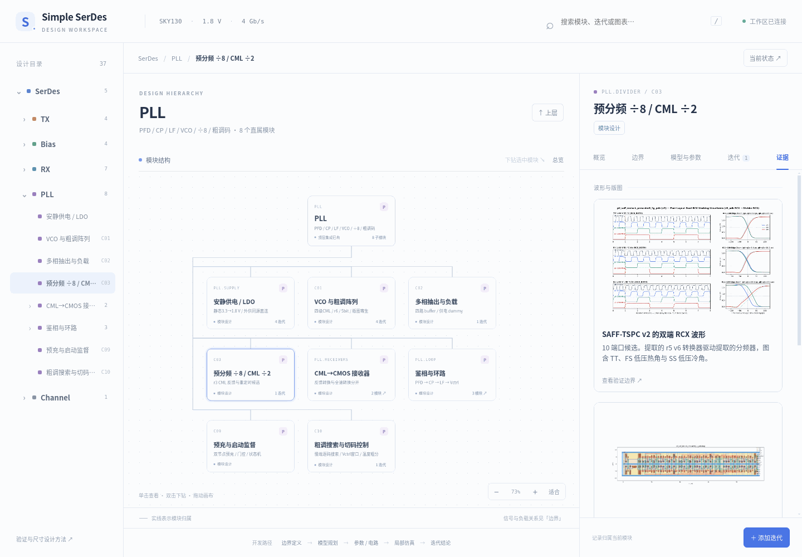

# Simple SerDes

SKY130、1.8 V、4 Gb/s NRZ 的 SerDes 电路设计：250 MHz 参考 → 2 GHz 四级 CML 环振 PLL → 16:1 CML 电流舵串化 → 100 Ω 线驱动；RX 为端接/CTLE → 64 码 PI → 四相半速 CML 采样 → 数字 CDR → 16 位解串。

接手本项目先读 [AGENTS.md](AGENTS.md)（约定、环境、注意事项）。

**[打开交互设计工作台](web/design/index.html)**：自上而下浏览 SerDes → TX / Bias / RX / PLL / Channel → 子模块，查看边界、模型规划、参数、迭代与证据。需要内嵌阅读资料和保存模块迭代时，运行 `uv run python -m serdes_flow.design_viewer --open`；[使用说明](web/design/README.md)。

## 规格摘要

45 个 PVT 条件（TT/SS/FF/SF/FS × 1.65/1.8/1.95 V × −40/27/85 °C）都必须满足功能和门槛：串化器边沿散布 ≤ 0.15 UI、位中心裕量 ≥ 75 mV、CML 摆幅目标 400 mVpp。唯一允许缩水的是高低温下的 4 Gb/s BER。抖动/相噪预算已有模型推导，待原生电路验证。详见 [规格](docs/overview/spec.md)。

## 架构

模块开发以边界与模型为主线，PLL 已有完整电路与启动顶层。近期改进挂在各子模块的迭代记录下；[详细模块状态与验证范围](docs/overview/development_map.md)保留数值和证据索引。



时钟域、串化分配、多端口 PI-CDR 与接口约定见 [架构](docs/overview/architecture.md)。

## 模块状态

| 模块 | 当前修订 | 已验证到 | 主要缺口 |
|---|---|---|---|
| [VCO](docs/design/pll_vco.md) | PLL r5 / 4 bit 主线；3 bit仅历史参考 | 真实偏置/PDK R 工作区135点、宽窗口45组三温共同码；五压力点各200样本频率σ 0.75–1.12%；[较窄门限窗口](docs/design/pll_coarse_windows.md)另计 | 当前码表/负载噪声重验；实际门限与电压迟滞切码、慢端失配余量、hl/lh |
| [÷8 prescaler](docs/design/pll_divider.md) | r3结构；首级W40/后级W80 | 真实偏置/PDK R、标准输入hh/ll各45点；六压力点MC共1048样本正确分频 | FF冷失配数值缺失；原生全角/启动、FS冷尾管余量 |
| [时钟接收器](docs/design/clock_receiver.md) | PLL r4 | 反馈 45/45，全速 45/45；原生 VCO 5 个工作点全部正常 | SS 热角幅度余量约 110 mV；1.95 V 过冲 |
| [PFD/CP/LF/启动](docs/design/pll_loop.md) | r5/k4转向CP、4.13kΩ/18pF PDK LF候选 | 行为VCO闭环135/135锁定；原生预充闭环三点；CP三点各200样本MC；粗码RTL与监测积木已有 | 自动粗搜接入真实闭环、从零启动、新环路噪声/供电抑制；转向CP窗口 |
| [TX 字入口](docs/design/tx_word_capture.md) | 16位捕获＋两组8位保持；extra5整链候选 | 首级6压力48字；B关闭12组；[完整TX](docs/design/tx_parallel_serializer.md)在理想2GHz、真实偏置/PDK R tt下45/45串化器与焊盘过门槛，每点256 bit | 内部幅度I-17；原生源/电阻角、物理guard/blank、建立保持、失配/噪声 |
| [TX 时钟分发](docs/design/tx_clock_distribution.md) | v3同步计数器、extra5/WT16/R240候选 | r4抽头回放15点；r5原生静态8点计数；理想2GHz整链45点眼图/位序正确 | 原生静态2个FF冷角数值缺失；原生动态/启动、内部幅度、功耗/噪声 |
| [TX 串化器](docs/design/tx_serializer.md) | TX r2 | 固定理想 TT 时钟边界下 45/45 满足 75 mV / 0.15 UI（128 bit） | 原生分发见上；FS 热角长码型：串化器 0.115 UI，远端 0.147 UI |
| [TX 输出级](docs/design/tx_output_driver.md) | r2使能；预驱120Ω/尾W60、输出W192候选 | 旧启用45点；新完整TX 45点焊盘过75mV/0.15UI门槛 | 幅度容差/内部超幅；实际焊盘/ESD、供电回流和电阻角 |
| [信道模型](docs/design/channel_model.md) | RLC16 + PCB 族 | C0–C5 构造与 TX 接入 | 链路级眼图门槛未定义 |
| [RX 前端](docs/design/rx_frontend.md) | vcm 1.05 V | AC/DC 45 条件 × 4 档；C2 眼图 45 条件（默认 EQ3） | C3 未做；档位自适应；输入失调 σ 6.1 mV |
| [RX PI 与采样](docs/design/rx_pi_sampler.md) | ac_trim/c2/120f；deser16/W40 | 无读出窗口135条件：18完整扫＋117门槛，最差0.8125 UI；PI压力角静态单调；旧读出45点；两边沿校准注入联调 | 当前W40读出FS/FF冷hh数值缺失、全网格未闭合；真实失配完整SAR、原生锚点/动态PVT |
| [RX 数字](docs/design/rx_cdr_digital.md) | 首版 RTL | 行为采样闭环 10 组 100 µs 零错字；物理 deser16 TT 短时联调与 PI 跨扇区/回卷 | 生产参数/频偏的物理验证；综合/STA；系统域 FIFO/CDC |
| [偏置](docs/design/bias.md) | 带隙 + 恒 I·R + vcm + 分配/B2（5 bit 修调） | 135条件上电；摆幅代理407–426 mV；分配MC200样本三温；多模块已接真实参考 | 当前整机动态/闭环/启动、ready与供电预算；B2目标匹配；PNP无失配模型；恒I·R不保证恒速度 |

版图前推进与验收见 [工作包和完成条件](docs/status/prelayout_plan.md)。全部问题、优先级和阶段见 [待解决问题](docs/status/open_issues.md)；版本线见 [版本与基线](docs/overview/revisions.md)。

局部提取、复核与建模可按[可委派工作包](docs/work_packages/README.md)交给外部模型或明确指定的低成本执行器；集成者独立复跑、review后更新设计结论。`uv run python -m serdes_flow.work_packages list` 查看任务，`show WP-001` 输出派发文本。

## 导航

| 想看 | 去哪里 |
|---|---|
| 规格、架构、版本 | [docs/overview](docs/overview/) |
| 模块层次、边界、模型与迭代 | [交互工作台](web/design/index.html)、[使用说明](web/design/README.md)、[详细验证范围](docs/overview/development_map.md) |
| 各模块当前设计 | [docs/design](docs/design/) |
| 验证方法、测量定义、PVT 覆盖 | [方法](docs/verification/methods.md)、[测量约定](docs/verification/measurement_conventions.md)、[PVT 覆盖](docs/verification/pvt_coverage.md) |
| MC 与仿真进度为何慢、优化优先级 | [成本与架构评估（11-05）](docs/history/workflow_review_20261105.md)、[MC 续跑与样本身份](docs/verification/statistics.md#执行续跑与成本) |
| 难过的工况、模块耦合与约束问题 | [设计评估（11-06，分三批结论）](docs/history/design_coupling_review_20261106.md) |
| 进展与待办 | [待解决问题](docs/status/open_issues.md)、[变更日志](docs/status/changelog.md) |
| 按时间的实验记录 | [docs/history](docs/history/index.md) |
| 图 / 数据 | [最新时钟链路 7 组图](docs/figures/clocking/README.md)、[完整图目录](docs/figures/README.md)、`docs/data/` |
| 仿真结果与归档 | [results](results/README.md) |
| 原理图（历史导出） | [原理图记录](docs/history/schematics.md) |

## 环境

```bash
uv sync                      # Python 3.12，numpy/scipy/matplotlib
uv run python …
/opt/ngspice47/bin/ngspice   # 系统默认 ngspice 是旧版，不要用
```

PDK 与工具路径见 [pdk.toml](config/pdk.toml)、[tools.toml](config/tools.toml)。RX 实时数模联调入口见 [verification/mixed_signal](verification/mixed_signal/README.md)，波形查看：`verification/mixed_signal/view.sh`。
