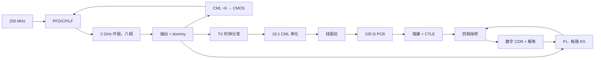

# Simple SerDes

SKY130、1.8 V、4 Gb/s NRZ 的 SerDes 电路设计：250 MHz 参考 → 2 GHz 四级 CML 环振 PLL → 16:1 CML 电流舵串化 → 100 Ω 线驱动；RX 为端接/CTLE → 64 码 PI → 四相半速 CML 采样 → 数字 CDR → 16 位解串。

接手本项目先读 [AGENTS.md](AGENTS.md)（约定、环境、注意事项）。

## 规格摘要

45 个 PVT 条件（TT/SS/FF/SF/FS × 1.65/1.8/1.95 V × −40/27/85 °C）都必须满足功能和门槛：串化器边沿散布 ≤ 0.15 UI、位中心裕量 ≥ 75 mV、CML 摆幅目标 400 mVpp。唯一允许缩水的是高低温下的 4 Gb/s BER。抖动/相噪预算已有模型推导，待原生电路验证。详见 [规格](docs/overview/spec.md)。

## 架构



时钟域、串化分配、多端口 PI-CDR 与接口约定见 [架构](docs/overview/architecture.md)。

## 模块状态

| 模块 | 当前修订 | 已验证到 | 主要缺口 |
|---|---|---|---|
| [VCO](docs/design/pll_vco.md) | PLL r5 候选 | 真实偏置/PDK R 下七压力点开环约 2 GHz，L(1 MHz) −84.9…−90.2 dBc/Hz；FF 冷角码 6 可在 B2 范围内跨过 2 GHz | 全角工作区/码间重叠；CP/LF 与原生闭环；实际扇出负载 |
| [÷8 prescaler](docs/design/pll_divider.md) | PLL r3/r4 | 标准输入 45 条件分频/反馈全部正确 | 真实偏置/RC 需回归共用 ÷2；无确定性复位；FS 冷角尾管余量约 −5 mV |
| [时钟接收器](docs/design/clock_receiver.md) | PLL r4 | 反馈 45/45，全速 45/45；原生 VCO 5 个工作点全部正常 | SS 热角幅度余量约 110 mV；1.95 V 过冲 |
| [PFD/CP/LF/启动](docs/design/pll_loop.md) | v0.1 电路；r5 配套环路待选 | PFD→CP 45 条件；r3 的 4 工况分层闭环锁定 | r5 的 CP/LF/选码联合设计、原生持续锁定、完整上电捕获 |
| [TX 时钟分发](docs/design/tx_clock_distribution.md) | TX r2；v3 候选 | v3 同步计数器方案在 15 个原生时钟边界 V/T 点满足，最差 121.6 mV / 0.140 UI | r2 原生源下失败；v3 待真实偏置/RC、全角与联合仿真，功耗待降 |
| [TX 串化器](docs/design/tx_serializer.md) | TX r2 | 固定理想 TT 时钟边界下 45/45 满足 75 mV / 0.15 UI（128 bit） | 原生分发见上；FS 热角长码型：串化器 0.115 UI，远端 0.147 UI |
| [TX 输出级](docs/design/tx_output_driver.md) | TX r2 | 45 条件从禁用态启动正常 | 焊盘/ESD 代理；无 FFE |
| [信道模型](docs/design/channel_model.md) | RLC16 + PCB 族 | C0–C5 构造与 TX 接入 | 链路级眼图门槛未定义 |
| [RX 前端](docs/design/rx_frontend.md) | vcm 1.05 V | AC/DC 45 条件 × 4 档；C2 眼图 45 条件（默认 EQ3） | C3 未做；档位自适应；输入失调 σ 6.1 mV |
| [RX PI 与采样](docs/design/rx_pi_sampler.md) | ac_trim + buffer c2 / cmix 120 fF；deser16 | 真实偏置、45 × tt/ll/hh 窗口门槛通过，压力角最差 0.81 UI；两边沿校准已联调；PI 压力角单调 | FS 低压热 hh 读出 ÷2 失败，SS 同条件摆幅 148 mVpp；FF 冷 hh 未收敛；原生 PLL 锚点与动态 PVT |
| [RX 数字](docs/design/rx_cdr_digital.md) | 首版 RTL | 行为采样闭环 10 组 100 µs 零错字；物理 deser16 TT 短时联调与 PI 跨扇区/回卷 | 生产参数/频偏的物理验证；综合/STA；系统域 FIFO/CDC |
| [偏置](docs/design/bias.md) | 带隙 + 恒 I·R + vcm + 分配/B2（5 bit 修调） | 135 条件上电；摆幅代理 407–426 mV；修调后 vcm 约 ±26 mV；RX/VCO 已有真实偏置测试 | TX/PLL 整链接入；动态供电与上电时序预算；恒 I·R 不保证恒速度 |

全部问题、优先级和阶段见 [待解决问题](docs/status/open_issues.md)；版本线见 [版本与基线](docs/overview/revisions.md)。

## 导航

| 想看 | 去哪里 |
|---|---|
| 规格、架构、版本 | [docs/overview](docs/overview/) |
| 各模块当前设计 | [docs/design](docs/design/) |
| 验证方法、测量定义、PVT 覆盖 | [方法](docs/verification/methods.md)、[测量约定](docs/verification/measurement_conventions.md)、[PVT 覆盖](docs/verification/pvt_coverage.md) |
| MC 与仿真进度为何慢、优化优先级 | [成本与架构评估（11-05）](docs/history/workflow_review_20261105.md)、[MC 续跑与样本身份](docs/verification/statistics.md#执行续跑与成本) |
| 难过的工况、模块耦合与约束问题 | [设计评估（11-06，分三批结论）](docs/history/design_coupling_review_20261106.md) |
| 进展与待办 | [待解决问题](docs/status/open_issues.md)、[变更日志](docs/status/changelog.md) |
| 按时间的实验记录 | [docs/history](docs/history/index.md) |
| 图 / 数据 | [docs/figures](docs/figures/README.md)、`docs/data/` |
| 仿真结果与归档 | [results](results/README.md) |
| 原理图（历史导出） | [原理图记录](docs/history/schematics.md) |

## 环境

```bash
uv sync                      # Python 3.12，numpy/scipy/matplotlib
uv run python …
/opt/ngspice47/bin/ngspice   # 系统默认 ngspice 是旧版，不要用
```

PDK 与工具路径见 [pdk.toml](config/pdk.toml)、[tools.toml](config/tools.toml)。RX 实时数模联调入口见 [verification/mixed_signal](verification/mixed_signal/README.md)，波形查看：`verification/mixed_signal/view.sh`。
