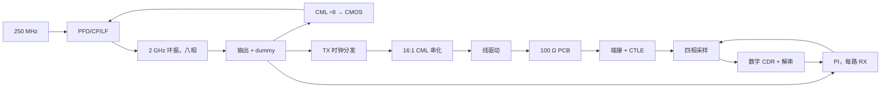

# Simple SerDes

SKY130、1.8 V、4 Gb/s NRZ 的 SerDes 电路设计：250 MHz 参考 → 2 GHz 四级 CML 环振 PLL → 16:1 CML 电流舵串化 → 100 Ω 线驱动；RX 为端接/CTLE → 64 码 PI → 四相半速 CML 采样 → 数字 CDR → 16 位解串。

接手本项目先读 [AGENTS.md](AGENTS.md)（约定、环境、注意事项）。

## 规格摘要

45 个 PVT 条件（TT/SS/FF/SF/FS × 1.65/1.8/1.95 V × −40/27/85 °C）都必须满足功能和门槛：串化器边沿散布 ≤ 0.15 UI、位中心裕量 ≥ 75 mV、CML 摆幅目标 400 mVpp。唯一允许缩水的是高低温下的 4 Gb/s BER。抖动/相噪预算待推导。详见 [规格](docs/overview/spec.md)。

## 架构



时钟域、串化分配、多端口 PI-CDR 与接口约定见 [架构](docs/overview/architecture.md)。

## 模块状态

| 模块 | 当前修订 | 已验证到 | 主要缺口 |
|---|---|---|---|
| [VCO](docs/design/pll_vco.md) | PLL r3 | 4 个选定工况原生回接约 2 GHz | 45 条件调谐映射；节点摆幅 < 400 mVpp；相噪 |
| [÷8 prescaler](docs/design/pll_divider.md) | PLL r3/r4 | 标准输入 45 条件分频/反馈全部正确 | 无确定性复位；FS 冷角尾管余量约 −5 mV |
| [时钟接收器](docs/design/clock_receiver.md) | PLL r4 | 反馈 45/45，全速 45/45；原生 VCO 5 个工作点全部正常 | SS 热角幅度余量约 110 mV；1.95 V 过冲 |
| [PFD/CP/LF/启动](docs/design/pll_loop.md) | v0.1 电路 | PFD→CP 45 条件；4 工况分层闭环锁定 | r3 原生持续锁定、从零捕获 |
| [TX 时钟分发](docs/design/tx_clock_distribution.md) | TX r2 | v0.1 源下相位达标 | r3 源下相位改变，trim 未重标 |
| [TX 串化器](docs/design/tx_serializer.md) | TX r2 | 45/45 满足 75 mV / 0.15 UI（128 bit） | FS 热角 1024 bit 散布 0.115–0.147 UI |
| [TX 输出级](docs/design/tx_output_driver.md) | TX r2 | 45 条件从禁用态启动正常 | 焊盘/ESD 代理；无 FFE |
| [信道模型](docs/design/channel_model.md) | RLC16 + PCB 族 | C0–C5 构造与 TX 接入 | 链路级眼图门槛未定义 |
| [RX 前端](docs/design/rx_frontend.md) | 首版 | TT 实际加载联调 | 无 PVT；共模参考 |
| [RX PI 与采样](docs/design/rx_pi_sampler.md) | 首版 | TT 64 码 PI；真实采样/读出短窗 | 无 PVT；依赖全速 CMOS |
| [RX 数字](docs/design/rx_cdr_digital.md) | 首版 RTL | 10 组 100 µs 闭环零错字；实时数模联调 | 无综合/STA；物理 16 UI 降速 |
| [偏置](docs/design/bias.md) | — | 镜像与本地偏置为真实 MOS | 上游参考理想，无基准 |

全部问题、优先级和阶段见 [待解决问题](docs/status/open_issues.md)；版本线见 [版本与基线](docs/overview/revisions.md)。

## 导航

| 想看 | 去哪里 |
|---|---|
| 规格、架构、版本 | [docs/overview](docs/overview/) |
| 各模块当前设计 | [docs/design](docs/design/) |
| 验证方法、测量定义、PVT 覆盖 | [方法](docs/verification/methods.md)、[测量约定](docs/verification/measurement_conventions.md)、[PVT 覆盖](docs/verification/pvt_coverage.md) |
| 进展与待办 | [待解决问题](docs/status/open_issues.md)、[变更日志](docs/status/changelog.md) |
| 按时间的实验记录 | [docs/history](docs/history/index.md) |
| 图 / 数据 | [docs/figures](docs/figures/README.md)、`docs/data/` |
| 仿真结果与归档 | [results](results/README.md) |
| 原理图（历史导出） | [原理图记录](docs/history/schematics.md) |

## 环境

```bash
uv sync                      # Python 3.12，numpy/scipy/matplotlib
uv run python …
/opt/ngspice47/bin/ngspice   # 系统默认 ngspice 是旧版，不要用
```

PDK 与工具路径见 [pdk.toml](config/pdk.toml)、[tools.toml](config/tools.toml)。RX 实时数模联调入口见 [verification/mixed_signal](verification/mixed_signal/README.md)，波形查看：`verification/mixed_signal/view.sh`。
