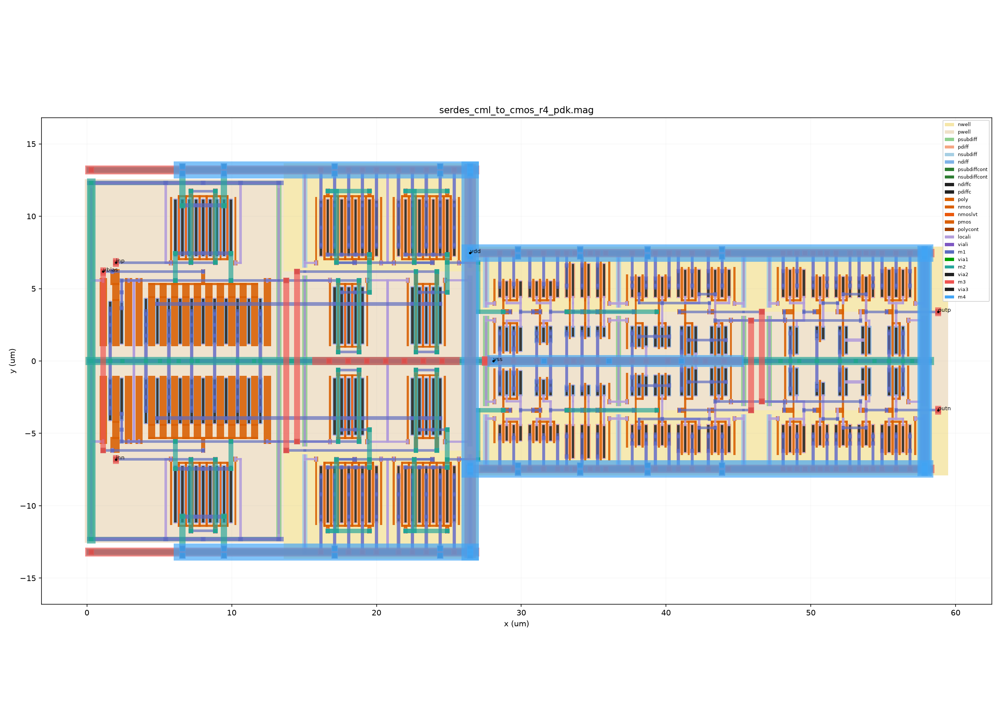

# `serdes_cml_to_cmos_r4_pdk` — 2 GHz 1D Straight-Through SKY130 CML-to-CMOS Receiver

**独立候选，未替换 C6 或采用主线。** 2026-11-17 当前几何重新 full-rule DRC/LVS/端口检查通过，作为 CMOS 分频研究的历史驱动和 r5 生成器的叶依赖保存。下表失配与无源 RC 的薄弱点仍开放；这次没有重新签核旧 MC 或扩大资格。复核边界见[新交付报告](../../../../../../docs/layout/pll_pending_review_20261117.md)。

- **版图生成器**：[build_cml_to_cmos_r4_pdk.py](../../build_cml_to_cmos_r4_pdk.py)（修订：`v4_1d_final`）
- **等效原理图网表**：[cml_to_cmos_r4_v4.spice](../../../spice/cml_to_cmos_r4_v4.spice)（`serdes_cml_to_cmos_r4_v4`）
- **版图与提取目录**：[`results/layout/cml_to_cmos/20261117_r4_v4_1d_final/`](../../../../../../results/layout/cml_to_cmos/20261117_r4_v4_1d_final/)、[`results/layout_review/cml_to_cmos_r4_v4_1d_final_20261117T0300/`](../../../../../../results/layout_review/cml_to_cmos_r4_v4_1d_final_20261117T0300/)

## 几何与物理提取指标

| 指标 | 实测结果 |
|---|---|
| 单元尺寸 / 面积 | `59.63 × 27.6 µm`（`1645.79 µm²`，`bbox=[-0.14, -13.8, 59.49, 13.8]`） |
| 物理检查 | `DRC = 0`、`LVS_MATCH = True`、`LVS_PROPERTY_ERRORS = False` |
| 导出端口（7 个） | `inp inn outp outn vbias vdd vss` |
| 提取器件段数 | `196`（`pfet_01v8: 98`、`nfet_01v8: 66`、`nfet_01v8_lvt: 32`） |
| 端口耦合+对地寄生电容（CPEX） | `inp/inn = 4.063 / 4.063 fF`、`outp/outn = 1.569 / 1.569 fF`、`vbias = 14.966 fF`、`vdd = 133.088 fF` |
| Magic 原生 RCX 提取 | `devices_preserved = True`、`1295` 个提取电阻（含信号与 `vdd/vss` 栅/源连线） |

## 版图关键结构（`v4_1d_final`）

1. **一维直通 `M1` 优先架构**：模拟域（`SF -> Diff-to-SE`，`y=0` 上下镜像对称）直连数字域（`bp/bn -> op/on -> 1.6x 延时链 + SR-NAND 恢复器`，`y=0` 对称双半行），消除早期折返行间长寄生跳线。
2. **栅/源低 RC 强化**：所有 `4.0 µm` 模拟指与 `bp`（`5.4/3.6`）、`op`（`2.4/4.8`）采用多指 `polycont + M1 + M2` 双端绑栅；`Xfp.D` 与数字源极加双 `viali`；`M4` 四入口外框 `VDD` 环配合数字区 `M4 VSS`，不跨压 `fp/fn` 与 `inp/vbias` 敏感节点。

## 仿真与提取验证汇总

均在 `2 GHz`、`serdes_cml_buffer`（`input_pp=0.3`）、每路 `20 fF` CMOS 负载下运行 ngspice-47 / SKY130A（无 `nodeset`，规格未外部签核前仅作工程门槛检查）：

| 验证项 | 结果 | 关键指标 | 记录目录 |
|---|---|---|---|
| **45 角全 PVT（CPEX）** | **45/45 PASS** | 占空比 `[0.487, 0.533]`，功耗 `[3.14, 8.85] mW` | `results/analog/common/cml_to_cmos/fullrate_pvt/20261116T190545Z_v4_1d_final_cpex_45corners` |
| **6 极端角 CPEX vs 未改原生 RCX** | **CPEX 6/6 PASS；RCX 6/6 全摆幅 2 GHz 翻转（5/6 占空比 PASS）** | RCX `ss_v1650_t-40` 以 `1.9998 GHz`、`[-0.082, 1.749] V` 满摆幅翻转，但 `duty_p=0.622 / duty_n=0.492`；其余 5 角 `duty 0.487–0.523` | `results/analog/common/cml_to_cmos/fullrate_pvt/20261116T190059Z_v4_1d_final_cpex_rcx_6corners` |
| **PEX 局部失配 MC（`tt_mm`, `1.8 V, 27 °C`）** | **200/200 翻转，183/200 占空比通过 `[0.45, 0.55]`** | `duty_p = 0.512 ± 0.0234`，`duty_n = 0.511 ± 0.0232`，差分偏斜 `0.46 ± 11.61 ps`（95% CI `[86.7%, 95.0%]`） | `results/analog/common/cml_to_cmos/fullrate_pvt/20261116T205122Z_v4_1d_final_pex_mc` |
| **PEX 局部失配 MC（`ss_mm`, `1.65 V, −40 °C`）** | **51/200 翻转，1/200 正式通过**（已知极限薄弱点） | `Diff-to-SE`（1:1 电流镜）及反相器阈值在低温低压慢角对失配敏感，在 `0.3 V` 输入下 `149/200` 失锁；已翻转样本 `duty_p std=0.120` | 同上 |
| **直驱纯 CMOS ÷8 预分频器（CPEX 驱动，45 角 PVT）** | **45/45 PASS** | 见 [cmos_prescaler8_2g.spice](../../../../../pll/divider/spice/cmos_prescaler8_2g.spice)：功耗 `[0.928, 1.576] mW`（TT `1.226 mW` vs 独立 CML ÷8 `8.359 mW`），`q2/q4/q8` 占空比分别 `[0.468, 0.534]` / `[0.481, 0.521]` / `[0.491, 0.517]`；TT 下实测可达 `3.0 GHz`（`1.826 mW`，`q8=375 MHz`） | `results/analog/pll/divider/cmos_prescaler8_2g/20261116T202627Z_45corners_pex_driven` |
