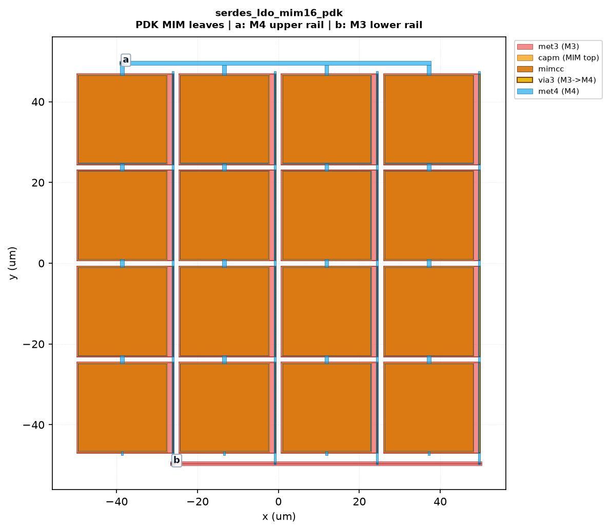

# PDK MIM 阵列迭代

本轮实际绘制的 `serdes_ldo_mim16_pdk`、`serdes_ldo_mim50_pdk`、`serdes_ldo_mim100_pdk` 位于本目录，与 Gemini 原候选分开。资格与适用边界见[项目当前状态](../../../../../../docs/status/current.md)；生成与检查结果由[结果索引](../../../../../../results/catalog/layout_gemini_review.json)定位。

每颗叶电容直接调用安装 PDK 的 `cap_mim_m3_1_draw`，尺寸从当前 `ldo_passives.spice` 读取。PDK 完成列内连接，脚本再绘制阵列的两条公共线：`a` 接 M4 上极板，`b` 接 M3 下极板，各列下极板通过独立 via3 接入下方 M3 母线。外部端口按 `a b` 导出。适用于滤波/去耦；不含下层电阻、保护环、宏级供电布线或填充。

参考请求边长 22.1965 µm；PDK 画图并提取后为 22.20 µm，边长差约 0.016%。保留真实提取尺寸，没有修改设计侧参考来强行匹配；生成器另检查尺寸偏差不超过 0.1%，并在 Netgen 并联归并前逐颗检查数量及两端网络。`mim_pdk_ref.spice` 仅改了三个顶层名字，其余来自设计侧参考。

重新生成到一个不存在的结果目录（内含 full-rule DRC、LVS、端口与逐颗检查和预览）：

```bash
uv run python analog/common/ldo/layout/build_mim_pdk.py --units 16 50 100 --output-dir results/layout/ldo_mim/new_run
```



采用到上层宏前仍须做对应边界的寄生回灌与电气检查；本轮未据此重跑或改记整个 LDO 的电气资格。当前提取是电容寄生网表，未做分布金属电阻、EM、天线/密度和整芯片 DRC 签核。
