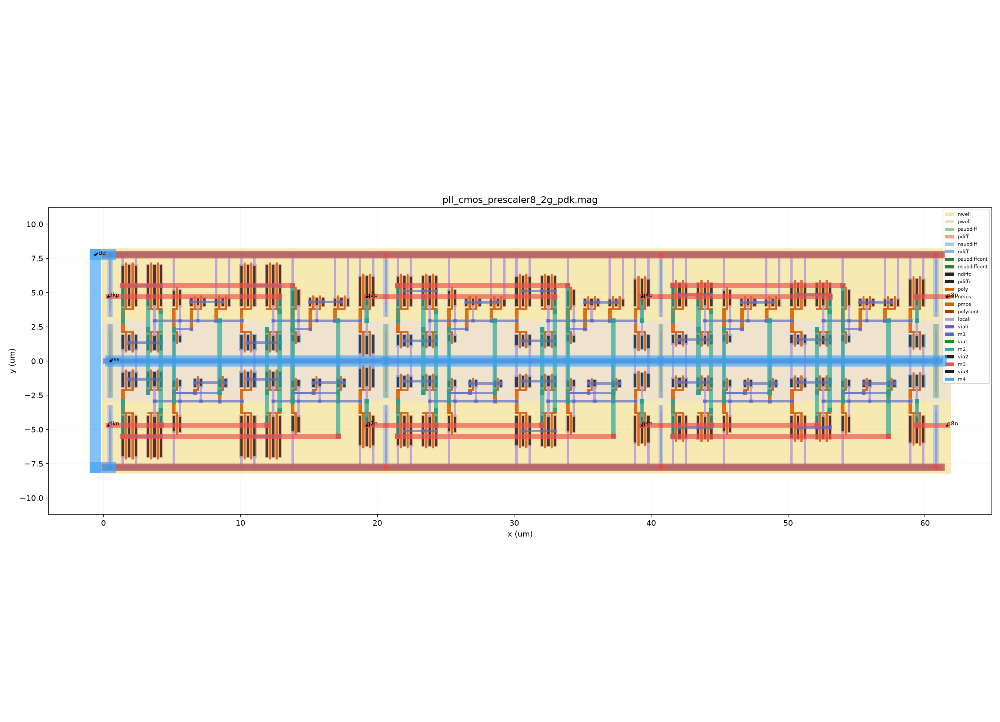

# `pll_cmos_prescaler8_2g_pdk` — Pure-CMOS 2 GHz ÷8 Prescaler SKY130 PDK Layout

**2026-11-17 复核：接受局部几何候选交付，未采用到 PLL。** 重建几何/参考逐字一致，独立全规则 DRC/LVS/端口检查通过，EXT 未发现浮空非器件 poly。对称行列、共享电源/地和级间短连可保留；最终接入还需包含前置全速转换器。下列 59 份历史波形的双极性、电平和逐周期频率已重算，观测均通过，但旧回执未保存 include 内容哈希，不能补签历史来源或完整 RC 资格。见[固定复核](../../../../../../results/catalog/pll_pending_cmos_review_20261117.json)和[系统边界](../../../../../../docs/layout/pll_pending_review_20261117.md)。下文原始边界数字按原记录保留。

- **版图生成器**：[build_cmos_prescaler8_2g_pdk.py](../../build_cmos_prescaler8_2g_pdk.py)（修订：`v4`）
- **对应电路网表**：[cmos_prescaler8_2g.spice](../../../spice/cmos_prescaler8_2g.spice)（`pll_cmos_prescaler8_2g`）
- **版图与提取目录**：[`results/layout/pll_divider/20261117_cmos_prescaler8_2g_v4/`](../../../../../../results/layout/pll_divider/20261117_cmos_prescaler8_2g_v4/)、[`results/layout_review/cmos_prescaler8_2g_v4_20261117/`](../../../../../../results/layout_review/cmos_prescaler8_2g_v4_20261117/)

## 几何与物理提取指标

| 指标 | 实测结果 |
|---|---|
| 单元尺寸 / 面积 | `62.87 × 16.42 µm`（**`1,032.33 µm²`**，相比 CML `pll_cml_prescaler8_pdk` `5,664.40 µm²` 缩小 **5.5×**） |
| 物理检查 | `DRC = 0`、`LVS_MATCH = True`、`LVS_PROPERTY_ERRORS = False` |
| 导出端口（10 个） | `clkp clkn q2p q2n q4p q4n q8p q8n vdd vss` |
| 提取器件段数 | `180`（`pfet_01v8: 96`、`nfet_01v8: 84`） |
| 端口耦合+对地寄生电容（CPEX） | `clkp/clkn = 5.229 / 5.037 fF`、`q2p/q2n = 5.918 / 5.756 fF`、`q4p/q4n = 5.816 / 5.655 fF`、`q8p/q8n = 0.960 / 0.953 fF` |
| Magic 原生 RCX 提取 | `devices_preserved = True`、`706` 个提取电阻（`cpex` 与 `rcx` 器件完全保留） |

## 版图结构

- 沿中心 `VSS` 脊柱（`y = 0.000 µm`）上下严格镜像对称的三级一维流水线：`Xdiv2 (2G→1G) -> Xdiv4 (1G→500M) -> Xdiv8 (500M→250M)`。
- 每级 11 列直通摆位，`M1`（`±2.33 / ±2.95 / ±3.57 µm`）负责级内节点与栅极互联，`M2` 负责互补节点跨中心线纵向交叉，`M3`（`±4.70 / ±5.50 µm`）负责高频差分时钟总线与反馈线；`nf=2` 器件栅极接触孔统一横向偏置（`dx = ±0.46 µm`）避开中心漏极，`M4 VDD` 跨接桥外置于左侧（`x = -0.60 µm`）不跨压中心 `M4 VSS`。

## 后版图联合仿真验证

由后版图 CPEX `serdes_cml_to_cmos_r4_pdk`（`2 GHz`、`serdes_cml_buffer`、`input_pp=0.3`）直接驱动，`q2/q4` 带 `15 fF`、`q8` 带 `20 fF` 负载（ngspice-47 / SKY130A）：

| 验证项 | 结果 | 关键指标 | 记录目录 |
|---|---|---|---|
| **45 角全 PVT（CPEX 驱动 CPEX）** | **45/45 PASS** | 功耗 `[1.050, 1.736] mW`，`q2p/n` 占空比 `[0.462, 0.516]` / `[0.483, 0.540]`，`q4p/n` `[0.473, 0.516]` / `[0.487, 0.529]`，`q8p/n` `[0.486, 0.516]` / `[0.495, 0.524]` | `results/analog/pll/divider/cmos_prescaler8_2g_pdk/20261116T223053Z_45corners` |
| **7 极端角 CPEX vs 未改原生 RCX** | **CPEX 7/7 PASS；RCX 7/7 PASS** | RCX `ss_v1650_t-40` `q2=0.508/0.518, q8=0.511, P=1.009 mW`；`tt_v1800_t27` CPEX `1.372 mW` / RCX `1.295 mW`；`ff_v1950_t85` CPEX `1.709 mW` / RCX `1.613 mW` | `results/analog/pll/divider/cmos_prescaler8_2g_pdk/20261116T221934Z_7corners` |
