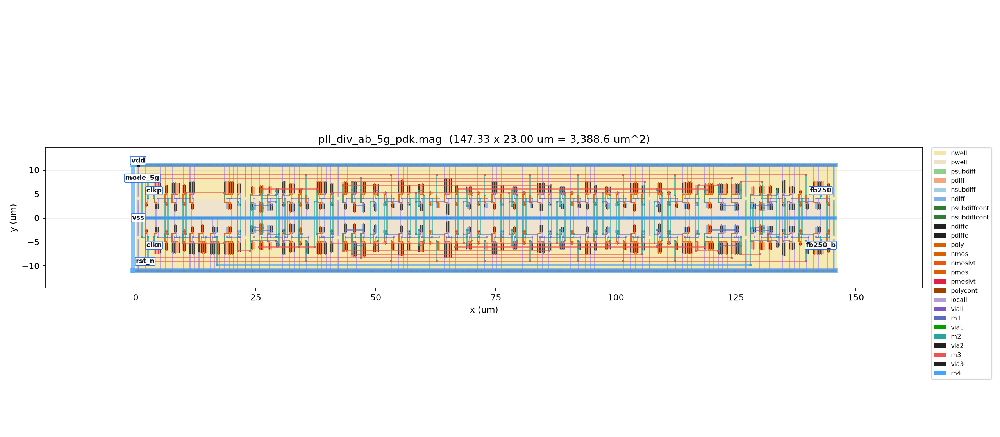

# `pll_div_ab_5g_pdk` — Dual-Rate 4G/5G PLL Feedback Divider A SKY130A PDK Layout

- **版图生成器**：[build_div_ab_5g_pdk.py](../../build_div_ab_5g_pdk.py)
- **对应规范网表**：[pll_div_ab_5g_cand.spice](../../../spice/pll_div_ab_5g_cand.spice)（`pll_div_ab_5g`：`2.0 GHz ÷8` / `2.5 GHz ÷10 → 250 MHz`，50% 占空比，快时钟 Nikolic SAFF 重定时；100% SKY130 MOS，零理想无源器件）
- **构建与独立复核目录**：`results/layout/pll_divider/div_ab_5g_pdk/build/`、`results/layout/pll_divider/div_ab_5g_pdk/review/`

## 几何与物理签核指标

| 指标 | 实测结果 |
|---|---|
| 单元边界框（bbox） | `[-1.100, -11.500, 146.230, 11.500] µm` |
| 单元尺寸 / 面积 / 长宽比 | `147.330 × 23.000 µm`（**`3,388.59 µm²`**，长宽比 `6.41:1`） |
| 物理签核（`review_cell.py --rc`） | **`Magic drc(full) = 0`**、**`Netgen LVS = MATCH`**（`254/254` 器件、`80/80` 网络、`LVS_PROPERTY_ERRORS = False`、`LVS_DISCONNECTED = none`）、**`physical_passed = True`** |
| 导出端口（8 个，全 M4） | `clkp clkn mode_5g rst_n fb250 fb250_b vdd vss`（`0` 浮空端口） |
| 逻辑器件 / 提取段数 | `254` 逻辑 MOS / `390` 提取段：`sky130_fd_pr__pfet_01v8` `127`（`228` 段）、`sky130_fd_pr__nfet_01v8_lvt` `96`（`129` 段）、`sky130_fd_pr__nfet_01v8` `29`（`29` 段）、`sky130_fd_pr__pfet_01v8_lvt` `2`（`4` 段）；**`0` 浮空 poly** |
| 金属层面积占比（M1–M4，**`M5 = 0.0%`**） | `M1 15.5%`（`260.57 µm²`）、`M2 26.1%`（`439.78 µm²`）、`M3 30.0%`（`504.65 µm²`）、`M4 28.4%`（`477.21 µm²`）、**`M5 0.0%`** |
| 端口寄生电容（CPEX，`to_sub + coupling = total`） | `clkp / clkn = 1.317 / 1.318 fF`（`0.08%` 失配）、`fb250 / fb250_b = 3.388 / 3.286 fF`、`mode_5g = 17.730 fF`、`rst_n = 24.753 fF`、`vdd = 439.498 fF` |
| 关键内部时钟与隔离（CPEX） | `ck_rt = 20.769 fF`（`83%` 耦合至 `vdd`/`vss`/`rst_n` 静默屏蔽，对 `ckh_p/n` 串扰仅 **`0.021 / 0.071 fF`**，对全部计数器数据网 `< 0.40 fF`）；`ckh_p / ckh_n = 23.312 / 22.994 fF`（`1.4%` 失配） |
| 整体 CPEX / Magic 原生 RCX | CPEX：`1,027` 电容元件（总对地 `410.369 fF`、总耦合 `234.040 fF`）；RCX：`3,041` 电阻、`390/390` 器件完整保留、零跨网桥接、零断连子网 |

## 版图架构与布线隔离

- **中心 `VSS` 镜像双半结构**：沿中心 `VSS` 脊柱（`y = 0.000 µm`，`psubdiff + locali + M1 + M4`）上下镜像对称；上下 `VDD` 轨位于 `y = ±11.000 µm`（`nsubdiff + locali + M1..M4`），外置左侧 `M4` 桥接（`x = -0.600 µm`）不跨压中心 `VSS`。全单元设置 6 道纵向衬底/阱接触墙（`x = 0.50, 22.90, 42.16, 107.03, 127.07, 145.37 µm`），将输入接收、2.5 GHz ÷2、1.25 GHz ÷4/÷5 计数器、双边沿整形与全速重定时逐域隔离。
- **左→右单向信号流**：
  - 西侧端口：`clkp` / `clkn`（`x = 3.800, y = ±5.700 µm` 镜像匹配 M4 焊盘）、`mode_5g`（`x = 1.335, y = +8.310 µm`）、`rst_n`（`x = 1.955, y = -9.060 µm`）、`vdd` / `vss`（`x = 0.500 µm`）。
  - 流水线：`[Xrst/Xmode + Xin (3 级差分转 CMOS + ck_rt 支路)] |W1| [Xdiv2 (Nikolic SAFF ÷2) + Xckhp/n] |W2| [Xfb_p/n (AOI21/OAI21) + Xff0/1/2 (3× 差分 MS-DFF)] |W3| [Xdly + Xsh_n/p (双边沿 50% 整形)] |W4| [Xretime (ck_rt 驱动 Nikolic SAFF 重定时) + Xout_p/n]`。
  - 东侧端口：`fb250` / `fb250_b`（`x = 142.665, y = ±5.700 µm` 镜像匹配 M4 焊盘）。
- **低串扰时钟与总线分层**：
  - 6 条对称 M3 水平总线（间距 `0.750 µm`）：`±5.310`（`ckh_p/n`）、`±6.060`（左 `h0p/n`、右 `q0p/n`）、`±6.810`（左 `ckp`、中 `q1p/n`、右 `q0dp/n`）、`±7.560`（中 `q2p/n`、右 `qsh_n/p`）、`±8.310`（静态直流 `mode_5g/mode_5g_b`）、`±9.060`（静态直流 `rst/rst_n`）。
  - 专用低阻 **M4 `ck_rt` 主干** 位于 `y = -9.860 µm`（`W = 0.400 µm`），内侧紧邻静态直流 `rst_n`（`-9.060 µm`）、外侧紧邻 `-VDD`（`-11.000 µm`），与 `q2n / q1n / q0n / ckh_n` 分别保持 `2.30 / 3.05 / 3.80 / 4.55 µm` 净距，且零 M3/M2 跨越。

