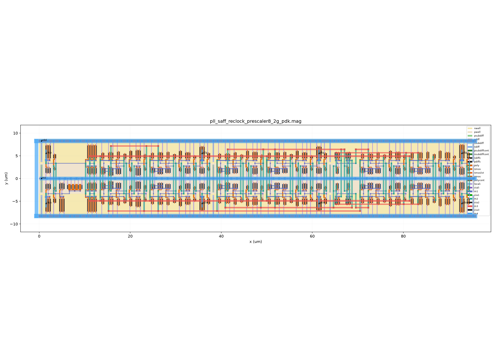

# `pll_saff_reclock_prescaler8_2g_pdk` — Pure-CMOS Equalized Nikolic SAFF-TSPC Reclocked 2 GHz ÷8 Prescaler SKY130 PDK Layout (`v2`)

- **版图生成器**：[build_saff_reclock_prescaler8_2g_pdk.py](../../build_saff_reclock_prescaler8_2g_pdk.py)（`v2`：交错紧邻布局 + v7 后仿感知器件尺寸）
- **对应规范网表**：[tspc_reclock_prescaler8_2g.spice](../../../spice/tspc_reclock_prescaler8_2g.spice)（`pll_saff_reclock_prescaler8_2g` `v7`，纯 SKY130 MOS，零电阻/零 MIM 电容）
- **构建与独立复核目录**：[`results/layout/pll_divider/20261120_saff_reclock_2g_v2/`](../../../../../../results/layout/pll_divider/20261120_saff_reclock_2g_v2/)、[`results/layout_review/saff_reclock_2g_20261120_v2/`](../../../../../../results/layout_review/saff_reclock_2g_20261120_v2/)

## 几何与物理提取指标（v2）

| 指标 | 实测结果 |
|---|---|
| 单元边界框（bbox） | `[-1.100, -8.760, 96.235, 8.760] µm` |
| 单元尺寸 / 面积 | `97.335 × 17.520 µm`（**`1,705.31 µm²`**） |
| 物理检查（全规则 DRC / Netgen LVS） | `DRC = 0`、`LVS_MATCH = True`、`LVS_PROPERTY_ERRORS = False`、`LVS_DISCONNECTED = none`、`physical_passed = True`；规范层级网表 `pll_saff_reclock_prescaler8_2g`（v7）1-to-1 LVS 零属性误差通过 |
| 导出端口（10 个，全 M4） | `clkp clkn q2p q2n q4p q4n q8p q8n vdd vss` |
| 逻辑器件 / 提取段数 | `189` 个逻辑 MOS 器件 / `312` 个提取段（`pfet_01v8: 150`、`nfet_01v8_lvt: 96`、`nfet_01v8: 66`）；`0` 个浮空非器件 poly |
| 端口寄生电容（CPEX，`to_sub + coupling = total`） | `clkp/clkn = 1.543 / 1.540 fF`、`q2p/q2n = 3.042 / 3.036 fF`、`q4p/q4n = 3.080 / 3.069 fF`、`q8p/q8n = 3.085 / 3.005 fF`、`vdd = 232.938 fF` |
| 关键内部信号电容（CPEX，`v2` vs `v1`） | `ck_2g = 38.969 fF`（`v1: 34.43`）、`b0n = 21.896 fF`（`v1: 21.13`，`b0n↔ck_2g = 1.51 fF`、`b0n↔b1n = 1.56 fF` 较 `v1` 减半）、`b0p = 6.775 fF`（`v1: 7.95`）、`b1n / b1p = 12.625 / 11.521 fF`（`v1: 17.14 / 16.13`，**`b1↔b2` 密勒耦合 `3.40 fF → 0`**）、`b2p / b2n = 8.977 / 8.860 fF`（`v1: 16.03 / 16.05`，**降幅 ~44%**） |
| 整体提取寄生电容（CPEX） | `743` 个电容元件（`v1: 824`）；总对地 `229.280 fF`、总耦合 `143.307 fF`（较 `v1` 净降 `10.81 fF`） |
| Magic 原生 RCX 提取（`pll_saff_reclock_prescaler8_2g_pdk_rcx.spice`） | `1,291` 个提取电阻（`v1: 2,549`，减半；覆盖 `10` 条网络，`0` 跨网桥接，`0` 断连子网）；`312/312` 器件拓扑/尺寸/父网完全保留（见下方 RCX 备注） |

## 版图架构与对称性（v2 交错紧邻布局）

- 沿中心 `VSS` 脊柱（`y = 0.000 µm`，`psubdiff + locali + M1 + M4`）上下镜像对称；上下 `VDD` 轨位于 `y = ±8.260 µm`（`nsubdiff + locali + M1..M4`），外置左侧 `M4` 桥接（`x = -0.600 µm`）不跨压中心 `VSS`。
- **v2 交错紧邻流水线顺序**：`[Xck] → [Xff0] → [Xr0+Xo0] |wall1| [Xff1] → [Xr1+Xo1] |wall2| [Xtg2] → [Xff2] → [Xr2+Xo2]`。每级分频器输出 `b0→Xr0`、`b1→Xr1`、`b2→Xr2` 直接跨越单列进入相邻重定时级（`~2.5 µm`），将 `b1/b2` 总走线长度较 `v1`（`~75–85 µm`）缩短 `2.6–4×` 并完全消除 `b1↔b2` 并行长线密勒耦合。
- **四组非重叠 M3 水平总线**：
  - `±4.900 µm`（`W = 0.40 µm × 2`）：`Xck` 向右驱动双轨对称 `ck_2g` 馈送 `Xff0 / Xr0 / Xr1 / Xr2`；
  - `±5.650 µm`（`W = 0.30 µm`）：局部短线 `b2p/b2n`（`Xtg2 ← Xff2 → Xr2`）；
  - `±6.400 µm`（`W = 0.30 µm`）：中段 `b1p/b1n`（`Xff1 → Xr1 → Xtg2`）与右侧独立局部短段 `d2p/d2n`（`Xtg2 → Xff2`，与 `b1n` 保留 `0.42 µm` M3 焊盘净距）；
  - `±7.150 µm`（`W = 0.30 µm`）：`+Y` 短线 `b0p`（`Xff0 → Xr0`）、`-Y` 时钟线 `b0n`（`Xff0 → Xr0 → Xff1.ck → Xff2.ck`），与 `ck_2g` 净距高达 **`1.90 µm`**（较 `v1` `0.37 µm` 扩大 `5.1×`），与 `VDD M3` 净距 `0.68 µm`。
- 每个 `saff_tspc_dff` 为 7 列镜像单元（`tail_pm / dp_pre / ln_lp / eq / inv / drv / keep`）：器件宽度与规范网表 `v7`（`Xck wn1=2.4/wp1=6.0, wn2=10.8/wp2=24.0`；`Xff0 wt=5.4/wd=3.4/wop=3.8/wdn=3.4`；`Xff1/2 wt=4.4/wd=2.8/wop=3.0/wdn=2.8`；`Xtg2 wn=1.3/wp=2.8`；`Xr0/1/2 wt=4.4/wd=2.8/wl=2.3/wop=2.8/wdn=2.6`）1-to-1 精确对齐；`Xff0`（`seed_k=0.30`）与 `Xff1/Xff2`（`seed_k=0.25`）保留精确启动失配，`Xr0/Xr1/Xr2`（`seed_k=0.0`）上下 100% 镜像对称。

## 后仿电气验证汇总（v2）

| 验证集 | 边界条件 | 结论 | 关键指标 |
|---|---|---|---|
| **45 角 CPEX PVT** | `r5_pdk` v6 CPEX 驱动，0.5 ns 冷上电，零 `Ikick` | **45/45 功能通过（`bad=0`）**，**44/45 `< 30 ps`** | 中位最大级间偏斜 **`4.28 ps`**（TT `4.08 ps`），第 2 差 `ss_v1650_t27` `15.61 ps`，仅 `ss_v1650_t-40` 为 `45.61 ps`；全角 `q8` 占空比 `0.4972–0.5046`，`max_pn = 17.81 ps`，`P = 3.38–5.27 mW` |
| **双向 RCX（`RCX_BOTH`）** | `r5_pdk` v6 RCX → 本单元 RCX（5 边界角） | **5/5 PASS** | TT `5.0 ps`、FS85 `6.1 ps`、SF-40 `8.5 ps`、FF85 `3.9 ps`、SS-40 `29.1/14.5/18.1 ps` |
| **200 样本 CPEX MC（`fs_v1650_t85_mm`）** | 0.30 Vpp，`Cpre = 45 fF` | **200/200 PASS**（`CI95 = [98.17%, 100%]`） | `sk4 = −7.60 ± 2.26 ps`，`sk8 = −4.26 ± 2.34 ps` |
| **200 样本 CPEX MC（`ss_v1650_t-40_mm`）** | 0.30 Vpp，`Cpre = 45 fF`，24 ns 窗口 | **`168/200` 正常分频 / `39/200` `< 30 ps`** | `sk4 = 52.60 ± 28.95 ps`；23/32 颗未翻样本定位到 `Xtg2` 传输门在 `1.65 V −40 °C` 导通死区，详见 [设计报告](../../../../../../docs/design/pll_tspc_reclock_divider.md) |

## Magic 原生 RCX 备注（`Xcdum` 短接源漏 MOS 电容）

`review_cell.py --rc` 的严格逐字属性比对在 `X56`（`Xck_cdum vss ck_dum vss vss sky130_fd_pr__nfet_01v8 w=4.0 l=0.5` 的 4 个并联指之一）处检测到 CPEX 与 RCX 的源极扩散属性差异：`CPEX` 输出 `as=36.54 ps=304.98001`（Magic 在未拆分 `vss` 网上对短接 `d=s=vss` 器件回退写入整网 `vss` `ndiff` 总面积），而 `RCX` 在 `extresist` 拆分 `vss.t85` 后输出 `as=0 ps=0`。其余 `311/312` 个器件段全部逐字符一致，`X56` 的源极与衬底均短接于 `vss`（`V_sb = 0`）无电学影响，`pll_saff_reclock_prescaler8_2g_pdk_rcx.spice` 网表与电阻网络（`1,291` 电阻、`10` 条网络、`0` 桥接、`0` 断连）完整可用。

