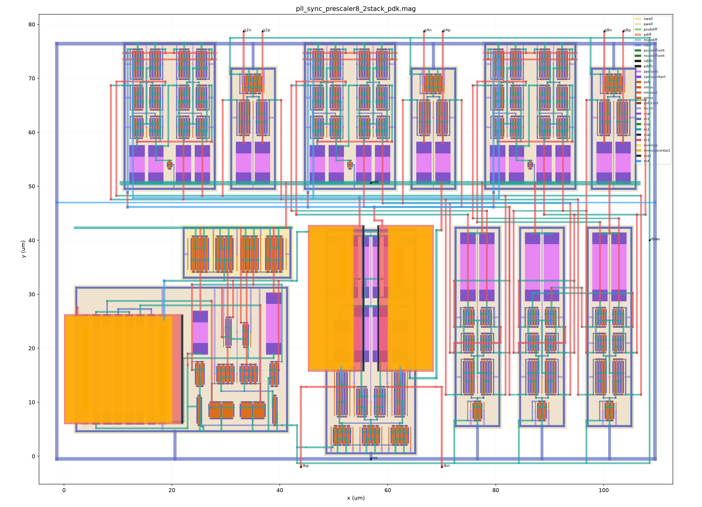

# `pll_sync_prescaler8_2stack_pdk` — 2-Stack 同步 CML ÷8 布线候选（CML 族 Var 2）

- **对应网表**：[sync_prescaler8_2stack.spice](../../../spice/sync_prescaler8_2stack.spice)
- **生成器与布线脚本**：[build_sync_prescaler8_pdk.py](../../build_sync_prescaler8_pdk.py)、[route_sync2_blocks.py](../../route_sync2_blocks.py)、[route_sync2_top.py](../../route_sync2_top.py)
- **设计说明**：[pll_sync_prescaler8.md](../../../../../../docs/design/pll_sync_prescaler8.md)

## 当前状态与明确边界

- 保留为 11 端口 CML 分频器家族的第 2 个候选变体（未替换 `config/pll_working_revision.toml` 中的 r3 `pll_cml_prescaler8` 主线）。
- **尚未完成独立电气与网表身份验收**：如 [pll_pending_review_20261117.md](../../../../../../docs/layout/pll_pending_review_20261117.md) 所记录，该布线快照尚未补齐完整提取网表身份复核及后仿 CPEX/RCX 电气签核，请勿将本目录几何快照视作已通过后仿验证。

