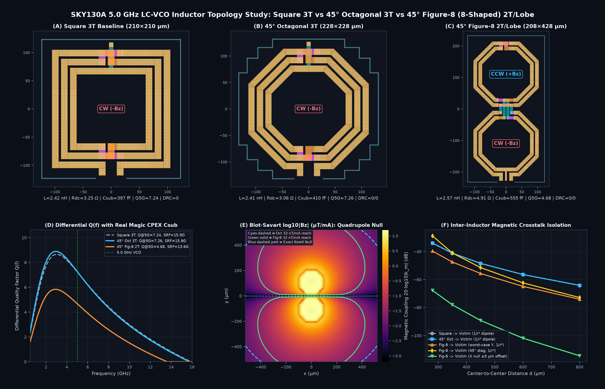

# 5.0 Gb/s 双速八边形 LC-VCO（`analog/pll/vco_5g/`）

面向 5.0 Gb/s 双速（4.0 / 5.0 Gb/s）Plan-C 路线的 SKY130A 八边形电感 LC-VCO + 同步 `÷2` I/Q 发生器，采用与 4G PLL v4 共享的 `PFD sc_dly + CP v4 + 融合 LF k4` 环路核心及 HV18 Kelvin LDO 安静域。固定签核证据见 [serdes_5g_signoff_20261126.json](../../../results/catalog/serdes_5g_signoff_20261126.json) 与 [PLL 环路文档](../../../docs/design/pll_loop.md)。

## 1. 已签核主变体（`lc_vco_5g_oct_pdk`）

- **原理图网表**：[`spice/lc_5g_div2_oct_pdk.spice`](spice/lc_5g_div2_oct_pdk.spice)
- **PDK 版图生成器**：[`layout/build_lc_vco_5g_pdk.py`](layout/build_lc_vco_5g_pdk.py)（顶层与有源核心 + `÷2`）· [`layout/build_lc_ind_oct_fig8_pdk.py`](layout/build_lc_ind_oct_fig8_pdk.py)（八边形 / 8 字形电感）
- **交付与签核摘要**：[`layout/variants/lc_vco_5g_oct_pdk/`](layout/variants/lc_vco_5g_oct_pdk/) · [`summary.json`](layout/variants/lc_vco_5g_oct_pdk/summary.json) · [顶层版图预览](layout/variants/lc_vco_5g_oct_pdk/vco5g_lc_div2_oct_pdk.png)
- **CPEX 验证脚本**：[`tb/verify_lc_vco_oct_cpex.py`](tb/verify_lc_vco_oct_cpex.py)

| 指标 | 实测签核值（`lc_vco_5g_oct_pdk`） |
|---|---|
| 顶层宏外框与面积 | `266.0 × 371.1 µm = 0.0987 mm²`（有源 + `÷2` 子宏 `238.2 × 104.3 µm`；八边形电感 `266.0 × 266.0 µm`） |
| 电感参数（`vco5g_ind_oct_2n5_pdk`） | `L_diff = 2.408 nH`，`L_eff @ 5 GHz = 2.724 nH`，`Q_5G = 7.26`，`R_dc = 3.065 Ω`，`C_sub = 410.5 fF` |
| 物理签核 | Magic full-rule **`DRC = 0`**、KLayout **`DRC = 0`**、Netgen **`LVS = MATCH`**（0 属性误差，13 端口） |
| 6 角 CPEX PVT + 125 °C 冻码 | **6/6 角 + 125 °C 冻码 3/3 PASS**；全角公共频段交集 **`4.469–5.350 GHz`**（完整覆盖 4G/5G 双速目标） |
| 失配 MC（`SS +85 °C`） | **24/24（100%）起振锁定**，正交 `I/Q` 偏斜 `σ = 0.645 ps` |

## 2. 其他电感与 VCO 对比变体

- 电感对照变体：`layout/variants/ind_oct_2n5_pdk/`、`layout/variants/ind_fig8_2n5_pdk/`、`layout/variants/ind_sym_2n2_pdk/`
- 早期/对比 LC-VCO 变体：`layout/variants/lc_vco_5g_pdk/`、`layout/variants/lc_vco_5g_unified_pdk/`
