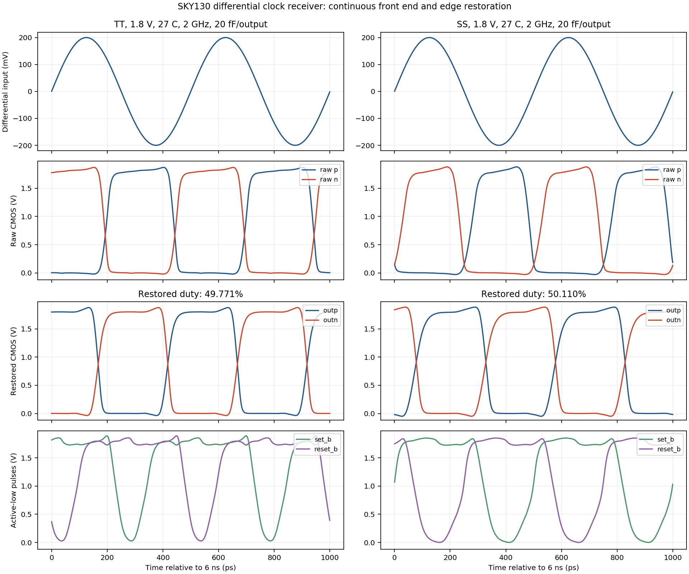
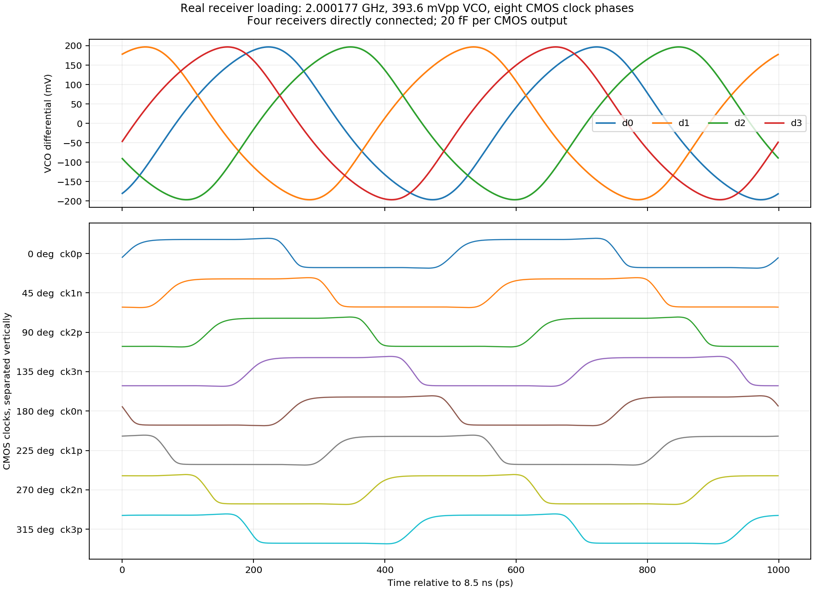

# CML 时钟接收器与 VCO 联调

## 当前连接建议

当前每个 VCO 差分对只连接一个接收器时，优先使用：

独立 CML buffer 是可选模块。输入源跟随器已提供一定反向隔离；额外缓冲也会给 VCO
增加输入负载、功耗及传播相位，不能把它当作无代价的隔离器。
需要分发给多个 CML 负载、驱动较长连线或有明确隔离要求时，再启用独立 CML buffer。
CMOS 端扇出较大时，在转换之后配置 CMOS 时钟树。

本版专门接收连续的 VCO 时钟。恢复级有记忆，输入停钟时会保持状态；
它不保证静态 inp/inn 到最终 outp/outn 的直流逻辑关系。
最终输出需在输入建立有效交替边沿后使用，尚未实现复位或无毛刺门控。

## 电路与接口

- 端口：inp、inn、outp、outn、vbias、vdd、vss。
- 输入：共模约 1.632 V、差分峰峰值 400 mV，2 GHz 正弦波作为 VCO 类激励。
- 电源：1.8 V；每路 CMOS 输出负载 20 fF，双路匹配。
- 输入缓冲：LVT NMOS 源跟随器，每端总宽 20 µm，电流下拉总宽 2 µm、长 0.5 µm。
- 两路反向输入的差分到单端级：LVT 输入对总宽 6 µm，PMOS 镜像负载总宽 8 µm，
  尾管总宽 6 µm、长 0.5 µm。
- 原始 CMOS 时钟分别产生上升沿脉冲，驱动 NAND SR 锁存器；输出延时匹配减小置位/复位路径差。
- 偏置用外部 0.85 mA 参考及 20 µm / 0.5 µm、nf=4 的二极管连接 NMOS 产生。
  接收器功耗不包含该理想参考支路；集成时与 VCO 共用同一支路并只计一次。
- DUT 全部由 SKY130 MOS 构成，无理想比较器或行为增益块。

器件适配含扩散面积/周长估算，尚无真实布线、接触和门极电阻提取。
源跟随器的多指化和真实偏置网络需要随后布局并复测。
工艺器件说明参见 [SKY130 官方文档](https://skywater-pdk.readthedocs.io/en/main/rules/device-details.html)。
时钟分发、电平转换和占空比的系统关系可参考
[Balamurugan 等，JSSC 2008](https://people.engr.tamu.edu/spalermo/ecen689/low_power_IO_balamurugan_jssc_2008.pdf)。
本设计的尺寸及结果来自本项目仿真，不从该文的不同工艺性能外推。

## 单模块结果

固定 1.8 V、400 mVpp 差分输入、1.632 V 共模、2 GHz、每路输出 20 fF。
取 12 ns 瞬态的 6–12 ns 窗口。功耗为时间加权平均。

| 工艺角 | 温度 | 输出占空比 | 上升 10–90% | 下降 90–10% | 接收器功耗 |
|---|---:|---:|---:|---:|---:|
| TT | 27°C | 49.771% | 45.64 ps | 27.90 ps | 3.467 mW |
| SS | 27°C | 50.110% | 62.75 ps | 33.24 ps | 3.360 mW |
| FF | 27°C | 49.580% | 35.76 ps | 24.41 ps | 3.489 mW |
| SF | 27°C | 49.024% | 58.94 ps | 28.03 ps | 3.630 mW |
| FS | 27°C | 50.600% | 40.62 ps | 30.07 ps | 3.202 mW |
| TT | 125°C | 49.434% | 49.63 ps | 32.46 ps | 3.650 mW |

这些点均输出 2 GHz、接近 0–1.8 V 的双路时钟，每周期一次翻转。
TT 的原始瞬态极值约 −37 mV / 1.876 V，存在开关过冲；极值不代表静态 VOH/VOL。
没有观测到恢复级 set_b/reset_b 在测量窗口内同时有效的采样点。
这不等于经过提取或失配后仍能保证严格非重叠。

[可导出 SVG](figures/common/level_conversion/cml_clock_receiver_waveforms.svg)；[最终版本测试点 CSV](data/cml_clock_receiver_points.csv)。

另测 TT、1 GHz：输出占空比约 49.909%，接收器功耗约 2.230 mW；其余条件相同。
1 GHz 尚未扩展到其他工艺角。

TT 最大步长从 1 ps 减为 0.5 ps，输出占空比从 49.771002% 变为 49.771076%，
证明此名义点的数值结果基本收敛，不能替代模型或布局准确度验证。

当前没有签定占空比、边沿、功耗和相位误差的最终允许范围。结果保留为 ungraded；
工程检查只用于发现丢边沿、幅度不足、脉冲重叠或明显失真。
尚未完成最低输入摆幅、连续共模范围、全电压/温度、失配、提取和相噪验证。

## 输入负载与反灌

TT、2 GHz 下，每端基波等效输入电容约 10.7 fF；五个工艺角约 9.0–12.2 fF。
这是有源、周期工作电路的复导纳等效值，随偏置和频率变化，不能等同于一个固定理想电容。
MOS 的 Cgs/Cgd 以及电源、偏置耦合仍然存在。

有限源阻抗测试使用每端 400 Ω，比较 CMOS 负载从 20 fF 增到 80 fF。
稳态输入电压差处于导出数值精度附近，保守表述为未见超过 1 µV 的变化。
此为确定性负载反灌检查，不是噪声、基底耦合或相噪隔离度保证。
80 fF 下输出上升时间约 122 ps、占空比约 47.4%，提示重负载应由后级 CMOS 驱动链承担。

## 真实 VCO 联调

四级 VCO 的四组差分抽头全部连接匹配的接收器，得到八路 CMOS 时钟。
移除原先每端 20 fF 的输入代理电容，仅保留每端 0.5 fF 的假定残余线电容。
输出仍为每路 20 fF。供电、参考源保持理想安静，工艺为 TT、27°C。

| 链路 | Vctrl | 振荡频率 | VCO 差分峰峰值 | CMOS 占空比 |
|---|---:|---:|---:|---:|
| 直接接收 | 1.306 V | 2.000177 GHz | 393.6 mV | 约 49.772% |
| 额外 CML buffer 后接收 | 1.412 V | 2.001291 GHz | 404.7 mV | 约 49.754% |

两种链路均保留约 45° 的八相上升沿间隔。这里使用匹配模型，不能将数值上的近乎均匀
间隔当作版图后相位精度。

[可导出 SVG](figures/clocking/distribution/vco_receiver_eight_phases.svg)；[联调测量 CSV](data/vco_receiver_integration.csv)。

| 功耗项 | 直接接收 | 加 CML buffer |
|---|---:|---:|
| VCO 与共享参考支路 | 7.593 mW | 7.594 mW |
| 四个双输出接收器 | 13.866 mW | 13.972 mW |
| 四个 CML buffer | 0 | 3.420 mW |
| 合计 | 21.460 mW | 24.986 mW |

这是功能优先的原型，时钟恢复逻辑有功耗代价，后续仍可优化。
CML buffer 输出差分峰峰值约 522 mV、共模约 1.657 V，单级约 0.855 mW。
这是约 2 GHz 时钟缓冲的验证，尚未测试 4 Gb/s PRBS 数据缓冲。

在相同 Vctrl=1.30 V 时，直接链路约 1.997 GHz，加缓冲链路约 1.950 GHz；
说明额外缓冲并没有消除 VCO 负载。因此当前单接收器/相采用直接连接。

原始结果目录：

- results/analog/common/cml_to_cmos/functional/20261027T125139Z_ngspice_tt_balanced_restorer_tt/
- results/analog/pll/top/vco_receiver/20261027T125654Z_ngspice_tt_release_direct_2g/
- results/analog/pll/top/vco_receiver/20261027T125654Z_ngspice_tt_release_buffered_2g/

每次运行保存网表快照、版本和输入哈希、完整日志、波形、run.json 与 metrics.json。
selected_revision 按 DUT SHA256 区分最终电路与探索版本，后者不能用于推断当前电路边界。

## 系统使用边界

时钟过零到下一输出边沿的时间按 modulo-T 记录，SS 下链路可能跨越一个周期。
设计分频、串化和字边界时应计入整个转换链的延迟，不能把周期内相位差当作无歧义传播延迟。
输出虽为名义互补，仍有有限边沿及占空比误差；4:1 MUX 所需的 25% 选通窗口
还需要单独生成和验证，接收器本身不提供该窗口。
边沿恢复不等同于闭环 DCC：原始互补上升沿若因失配而偏离 180°，恢复级不会自动消除该误差。

本轮未实现完整 PLL、串化器、时钟门控、外部线驱动或流片签核。
