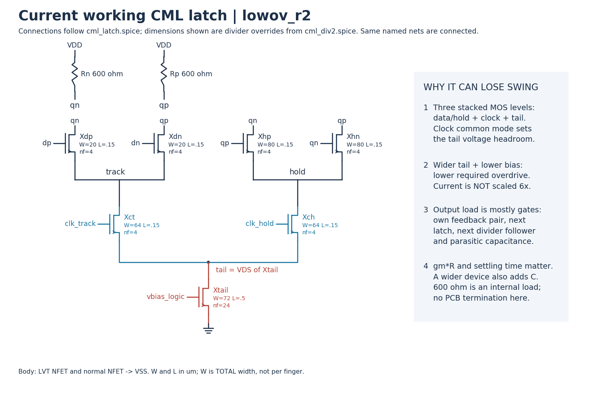
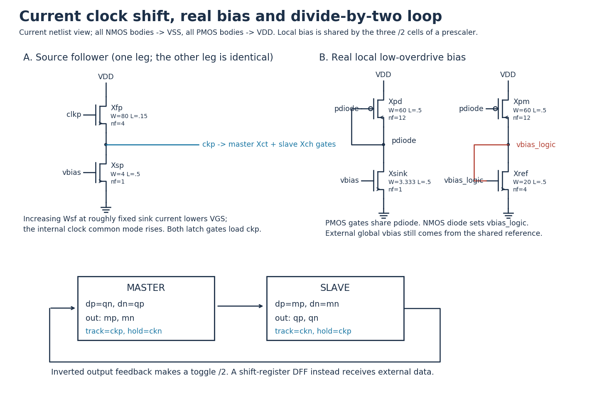
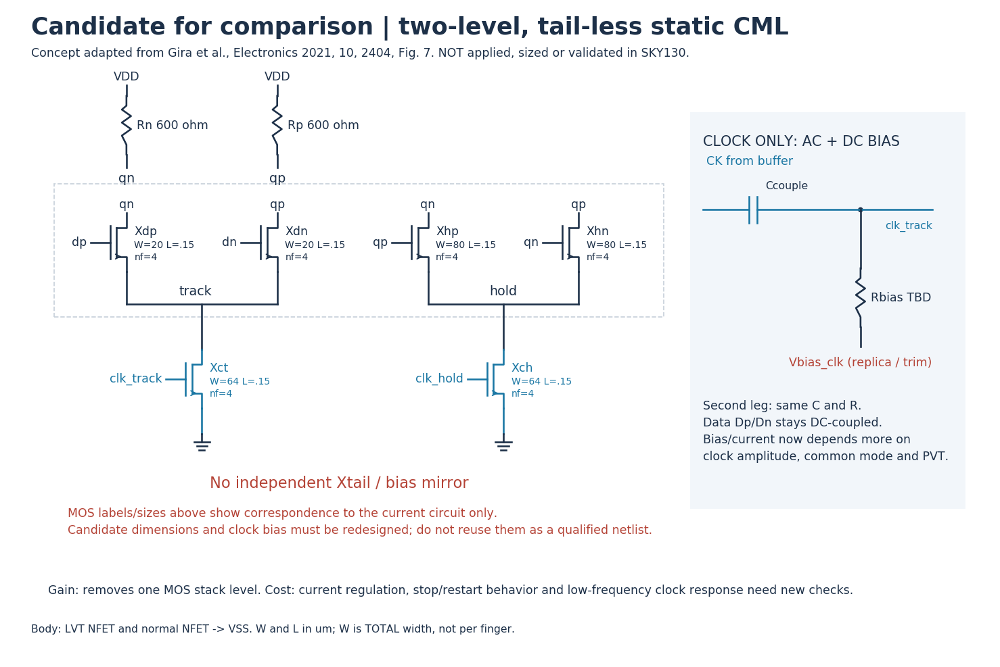

# CML 锁存器：失效机制与结构选择

后续已完成[独立拓扑探索](cml_latch_topology_experiments.md)。下文保留调研时的状态和方案；候选已进入独立探索网表，尚未替换当前工作设计。

2026-10-29。崩溃后已确认工作网表、最终 r2 源快照和完成的 PVT 数据仍在磁盘。当前设计见 [工作入口](../config/pll_working_revision.toml)，仿真范围及缺口见 [低过驱动 PVT](pll_lowov_pvt.md)。本页是结构调研和电路解释，没有将文献候选替换进工作设计，也没有为候选新增仿真。

先看 [三页电路 PDF](schematics/lowov_review/cml_latch_review.pdf)：当前锁存器、时钟源跟随与真实偏置镜、两层 CML 候选。[连接核对清单](schematics/lowov_review/manifest.json)记录来源哈希及 9 个锁存器实例的命名节点检查。这是按网表绘制的矢量阅读图，不是 Xschem 导出、LVS 或版图。旧的 29 页 Xschem 导出仍是历史版本，不代表本轮内部偏置和参数已同步。

## 到底在驱动谁

当前每个 ÷2 的输入源跟随器，将高共模 CML 时钟移到堆叠锁存器需要的较低共模。每侧源跟随输出同时驱动主、从锁存器各一只时钟管的栅极；当前分别为两只总宽度 64 µm 的管，而非外部低阻端接。

锁存器输出驱动另一个锁存器的数据栅极、自身交叉耦合保持管的栅极；slave 输出还驱动下一级分频器源跟随输入。测试台另有每端 5 fF 的 tap 负载，最后一级接实际反馈转换器。因此负载主要为门电容、器件寄生和内部反馈。600 Ω 电阻是每根输出到 VDD 的电流转电压负载，不是 PCB 的 100 Ω 差分端接；减小它会降低 RC，同时也降低相同电流下的摆幅和再生增益。

## 为什么摆幅会消失

有三个不同的机制，不宜全部称为“驱动力不足”。

1. **压差不足。** 尾源、时钟管、数据/保持管形成三层 MOS 堆叠。时钟共模偏低时，内部源节点下降，尾管 VDS 可能不足；其电流及输出电阻随节点电压变化，不能维持预期恒流。之前 SS 诊断的旧尾管 VDS 约 0.208 V，而模型 VDSAT 约 0.378 V；这已有直接探针证据。
2. **转向与再生不足。** 有尾电流也不保证正确锁存：内部时钟差分、交叉耦合增益以及 track/hold 时间都必须足够。转向不充分、残留竞争或再生时间不够，可能只留下微弱周期纹波，后级不再翻转。简单近似的增益条件为 gm·R_eff>1，再生时间还依赖 C_eff 和正反馈净跨导；需要按实际动态状态验证，不能用一个 DC 数字替代。
3. **接口幅度与负载。** 真实 VCO 的频率、摆幅和共模都随粗细调变化。FS 热角某个低 Vctrl 测点中，VCO 只有约 225 mVpp，buffer 后约 301 mVpp，低于标准输入夹具产生的 buffer 幅度；这是另一项实际回接差异。该点的尾管平均压差为正，仍出现后级失效，说明不能把所有失败都解释成尾管未饱和。

尾管从 W12 增至 W72 µm **同时降低偏置**，意图是在近似同一电流量级降低所需过驱动，不是让电流变六倍。源跟随器 W40→80、下拉管 W4 不变，则是在近似固定下拉电流下减小 VGS、抬高内部时钟共模，同时改变跨导和输入寄生。它不是毫无代价的加宽：前一级看到的电容会增加。

全速 CML→CMOS 在 SS 冷角的失败是另一条支路，不能拿分频器的修复直接解释或宣称解决。

## 其他结构的比较

| 方案 | 解决的主要矛盾 | 代价及本项目判断 |
|---|---|---|
| 保留静态堆叠 CML，独立设置/跟踪时钟共模 | 把时钟共模与输入 VCO 共模、源跟随 VGS 的漂移解耦 | 优先比较 replica 偏置/可调共模接口；仍需留足三层压差。可通过匹配 AC 耦合电容和偏置电阻设置时钟 DC，检查输入电容、启动时间及最低时钟频率。数据路径继续 DC 耦合。 |
| 去独立尾源、两层静态 CML | 直接省掉尾源的一层压差 | 时钟管同时承担电流设定，电流/功耗更依赖时钟偏置与幅度。需重做摆幅、噪声、停止/重启与 PVT；作为首个真正更换拓扑的候选。 |
| Folded MCML，必要时 n/p 交替级联 | 用折叠电流路径减少堆叠，并处理级间共模 | 新增电流镜和内部节点，PMOS 路径速度及失配需查；先保留为低压备选。文献的体偏置与先进工艺性能不能直接照搬到本项目 SKY130。 |
| TSPC / C²MOS 等 CMOS 锁存链 | 可减少静态功耗和 CML 级数 | 需要全速 CMOS 时钟/数据接口；动态版本还需保持时间、漏电、最低频率、复位检查。现有全速转换器已有冷角缺口，当前切换不能自动消除问题。 |

两层 CML 的器件级实例见 Gira 等 [Fig. 7 与 §5.2](https://iris.cnr.it/bitstream/20.500.14243/511962/1/2021_ELECTRONICSMDPI.pdf)：时钟通过电容耦合，电阻提供栅 DC 偏置，省去独立尾源。这里只借鉴结构，不沿用其低温工艺结论或性能。

Folded MCML 的原始分析讨论了电流镜路径、源跟随延迟，以及 n/p DIV2 交替避免级间移位的方法，见 Centurelli 等 [§2–3](https://iris.uniroma1.it/retrieve/e383532c-03c0-15e8-e053-a505fe0a3de9/Centurelli_0.5V-frequency_2021.pdf)。折叠减少压差要求，也增加必须设计的节点。

另一种减少逻辑堆叠的方法是 triple-tail latch：数据和保持支路各有电流源，再由时钟支路竞争电流。原文指出摆幅与输入/状态有关，时钟管和数据管尺寸比也影响完全转向，见 Gupta 等 [原始电路与分析](https://onlinelibrary.wiley.com/doi/10.1155/2013/217674)。因此它不是“减少一层、其他均不变”的替换。

图中尺寸仅标示与当前器件的对应关系，**不是候选设计参数**。候选需重新设计时钟偏置和尺寸，尚未应用到工作网表。

## 建议形成公共 latch 单元，而不是逐处堆尺寸

下一步优先把独立时钟共模接口和两层静态 CML 做成并行候选，并复用同一组加载测试。此处的“并行”是方案比较，不代表已启动其他模型或仿真。

- 单 latch：track 增益与延迟、hold 再生、输入偏移敏感性、允许的时钟/数据共模及幅度；测真实时钟波形，不只用理想方波。
- DFF：任意数据的 setup/hold、clock-to-Q、长 0/长 1、交替位和 PRBS；与 ÷2 的周期性反馈分开验证。
- 级联：前一级带下一级真实门负载，测多个 tap、启动与停止/恢复；给出不同扇出下的接口边界。
- 选角：先 TT 和已暴露的 SS/FS 低压冷热角，再扩完整网格。稳态正确周期、模拟裕量、启动时间分开记录。

分频器是 DFF 反相反馈形成 toggle；移位器是 DFF 接收前一级数据。它们共享锁存问题，但分频只测试了一种高度周期化状态，不能替代任意数据的时序资格验证。当前修改仅应用到 PLL 分频包装，RX 采样器仍保留原参数；不要把 PLL 的 45 点结果转记为 RX 已通过 PVT。
