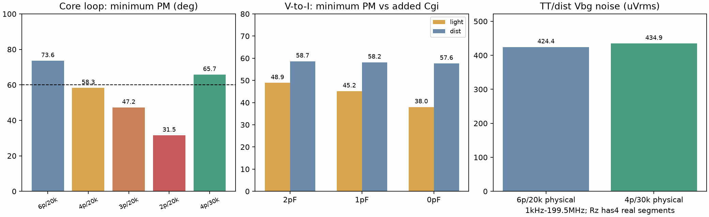

# 带隙基准电容复核（2026-11-14）

**共享参考先保留13 pF：核心补偿6 pF、Vbg去耦5 pF、V→I栅节点2 pF。** 直接缩小任意一项都有可测代价。`Cc=4 pF / Rz=30 kΩ` 可形成11 pF候选，已完成局部双环AC、启动和噪声对照，但尚未证明能缩小版图；本轮不改采用网表或正在重构的版图。

LDO另按[电容与面积方案](ldo_cap_area.md)保留70 pF本体，算独立尾偏置16 pF是86 pF。这里的BG 13 pF、各CML本地5 pF及PLL环路电容均另计，不能重复归入LDO本体。

## 构造与电容作用

[带隙核心](../../analog/bias/spice/bandgap.spice)利用PNP面积比8产生正温度系数的ΔVBE，经R1=11 kΩ和R2=106.5 kΩ加权，与负温度系数的VBE相加，输出约1.23 V。两支路各有50 kΩ电平移位电阻，改善低电源、低温下误差放大器的输入余量；PMOS电流源由两级放大器共同控制。启动电路帮助离开零电流平衡。

第二个单级OTA构成V→I环，把参考电阻顶端保持在Vbg，产生约10 µA并经PMOS拷贝送往各模块。5 bit修调改变参考电阻，修的是电流及I·R代理量，不能直接当作Vbg/PTAT增益修调。TT本轮名义码下Vbg约1.2368 V、Iref约10.046 µA。

| 电容 | 当前值 | 作用与减容代价 |
|---|---:|---|
| 核心Miller `Cc`，串联 `Rz=20 kΩ` | 6 pF | 两级放大器极点分离；Rz调整补偿零点。直接减Cc降低核心相位裕度，需连同Rz重定尺寸。 |
| `Cvbg`，Vbg到地 | 5 pF | 降低基准输出的电源耦合和高频噪声。降到3 pF会明显增大受检供电耦合。 |
| `Cvgi`，V→I控制栅到Vdd | 2 pF | V→I环补偿；实际还依赖外部拷贝管的栅电容。轻载对减容更敏感。 |
| 每个 `serdes_bias_cml` 本地二极管节点 | 5 pF/实例 | 本地偏置去耦，随模块实例数另计；本轮未减。 |

裸 `serdes_bandgap` 的默认 `Cvgi=10 pF`，而实际共享[分配参考](../../analog/bias/spice/bias_dist.spice)明确覆盖为2 pF并增加Vbg的5 pF。13 pF是后者的口径。

## 适用范围与测量

局部AC使用五个边界：TT/1.8 V/27°C、SS_hh/1.65 V/−40°C、FF_ll/1.95 V/85°C、FS_ll/1.95 V/−40°C、SF_hh/1.65 V/85°C，每项各两种负载。不是MOS45或旧135条件完整重验。

- `light`：一份n=4电流拷贝输出钳在0.9 V；四个内部备用输出钳在0.7 V。
- `dist`：CML n=85、CTLE n=20、CP n=20及其本地二极管；另接一份CML尾管/500 Ω/1.0 V供电代理。大拷贝管额外提供约24 pF的控制栅负载。这是明确的分配夹具，尚非完整TX/PLL。

核心环在**误差放大器输出与公共PMOS控制栅之间**作电压/电流双注入，V→I环在参考电阻顶端与OTA输入之间双注入；用共享 `feedback.middlebrook` 合成返回比，测某一环时另一环保持闭合。TT核心PM约82.27°，与原设计记录相符。仅在核心差分输入的一侧断环会留下另一反馈支路，早期该方法得到的17.5°不是核心总环路PM，已排除；纯电压注入的额外交越也不作为结论。

60°仅是本轮选候选的局部规划护栏。当前V→I环在轻载/分配夹具下约49°/59°，不能由新护栏追认旧功能失败；候选也不能降低这项已有余量。BG尚无单独分配的噪声/PSRR规格，噪声和供电传递记为表征值。原135点启动/功能与200样本失配记录仍按[原模块](bias.md)的源码及边界解释，本轮不扩展其资格；PNP模型没有随机失配的缺口仍在。

## 减容结果

第一轮100条件使用显式1 pF PDK MIM单元，补偿Rz仍是理想电阻；十种候选各五边界×两负载。完整PDK与精简库TT两负载共10张AC表逐值相同。

| 方案 | 共享电容合计 | 核心最小PM | 判断 |
|---|---:|---:|---|
| Cc6 / Rz20k，Cvbg5 / Cvgi2 | 13 pF | 73.57° | 基准 |
| Cc4 / Rz20k | 11 pF | 58.31° | 单减Cc不满足本轮60°护栏 |
| Cc3 / Rz20k | 10 pF | 47.22° | 不继续 |
| Cc2 / Rz20k | 9 pF | 31.55° | 不继续 |
| Cc4 / Rz30k | 11 pF | 65.75° | 入选物理电阻复核 |
| Cc3 / Rz40k | 10 pF | 57.82° | 不继续 |

单减Vbg电容5→3 pF，TT分配夹具1 MHz供电到Vbg幅度0.483→0.732 V/V，20 MHz约0.00681→0.01091 V/V，分别增加约52%和60%。先保留5 pF。单减Cvgi为2/1/0 pF，五边界轻载最小V→I PM为48.89°/45.17°/38.00°，分配夹具约58.65°/58.18°/57.60°；因此2 pF也先保留。

第二轮20条件将Rz改为**四段真实high_po电阻**，按每段端头阻值重新计算长度：当前20 kΩ每段W1/L14.5804 µm，候选30 kΩ每段W1/L22.4669 µm。不是对现有PEX直接放大倍率。

| 物理Rz方案 | 电容合计 | 核心最小PM | 轻载V→I最小PM |
|---|---:|---:|---:|
| Cc6 / Rz20k，四段校准 | 13 pF | 71.46° | 48.89° |
| Cc4 / Rz30k，四段校准 | 11 pF | 64.23° | 48.89° |

11 pF在受检核心环上有余量，但Rz变长，面积收益不能按省下2 pF直接推算。

图左为第一轮理想Rz筛选；物理Rz以表格和后续动态结果为准。图中60°虚线仅用于核心候选选择。

## 启动、供电阶跃与噪声

两个物理Rz方案各TT、SS_hh低压冷、FF_ll高压热×两负载：共12次从零启动和12份独立DC噪声deck（30条谱）。启动时所有外加钳位和电源都从零用1 µs斜坡上升，无nodeset、`.ic`或uic；60 µs终点完整，38–40 µs全部到达各自AC卡工作点（Vbg误差<2 mV，Iref误差<1%）。40 µs处增加50 mV供电阶跃，1.95 V工况改为减少50 mV，10 ps边沿，供电始终处于1.65–1.95 V范围。

| TT、分配夹具 | 当前13 pF，物理Rz20k | 候选11 pF，物理Rz30k |
|---|---:|---:|
| 供电阶跃Vbg峰值偏移 | 25.99 mV | 19.15 mV |
| Vbg积分噪声 | 424.36 µVrms | 434.86 µVrms |
| 本地CML栅偏置积分噪声 | 134.60 µVrms | 135.55 µVrms |

积分频段为1 kHz–199.526 MHz；噪声单独使用纯DC源，并在每条谱之后立即核对核心PMOS与V→I PMOS电流及后者Vgs，防止噪声求解落到错误工作点。11 pF的Vbg噪声增加约2.5%；受检SS/FF趋势相同。供电阶跃改善不等于整机抖动预算已经闭合。

## 版图反馈：串段端头不能在电气上合并

固定输入为 `20261114_compact_w1_v2` 的已安装BG放大器LVS原始网表与参考网表快照，不是正在重构的 `20261114_plan_v2`。原始提取含四段W1/L15.48 µm的Rz，LVS参考合并为一段W1/L61.90 µm。连接关系可LVS匹配，但每段都有端头电阻，合并长度不能保持其电气阻值。

TT模型、0.9 V共模、10 Hz小信号电阻卡：27°C时合并单段为20.014 kΩ，实际四段为21.155 kΩ，差5.70%；−40/85°C差6.23%/5.61%。重新按四段端头定长后，本轮20k/30k方案在27°C约20.014/30.021 kΩ。

后续版图重构应按**未合并段的真实器件模型**校准Rz并做环路PEX，不得将LVS长度合并当作电气等效。本轮只反馈该补偿支路的具体差异，未改Antigravity进行中的生成器/已安装版图，也未据此撤销其他模块已有结果。

同一固定版图快照共享参考面积31,244.04 µm²；Cc已叠放于放大器上方，Vbg/Vgi电容叠放于电阻区上方。减2 pF是否释放外框面积尚未证明。下一步先结合正在重构的布局确认几何收益及真实Rz，再决定是否值得对11 pF补完整PVT/保码失配/启动和宏RC噪声资格。当前保留13 pF。

## 复跑与证据

入口：[测试台与命令](../../analog/bias/tb/cap_sizing/README.md)、[固定证据清单](../../config/bias_cap_review_evidence.json)、[小数据](../data/bias_cap_review.json)、[结果索引](../../results/catalog/bias_cap_review.json)。清单指定具体analysis和版图快照，汇总记录其SHA256；各campaign保留源码、模型、deck及哈希，按身份续跑，不搜索“最新一次”。

早期单输入断环、Rz小卡频点数不符及第一次动态JSON导出失败的目录保留诊断，未计入上述覆盖；最终分析来自固定清单中的完整输出。
