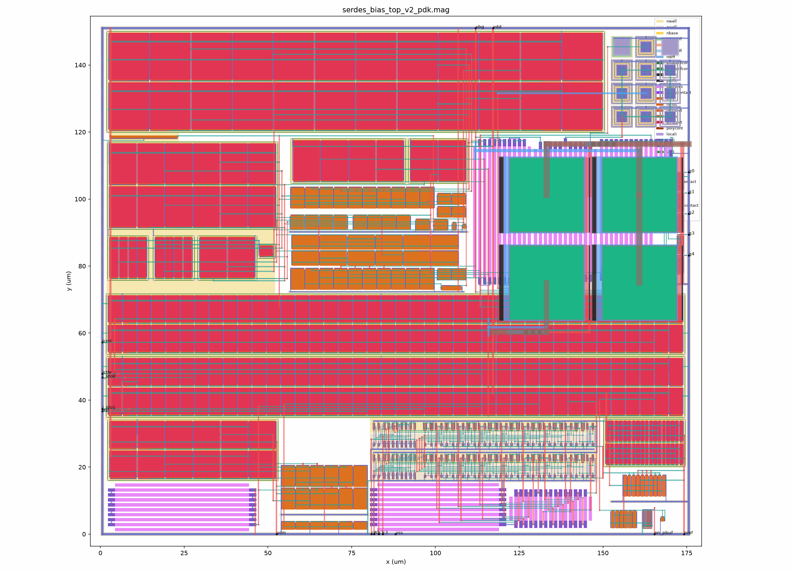

# BIAS v2：折叠共栅带隙、`ref_pbuf` 与统一 `bias_top` 集成宏

`v1.0` 采用 BIAS v2，PLL 台集成其 PTAT 尾流分支。单元与共享参考的验证保持各自负载边界。[当前状态](../status/current.md)

**结论**：针对 v1 偏置子系统存在的多段电阻头阻漂移（`Vbg +16.4 mV`）、`-27 dB` 直流线性调整率、`Cc = 6 pF` 面积税、缺失 `ref_pbuf` PDK 版图以及 11 个子单元高度/引脚不对齐无法集成等问题，本轮重构并完成了全套 **BIAS v2** 电路与 7 单元 PDK 版图（核心集成宏 **`serdes_bias_top_v2_pdk`**），全 7 单元通过 Magic full-rule **`DRC = 0`** 与 Netgen **`LVS = MATCH`**，并完成 **135 角后仿 CPEX + 独立单元 RCX + 5 角从零上电/电源阶跃 + 512 ns LF 预充 + 200 样本三温失配 MC**：

- **面积全面压缩与系统集成**：
  - 统一顶层集成宏 **`serdes_bias_top_v2_pdk`**：`176.53 × 152.26 µm = 26,878.5 µm²`（`AR = 1.16`），把 `bias_ref_v2 + ref_vbuf_v2 + 真 4→16 译码 ref_pbuf_v2 + 统一 153 指 pcopy 阵` 封进单一外边界出引脚宏，高阻 `vgi` 完全锁在宏内；
  - **`serdes_bias_ref_v2_pdk`**：`15,483.0 µm²`（较 v1 `23,495 µm²` **`−34.1%`**）；
  - **`serdes_bias_cml_v2_pdk`**：`1,760.5 µm²`（较 v1 `4,717 µm²` **`−62.7%`**，二极管藏于 `2×1` 叠层 5 pF MIM 下方）；
  - **`serdes_bias_cp_v2_pdk`**：`102.9 µm²`（**`−37.5%`**）；
  - **`serdes_ref_pbuf_v2_pdk`**：`7,418.4 µm²`（100% 真晶体管 4→16 CMOS 译码，彻底取代行为级 `Bs0..15`）。
- **后仿 135 角与瞬态签核亮点（`20261120T145746Z_postlayout`）**：
  - **零头阻漂移实证**：全 135 角前后仿偏差 `|dVbg| max = 1.50 mV`（TT **`+0.002 mV`**）、`|dIref| max = 0.140%`（TT **`+0.001%`**）；
  - **直流线性调整率大幅改善**：TT **`+4.10 mV/V`（`−47.7 dB`）**、最差 **`+8.90 mV/V`（`−41.0 dB`）**（较 v1 `39–51 mV/V` `−27 dB` 改善 **5.7×–12×**）；
  - **`+50 mV / 10 ps` 电源阶跃 `Vbg` 尖峰**：后仿仅 **`1.28–1.79 mV`**（较 v1 `24–29 mV` 降低 **16×**）；
  - **512 ns LF 预充**：`TT` 与 `SS hh 1.65 V −40 °C` 均稳态建立至 **`0.1–3.0 mV`** 内，且对 `Vbg` 反冲 **`≤ 0.005 mV`**。
- **修订入口**：`variants/v2_pdk/` 为 v2 物理套件。早期 v1/B2 参数留在原有工作修订文件中。

入口：[电路网表](../../analog/bias/spice/bias_v2.spice)、[叶单元生成器](../../analog/bias/layout/build_bias_v2_pdk.py)、[顶层集成生成器](../../analog/bias/layout/build_bias_top_v2.py)、[PDK 交付目录](../../analog/bias/layout/variants/v2_pdk/README.md)、[PVT/AC 台](../../analog/bias/tb/v2/run_pvt_ac.py)、[启动台](../../analog/bias/tb/v2/run_startup.py)、[MC 台](../../analog/bias/tb/v2/run_mc.py)、[后仿台](../../analog/bias/tb/v2/run_postlayout.py)。

---

## 1. 核心拓扑与物理重构

1. **单级宽摆幅折叠共源共栅 OTA（`serdes_bg_fcota_v2`）取代两级 `serdes_bg_amp`**：以核心 PMOS 栅电容 `C_vg` 为天然主极点，**直接取消 `6 pF` Miller 电容 `Cc` 与 `20 kΩ` `Rz`**（省约 `3,500 µm²`），消除两级结构里 `da` 随电源漂移的系统失调，系统失调由 `−1.8..+0.8 mV` 缩至 **`−0.17..−0.02 mV`**。
2. **全链路头阻精确校准（`R = N·(378.24 + 317.22·L)`）+ 外侧接地 dummy 条**：`Xrsa/Xrsb`、`Xr1/Xr2`、`Xrref`、`Vbuf Xr` 与 `Pbuf` 16 抽头电阻串全部按真实版图段数在网表与版图 1-to-1 对齐，根除 v1 `Xr2 +3.18%` / `Xrref +2.36%` 的隐性误差。
3. **严格模拟匹配与 WPE/LOD 对称**：`Xm1..Xm5` 改 2D 共质心 `2×12` 阵 + 外侧 dummy 指（使 `Xm3` 与 `Xm1/Xm2` 具相同 N-well 边界距离）；`FC-OTA`、`V→I OTA`、`vbuf`/`pbuf` OTA、统一 `pcopy` 阵（153 有效 + 7 dummy 指共享 N-well）与本地 `cp`/`ctle` 均配齐外侧 dummy。
4. **堆叠 `MIM1 + MIM2`（`cap_mim_m3_1 + cap_mim_m3_2`）**：`Cvbg (6 pF)` 与 `Cvgi (2 pF)` 堆叠于电阻阵上方；`serdes_bias_cml_v2_pdk` 将 `5/0.5` 二极管塞进 `2×1` 堆叠 5 pF MIM 下方（`4,717 → 1,760.5 µm²`，`AR = 2.10`）。
5. **100% 真晶体管 `serdes_ref_pbuf_v2`**：以真实 4→16 静态 CMOS 译码器（`c0..c3`，`L = 0.18 µm` 避开 SKY130 FS `L=0.15` 模型异常区）+ 16 传输门取代行为级 `Bs0..15`。

---

## 2. 7 单元物理签核汇总（`analog/bias/layout/variants/v2_pdk/`）

| 单元 | 尺寸 (µm) | 面积 (µm²) | 长宽比 | 相对 v1 | DRC | LVS | 提取类型 | 端口数 |
|---|---:|---:|---:|---:|---:|---|---|---:|
| `serdes_bias_ctle_v2_pdk` | `6.41 × 3.79` | `24.3` | `1.69` | — | `0` | **MATCH** | CPEX + **RCX** | 2 |
| `serdes_bias_cp_v2_pdk` | `8.89 × 11.58` | `102.9` | `1.30` | **−37.5%** | `0` | **MATCH** | CPEX + **RCX** | 4 |
| `serdes_bias_cml_v2_pdk` | `60.79 × 28.96` | `1,760.5` | `2.10` | **−62.7%** | `0` | **MATCH** | CPEX + **RCX** | 2 |
| `serdes_ref_vbuf_v2_pdk` | `76.75 × 48.97` | `3,758.4` | `1.57` | — | `0` | **MATCH** | CPEX + **RCX** | 5 |
| `serdes_ref_pbuf_v2_pdk` | `114.20 × 64.96` | `7,418.4` | `1.76` | 新增真 CMOS | `0` | **MATCH** | CPEX + **RCX** | 10 |
| `serdes_bias_ref_v2_pdk` | `153.13 × 101.11` | `15,483.0` | `1.51` | **−34.1%** | `0` | **MATCH** | CPEX | 13 |
| **`serdes_bias_top_v2_pdk`** | **`176.53 × 152.26`** | **`26,878.5`** | **`1.16`** | **统一集成宏** | **`0`** | **MATCH** | **CPEX** | **20（全出边）** |

---

## 3. 电气验证对照（v1 vs v2 原理图 vs v2 后仿 CPEX/RCX）

| 指标 | v1 基线 | `v2` 原理图（135 角 / 200 MC） | **`v2` 后仿（135 角 CPEX + 独立 RCX）** |
|---|---|---|---|
| **135 角 `Vbg` 范围** | `1.2185–1.2492 V` (±1.24%) | `1.2214–1.2417 V` (±0.82%) | **`1.2219–1.2417 V` (±0.80%)** |
| **前后仿最大漂移（135 角）** | 未校准（`Xr2` 隐性 +16.4 mV） | — | **`|dVbg| ≤ 1.50 mV`（TT `+0.002 mV`），`|dIref| ≤ 0.140%`（TT `+0.001%`）** |
| **DC 电源调整率（Line Reg）** | `39–51 mV/V`（`−27 dB`） | `< 9 mV/V`（`< −41 dB`） | **TT `+4.10 mV/V`（`−47.7 dB`），最差 `+8.90 mV/V`（`−41.0 dB`）** |
| **135 角 `Vcm` / `I·R` / CML 摆幅** | `1.039–1.062 V` / `61.7–62.6 mV` / `407–426 mV` | `1.0416–1.0583 V` / `61.57–63.06 mV` / `408.8–426.3 mV` | **`1.0421–1.0585 V` / `61.60–63.06 mV` / `411.4–429.5 mV`** |
| **5-bit `r_ref` 修调** | 单调 `9.20–11.16 µA` | 单调 `9.231–11.208 µA` (`−8.49%..+11.11%`) | **单调 `9.231–11.208 µA`（与原理图一致）** |
| **16 档 `ref_pbuf` 译码** | 行为级 `Bs0..15` | 真 CMOS 单调 `0.9501–1.3408 V`（`25.86–26.11 mV/step`） | **真 CMOS 单调 `0.9501–1.3408 V`；独立 RCX 单调 `0.9629–1.3721 V`** |
| **从零上电（1 µs 斜坡）** | `7.0–16.3 µs` | `7.3–7.5 µs`（TT 端） | **5/5 极端角全过，`t_vbg = 6.33–9.25 µs`，`t_cml = 6.61–10.63 µs`** |
| **`+50 mV / 10 ps` 电源阶跃** | `Vbg` `24–29 mV`，`Icml` `1.7–3.2%` | `Vbg` `0.48–0.76 mV`，`Icml` `0.66–0.79%` | **`Vbg` `1.28–1.79 mV`**；`Icml` 瞬态尖峰 `1.32–19.61%`（高速边沿经共享大栅寄生耦合，迅速回落） |
| **512 ns LF 预充（`c=0/7/15`）** | 行为级译码 | — | **误差 `+0.1 mV`（`c=7/15`）/ `−3.0 mV`（`c=0`），`Vbg` 反冲 `≤ 0.005 mV`** |
| **200 样本失配 MC（27/−40/85 °C）** | `Vbg σ = 26.8 mV` | `Vbg σ = 27.75 mV`、`Vcm σ = 26.40 mV`、`Iref σ = 0.253 µA` | —（原理图 200 样本） |

---

## 4. 适用边界与归档证据

- `serdes_bias_ref_v2_pdk` 与 `serdes_bias_top_v2_pdk` 后仿为完整 CPEX（`vbuf/pbuf/cml/cp/ctle` 已含独立 RCX）；整宏级全金属 RCX 留待顶层电源网集成阶段补跑。
- 在 `+50 mV / 10 ps` 极陡电源阶跃下，`bias_top` 后仿 `Icml` 瞬态峰在 `sf_hh 1.95 V −40 °C` 可达 `19.6%`（主要源于 `vgi` 节点对地耦合寄生在 10 ps 边沿瞬态分压，下游 `bias_cml` 本地 5 pF `Cdec` 会进一步滤除）。
- 运行目录：`results/analog/bias/v2/`（`20261120T090254Z_pvt_ac`、`20261120T090820Z_startup_fast`、`20261120T091915Z_mc200`、`20261120T145746Z_postlayout`）。
