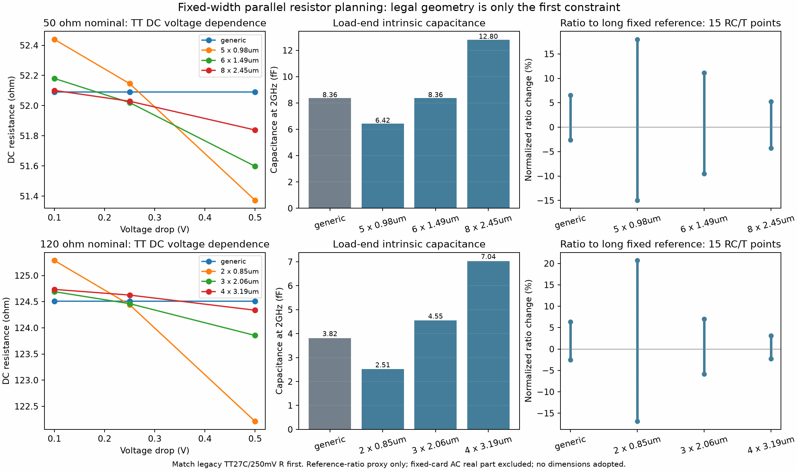

# 固定宽高阻负载：并联规划与模型核对

**TX不能直接套用当前单只固定宽电阻映射。** 120Ω预驱、50Ω端接会算出负长度；240Ω虽有正长度，短电阻的角点跟踪也与旧通用卡相差较大。已完成合法并联候选的1080组无源测量。固定卡AC实部差异已进一步定位到动态立方的导数，并在[独立模型副本](fixed_poly_ac_overlay.md)完成1080点和微小瞬态验证；本报告保留原卡观测，暂未采用新网络或修改生产DUT。



## 规划边界

器件为`sky130_fd_pr__res_high_po_2p85`，体端接VSS。本机Magic生成器给出`lmin=0.50µm`，规划长度取0.01µm网格；每条支路发成独立X实例，不用一个乘数隐去物理数量。该下限只约束规划，不代表新网络已经过版图DRC/LVS或电流容量检查。

先测旧通用卡在TT/27°C/250mV压降下的实际阻值，再匹配该电气点：名义50/120/240/400Ω实际为52.090/124.512/247.223/409.881Ω。目标是隔离实现变化，不把旧映射的近似误差混入比较。后续若改回精确名义值，需要另做尺寸/偏置规划。

固定卡接触项含电压系数及`1/L`。TT/27°C/250mV下用9个长度点0.5–8µm校准：

`R(L) = 130.360 + 113.569465 × L + 18.689449 / L`（Ω，L单位µm）。

最大拟合偏差约1e−12Ω，是这张卡在该偏置点的确定性复现，不是工艺精度或预测保证。最短合法L0.5时为224.524Ω；4只并联最低约56.13Ω，匹配不了旧52.09Ω端接，5只才有合法解。只把“138+112L”往短尺寸外推会错误地认为4只足够。

测量网格为tt/ll/hh/hl/lh五个RC角、−40/27/85°C、0.1/0.25/0.5V压降；24个网络，共1080行。hl/lh分别表示R高/C低、R低/C高；本卡没有MOS，也不计为MOS45点资格。AC频率2GHz，电源轨与体端为AC地。

## 并联数量的代价

| 原名义值 | 固定2p85候选 | TT实际R Ω | 单个负载输出端显式C fF | 相对长参考的比值变化范围 |
|---|---|---:|---:|---:|
| 50Ω旧通用卡 | 原映射 | 52.090 | 8.364 | −2.59…+6.52% |
| 50Ω | 5并、每只L0.98 | 52.146 | 6.423 | −14.96…+17.97% |
| 50Ω | 6并、每只L1.49 | 52.020 | 8.364 | −9.49…+11.10% |
| 50Ω | 8并、每只L2.45 | 52.029 | 12.801 | −4.25…+5.24% |
| 120Ω旧通用卡 | 原映射 | 124.512 | 3.816 | −2.56…+6.40% |
| 120Ω | 2并、每只L0.85 | 124.441 | 2.513 | −16.91…+20.68% |
| 120Ω | 3并、每只L2.06 | 124.462 | 4.549 | −5.87…+7.00% |
| 120Ω | 4并、每只L3.19 | 124.626 | 7.036 | −2.26…+3.13% |
| 240Ω | 单只L0.83 | 247.140 | 1.252 | −17.23…+21.15% |
| 240Ω | 2并、每只L3.15 | 247.018 | 3.501 | −2.34…+3.21% |
| 400Ω | 单只L2.39 | 409.611 | 1.587 | −4.47…+5.48% |
| 400Ω | 2并、每只L6.04 | 409.707 | 4.741 | −1.07…+1.08% |

TT的R/C取27°C、250mV。C是PDK模型在负载端的本征导纳虚部，不含走线、MOS或焊盘。比值用1p41、L42.36µm的长电阻作代理，固定250mV压降，归一到TT27°C，再扫15个RC/温度点；**不是实际112kΩ＋修调串、Vbg或偏置环路的I·R结果**。旧通用负载与该固定参考比较也不是旧整机摆幅资格。

结果说明最少并联数只解决几何，未解决跟踪。加长每只单元、增加并联数，可降低接触项占比，但增加面积和节点电容。下一轮值得比较120Ω的3/4并、240Ω的2并及50Ω更多并联数，并用实际参考与当前完整TX确认；本轮不据代理比值选定网络或设新门槛。

[端接电流与AC耦合状态](tx_coupling_state.md)进一步补上电流边界：旧45点短记录估计本地峰4.69mA，新的已使能DC初态局部对照测得6.62mA。2p85五并虽可解几何，不能据此默认满足推荐电流使用区间；更多并联或更宽单元的候选需连同寄生和实际参考一起规划，尚未采用新网络。

后续[宽度与并联数联合规划](wide_load_planning.md)已完成2p85/5p73的45网络、2700行比较，并独立复跑两种L10原语的DRC/LVS/三端连接。按局部6.619mA峰值规划，2p85×24/5p73×12的50Ω端口C分别76.47/67.66fF，较宽单元降低约11.5%，面积相近；完整参考/电流/电路和网络版图仍待验，未采用新网络。原报告的单宽度测量范围和结论保留。

## AC实部交叉检查

在同一TT/27°C/250mV工作点，分别做±1mV DC、1mV/2GHz正弦瞬态和AC。瞬态只用最后两周期拟合电压/电流基波，不把直流电流当导纳。

| 网络 | DC微分电阻 Ω | 瞬态电阻 Ω | AC电阻 Ω |
|---|---:|---:|---:|
| 旧通用50Ω | 52.08974 | 52.08974 | 52.08974 |
| 固定50Ω、5并 | 51.53838 | 51.53839 | 46.56392 |
| 固定50Ω、8并 | 51.87851 | 51.87851 | 50.51439 |
| 旧通用120Ω | 124.51163 | 124.51163 | 124.51163 |
| 固定120Ω、2并 | 122.69295 | 122.69296 | 108.70098 |
| 固定120Ω、4并 | 124.39785 | 124.39785 | 122.27806 |
| 固定400Ω、单只 | 408.37415 | 408.37416 | 397.20219 |

固定120Ω两并的AC实部比DC微分低约11.4%，不是由DC阻值52/50这一类名义误差解释的。该诊断中，DC微分和瞬态吻合，电容的AC/瞬态也在约6e−6相对差内。**原卡AC实部保留为历史观测，不直接用于物理阻抗/传递模型选型。** 新的[立方导数修正验证](fixed_poly_ac_overlay.md)已消除所测网格中的差异，消费者可显式使用经记录的模型副本。生产DUT、新尺寸、噪声和真实偏置资格仍需分别验证。

## 执行与证据

主campaign：`results/analog/common/devices/fixed_load_card/20261111T133044.144773Z_20c38295`；每RC角一个deck，短OP/AC合并加载模型，按角续跑。首轮`20261111T132718.601205Z_547dca7d`的求解完成，但通用波形读取器不支持AC复数标记；保留失败解析记录，未覆盖。新增标量读取器严格检查点数、频率、有限值和完整payload，不丢弃复数观测的虚部。

交叉检查：`fixed_load_ac_check/20261111T133339.231456Z_e705b415`。物理run完整，原分析器因OP的重复scale向量名中断；修正后的分析只读回收旧run，并另存`analysis/20261111T162846.908951Z_30fb9ba0`，未重跑或改写原计划。发布器重新读取全部90个OP/AC文件的1080行数据，以及诊断原始波形、deck/log和哈希。

[数据](../data/fixed_load_card.json)、[索引](../../results/catalog/fixed_load_card.json)、[规划器](../../src/serdes_flow/resistor_networks.py)、[主卡](../../analog/common/devices/tb/passive_card/fixed_load_card.py)、[诊断/只读复算](../../analog/common/devices/tb/passive_card/fixed_load_ac_check.py)。

```bash
uv run python verification/plotting/fixed_load_card.py --summary results/analog/common/devices/fixed_load_card/20261111T133044.144773Z_20c38295/analysis/measurement/summary.json --diagnostic results/analog/common/devices/fixed_load_ac_check/20261111T133339.231456Z_e705b415/analysis/20261111T162846.908951Z_30fb9ba0/summary.json
```
