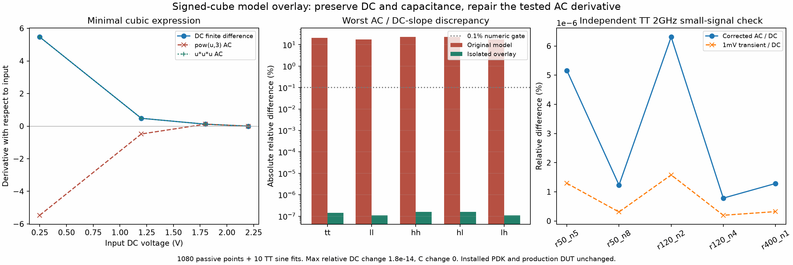

# 固定多晶电阻的AC导数修正与验证

**已找到固定高阻卡AC差异的直接原因，并在独立模型副本中消除。** 本项目ngspice47/HSA配置下，负底数的`pow(x,3)`保留正确的有符号DC值，却给出反号的AC导数；固定1p41/2p85卡的接触电阻使用了这个表达式。只把该动态立方写成显式三次相乘后，1080个无源条件的AC与DC微分吻合，DC和电容保持不变。原PDK、生产DUT及Claude正在运行的工作区/MC没有修改。



该修正解决小信号导数，不改变[并联规划卡](fixed_load_resistors.md)测得的真实阻值、温度/角点跟踪或电容代价。120/50Ω的单只映射非法、240Ω短单元的跟踪风险仍然存在；没有采用新电阻网络。

## 最小复现

不加载PDK，用同一输入驱动十种表达式；测五个输入DC点的±10µV差分和AC导数，再在0.25V上做1mV/2GHz瞬态。核心变量是`u=min(abs(Vx)-1.6,0.4)`，与2p85卡的接触电阻相同。

| Vx=0.25V，u=−1.35 | DC值 | DC微分 | AC导数 | 瞬态基波增益 |
|---|---:|---:|---:|---:|
| `pow(u,2)` | 1.8225 | −2.7000 | −2.7000 | −2.7000 |
| `pow(u,3)` | −2.460375 | +5.4675 | **−5.4675** | +5.467501 |
| `u*u*u` | −2.460375 | +5.4675 | +5.4675 | +5.467501 |
| `u**3` | −2.460375 | +5.4675 | +5.4675 | +5.467501 |

在正底数点及限幅平台也做了对照，完整50行在数据中。原接触多项式的AC导数为−0.64173075，而DC微分、显式乘积与Horner形式约−0.06326925。差异因此可在没有PDK、寄生、电流提取或串并联网络的情况下复现。

[ngspice手册](https://ngspice.sourceforge.io/docs/ngspice-manual.pdf)的3.3.4和5.1节给出了行为电阻及基于工作点导数的AC解释。上游[历史问题336](https://sourceforge.net/p/ngspice/bugs/336/)涉及幂函数求导，但该旧讨论不证明本机版本的修复状态；这里以当前二进制的独立实验作为证据。不把结论扩展到其他模式、版本、指数或所有表达式。

## 独立模型副本

[`pdk_overlays.fixed_poly_library`](../../src/serdes_flow/pdk_overlays.py)把本机模型树复制到新的结果目录，保留相对include关系；仅在两张卡的`rend`动态表达式中，将唯一的`pow(min(abs(v(r0,r1))-…,…),3)`换成等价乘积。参数中的幂、平方项、器件几何、随机量、温度系数和其他模型文件均不变。

每个原文件、修改前后文件及被替换片段都在`models/overlay.json`记录SHA；逐文件核对副本只有两处声明过的变化，并核对原PDK未变。已有目标目录、未知模型、缺失/重复立方和已修过的输入都会拒绝。消费者必须显式选择该库，默认库路径未切换。这不是官方PDK更新。

## 全网格与瞬态验证

保持首轮的24个物理网络及几何不变，覆盖tt/ll/hh/hl/lh、−40/27/85°C、0.1/0.25/0.5V压降，共1080点。每点保留原样OP、±100µV电流差分和2GHz AC；按RC角合并短分析，单worker执行。

| 检查 | 数值验收门槛 | 实测最大差 |
|---|---:|---:|
| 相对原卡DC阻值变化 | 1e−8相对 | **1.83e−14** |
| 相对原卡节点C变化 | 1e−8相对 | **0** |
| 新AC电阻与DC差分 | 0.1%相对 | **1.59e−9相对** |
| TT十网络：1mV/2GHz瞬态与新AC电阻 | 0.01%相对 | **4.73e−8相对** |
| TT十网络：瞬态与新AC节点C | 记录差异 | **3.29e−6相对** |

这些是数值一致性门槛，不是新增的电路规格。旧卡相对正确微分电阻的最大差为**22.81%**，出现在240Ω单只、hh、−40°C、0.5V。该点新AC为300.417250Ω，DC微分为300.417250Ω；原卡DC阻值323.414360Ω也保持不变。静态V/I、增量电阻和负载端电容各自记录，没有混用。

| TT/27°C/250mV | 原AC Ω | 修正AC Ω | 1mV瞬态 Ω |
|---|---:|---:|---:|
| 50Ω、5并L0.98 | 46.56392 | 51.53838 | 51.53839 |
| 50Ω、8并L2.45 | 50.51439 | 51.87851 | 51.87851 |
| 120Ω、2并L0.85 | 108.70098 | 122.69295 | 122.69296 |
| 120Ω、4并L3.19 | 122.27806 | 124.39785 | 124.39785 |
| 400Ω、单只L2.39 | 397.20219 | 408.37415 | 408.37416 |

1080点中的C是PDK本征端点导纳，不含布线或MOS。十个TT弱正弦对照不替代大信号全角、完整偏置、噪声/失配、环路稳定性或版图电气回测；生产电路使用该副本后还须保留自己的源/负载和迭代身份。

## 复算与后续接口

模型副本campaign：`results/analog/common/devices/fixed_load_overlay/20261111T164932.207264Z_a0c98cb1`；最小复现：`linearization_probe/20261111T164456.854485Z_452ce563`。原始模型和首轮观测完整保留。

[摘要](../data/fixed_load_overlay.json)、[索引](../../results/catalog/fixed_load_overlay.json)、[原始验证入口](../../analog/common/devices/tb/passive_card/fixed_load_overlay.py)。发布器重新读取全部180个OP/AC/差分文件、50个表达式导数及十个原始瞬态拟合，并检查源、模型和执行身份。

```bash
uv run python verification/plotting/fixed_load_overlay.py --summary results/analog/common/devices/fixed_load_overlay/20261111T164932.207264Z_a0c98cb1/analysis/measurement/summary.json --expression results/analog/common/devices/linearization_probe/20261111T164456.854485Z_452ce563/summary.json
```

下一步在新的物理负载/弱输入卡中显式引用这个已记录的库，再比较合法并联方案和当前TX负载。不得通过修改旧campaign的库路径把历史观测重标成通过；不得直接改装在跑任务使用的PDK。
