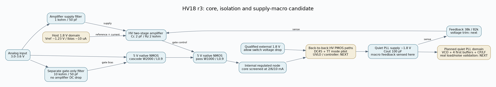
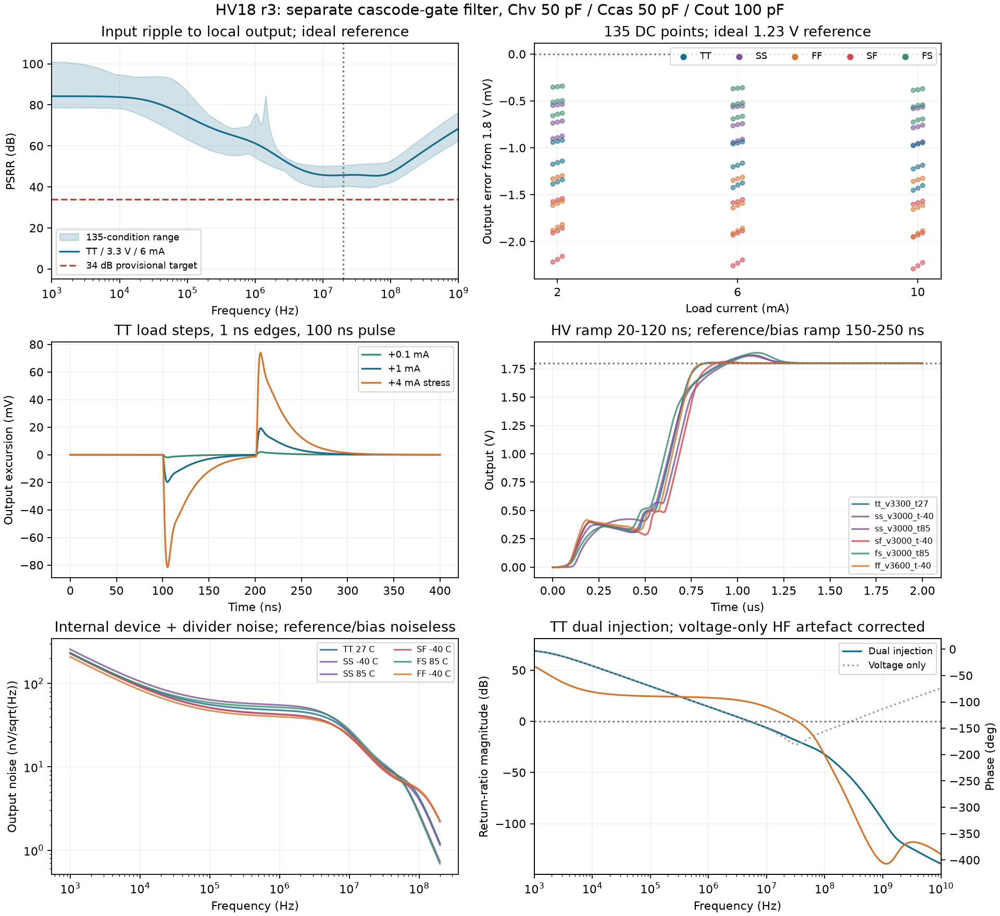
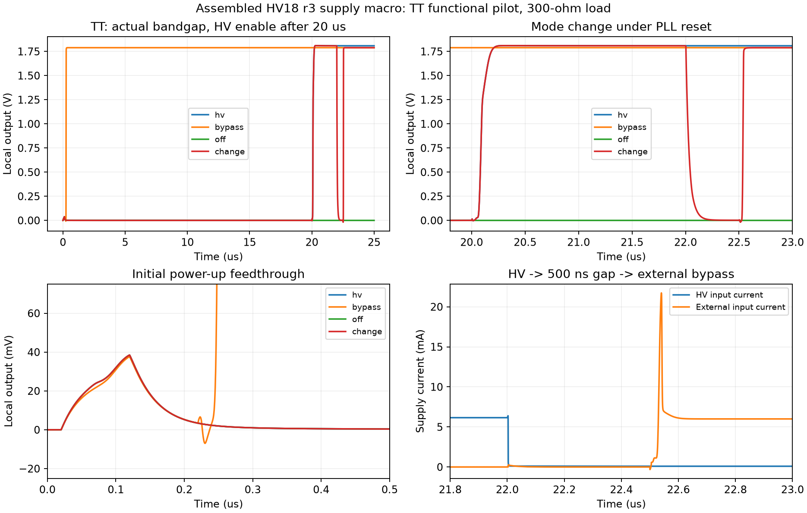

# PLL 安静供电：HV18

3.3 V→1.8 V 主路线已进入晶体管级实现。当前候选为 **r3：双原生 NMOS 调整路径、独立隔离级栅极滤波、两级 HV 误差放大器**，另有背靠背 HV PMOS 隔离单元和稳压/外供旁路供电宏。它们仍是版图前局部候选，尚未替换现行 PLL 的供电。

入口：[电路与测试台](../../analog/common/ldo/README.md)、[工作修订](../../config/ldo_working_revision.toml)、[现有功耗审计](power_audit.md)。历史架构比较保留在[供电 VAR 规划](pll_supply_variants.md)；其中“本轮不仿真”只描述当次规划，不代表本次实现阶段。

## 当前电路与边界

供电宏的输入是 3.0–3.6 V 模拟电源、宿主 1.8 V、合格外供 1.8 V，以及宿主带隙 Vbg/vgi；输出为 PLL 安静域。`sel_hv`、`sel_ext` 必须互斥，两者均为零表示关闭；模式切换须保持 PLL 复位，控制器还需确认参考与高压电源有效。当前 cell 没有 UVLO、参考就绪检测或自动模式控制，不能按无缝切换使用。

安静域拟包含 VCO、四个首级时钟 buffer、CP/LF、本地偏置和预充。分频器、其余时钟接收/分发、TX/RX 保留宿主供电。LF 电容参考端、阵列码驱动及预充必须逐项归属供电域；不能把 VCO 换电源后继续默认沿用旧供电抵消关系。

- 主调整管为 `nfet_05v0_nvt`，总 W1000 µm、L0.9 µm、100 指；上方隔离级 W2000/L0.9、200 指。原生 03v3 型不用于本方案的 3.6 V 输入/启动路径。5 V 原生器件和 HV 增强型器件的模型边界见 [PDK 器件说明](https://skywater-pdk.readthedocs.io/en/main/rules/device-details.html#v-native-nmos-fet)。模型范围不代替瞬态应力检查。
- 隔离级 gate 单独从输入经 10 kΩ/50 pF 滤波，不承载放大器直流电流；放大器另用 1 kΩ/50 pF。这样在相同 MIM 总电容下保留最低输入时的调节余量。
- 放大器为 HV PMOS 输入对、NMOS 镜像负载及 NMOS 共源第二级，Miller 2 pF/串联 2 kΩ。宿主 PMOS 电流拷贝把约 10 µA 送入本地 HV 二极管；不跨电源域直接复用 PMOS gate 偏置。
- 反馈比为 38 kΩ/82 kΩ，输出去耦 100 pF，100 kΩ 泄放。供电宏在隔离开关**之后**取反馈，稳态会补偿稳压路径的开关压降；旁路的压降无法由反馈补偿。
- 两条供电路径各有一对共 source/well 的背靠背 HV PMOS，关闭时 gate 跟踪共井节点。单元 DC 不等于模式控制/掉电过程已验证。

MOS 的AD/AS/周长按未共享指估算；物理接触、井和布线寄生尚未提取。

## 迭代结果

| 迭代 | 改动 | TT、6 mA、20 MHz 抑制 | 结论 |
|---|---|---:|---|
| r1 | 单原生调整管、基本两级放大器 | 23.8 dB | 不够；单纯增大放大器滤波后约 27 dB 即趋于平台 |
| r2 | 增加原生隔离级，其 gate 接放大器滤波供电 | 50 pF 时 40.1 dB | 最差 10 mA 仅 31.0 dB；100 pF 后理想参考全角最差 36.5 dB |
| r3 | 隔离级 gate 使用独立 10 kΩ/50 pF，放大器 1 kΩ/50 pF | 见结果图 | 总 MIM 仍约 202 pF；真实参考下全角最差 39.9 dB |

r3 两组各 135 点：MOS 五角 × 3.0/3.3/3.6 V × 三温 × 2/6/10 mA。理想 1.23 V/10 µA 边界输出 1.7977–1.7997 V，20 MHz 最差 40.33 dB；接入实际带隙与 n=4 电流拷贝后输出 **1.7934–1.8147 V**，最差 **39.90 dB**。后者宿主固定 1.8 V，不能据此宣称宿主 1.65–1.95 V、参考失配和电阻角都完成。[逐点数据与身份](../data/ldo_characterization.json)、[结果索引](../../results/catalog/ldo_characterization.json)。

真实参考条件下，宿主 1.8 V→输出的 20 MHz 耦合另测为约 0.0015–0.0037 V/V。两路电源的噪声须分别计入；不能只根据 3.3 V PSRR 判断完整输出谱。暂以 100 mVpp 输入单音→≤2 mVpp 输出（34 dB）作为内部规划目标，并非改写原 PLL 抖动规格。

## 稳定性与动态测量

单电压注入 `−V(div)/V(fb)` 在约数百 MHz 有再次向上穿越，不能只取低频向下交越就宣称稳定。双注入增加向放大器输入的 1 A AC 电流，取 `Ti=I(Vtest)/(1−I(Vtest))`，与 `Tv` 合成 `(Tv*Ti−1)/(Tv+Ti+2)`，检查全部交越和高频衰减；参考 [Middlebrook 双注入说明](https://ez.analog.com/ez-blogs/b/engineerzone-spotlight/posts/so-many-middlebrooks-which-stability-method-wins-part-5-of-7)。r2 TT 复核的真实交越约 5.09 MHz、PM79.4°，高频单注入上穿消失。r3 的135点各有一个向下交越，**4.12–6.38 MHz、PM75.05–82.36°**；扫至10GHz时增益均小于1.7e-7，所测频段距−1点最小约0.839。它不替代新增开关后的供电宏及宿主带隙内部环路验证。

局部瞬态用理想参考和电流偏置，负载阶跃 6→6.1/7/10 mA、1 ns 边沿、100 ns 保持；启动以电阻负载代替不应在零电压强行抽流的理想电流源，不使用 `.ic/uic`。六个压力条件覆盖 TT、SS 冷/热、SF 冷、FS 热、FF 冷。较大的 4 mA 跳变是压力激励，不能当作实际 PLL 电流波形或新通过门槛。

r3 六点下冲为：100µA跳变1.46–2.54mV，1mA跳变14.67–25.55mV，4mA压力跳变60.2–104.5mV。100mVpp/20MHz输入时输出单音0.300–0.854mVpp（6mA负载）。**不受控的核心上电峰值最高1.892V**：隔离级慢RC建立期间误差放大器会饱和，不能把“最终收敛”写成“启动通过”。供电宏采用等待HV/参考稳定、核心夹栅与隔离开关联动的流程，须在全角确认这个顺序。

noise 分析包含核心和理想电阻的器件噪声，参考、电流源无噪；频带 1 kHz–约199.5 MHz。实际带隙、偏置拷贝、码驱动及源电源 PSD 未合并，尚不对 LDO 新增 PLL 抖动作通过判定。HV 模型 noise 的接触电导复位警告保留在日志，不能据执行成功推断模型噪声已经校准。

六点核心自身噪声约142.5–165.1µVrms。供电宏TT真实带隙启动pilot：20µs使能稳压，最终1.8088V、峰值1.8107V；无3.3V时旁路最终1.7891V，回灌高压端约11.6nA。两路关闭最终约4.9µV，HV仍消耗约94µA；这只是夹栅关断，尚未节省放大器偏置。稳压→500ns断开间隔→旁路最终1.7891V，期间跌落并有约−18mV瞬态，**要求PLL复位，不是无缝切换**。上述均为TT、300Ω负载，未覆盖空载/全PVT/掉电。

旁路切入时给100pF充电的电源电流约22mA，超过稳态2–10mA筛选范围；需要作为模式测试的实际瞬态边界，不能把稳态额定负载误当成启动峰值上界。

## 功耗和面积

拟供的 VCO+四 buffer+CP 名义约 5.74 mA、10.33 mW；这是尺寸估算，不是全 PVT 上界。3.3→1.8 V 的调整路径损耗约 **8.61 mW**，再加放大器、分压、泄放和开关驱动静态电流。核心 `iq_ua` 是 Vin 电流减负载与 100 kΩ 泄放后的量，包含分压，约 102–110 µA；不包括宿主偏置供电。真实参考 bench 的宿主约 0.11–0.14 mW 还包含整套带隙，系统共享时不能重复计费。大致应按每个安静域新增约 **9 mW** 规划，完整 PLL 仍需电流实测。

202 pF 按现有系数约 0.176 mm²，仅为电容估算；两条路径的开关沟道面积合计另约 0.031 mm²，井、保护、布线和 MOS 外围尚未计入。后续可优化开关宽度和滤波，但功能/PVT/噪声优先。

旁路开关在 45 条件、外供 1.65/1.8/1.95 V、控制高电平1.65 V 下，10 mA 压降约 **10.7–31.4 mV**；关闭时输入扫0–1.95 V、另一端固定相应电压，最差约 **9.55 nA**。因此 **1.65 V 外供不保证负载端仍有1.65 V**。旁路电压下限必须留压降预算（例如先按≥1.70 V规划），或另行验证更低本地供电；不静默扩大旧电路的已测范围。

## 下一轮闭合项

1. 映射 PDK 电阻/MIM，核对独立电源范围、ll/tt/hh 与电容容差；复核最差 PSRR 和全部交越。
2. 完成宿主1.65/1.95 V、带隙/放大器失配和独立**电压**修调。现有 r_ref 码只修参考电流，不能消除 Vbg 的芯片间电压误差；不能用同一个 Vbg 自比实现绝对电压校准。
3. 供电宏的关断、冷启动、反灌、重叠/死区、掉电和再启动全角；加入 UVLO/ref-ready 与现有 PLL 监督器边界。真实带隙启动按微秒计，理想参考数百 ns 结果不能替代它。
4. 从当前 PLL 拆出真实目标电流、偏置/预充/码驱动边界，测锁定、切码和启动负载；再做局部供电传递及相噪预算，最后挑必要的 PLL 集成点确认。

VCO 1.5 V 保留后续路线。可复用参考接口、修调方法、模式管理和验证工具；本次双原生 NMOS 的压差需求不适合直接照搬到1.8→1.5 V，低压调整路径仍需另选。
