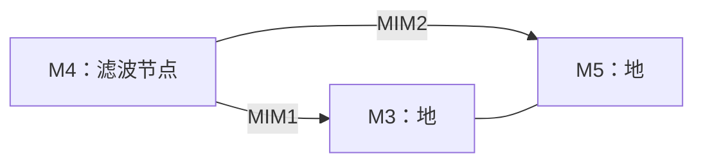
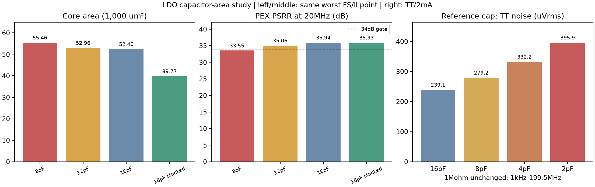

# LDO周边电容与面积：12pF和同值叠层

**12pF可实现，8pF不是工艺步长。当前更有效的面积候选是保持70pF电气数值、将核心32/16pF改为两层MIM并联：核心52,395.57→39,774.73µm²，缩小24.1%。** 12pF隔离栅在受检压力点通过，但本次2×6排布未缩小核心包围面积，暂不替代16pF。现有r4/PLL采用组合不改；这里是供电的局部候选迭代。

入口：[固定证据](../../config/ldo_cap_area_evidence.json)、[数据](../data/ldo_cap_area.json)、[结果索引](../../results/catalog/ldo_cap_area.json)、[第一轮70pF](ldo_smallcap.md)。

固定电容的同节点重分块、PCell尺寸范围、截止频率与串阻端头影响见[融合复核](../layout/capacitor_fusion.md#固定pf电容截止频率与其它融合点)；它是另一个物理候选，不改变本页采用边界。

## 盘点与计数边界

按实际实例展开，不把历史网表、备用定义或行为模型积分电容计入芯片面积。盘点脚本为[ldo_cap_inventory.py](../../verification/analysis/ldo_cap_inventory.py)。

| 所属 | 名义电容 | 用途与本轮决定 |
|---|---:|---|
| LDO放大器供电 | 32pF | 20MHz输入抑制；保容量，尝试叠层 |
| LDO隔离栅 | 16pF | 独立RC抑制输入到调整管漏端的耦合；比较8/12/16pF |
| LDO参考 | 16pF | BG/宿主纹波、参考噪声、软启动；直接减容的代价已测出，保留 |
| LDO输出、Miller补偿 | 4pF、2pF | 输出4pF已有快卸载过冲；本轮均保持 |
| 独立PLL尾偏置 | 16pF | 在本地CML二极管之后；不计入LDO的70pF，不改数值 |
| PLL环路积分 | 18pF | 定环路增益/零点，与CP匹配；不作为去耦电容直接缩减 |
| 一份共享参考 | 13pF | BG放大器补偿6pF、Vbg5pF、Vgi2pF；共享，只记一份 |
| 每份本地CML二极管 | 5pF | 电流拷贝与尾偏置线的高频去耦，实例数由所属模块决定 |

这些独立根不能简单相加成整片总量；当前采用PLL仍接原r4，70pF及叠层为局部候选。

## 为什么先前用了8的倍数

基础叶单元约1pF；大小由实际PDK几何定义，不存在8pF的电气量化限制。首轮阵列生成器用固定8行，让32pF的4×8和16pF的2×8与核心有源列等高，便于布线。它把布局选择写成了检查条件，不能解释为工艺规定。

12pF已经用12个真实MIM单元组成2×6，阵列和完整核心均DRC0/LVS通过。也可以选3×4，或重新选择单元W/L形成其他容量。任意改排布仍要比较电阻、护环、走线和有源列的整体包围面积。

## 隔离栅：8、12、16pF的实际比较

先保持名义RC约0.5µs，电阻分别62.5kΩ、41.667kΩ、31.25kΩ。每个电路先做TT、FS热ll、SS冷hh、SF热hh共10个局部DC/AC条件；下表PEX为同一FS/ll、HV3.0V、host1.95V、85°C、10mA压力点，不能把一个压力点当完整PEX网格。

| 隔离栅方案 | 原理图短筛最低PSRR | 该点核心PEX PSRR | 核心面积µm² | 结论 |
|---|---:|---:|---:|---|
| 8pF / 62.5kΩ | 34.59dB | **33.55dB** | 55,456.90 | 低于34dB门槛；长电阻还撑高了布局，不采用 |
| 12pF / 41.667kΩ | 35.98dB | **35.06dB** | 52,956.92 | 该点PM75.11°；可行的中间值，但当前排布无面积收益，未做其全PVT/MC/启动 |
| 16pF / 31.25kΩ，单层 | 36.77dB | **35.94dB** | 52,395.57 | 当前紧凑70pF物理对照 |
| 16pF / 31.25kΩ，叠层 | 36.77dB | **35.93dB** | **39,774.73** | 保持数值，减少物理占地；优先推进此物理候选 |

12pF的TT/2mA积分噪声239.105µVrms，与16pF的239.099µVrms接近。容量减少4pF后，电阻长度增加；阵列仍为两列，有源列仍决定高度。当前12pF核心248.385×213.205µm，并未自动变窄。这是本次布局结果，不是12pF在所有排布下都省不了面积的结论。

## 参考电容：减小容量的噪声代价

同一真实BG、相同负载和噪声分析方法，TT/27°C/2mA，积分1kHz–199.5MHz；宿主耦合列取上述10点短筛中1MHz的最大值，两列不是同一个工况。

| 参考R/C | TT输出噪声µVrms | 相对16pF/1MΩ | 宿主→quiet最大V/V |
|---|---:|---:|---:|
| 1MΩ/16pF | 239.10 | 对照 | 0.00673 |
| 1MΩ/8pF | 279.17 | +16.8% | 0.01393 |
| 1MΩ/4pF | 332.18 | +38.9% | 0.02772 |
| 1MΩ/2pF | 395.86 | +65.6% | 0.05298 |
| 2MΩ/8pF | 240.41 | +0.55% | 0.00378 |
| 2MΩ/4pF | 278.34 | +16.4% | 0.00762 |

2MΩ/8pF能接近原噪声，但现有参考滤波已经把1MΩ放在MIM下方。单份1MΩ电阻阵列约5,010µm²，双份约10,020µm²，已接近原完整1MΩ/16pF滤波块10,339.58µm²；容量减半并未提供同等比例的整体面积收益。噪声和宿主耦合尚无新放宽预算，因此这些参考缩容组合不作为替换。

## 同值叠层的构造与结果

M3与M5接地，中间M4接滤波节点，两层电容并联。32pF使用16个MIM1加16个MIM2，16pF使用8加8；仍是显式器件，不用mf倍乘名义电容。仅核心两组滤波改变电容层，参考16pF、输出4pF、Miller2pF及所有MOS/修调/电阻数值保持。



PDK的MIM1生成器有叠层兼容选项；上层器件镜像放置，使两层的底板接触位于相反侧，再按实际提取的端口接线。官方器件说明明确支持M3/M4两种MIM构造叠放，模型电压范围0–5V，覆盖这里的3.0–3.6V输入范围。[SkyWater器件说明](https://skywater-pdk.readthedocs.io/en/main/rules/device-details.html#mim-capacitors)

独立源：[叠层无源](../../analog/ldo/spice/ldo_stacked_passives.spice)、[核心](../../analog/ldo/spice/ldo_hv18_core_stacked.spice)、[供电宏](../../analog/ldo/spice/pll_supply_hv18_stacked.spice)。规范化去掉名称/注释后，与实际测试的stack_core70源一致。版图由[叠层阵列](../../analog/ldo/layout/build_stacked_mim.py)和[叠层核心](../../analog/ldo/layout/build_ldo_stacked_core.py)独立生成；已安装单层版图和生成器未改写。

| 检查 | 叠层候选自身结果 |
|---|---|
| 物理 | 16/32pF叶和核心DRC0、LVS、端口和未合并器件数通过；核心188.555×210.945µm |
| 原理图DC/AC | 1215DC、255AC，输出1.775953–1.814801V，最低PSRR36.77dB、最小PM76.72°，均过原局部门槛 |
| 模型精简复核 | 完整PDK与精简库的4模型、10条件、40张完整AC表逐值一致；MIM2显式纳入模型族，不用于MC |
| 核心电容PEX | 同身份5点短筛＋实际最差点，共6点；最低35.93dB、最小PM约75.03° |
| 启动 | TT、FS热ll、SS冷hh，各2/10mA，6条完整180µs；10mV内约75.7–116.1µs，TT约94.9µs |
| 独立噪声 | 同三工况、两负载，共6谱；约225.0–262.2µVrms，TT/2mA为239.099µVrms，与原70pF接近；每谱后核对两条调整管电流和输出偏置 |
| 局部MC初筛 | 完整PDK，TT/FS热ll各8颗；每颗27°C扫64码后保码，DC与10mA AC均过门槛；种子71、4颗/块，首样本独立重跑标量和完整AC谱复现 |
| 人工阶跃 | 仍有原输出4pF快卸载限制：FS人工±4mA/1ns峰1.984V，不接受该边界；未声明实际PLL负载通过 |

叠层MC的TT输出1.79724–1.80273V、FS热1.80722–1.81573V，受检最低PSRR36.59dB、PM76.17°。每角仅8颗，8/8通过的双侧95%通过率区间仍为63.1%–100%；不作量产良率或尾部外推，也不与旧16颗样本直接作配对。PNP无失配、g5直接Vth随机系数为零的模型盲点保持。

64码全扫用于独立LDO测试台的量程/选码评估，下游未接入；它不证明带实际负载的生产搜索协议安全。实际修调仍按接口约定在测量保护和使能顺序明确后实施。

## 适用范围与下一步

核心面积下降24.1%不等于完整供电宏或整片面积下降24.1%。第二层MIM占用M5，完整宏需要明确其地回流与布线预算；当前提取是器件/电容PEX，不含分布金属电阻、pad/ESD/封装。原理图噪声、原理图MC和名义核心PEX分别陈述，没有合并成PEX噪声/MC资格。

外围1MΩ/16pF另有2×4叠层滤波物理试验，保留32只真实高阻poly和16pF；完整滤波块面积10,339.58→6,226.62µm²（−39.8%），DRC0/LVS通过。三组RC/温度（TT27°C、FS/ll85°C、SS/hh−40°C）完整PDK的电容PEX被动小卡，分别加载1/5pF代理，截止频率变化0.068%–0.102%；TT/1pF的100Hz–100MHz自身热噪声15.2347→15.2418µVrms。纯DC工作点及每次noise后输出在10µV数值容差内核对；这不是原生VCO门负载或系统抖动预算。该候选不改变已采用外围电路，也不转移PLL尾偏置/捕获/抖动资格。具体记录见数据及索引。

后续先把叠层核心接入完整供电宏并提取，再承接真实PLL负载、使能/关断、ready和噪声/抖动预算。12pF保留为压力点已验证的备选；参考/尾偏置不因本轮面积目标直接减容。

## 复跑

每次生成或prepare使用新目录；仿真结果追加，不覆盖历史。数据和图从固定清单重建：

```bash
uv run python verification/analysis/ldo_cap_area.py --manifest config/ldo_cap_area_evidence.json
uv run pytest -q tests/test_ldo_cap_sizing.py tests/test_resistor_networks.py tests/test_feedback.py tests/test_doc_links.py
```


