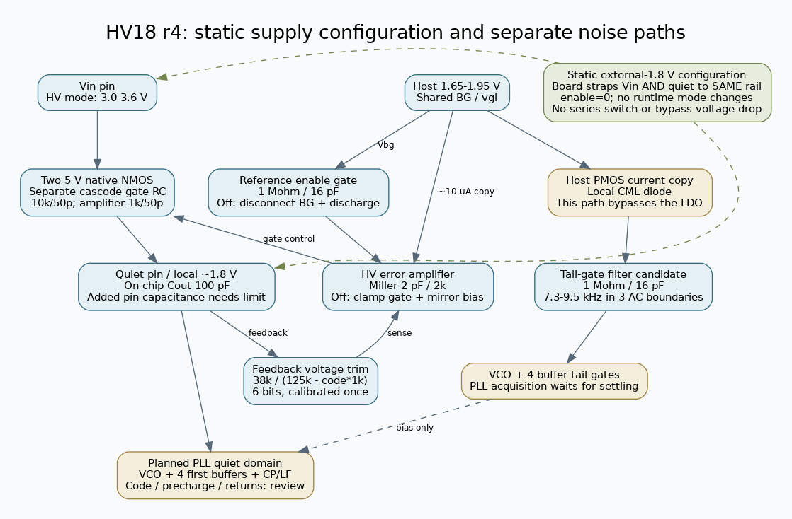
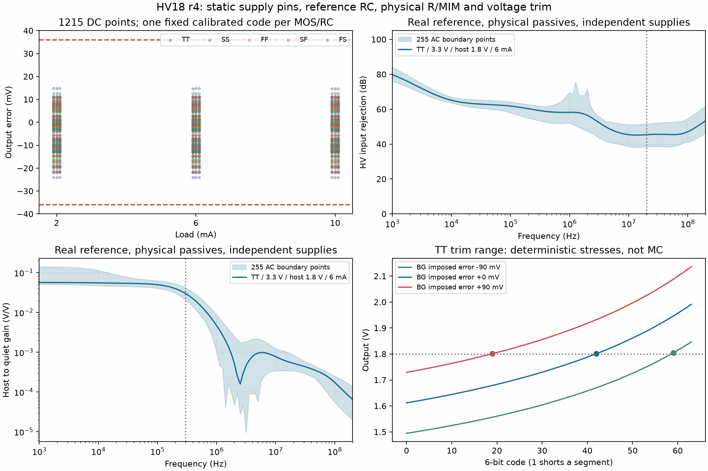
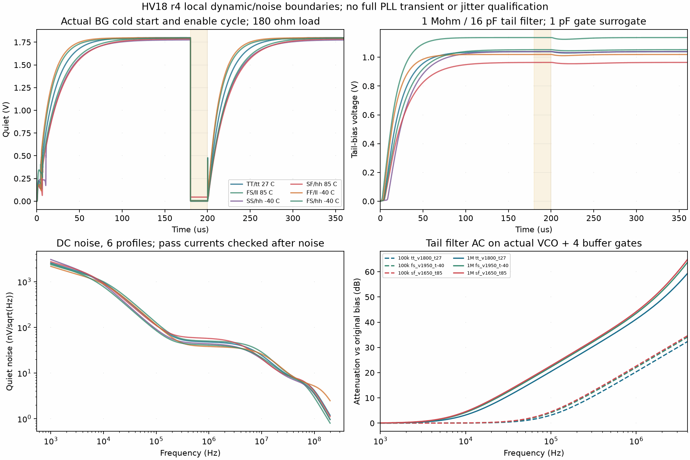
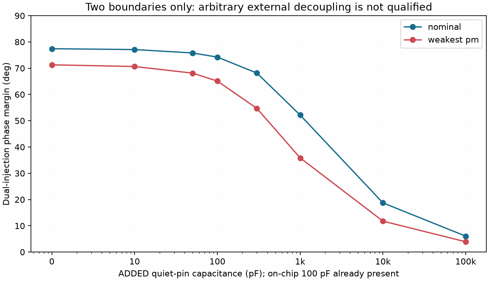
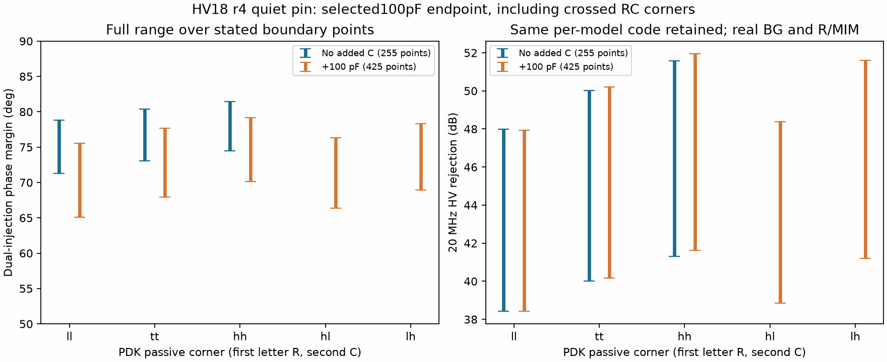

# PLL 安静供电：HV18 r4

> 2026-11-14：新增[70pF减容局部候选](ldo_smallcap.md)，已独立补原理图网格、启动/噪声和核心PEX压力点。下文保留r4原参数及其证据，原生PLL记录不自动转为减容版本通过。

**r4 是当前 LDO 候选：3.3→1.8 V 双原生 NMOS核心、静态供电接口、参考RC、6bit电压修调和PDK无源。** DC1215条件输出1.776–1.815V；AC255条件20MHz抑制最差38.44dB、PM71.28–81.43°。已接quiet PLL `r5k4q`，完成TT及三个压力条件×hv/ext共8条原生预充闭环锁定；这批结果继续保留。下一步承接r6实际负载、ready/从零启动和相应噪声预算，不重复未改动的r4局部网格。

入口：[工作修订](../../config/ldo_working_revision.toml)、[电路与复跑](../../analog/ldo/README.md)、[数据](../data/ldo_r4.json)、[结果索引](../../results/catalog/ldo_r4.json)、[交接包](../work_packages/WP-LDO-002-r4-handoff.md)。[r1–r3 记录](ldo.md)保留历史供电开关与模式实验，不能继续当作 r4 接口。

## 接口与适用范围

供电方式在初始化时确定，运行期间不切换。

| 配置 | Vin 引脚 | quiet 引脚 | enable | 集成要求 |
|---|---|---|---|---|
| 高压稳压 | 3.0–3.6 V | LDO 输出，目标 1.8 V | 宿主逻辑高 | 外部电容受稳定性约束；等待电源、参考与偏置建立 |
| 外供旁路 | 与 quiet 同一条合格 1.65–1.95 V 电源 | 外供电源输入 | 0 | **板上必须同源硬连 Vin 和 quiet**；该电源的噪声由集成方负责 |

旁路取消串联开关压降，也取消 r3 的背靠背开关及运行时先断后通流程。**Vin=0、quiet=1.8 V 并非 r4 的支持接法**；不能把静态等电位约定理解成任意反灌隔离。enable=0 关闭稳压和参考通路，不构成硬电源隔离：高压仍存在时，原生管漏电可在轻负载上留下约 85 mV；需要真正断电的负载应另行设计。

宿主 1.65–1.95 V 向共享带隙、电流拷贝和逻辑供电。生产 cell 为 `serdes_pll_supply_hv18_r4`，端口顺序是 `vin host quiet bg vgi enable t0 t1 t2 t3 t4 t5 vss`。`_probe` cell 仅把反馈断点引出供测试；生产 wrapper 将两端直接相连，没有测试源。

本轮局部 bench 采用独立电源、公共理想地、真实带隙与偏置拷贝。直流/交流负载是 2/6/10 mA 电流源；启动负载为 900/180 Ω、旁路为 300 Ω。启动还接入 n=85 CML 拷贝、本地二极管、1 MΩ/16 pF 尾偏置滤波、额外 12 pF vgi 分布负载和 1 pF 尾管栅负载代理。后两者不是提取后的真实 PLL。无 pad/ESD、供电回流、封装和布线提取，未覆盖任意负载跃变或低于 2 mA 的稳态工作区。

## 这次修改解决什么

原 r3 的高压输入纹波已有效压低，但宿主电源仍可经 Vbg 和尾偏置绕过 LDO。16:35 的[供电评估与接口记录](../work_packages/collaboration.md)据此提出静态 quiet 引脚、参考滤波及独立电压修调。带尾偏置的最新规划数据为 `ldo_supply_tolerance/20261110T102125Z`；其中“只滤参考后宿主容限超过 1.8 V”的早期结论已被修正，不能沿用。

1. Vbg 通过传输门后接 **1 MΩ/16 pF**；关闭时先隔离共享 BG，再夹低本地参考，使慢参考同时承担软启动。关闭还夹低放大器镜像偏置，避免仅夹输出 gate 时误差放大器持续工作。宿主电流拷贝本身仍在供流，不能按零静态电流记账。
2. 反馈上臂 38 kΩ；下臂 62 kΩ 固定项加 32/16/8/4/2/1 kΩ 六段，bit=1 短接对应段。该码修的是**输出电压**；已有带隙 r_ref 电流码不能代替它。NMOS 短路管的有限导通电阻已在本轮电路测量中包含。
3. 保留隔离级 gate 的 10 kΩ/50 pF、放大器供电 1 kΩ/50 pF、Miller 2 pF/2 kΩ 及输出 100 pF。R 使用 `high_po`，MIM 明确实例化 1 pF 叶单元，不用 `mf` 假定倍乘名义电容。
4. 独立增加 **1 MΩ/16 pF 尾偏置滤波**，位置是本地CML二极管之后、VCO与四个首级buffer尾管gate之前。电流拷贝/二极管留在原节点。已插入quiet PLL候选`r5k4q`；100kΩ/16pF版本保留作比较。

1 MΩ 采用 32 个约 31.25 kΩ 的 high_po 串联。独立噪声卡发现本机 ngspice 47 忽略模型的 `isnoisy=0`，普通 high_po 确实有热噪声；xhigh_po 的行为主体缺少相应噪声，名义 1 MΩ 仅表现约 160 Ω 的热噪声。改用串联 high_po 后实测等效 1.00069 MΩ、128.79 nV/√Hz。不能仅凭模型源码中的开关文字推断模拟器行为。[模型审计](../work_packages/deliveries/LDO-MODEL-20261110/summary.md)记录局部失配的另一组限制。

## 校准与稳态覆盖

先在每个 MOS/RC 模型的 HV3.3 V、host1.8 V、27 °C、6 mA 下扫描 64 码，选择最接近 1.8 V 的码；随后跨输入、宿主、温度和负载**保持该码不变**。这模拟每芯片一次校准，不是每个工况重新择码。15 个模型截面的码为 41–43，TT/tt 为 42。

工厂电压校准需要独立的绝对电压测量。首次从码 0 逐步向上寻找目标；全码扫会超过工作电压，必须在负载隔离的校准环境完成。TT 名义码 0 约 1.612 V、码 63 约 1.991 V；加 +90 mV 的参考误差后，高码可达 2.136 V。当前模拟修调单元没有自动限压、校准状态机或非易失存储。

TT 额外施加 Vbg −90/0/+90 mV 的确定性输入误差，64 码均单调；最佳码分别 59/42/19，输出 1.8042/1.8011/1.8010 V。**这只证明该名义电路的范围，不是 MC，也不证明极端工艺和随机失配联合覆盖。** 设置好的码在使能前稳定；不把多 bit 异步变化当作无毛刺在线调压。

| 测量 | 覆盖 | 结果 |
|---|---|---|
| 无源卡 | ll/tt/hh × 三温 × 0/1.23/3.3 V 共模，共 27 条 | TT27：1 MΩ→1.00069 MΩ；16 pF→16.00002 pF |
| 电压校准 | 15 模型×64 码，另加 TT 的 ±90 mV 扫描，共 1088 点 | 模型码 41–43；TT 误差压力码 19–59 |
| 直流 | 5 MOS×3 RC×3 HV×3 host×3 温度×3 负载，共 1215 点 | **1.77595–1.81480 V**，在内部 ±2% 电压目标内 |
| 输入纹波传递 | 每模型 16 个电压/温度/负载边界加名义点，共 255 点 | 20 MHz **38.44–51.57 dB** |
| 宿主→quiet | 同 255 点 | 300 kHz：0.0206–0.0412 V/V；1 MHz：0.00100–0.00878；20 MHz：0.000340–0.000854 |
| 双注入返回比 | 同 255 点，10 Hz–10 GHz | 各一次向下交越，**PM71.28–81.43°** |

这里的 RC 是 PDK 的 ll/tt/hh 组合库段，未查 hl/lh。全直流网格的交流测试只覆盖所列 255 个边界/名义点，不能写成 1215 点均做过交流。15 份完整网格日志均没有瞬态工作点回退；直流边界与交流偏置身份已核对。

## 冷启动、偏置滤波和噪声

六个模型压力条件，各含高压轻载、高压重载和静态旁路，共 18 条、每条完整 360 µs。HV/host 在 20–120 ns 斜坡，255 ns 使能；180–200 µs 关断后同模式重启。高压两负载启动最高约 **1.80116 V**，所测条件未出现 r3 不受控核心的 1.892 V 峰值；350–360 µs 输出均值 1.77415–1.80075 V，最慢条件在该窗口内仍有约 1.11 mV 变化。不能把这六点当成全 PVT 启动或零时间建立。

旁路 Vin/quiet 同源硬连，输出跟随 1.65/1.8/1.95 V；这是静态连法/启动负载测试，不是电源抑制测试。旁路 Vin 电流包含 300 Ω 负载，不能作为关闭 LDO 的静态电流。低压欠压、参考失效和慢斜坡尚需监督器处理。等待 100–200 µs 可作为控制规划起点；正式释放 PLL reset 的条件应核实 quiet **和尾偏置**，当前没有 quiet-ready/UVLO 电路或保证的等待时间。

尾偏置 AC 使用三份明确的原 PLL 边界 deck，包含实际 VCO 和四 buffer 栅负载、非振荡工作点。1 MΩ 版本的 −3 dB 频率 **7.31–9.53 kHz**，1 MHz 相对原节点改善 **41.2–44.2 dB**，4 MHz 改善 **59.4–64.9 dB**，直流压降可忽略。100 kΩ 版本仅为 74–96 kHz、1 MHz 改善 20.4–22.6 dB。串联电阻分布寄生在模型里使高频抑制更强；没有互连串扰/跨接电容/PEX，故不把 20 MHz 的约 100 dB 模型值当作物理保证。实际振荡时的尾管门耦合、码变化和捕获仍待局部联合验证。

噪声单独使用纯 DC 电源，含真实 BG、CML 拷贝和 PDK 无源，频带 1 kHz–约 199.5 MHz：

| 节点/负载 | 六条件积分噪声 | TT |
|---|---:|---:|
| quiet，约 2 mA | 201–246 µVrms | 231.0 µVrms |
| quiet，约 10 mA | 200–240 µVrms | 229.4 µVrms |
| 滤后尾偏置 | 34.0–51.5 µVrms | 40.8 µVrms |

早期启动测试后直接追加的 noise 结果作废，未进入发布数据。噪声分析会独立重求工作点；ngspice 默认回退瞬态仅 10 µs，短于参考 RC。即使预先 `.op` 正常，后续谱也可能在错误偏置下计算。现在允许 300 µs 回退，并在**每次 noise 后比对两条调整管电流**；旧错误样本被检查器拒绝。该检查并非逐一认证所有慢节点，尾偏置精确工作点仍可进一步加强检查。`nodeset` 只是 Newton 初猜，实际冷启动从零独立验证，不用 `.ic/uic` 代替启动。

数值反映现有模型与积分频带，未包含 1 kHz 以下漂移、真实外部电源 PSD 或完整相关噪声合成。quiet 与尾偏置共用 BG，不能简单当独立源作 RSS；需用完整传递/交叉谱，或明确的保守求和。**本轮没有给出新增 PLL 抖动通过结论。** 旧 r3 理想参考核心噪声与 r4 真实参考整支路的口径不同，不直接比较优劣。

## quiet 引脚的电容约束

在 TT 名义条件和网格最低 PM 条件（FS/ll、HV3.0 V、host1.95 V、85 °C、2 mA）分别增加理想对地电容；片上 100 pF 始终存在。双注入后另以调整管 Vbs 核对 quiet 偏置。

| 额外电容 | TT PM | 原最低 PM 边界 |
|---:|---:|---:|
| 0 | 77.4° | 71.3° |
| 100 pF | 74.2° | 65.1° |
| 300 pF | 68.2° | 54.7° |
| 1 nF | 52.1° | 35.8° |
| 10 nF | 18.7° | 11.8° |
| 100 nF | 6.0° | 3.9° |

因此，高压模式的 quiet 引脚**不能承诺任意外接 nF/µF 去耦**。额外 ≤100 pF 可作为引脚负载规划；100 pF 端点已完成下述补测，仍需 pad/ESD/package 与电容区间验证，不是已签核上限。若宿主必须在该引脚挂大电容，需要重新补偿或改供电结构，不能只补一句集成建议。旁路模式 LDO 关闭，外部电源的去耦由其自身稳定性决定。

追加的 **100 pF 端点**覆盖5个MOS角×5个RC库段（ll/tt/hh/hl/lh）×17个电压/温度/负载边界及名义点，共 **425 条DC/AC**。沿用原来同电阻角的电压码，改变电容角后DC差小于0.6nV；没有按新条件重调码。每条双注入均只有一个向下交越，**PM65.07–79.16°，20MHz抑制38.44–51.94dB**；25份日志均无瞬态OP回退。最差PM现在为FS/ll、HV3.6V、host1.95V、85°C、2mA，不能用原无附加电容最差点代替端点扫描。

这补齐的是固定100pF理想附加电容的所列边界，不包含所有中间电容值、真实ESR/封装寄生或新增电容下的启动/真实PLL动态。完整输入身份、逐点结果和重画参数见[端点数据](../data/ldo_r4_pin_cap.json)与[索引](../../results/catalog/ldo_r4_pin_cap.json)。

## 功耗、面积与下一道边界

原生接入已由`pll_core_r5k4q`/`clock_frontend_r5q`建立：VCO、首buffer、CP/LF在quiet，PFD/预分频/接收器在host，码驱动取quiet，CP的vbp二极管取quiet。TT高压配置quiet1.80109V、锁定后纹波1.527mVpp、约310ns捕获；外供配置quiet1.8V、约118ns捕获，两者最终约2GHz、相差33ps。该实验从参考/LDO/尾偏置已建立的OP开始，52ns释放PFD复位，不能作为真实冷启动。明确来源与复算见[TT原生数据/窗口检查](../data/native_pll_cost.json)。

[最新供电模型](pll_loop.md#供电路径与hv18稳压2026-11-10)已合并r4和尾滤波的现有谱，给出新增抖动约0.23ps的模型上界；尚缺宿主域定时单元、部分偏置/驱动路径和完整原生噪声。数百mV或1V级“容限”是小信号线性外推，不是允许输入真实摆幅；Vin/host仍须维持其器件和接口电压范围。

既有[功耗审计](power_audit.md)仍适用：完整 TX TT 约 103 mW，45 条件约 86–119 mW；当前 RX 的 30.36 mW 是单压力点，不能与不同边界直接相加成完整 SerDes 功耗。拟供安静域名义约 5.74 mA、10.33 mW；3.3→1.8 V 路径损耗约 8.61 mW，加控制开销仍按每 PLL 新增约 9 mW 规划。

r4 Vin 电流减主负载为 105–147 µA，包含泄放和反馈，不能全部记为放大器静态电流。直流 bench 宿主功耗 0.091–0.177 mW 含整套 BG 与本地拷贝，共享 BG 时不能重复计费；启动 bench 另有 n=85 分配支路，其宿主消耗口径不同。

核心 MIM202 pF 加参考16 pF，共218 pF，按项目当前系数约 **0.190 mm²**；尾滤波另16 pF、约0.014 mm²。去掉 r3 四只大开关，省去约0.031 mm² 沟道；两个1 MΩ电阻、保护/井/布线等另计，这些不是版图实测面积。

交接优先级如下；每一步先在该边界测量，再挑必要的已有 PLL 顶层点确认。

1. **供电域接线**：quiet 归属 VCO、首级 buffer、CP/LF、预充与码驱动；逐个审查 LF 电容返回端和监测窗口。host 与 quiet 可以不同电压，原来相对 host VDD 的窗口门限不能直接视作 quiet 域门限。CP 偏置及数字驱动还有独立纹波路径。
2. **真实负载与引脚电容**：100pF理想端点PVT已补；提取上述模块的DC/动态负载与gate负载，加入真实引脚/寄生及电容区间，再安排启动、负载阶跃、捕获和切码的短联合实验。r3的负载阶跃数值不是r4动态资格。
3. **控制与工厂修调**：存储电压码、保持初始化状态、quiet/bias-ready 与失效复位；验证实际校准流程而非只扫静态码。
4. **噪声/统计**：将 r4 的两路电源传递和独立尾偏置路径带回 PLL 模型，合并相关噪声和抖动。HV NMOS/PMOS 的直接 Vth 随机系数为零，PNP 等也有模型缺口；先验证采样独立性/几何解释，再决定 MC 与显式失调压力的分工，不能把 PVT 或 ±90 mV 误差扫描称为失配完成。

VCO 1.5 V 继续保留后续迭代。参考、修调和边界验证可复用；本次高压双原生调整路径不能直接当作 1.8→1.5 V 的低压 LDO。
