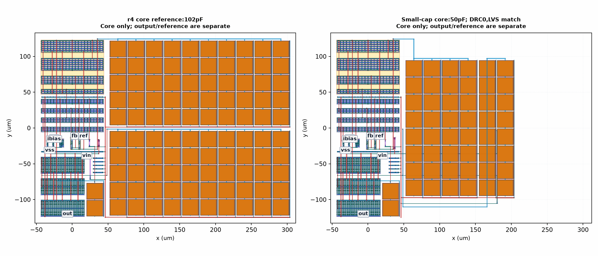
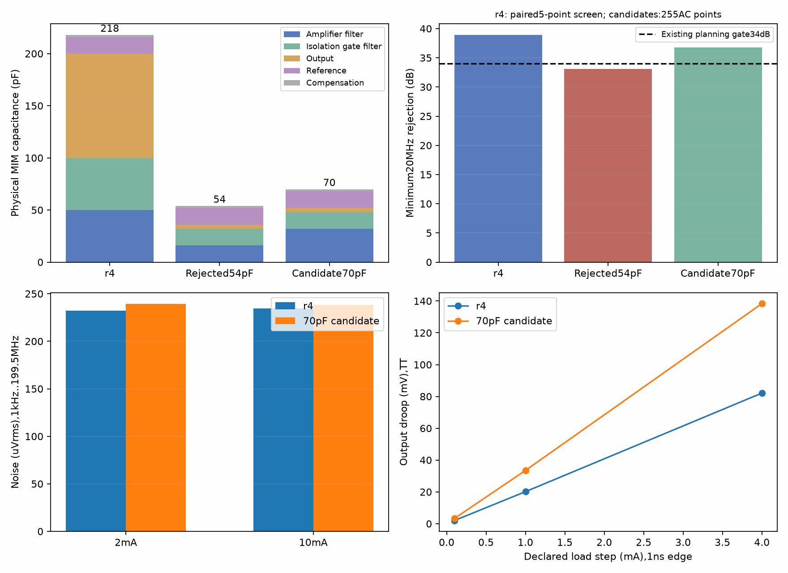

# LDO减容：70pF局部候选

**选用 `b32_h2` 的70pF电气数值作为减容基点：本体MIM从218pF降到70pF（−67.9%），核心从102pF降到50pF。** 首轮核心通过full-rule DRC/LVS/端口检查，面积0.087021→0.062096mm²（−28.64%）；本页下表和旧PEX证据对应该首轮。后续单层紧凑核心已至0.052396mm²，新增[第二轮电容/面积迭代](ldo_cap_area.md)验证12pF及同值叠层候选，后者核心0.039775mm²。各提取快照分开追溯，原r4/PLL采用状态保留。

入口：[电路核心](../../analog/ldo/spice/ldo_hv18_core_smallcap.spice)、[供电宏](../../analog/ldo/spice/pll_supply_hv18_smallcap.spice)、[物理候选](../../results/catalog/retired_pre_release_20261123.json)、[小数据](../data/ldo_smallcap.json)、[结果索引](../../results/catalog/ldo_smallcap.json)、[固定证据清单](../../config/ldo_smallcap_evidence.json)。

## 电路和面积

| 分支 | r4 | b32_h2 | 取舍 |
|---|---|---|---|
| 放大器供电滤波 | 1kΩ/50pF | **2kΩ/32pF** | 理想极点约3.18→2.49MHz；增加直流压降换取滤波，实际低输入/重载已经纳入网格 |
| 隔离管栅滤波 | 10kΩ/50pF | **31.25kΩ/16pF** | 保持名义RC=0.5µs；实际寄生和噪声另测，不能只凭相同RC宣称等效 |
| 输出 | 100pF | **4pF** | 大幅省面积，负载阶跃容限下降 |
| Miller补偿 | 2pF/2kΩ | 保持 | 不把稳定性补偿与电源滤波电容合并缩放 |
| 参考 | 1MΩ/16pF | 保持 | 保留参考滤波/软启动及输出修调接口 |
| 独立尾偏置 | 1MΩ/16pF | 保持，另计 | 不包含在218/70pF中 |

MOS尺寸、反馈电压DAC、开关/使能拓扑均保持。物理MIM使用真实1pF叶单元显式并联，未使用mf假定名义电容倍乘；核心的32pF和16pF阵列并排，长隔离栅电阻位于接地MIM底板下方。4pF输出叶单元也已完成物理检查，其包围盒约0.00261mm²；原100pF叶约0.06117mm²。完整宏的实际面积还取决于重新排布，不能把叶面积直接当作宏面积。



## 已有结果

| 项目 | 覆盖 / 结果 |
|---|---|
| DC | 5MOS×3RC×3HV×3host×3温度×3负载=**1215条**，全部满足既有±2%规划目标；输出**1.775953–1.814801V** |
| AC | 每模型16边界＋名义点，**255条**；20MHz输入抑制最差**36.77dB**，高于原34dB规划门槛；每条仅一个向下交越，最小PM **76.72°** |
| 核心电容PEX回灌 | 完整核心提取器件/电容替换，供电宏其余部分保持显式原理图边界；TT/FS热5压力点及实际PVT最差工况追加1点，共6点，最低**35.94dB / 75.00°**；最差仍高于原34dB规划门槛约1.94dB |
| 从零启动 | TT、FS热ll、SS冷hh，各2/10mA等效电阻，共6条完整180µs；到最终值10mV内约**75.7–116.1µs**，TT约94.9µs，与配对r4接近 |
| 独立噪声 | 同三工况、两负载，共6谱；1kHz–199.5MHz，约**225.0–262.2µVrms**；TT 2mA为r4 **232.43→239.10µVrms**，10mA **234.71→238.48µVrms**；每谱重算后核对两条调整管电流和输出偏置 |
| 负载阶跃 | 三工况、6mA静态上叠加0.1/1/4mA、1ns沿；TT 0.1mA受检段跌落 **2.01→3.31mV**，1mA **20.14→33.47mV**；不是实际PLL负载资格 |
| 物理 | 核心、4/16/32pF叶阵列full-rule DRC0、LVS匹配、外部端口完整；核心248.385×250µm，0.062096mm² |



## 局部失配首轮（2026-11-14）

**TT和FS热ll各16颗样本，逐颗修调后均满足本轮DC/AC门槛；固定一个名义码不能覆盖这些样本。** 这轮支持继续使用70pF候选和6位逐颗修调，尚不构成完整失配或良率资格。原始结果与身份见[失配索引](../../results/catalog/ldo_smallcap_mismatch.json)，测试台见[失配执行器](../../analog/ldo/tb/cap_sizing/mismatch.py)。

| 工况 / 样本数 | 固定名义码输出，27°C校准工况 | 逐颗修调后受检负载输出 | 20MHz PSRR最低 | PM最低 |
|---|---|---|---|---|
| TT，16 | 1.7290–1.8536V，8/16在±2%内 | **1.79725–1.80276V** | **45.07dB** | **79.69°** |
| FS/ll，16 | 1.7462–1.8446V，12/16在±2%内 | **1.80240–1.81309V**，85°C | **36.63dB** | **75.89°** |

每颗样本在HV3.3V、host1.8V、27°C、6mA扫描全部64码，选最接近1.8V的码，再保码测量：TT保持相同电源/温度，FS/ll转至HV3.0V、host1.95V、85°C；DC各检查2/6/10mA，PSRR和双注入环路各检查10mA。带隙自身trim固定15，没有追加逐点校准。所选码TT为34–52、FS为34–49，未撞修调端点；校准点最大残差约3.21mV。所有样本码序单调，交流均只有一个向下单位增益交越。两工况分别独立重跑首样本，标量和完整三组AC谱均复现，并确认跨样本输出确有变化。

观测到的主要问题是可修调直流偏差；减容后在这些失配样本中尚未出现PSRR不足或失稳。未对r4做配对统计，因此不能据此声称减容前后的良率相同。FS的36.63dB是原理图MC结果，不能与35.94dB核心PEX名义结果合并成“PEX＋MC通过”。

统计与模型边界集中如下：

- 完整PDK的`tt_mm`/`fs_ll_mm`条件局部失配；固定seed70、4样本/块，工况内同颗芯片的校准和测量之间不重采样。两个MOS截面间不宣称相同seed代表同一物理芯片。没有全局统计过程/局部失配联合分布，也没有45条件的保码MC。
- 每工况仅16颗；即使16/16通过，其通过率的双侧95% Clopper–Pearson区间仍为**79.4%–100%**，不能用于高良率承诺或尾部外推。
- [模型审计](../work_packages/deliveries/LDO-MODEL-20261110/summary.md)所列盲点仍在：g5 NMOS/PMOS的直接Vth随机系数为零，其他随机项非零；带隙PNP没有失配模型。首样本复现和整体输出变化不证明每个器件的随机模型均完整。
- 本轮不含随机启动、失配噪声谱、完整宏PEX、版图系统梯度/相关性或真实PLL负载；人工快卸载失败边界保持不变。

## 为什么选这一点

两组滤波同时缩到8pF时，热角20MHz抑制降到约28dB，虽稳定仍不接受。54pF组合在完整网格中最差33.08dB，也不采用。70pF/Rhv1k的原理图网格通过，但核心PEX压力点只余约0.1dB；增Rhv到2k后，对该参数组合重新完成自己的PVT、动态/噪声和物理回灌，而非借用旧参数的通过。

输出电容缩减在本轮静态负载AC模型下提高了PM，但不能据此认为所有动态负载都改善。三工况人工±4mA阶跃中，FS整体输出峰达**1.984V**，超过下游1.8V器件1.95V模型上沿；**不接受该快卸载边界**。必须核对实际PLL使能、关断、切码等负载变化；若存在这一量级快卸载，要增加输出储能或改进快速源/泄放控制。该压力结果保留，不宣称70pF可承受任意2↔10mA切换。

## 适用范围与下一道边界

本轮是LDO局部减容，不替代完整系统资格：

- DC/AC使用真实BG/电流拷贝、物理R/MIM、独立host/HV和静态电流负载；RC为tt/hh/ll，未扩为全部hl/lh包络。沿用原每MOS/RC一次校准码，跨工况固定，不逐点追最佳码。
- 新启动/noise为单LDO加载，不含旧r4启动bench额外n85拷贝/12pF分布/尾偏置。配对r4使用同一新边界；旧不同加载噪声谱不直接拿来做提升比。缺少1kHz以下谱、完整MC和系统相关噪声合成。
- 核心PEX包含当前提取的电容及真实器件几何；输出、参考、分压和板级外围仍未成为完整宏PEX，也没有承诺任意外接电容范围或金属电阻/回流/ESD/package资格。
- 当前PLL的r4原生锁定结果属于旧电路。减容候选要接实际PLL加载，检查相对抖动、动态工作及ready/复位协议后再更新该接口资格。外供静态接口和从零启动/停机协议也按实际边界核对。

后续版图以本候选及已交付4pF叶重新排布；完整宏回灌时先关注最差PSRR工作点与快卸载，不先重复整机长扫描。

## 成本、复跑和维护

测试台见[cap_sizing](../../analog/ldo/tb/cap_sizing/README.md)。短分析按工艺/RC合deck，单deck包含81条DC与17条AC；本轮局部PVT使用两个worker，完整网格为分钟级任务。核心PEX展开更多器件，受检deck约1–2分钟。完整PDK与显式精简族库的r4五条件四组AC表逐值相同；MC不使用此裁剪。

```bash
uv run python verification/plotting/ldo_smallcap.py --manifest config/ldo_smallcap_evidence.json
uv run pytest -q tests/test_ldo_cap_sizing.py tests/test_feedback.py tests/test_doc_links.py
```

运行只追加，源码、模型、deck、指标及真实终点可追溯。原理图门槛失败、版图首轮接线失败与修正后的物理结果分别保留；没有覆盖旧r4结果或发布基线。
