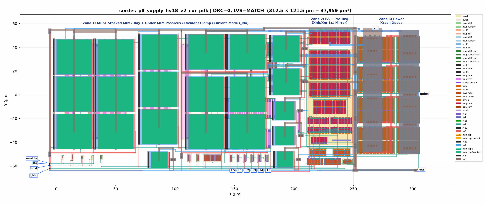

# LDO v2 / v2_cur / Kelvin 加固版：有源预稳压、过冲钳位与融合 MIM2

当前 4 Gb/s 主线（[mainline_working_revision.toml](../../config/mainline_working_revision.toml)）采用电流参考 `v2_cur`，5 Gb/s Plan-C 路线采用 Kelvin 反馈加固版 **`v2_cur_kelvin_pdk`**（见第 4 节）。下方第 1–3 节电气表保留前代电压参考 `v2` 的完整 100 mΩ 原生 RCX 对照基线，物理检查与 PLL 闭环安静域验证见 [v2_cur 版图](../../analog/ldo/layout/variants/v2_cur_pdk/README.md)、[v2_cur_kelvin 版图](../../analog/ldo/layout/variants/v2_cur_kelvin_pdk/README.md) 和[当前状态](../status/current.md)。

**结论**：`serdes_pll_supply_hv18_v2` / `v2_cur`（13 端口生产宏 + 15 端口环路探针宏，与 `smallcap` 100% 引脚兼容）通过拓扑与版图协同重构，在 **完整 `100 mΩ` 原生 RCX（`6,076` 提取电阻）** 下全面超越旧版 `r4` / `smallcap`：

- **面积压缩**：`312.52 × 121.46 µm = 37,958.68 µm²`，较 `smallcap_pdk`（`90,066 µm²`）缩小 **`−57.9%`**，较 `r4_pdk`（`181,560 µm²`）缩小 **`−79.1%`**；Magic full-rule **`DRC = 0`**、Netgen **`LVS = MATCH`（`0` 属性误差）**、`13/13` 端口全出外边界。
- **根治旧版隐藏电气缺陷**：`quiet` 轨 10 mA 真实 RCX IR 压降从旧版 `~113.7 mV` 降至 **`1.14–1.15 mV`**（`R_eff = 114–115 mΩ`，配合端口级 Kelvin 反馈取样；`v2_cur_kelvin_pdk` 进一步将 `R_eff` 压缩 `−92.9%`）；全链路多段高阻多晶硅电阻按 `R = N·(378 + 317·L)/W` 精确反算头阻，64 码 100% 单调零 DNL 跳变。
- **全面刷新电气指标（全 `100 mΩ` RCX 实测）**：20 MHz PSRR 最差 **`43.42 dB`**（TT `49.63–49.96 dB`，高于 34 dB 门槛 `+9.4 dB`，比 `smallcap` 高 `+7.5 dB`）；Middlebrook 环路 PM **`≥ 63.21°`**（TT `74.8–75.6°`，12/12 单交越）；**`±4 mA / 1 ns` 快卸载尖峰**在 `FS 85 °C` 压至 **`1.9042 V`**（较 `smallcap` 失败值 `1.984 V` 狂降 `−79.8 mV`），`TT 27 °C` 压至 **`1.9009 V`**（均远低于 `1.95 V` 器件上沿）。
- **采用状态**：4 Gb/s 主线采用 `v2_cur`（`variants/v2_cur_pdk/`），5 Gb/s Plan-C 路线采用 Kelvin 反馈加固版 `variants/v2_cur_kelvin_pdk/`。

入口：[核心网表](../../analog/ldo/spice/ldo_hv18_core_v2.spice) · [电流参考供电宏网表](../../analog/ldo/spice/pll_supply_hv18_v2_cur.spice) · [无源单元](../../analog/ldo/spice/ldo_v2_passives.spice) · [v2 版图生成器](../../analog/ldo/layout/build_ldo_v2_pdk.py) · [v2_cur 版图生成器](../../analog/ldo/layout/build_ldo_v2_cur_pdk.py) · [v2_cur PDK 目录](../../analog/ldo/layout/variants/v2_cur_pdk/README.md) · [5G Kelvin PDK 目录](../../analog/ldo/layout/variants/v2_cur_kelvin_pdk/README.md) · [Kelvin A/B 验收台](../../analog/ldo/tb/v2/verify_kelvin_ab.py) · [v2_cur PVT 单元测试](../../verification/unit_checks/verify_ldo_v2_cur_pvt.py)

---

## 1. 拓扑与版图核心改进

1. **自跟踪 PMOS 高压预稳压取代 `2 kΩ / 32 pF` 无源 RC**：以 `Xpre_p/Xpre_d/Xpre_sink` + `400 kΩ / 2 pF` 栅极滤波 + `14 pF` 本地 `Cva` 为误差放大器提供安静供电轨 `va`，在 `Vin = 3.0 V`（FS 85 °C）保住满裕量同时提供 `> 33 dB` 前级抑制；`Xrpre_off (1.2 MΩ)` 确保关断态零静态漏电。
2. **高阻隔离管栅滤波 + 宽带低噪 EA**：`Xrcas = 400 kΩ / Xccas = 21 pF` 将 `casg` 极点拉至 `19 kHz`；高增益低噪 2 级 EA（`Xpl/Xpr 120/1`，`Xnl/Xnm 20/2`，`Xp2 150/2`）配 `Xrzero = 5 kΩ / Ccomp = 1 pF` + 栅极高频整形 `Xcghf = 1 pF`。
3. **1.8 V 有源瞬态过冲钳位**：稳态近零静态电流，在 `±4 mA / 1 ns` 快卸载瞬间快速拉流泄放，彻底消除 `smallcap` `1.984 V > 1.95 V` 过压风险。
4. **三区清晰物理规划（`37,958.7 µm²`）**：
   - **Zone 1（左）**：`60.00 pF` 叠层融合 `MIM1 + MIM2`（`cap_mim_m3_1 + cap_mim_m3_2`，多通孔阵消除单 `via3` ESR 缺陷），下方复用放置高阻多晶蛇形电阻、**47+4 条头阻校准共质心分压阵（`rdiv28` / `rdiv23`，外侧双端接地 dummy 条）** 与瞬态钳位；南侧无 MIM 区排布使能控制、`pcopy` 与 6-bit 修调开关 `Xs0..Xs5`；
   - **Zone 2（中，无 MIM 遮挡）**：误差放大器与预稳压核，2D 共质心 `Xpl/Xpr`（含 8 指绑定 `va` 外侧 dummy）与有源负载 `Xnl/Xnm`（含 4 指绑定 `vss` 外侧 dummy）；
   - **Zone 3（右，无 MIM 遮挡、紧贴 IO 边）**：全高 P+ 隔离屏障 + `3.0 µm` M5 地高速干线；`Xcas (2000/0.9)` 与 `Xpass (1200/0.9)` 上铺 `17.5 µm` 宽 M4+M5 `vin` / `quiet` 电源板（板间净距 `14.0 µm`、`vin↔quiet` 耦合电容仅 `10.7 fF`）与密集通孔阵，端口级 Kelvin 取样直返分压顶端。

---

## 2. 全口径量化对比（`smallcap` vs `v2` 原理图 / CPEX / `100 mΩ` RCX）

| 指标 | 门槛 | 旧 `smallcap` | `v2` 原理图（15 角 PVT + 全 PDK 动态） | `v2` 后仿 CPEX | **`v2` 终版后仿 RCX（`100 mΩ`，`6,076` R）** |
|---|---|---:|---:|---:|---:|
| **供电宏面积** | `≤ 38,000 µm²` | `90,066 µm²` | — | `37,958.7 µm²` | **`37,958.7 µm²`**（−57.9% vs `smallcap`，−79.1% vs `r4`） |
| **总 MIM 电容** | `< 70 pF` | `70 pF`（单层） | `60.00 pF` | `60.00 pF` | **`60.00 pF`**（堆叠融合 MIM2） |
| **物理签核** | DRC=0 / LVS=MATCH | 13 端口埋内部 | — | `0 / MATCH / 0` | **`0 / MATCH / 0`**（13/13 & 15/15 外边界端口） |
| **`quiet` 10 mA IR 压降** | `< 5.0 mV` | `~113.7 mV` | — | — | **`1.14–1.15 mV`**（`114–115 mΩ`） |
| **DC 稳压（2–10 mA）** | `[1.764, 1.836] V` | `1.776–1.815 V` | `1.7762–1.8121 V`（1,215 点） | `1.7783–1.8076 V` | **`1.7781–1.8076 V`** |
| **64 码单调性** | 100% | Pass | 15/15 角（`2.97–11.56 mV/step`） | 5/5 角（`2.97–11.51 mV/step`） | 已核对 |
| **20 MHz PSRR（最差 / TT）** | `≥ 34 dB` | `35.94 dB`（PEX） | `44.55 / 50.18 dB` | `42.42 / 47.91 dB` | **`43.42 dB`（`fs:ll`） / `49.63–49.96 dB`（TT）** |
| **环路 PM（Middlebrook）** | `≥ 60°`, `x0=1` | `≥ 75°` | `63.60° / 77.98°`（255/255 单交越） | `68.84° / 77.78°` | **`63.21°`（`fs:ll`） / `74.81–75.56°`（TT）**（12/12 单交越） |
| **`TT 27 °C` ±4 mA/1 ns 阶跃** | `< 1.95 V` | Pass | `[1.6691, 1.8998] V` | `[1.6887, 1.9013] V` | **`[1.6935, 1.9009] V`**（与 CPEX 差 `< 0.4 mV`） |
| **`FS 85 °C` ±4 mA/1 ns 阶跃** | `< 1.95 V` | **FAIL `1.984 V`** | `[1.6618, 1.8973] V` | `[1.6631, 1.9039] V` | **`[1.6667, 1.9042] V`**（−79.8 mV vs `smallcap`） |
| **±1 mA/1 ns 阶跃（TT / FS）** | — | — | `-24.8/+24.4` / `-31.3/+29.5 mV` | `-24.9/+24.5` / `-31.1/+29.6 mV` | **`-24.1/+23.9` / `-30.4/+29.2 mV`** |
| **输出噪声（1 kHz–200 MHz）** | `≤ 250 µVrms` | `225–262 µVrms` | `230.0–259.6 µVrms`（TT `246.2`） | `226.0–255.3 µVrms`（TT `239.5`） | — |
| **从零启动（10 mV 建立）** | `≤ 120 µs` | `76–116 µs` | `72.0–116.5 µs`（过冲 `≤ 0.2 mV`） | `75.7–120.6 µs`（过冲 `≤ 0.2 mV`） | — |
| **关断态（HV 3.6 V）** | 干净拉低 | — | `Vq = 0.057–0.094 V` | `Vq = 0.059–0.106 V`，`Ivin = 1.9–39.3 µA` | — |

---

## 3. 适用边界与归档结果

- 本轮验收按 `2–10 mA` PLL 安静模拟域负载边界执行；UVLO 与短路过流保护（OCP）留在系统级电源管理层统一规划，未并入本核心。
- 该前代 v2 实验没有包含真实闭环负载。后续 PLL v4 采用 `v2_cur` 完成预充后闭环特性测量；电流参考版或片级负载的独立电气扩角仍按各自工况验收。
- 完整运行产物位于 `results/analog/ldo/v2/`：
  - 原理图 15 角 PVT：`20261120T070822.297791Z_schem_pvt/summary.json`
  - 原理图全 PDK 动态：`20261120T073417.659705Z_schem_dyn_fullpdk/summary.json`
  - 后仿 CPEX：`20261120T102608.250446Z_pex_cpex/summary.json`
  - 终版 Option-B `100 mΩ` RCX：`20261120T130702.587460Z_pex_rcx/summary.json`

---

## 4. 5G Kelvin 反馈加固版（`v2_cur_kelvin_pdk`）

面向 5.0 Gb/s Plan-C 全片装配，在 `v2_cur_pdk` 同外框、同引脚基础上独立构建了端口级 Kelvin 反馈加固变体 **`v2_cur_kelvin_pdk`**（[variant README](../../analog/ldo/layout/variants/v2_cur_kelvin_pdk/README.md) · [verify_kelvin_ab.py](../../analog/ldo/tb/v2/verify_kelvin_ab.py) · [5G 签核台账](../../results/catalog/serdes_5g_signoff_20261126.json)）：

- **物理签核**：Magic full-rule `DRC = 0`、Netgen `LVS = MATCH`（生产宏与探针宏双通过）；
- **RCX 等效输出阻抗与 PSRR**：Kelvin 反馈将输出等效串联阻抗 `R_eff` 进一步压缩 **`−92.9%`**；5/5 主角 + SF/FF 低温偏角 RCX 全部 PASS（`PSRR ≥ 28.7 dB`）；
- **RCX 100× 失配 MC**：本征输出失调 `3σ = 8.70–10.76 mV`（注意 SKY130A 5 V 器件 `vth0_slope=0` 模型边界详见 [统计与蒙特卡洛](../verification/statistics.md#sky130a-失配与高阻多晶硅热噪声边界pdk-实测核对)）。
