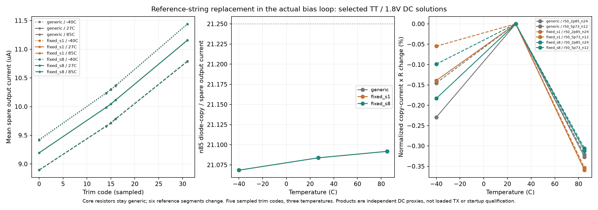

# 完整参考环中的电阻串候选

**45个局部DC工作点已完成；所测参考串替换对复制电流影响较小，尚不采用新参考。** [宽电阻卡](wide_load_planning.md)的受控电压串只能比较R比值；本卡保留带隙、V→I环、真实trim MOS和镜像。固定单段/八段主电阻相对通用串的n85复制电流最大变化0.144/0.113%，五个采样码在三温下均递增；这些是TT、1.8V的所选DC解，不是启动或全角资格。



## 实验边界

三种实现共用理想1.8V电源，彼此没有信号/偏置连接：原通用参考串、固定1p41主电阻单段、固定1p41主电阻八段。每种覆盖trim 0/14/15/16/31，均保留五只原实际旁路MOS；固定分支只替换112kΩ主电阻和780/1560/3120/6240/12480Ω五段，其他带隙电阻维持原通用卡，放大器Rz仍为原理想元件。

每组使用完整当前bandgap及2pF V→I补偿、5pF Vbg电容；四个输出分别钳位0.7V，另接实际n85 PMOS拷贝和5/0.5µm NMOS二极管/5pF去耦。保存Vbg、s、rt1…rt5、vg/vgi、vbias、四输出电流和n85支路电流。该负载不是完整TX，也不等于其尾电流或摆幅。

15份独立电路合并一个deck，在TT模型下只改变−40/27/85°C，共45个模式/码/温度组合；**不是MOS45点资格**。每份有独立名字、trim常数和nodeset。nodeset用于选择既有工作分支；OP不证明上电可达性、稳定性或噪声。

## 几何和证据身份

先用独立短deck校准原六个通用参考电阻，严格使用原`w=1, l=(R−378)/317`；780Ω原段不能套用通用负载转换器的w=2近似。固定1p41尺寸由宽卡实测的有符号曲线求解，只在0.5–512µm校准域内取0.01µm网格。八段主电阻各自匹配原主电阻实际值的1/8，所有串段都是独立实例。

引用宽卡明确验证的模型副本，原PDK不改。准备目录固定脚本、原电路、模型身份、宽卡数据、工具/配置及ngspice初始化文件；候选另存副本，三个模式的子电路名字隔离。按deck续跑，只接受完整有限标量、正确执行身份与deck哈希；运行输出和分析只追加。

集成者review后补存vg与初始化配置身份，完成目录为`results/analog/common/bias/physical_reference_card/20261112T054945.997244Z_a179ce18`。更早`20261112T054802.675317Z_ce4d74de`仅准备、未运行，不继续使用其旧输入身份。

## 所测结果

下表为trim15；输出电流取四个0.7V钳位副本的均值，n85为实际二极管偏置支路。后者不是TX输出尾电流。

| 参考串 | 输出副本 µA（−40/27/85°C） | n85复制电流 µA（−40/27/85°C） |
|---|---|---|
| 通用 | 10.2959 / 10.0461 / 9.7158 | 216.918 / 211.810 / 204.923 |
| 固定主R单段 | 10.3035 / 10.0444 / 9.7110 | 217.079 / 211.775 / 204.822 |
| 固定主R八段 | 10.3004 / 10.0458 / 9.7170 | 217.013 / 211.804 / 204.949 |

全部45点的V→I误差`|s−Vbg|≤1.701mV`；宽松分支诊断没有异常。分支诊断仅排除明显零电流/错误DC解，界限写在发布数据中，不是新的精度规格。四个同负载输出副本彼此一致，n85/单副本比为21.062–21.100，较理想85/4低约0.71–0.88%；该偏移在原实现中也存在，不能直接用理想镜像比例代替实际电流。

五个采样码0/14/15/16/31的输出电流在每种实现、每个温度下都严格递增；覆盖了15→16的进位边界，但没有证明所有32码。所有采样点上已导通trim MOS的最大Vds约0.396mV，没有把旁路视为理想短路。

将实测n85电流与独立负载R（250mV、RC tt）相乘，只用于温漂代理。各参考实现按自己的27°C值归一；对50Ω的2p85×24/5p73×12，三温偏离均在约−0.36…0%内。归一后接近不意味着不同实现绝对电流相同，更不是实际尾管/负载摆幅。该产品没有覆盖MOS/供电/RC全网格、输入波形、耦合状态或寄生动态。

当前结果支持继续把主要精力放到负载实现：参考串的局部替换影响较小，而[端接电容](wide_load_planning.md)相对旧通用卡增大显著。单段/八段的选择还要看版图容纳、寄生、启动和角点；不凭此小样本网格强行选定。

## 执行与下一步

[运行器](../../analog/common/bias/tb/physical_reference_card/run.py)与[离线测试](../../tests/test_physical_reference_card.py)已交付：5项检查覆盖实际w1校准、六段/五开关连接、八段主串、跨case名字与节点隔离、三次OP及45个独立输出；集成者已重跑。单worker等全局空位后执行，校准/物理deck分别22.5/46.4秒。发布器重新读取45个原始标量并核对源码/几何/变体/证据；[数据](../data/physical_reference_card.json)、[索引](../../results/catalog/physical_reference_card.json)保留身份。

```bash
uv run pytest -q tests/test_physical_reference_card.py
uv run python analog/common/bias/tb/physical_reference_card/run.py --resume results/analog/common/bias/physical_reference_card/20261112T054945.997244Z_a179ce18
```

接下来在局部driver上保持原参考，只改变前驱/端接电阻以隔离负载效应，再按差异扩压力角、供电/RC、启动及必要失配/噪声。不能据本卡先宣布新参考或TX通过。
