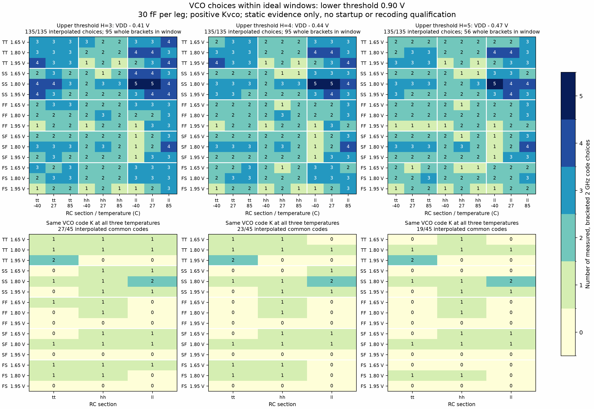
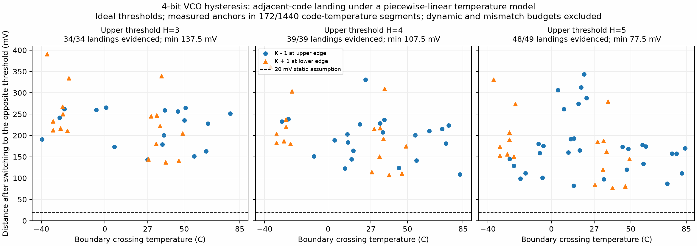
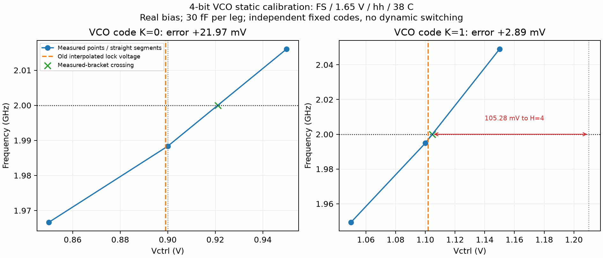
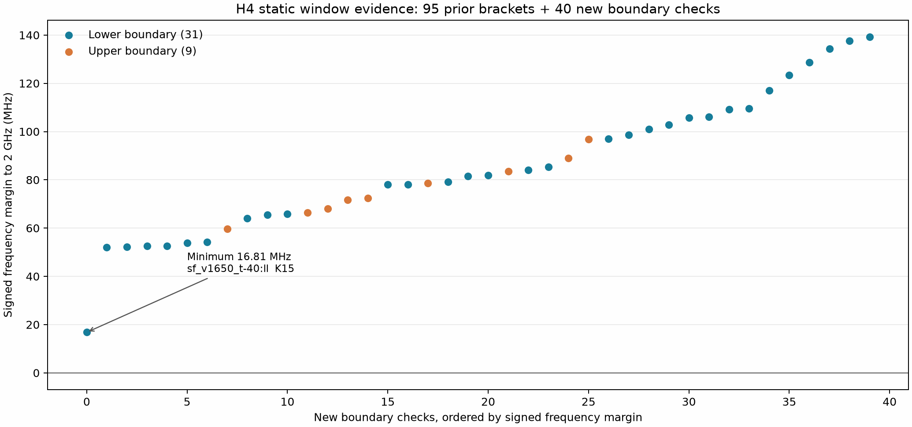

# 粗码上门限与 VCO 实测控制范围

> 本页下文是r5/4bit实测窗口及H3/H4规划的历史边界，保留既有记录和未提交局部分析；其中“后续只推进4bit”不再适用于当前主线。当前r6/5bit采用与验证见[current.md](../status/current.md)，新窗口/实际码驱动须按r6曲线和接口承接，不能从本页直接派发旧4bit任务。

上门限H=4（VDD−0.44V）、下门限0.90V的名义静态窗口，已有 **135/135工况各自的2GHz实测夹区**：95个既有完整夹区，加40个新边界频率点。它解决了此前粗网格内插跨过门限的不确定性。码4改善了[CP静态失配实验](pll_cp_window.md#同样本门限码对照32样本pilot)的上沿余量；实际门限、失配与动态切码仍待确认，未改电路或RTL默认H值。

这里有两套独立的4 bit码：VCO电容阵列粗码记为K=0…15（0最快、15最慢）；上门限电压梯档位记为H=0…15。H=3/4是同一门限梯的两个数值，不是3 bit/4 bit阵列。后续设计只推进4 bit VCO；旧3 bit电路和相噪数据保留为历史参考，不再作为并行候选，也不转移其噪声资格。

固定工况和粗码后，2GHz所需控制电压由该码的调谐曲线决定。运行控制器不计算“最近中心码”，而是越界后只切相邻档，要求新工作点回到窗口并留足反向余量。窗口中心可作初始选点参考；上电停止位置还需结合温漂方向、Kvco、CP余量和噪声一起选，不能把居中等同于最优工作点。

## 窗口比较

下门限固定为理想0.90 V。芯片组合指MOS×VDD×RC，共45组；温度为−40/27/85 °C。表中数字只计实际电压测点夹住2 GHz、局部Kvco为正的码。

| 上门限码 | 理想上门限 | 线性内插预测候选 | 同一组合三温共用码预测 |
|---|---|---:|---:|
| 3，当前候选 | VDD−0.41 V | 135/135 | 27/45 |
| 4，对照 | VDD−0.44 V | 135/135 | 23/45 |
| 5，对照 | VDD−0.47 V | 135/135 | 19/45 |

上表保留补边界前的内插统计，不代表共同码均已精确验证。补点前完整夹区位于窗口内的工况数，H=3/4/5为95/95/56；H=4现已补齐另外40点。H=3窗口更宽，相同夹区也适用；H=5全覆盖和三温共同码没有在本轮独立确认。

码3→4时失去预测三温共同码的四组为TT/1.65V/ll、SS/1.65V/hh、FF/1.65V/tt、FS/1.65V/ll。各温度仍有候选；这些计数不能证明相邻切码可行或全温无解。控制器本来允许运行中切码，三温固定码只是可用余量的观察量。



旧[固定码45/45记录](pll_vco.md#固定码三温补测2026-11-07)使用0.85 V到各工况CP直流上沿的较宽窗口，并包含单独的CP边缘补测。本表使用0.90 V到理想检测门限，以及下面两份明确的数据输入；两种窗口和证据集合不同，不能相互替代。没有找到被括住的共同码只记为缺少证据，不据此宣布电路不可达。

## 输入与插值

本次完成了被中断调谐任务的20个点：FS/ll/1.8V的6点、FS/ll/1.95V的14点。两个续跑deck均正常完成，分别耗时224/497s，波形至24ns。最终汇总有228条完整码曲线；另3条历史额外曲线缺10个未经计划的电压点，单列部分观测，不进入完整曲线矩阵。原计划、旧执行和旧summary保持原样，见[恢复审计](../work_packages/deliveries/vco-fill-resume-audit.md)。

输入为：

- 原工作图：`results/analog/pll/vco/workmap/20261106T035710Z/summary.json`，950条码曲线。
- 完成后的补点：`results/analog/pll/vco/workmap_fill/20261109T044852Z/analysis/20261109T092349.030536Z_0bac2b46/summary.json`，228条完整曲线。

相同工况/码存在完整补点曲线时整条替换原曲线，不混合电压网格或平均不同运行。最终选择1100条曲线；两套输入78个相同电压的重复频率观测差为零。只在相邻实测点之间线性求2 GHz交点，Kvco是该段割线；不外推控制电压，不借邻码温度斜率，不把缺测码当作失败。

## 边界与下一步

运行中采用电压窗口形成迟滞：感测LF积分节点z；z高于Vhi时K减1，换快一档；低于Vlo时K加1，换慢一档。上沿换码后的迟滞距离为`z_new−Vlo`，下沿换码后为`Vhi−z_new`。两者必须保持正值，并容纳检测误差、纹波和决策/再捕获过程。窗口宽度本身不能替代换码后落点检查。

[现有控制器](../../digital/pll/rtl/pll_coarse_ctrl.sv)已有同步、连续越界确认和换码后等待：250MHz参考下默认每16周期采样，连续8次确认，换码后2048周期（8.192µs）不再决策。它们抑制暂态反复触发；迟滞仍由两侧门限和实际码间电压跳变共同决定。等待时间还需按真实比较器和环路校准，不把这些默认值当作已验收的动态预算。

持续性滤波现用显式同步清除：切码同沿、搜索、保持或关闭跟踪时丢弃旧确认及未满计数。原实现靠连续送零清除，短HOLD小于PERSIST时会重复消费旧确认；`HOLD=1/PERSIST=8`回归已修复，默认HOLD=2048不属于该复现条件。数字回归不替代实际比较器和环路暂态验证。

实测锚点的分段线性温度模型已检查局部落点：

| 上门限H | 有落点证据 / 模型边界事件 | 已覆盖事件的最小对边距离 |
|---|---:|---:|
| 3 | 34/34 | 137.52 mV |
| 4 | 39/39 | 107.52 mV |
| 5 | 48/49，另1个邻码缺证据 | 77.52 mV |

三者最小值均来自FS/1.65V/hh，在27–85°C锚点间模型约38.37°C的下沿事件，K=0→1，落点约1.10248V。模型只在同一码本身两个温度锚点均有2GHz括交时插值，共172个码温区段有证据；全部45组×16码×两个温区的其余1268段没有这种括交，其中包含远离目标频率、运行中未必会用到的码。结果未覆盖全部可能路径，最小值不能当全局保证。图中20mV为静态筛查假设，不是已经分配的动态预算。



[落点数据](../data/vco_hysteresis.json)保存各事件、缺邻码记录和来源哈希；[分析器](../../verification/analysis/vco_recode_evidence.py)不借邻码温漂斜率。附带的慢端搜索仅为运行窗口下的简化覆盖审计，不含当前RTL的温度分档停止门限或回退规则，不能用其覆盖数验收RTL上电策略。

38°C局部电路校准已完成6个点：K=0/1的2GHz实测夹内插值分别0.92104/1.10472V，较旧模型在同温度的预测偏+21.97/+2.89mV；K=1到H=4上门限的静态距离约105.28mV。差异同时包含原锚点Vctrl粗网格和温度插值误差，不能全归因于温度。38°C不是实测切换温度，也没有动态换码；这个结果用于校准模型和安排边界补点，不替代上表的全路径验证。



[校准数据](../data/vco_hysteresis_anchor.json)保留6点频率、摆幅、测点夹区和原始输出身份。H=4边界确认已完成：31个下沿、9个上沿点，13个MOS×RC合并deck均正常退出，正式波形到24ns；独立1ns冒烟不计资格。下沿测频不高于2GHz，并与同码已有窗口内高频端点配对；上沿反之。40/40均形成实际夹区。

新增边界点距离2GHz最小的频率差16.8066MHz，位于SF/1.65V/−40°C/ll、K15、Vctrl=0.90V，实测1.9831934GHz。这个数是频率差，不能直接称为电压或统计余量。95旧夹区绑定历史source/fill汇总及恢复审计；135不代表本轮重跑135点，也不代表自动粗搜一定选中这些码。



[边界数据](../data/vco_window_boundaries.json)、[逐点索引](../../results/catalog/vco_window_boundaries.json)和[独立采集器](../../verification/plotting/vco_window_boundaries.py)保存新40点的raw/deck/execution身份、实际测量及旧端点。后续采用H4还需实际门限与MC、ctrl−z动态预算、二进制码译码/切换和噪声验证。

电路为r5四位阵列、真实偏置、PDK R tt/hh/ll、四缓冲且每端30 fF。135条件覆盖MOS45×上述RC三段，不含hl/lh；不是实际B2/CP/LF动态加载。当前分析不含门限梯实际误差、比较器失调、CP失配、ctrl−z纹波、决策延迟、噪声或上电，全部为ungraded静态模型证据。

优先用同码本身的实测三温曲线检查相邻切码落点与对边距离，明确标出缺测，取代旧行为模型对单温码借邻码斜率的估计。再把实际门限/比较器和CP静态联合样本叠加，并校准切码后的环路暂态；不先把码4写进默认配置。

## 复算

[小数据](../data/vco_control_windows.json)与[索引](../../results/catalog/vco_control_windows.json)保存135条件、45组三温交集、每个交点的原测量夹区，以及输入/分析器/采集器哈希。复算显式指定输出新文件：

```bash
uv run python verification/analysis/vco_control_windows.py \
  --source results/analog/pll/vco/workmap/20261106T035710Z/summary.json \
  --fill results/analog/pll/vco/workmap_fill/20261109T044852Z/analysis/20261109T092349.030536Z_0bac2b46/summary.json \
  --out results/analog/pll/vco/workmap_fill/20261109T044852Z/analysis/control_windows_recheck.json
uv run python verification/plotting/vco_control_windows.py \
  --analysis results/analog/pll/vco/workmap_fill/20261109T044852Z/analysis/control_windows_recheck.json
```


## 证据版本与安静供电边界

本页工作图和40个H4补点使用旧r5同轨静态供电：VCO、偏置和理想上门限都随原VDD条件变化。当前`r5k4q`已将VCO、CP/LF与码驱动接入quiet域，并增加尾偏置滤波；host与quiet可不同。不能把旧VDD直接换成quiet电压并沿用原门限，也不能把这些135夹区计为当前quiet版本的135点资格。下一步须明确门限梯/比较器的实际参考与供电域，按实际vq、host、B2/CP/LF负载和选码重验；本轮不改H默认值。

新增40点现已在禁止写文件/启动子进程的只读上下文中重新测频。冻结与当前`spice.py`仅执行函数`run`及提取的`log_failures`不同；精确旧/新SHA与排除这两个定义后的完整模块AST均核对相等。其余源码、PDK清单、输入、计划、全部快照/deck及完整24ns终点仍严格检查；原执行器的续跑校验未放松。[只读迁移器](../../verification/analysis/vco_boundary_readonly.py)与数据中的迁移记录保留证明。95条历史夹区的当时PDK文件和原始source-summary哈希缺口仍保留。
