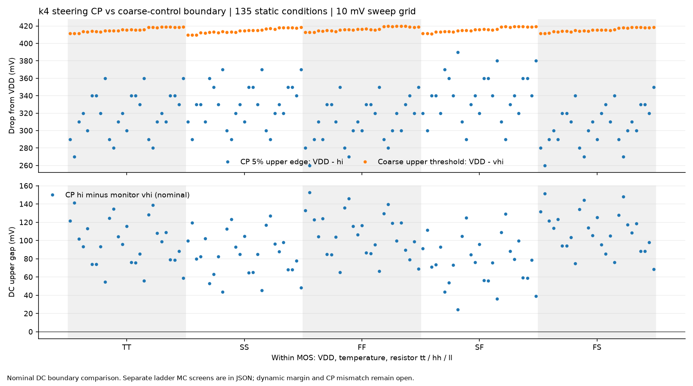

# 转向 CP 的直流窗口与粗码门限交接

当前 k4 电流转向 CP 已完成真实偏置下 MOS45 × 电阻tt/hh/ll的135点直流扫描。上下支路各自相对 VDD/2 电流下垂5%的共同窗口足以包含候选粗码窗口的名义上下门限；最小上沿距离仅 **24.37 mV**，在 SF 1.65 V 85 °C ll。这个距离尚未分给CP失配、ctrl相对z的纹波和比较/控制延迟，不能据此宣布粗码交接通过。

## 实际电路与测量

与当前 `pll_core_r5k4` 相同的200µA转向CP尺寸和跟随器，参考与跟随器电流均来自真实带隙分配。两个独立静态实例分别保持UP、DN导通，以理想电压源强制输出，扫描0.10 V至VDD−0.05 V，步长10 mV。每支路用自己的中点电流归一化；UP/DN确定性电流差另计，不用两支路互相接近作为窗口判据。采集时检查UP正向、DN负向，避免绝对值隐藏错误方向。

| VDD | 135点子集的下沿最大值 | 上沿最小值 | 对实测vhi最小名义距离 |
|---|---:|---:|---:|
| 1.65 V | 0.38 V | 1.26 V | 24.37 mV |
| 1.80 V | 0.39 V | 1.42 V | 36.27 mV |
| 1.95 V | 0.41 V | 1.57 V | 39.19 mV |

边界为最后一个满足5%的采样点，未对边界外推；真实连续交点还存在10 mV网格不确定性。中点UP电流约163–229µA，最大UP/DN不匹配11.29%（SF 1.65 V −40 °C ll），这是确定性工艺/偏置差，不能称作随机MC。

固定输出位置的最坏UP下垂：VDD−0.36 / 0.39 / 0.41 / 0.44 V分别6.20 / 4.54 / 3.83 / 3.10%。候选上门限码3名义为VDD−0.41 V；实际门限按同工况[窗口检测DC](monitor.md#门限梯与窗口检测pll-实例135-条件)的vhi逐项配对，最差点vhi=1.235627 V、CP上沿1.260 V。

## 失配与动态范围

旧窗口MC的五个Rtt压力点各105样本，单独取vhi均值+kσ与同点名义CP上沿比较，还有约34–52 mV；它没有覆盖名义距离最小的SF低压热角ll，也没有同时采样CP与门限共享参考的相关失配。该比较只作分量筛查，仍为ungraded，不能转成联合良率或全角余量。

窗口比较器感测LF积分节点z，CP输出是ctrl；Rz两端动态电压和CP纹波不能从静态比较中消失。下一步在SF低压热角ll共用真实参考，对同一MC器件先测中点电流，再把输出置于该样本vhi及明确的纹波预留位置，检查各自下垂和电流方向。先小样本校准成本，再决定门限码、匹配尺寸或电路改进，不直接放宽5%窗口。

## 证据与执行

[数据](../data/pll_cp_steer_window.json)、[索引](../../results/catalog/pll_cp_steer_window.json)记录135个完整扫描、原始输出/执行哈希与门限来源。[运行器](../../analog/pll/cp/tb/dc/window_steer.py)先做单条件DC冒烟，再按MOS×RC合并9个V/T；每组快照及PDK身份固定，只补缺失组。活动目录为 `results/analog/pll/cp/window_steer/20261109T082621.791624Z_9de0d024`。

首轮SF/tt分组在第九条件遭遇求解器段错误（exit −11），保留原尝试后以相同deck在 `sf_tt.r2` 重跑完成。采集器不采用失败进程的前八个输出，而是使用完整重跑；135/135表示DC数据完整，不是PLL设计签核。无噪声、动态捕获、hl/lh或上电验收。

复算：`uv run python verification/plotting/pll_cp_steer_window.py --campaign results/analog/pll/cp/window_steer/20261109T082621.791624Z_9de0d024`。
