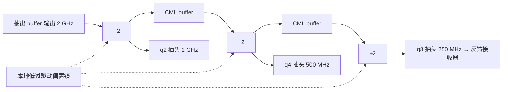

# CML ÷8 prescaler（r3）

> **当前修订**：PLL r3 `pll_cml_prescaler8`——三级低过驱动 CML ÷2，÷2→÷4、÷4→÷8 之间各加一个 CML buffer（[网表](../../analog/pll/divider/spice/cml_prescaler8.spice)，[配置](../../config/pll_working_revision.toml)）。
> **关键数字**：标准 2 GHz 输入下 45 条件 ÷2/÷4/÷8 与 250 MHz 反馈 CMOS 全部正确；最小 tap 差分摆幅约 227 mVpp；每条支路比 r2 多耗 1.44–1.98 mW。
> **主要缺口**：分频器没有确定性复位，TX 取用的多相抽头来自不同支路的独立 prescaler；FS/1.65 V/−40 °C 首级尾管处于饱和边界（VDS − VDSAT ≈ −5 mV）。

## 电路

每个 ÷2 是主从两只静态 CML 锁存器，反相输出回授。锁存器为三层 NMOS 堆叠：数据/再生对、时钟转向对、尾管。时钟先经 LVT 源跟随器降共模，再驱动下层转向对；每级输出共模由本级负载重建（约 VDD − I·R/2），不会沿链累减。

| 部分 | 参数 |
|---|---|
| 锁存器 [cml_latch](../../analog/pll/divider/spice/cml_latch.spice) | 数据 W = 20 µm、保持 W = 80 µm、时钟 W = 64 µm（均 LVT，4 指）；负载每端 600 Ω（理想） |
| 尾管 | 普通 NMOS，总宽 72 µm、24 指、L = 0.5 µm，接本地 `vbias_logic` |
| 时钟源跟随器 | LVT W = 80 µm、4 指；下拉 W = 4 µm、L = 0.5 µm，接全局 `vbias` |
| 本地偏置 [pll_cml_tail_bias](../../analog/pll/divider/spice/cml_div2.spice) | 复制全局参考约 1/6，经 PMOS 镜注入 W/L = 20/0.5 µm、nf = 4 的 NMOS 二极管；每条 prescaler 一份 |
| 级间 buffer | `serdes_cml_buffer`：输入 W = 24 µm、尾 W = 12 µm、负载 600 Ω，接全局 `vbias` |

外部端口和分频比与 v0.1 相同。四条支路（一条真实反馈、三条供电 dummy）结构完全相同。

### 为什么是这个结构

1. **低过驱动宽尾管（r2）。** SS/1.65 V/85 °C 下原 W12 尾管的 VDS 约 0.208 V，而 VDSAT 约 0.378 V，实际尾电流只有约 0.313 mA（名义 0.51 mA），÷4 起丢失。单独提高 Vbias 会同时提高 VDSAT，无法恢复。把尾管加宽 6 倍并把参考电流降到约 1/6，名义电流不变而 VDSAT 降到约 0.175 V，三级分频恢复。见 [SS 诊断](../history/cml_divider_ss_diagnosis.md)。
2. **加宽源跟随器（r2）。** FS/1.65 V/85 °C 下源跟随后的时钟共模只有约 0.804 V，首级尾管平均余量约 −0.4 mV，÷8 无摆幅；源跟随器 40 → 80 µm 后共模约 0.838 V、余量约 +25.6 mV。见 [r2 记录](../history/pll_lowov_pvt.md)。
3. **级间 buffer（r3）。** FS 热角真实 VCO 波形偏弱（buffer 后约 301 mVpp）时，r2 的 ÷4 基本无摆幅；中间加一个真实 CML buffer 后 ÷4 恢复到约 318 mVpp。buffer 恢复的是时钟幅度，不是堆叠余量——SS 测点中加 buffer 后后级尾管平均余量反而略降。见 [结构探索](../history/cml_latch_topology_experiments.md)、[偏置与 buffer](../history/serdes_bias_inventory.md)。

## 已验证结果

### 标准输入 45 条件（r3）

输入为差分 300 mVpp、共模 VDD − 0.15 V 的 2 GHz 正弦，经真实上游 buffer；每 tap 每端 5 fF，CMOS 输出每端 20 fF；每条件 64 ns，分析 32–64 ns。

| 项目 | 结果 |
|---|---|
| ÷2/÷4/÷8 稳态周期与幅度 | 45/45 |
| 250 MHz 反馈 CMOS | 45/45 |
| 全速 2 GHz CMOS（接收器） | 44/45，SS/1.65 V/−40 °C 失败，见 [时钟接收器](clock_receiver.md) |
| 最小 CML tap 差分摆幅 | 约 227 mVpp |
| 相对 r2 每条完整支路功耗增量 | 1.44–1.98 mW（不含外部参考） |

来源：[r3 记录](../history/pll_buffered_pvt.md)、[数据](../data/pll_buffered_pvt.json)。原生 VCO 回接见 [VCO](pll_vco.md)。

### 尺寸

| 版本（三级 ÷8） | MOS 实例 | 总栅面积 ΣWL | 电阻 |
|---|---:|---:|---:|
| v0.1 | 54 | 379.2 µm² | 12 |
| r2 | 58 | 666.9 µm² | 12 |
| r3 | 64 | 693.3 µm² | 16 |

相对 v0.1 增加的约 314 µm² 中，尾管加宽占 180、本地参考镜 71.7、源跟随器 36、级间 buffer 26.4 µm²。ΣWL 不含电阻、井、间距和布线，不是版图面积。来源：[尺寸评估](../history/divider_size_and_clock_priority.md)。

## 分频状态与相位

- **没有确定性复位。** 每个 ÷2 上电后有两种状态，各支路 prescaler 的状态彼此独立。TX 时钟分发从不同支路取抽头（250 MHz 取支路 0 的 ÷8，500 MHz 取支路 2 的 ÷4，1 GHz 取支路 3 的 ÷2），所以抽头之间的相对相位取决于启动状态。r3 的一次 TT 启动中 1 GHz 相对目标差了半个周期（约 2 UI）。见 [TX 时钟分发](tx_clock_distribution.md)。
- **多相间隔不等距。** 同极性核对时，÷2 四支路间隔约 0.50/0.75/0.50/2.25 UI，继承自抽出 buffer 的相位极性（b0 → b2 → b1 → b3），不是分频器延迟差。见 [串化时序溯源](../history/serializer_timing_root_cause.md)。

## 结构备选

在 TT 调参、5 个工况、2 GHz 下比较过的候选（细节见 [结构探索](../history/cml_latch_topology_experiments.md)）：

| 候选 | 观察 |
|---|---|
| 当前静态 CML（r2/r3） | 5/5 工况分频；任意数据 DFF 0/120 错误 |
| 独立时钟共模静态 CML | 单元 5/5，但 AC 耦合接口在级联中失效，需与 buffer 同时评估 |
| 两层去尾源 CML | 固定偏置 1/5；角上重调偏置后全部可分频——需要 replica 偏置 |
| folded MCML | 重调后可分频，但热角摆幅约 176–185 mVpp，功耗不低 |
| PMOS 电阻式负载 | 4/5，可调；但作数据锁存时 SS 冷/热角各有 33/32 个错误 |
| C²MOS / TSPC 动态 CMOS | 理想 CMOS 时钟下 5/5；接真实转换器后 SS 冷角失败 |

## 适用范围

- 标准输入是理想正弦经真实 buffer；原生 VCO 驱动只验证了 4 个选定工况。
- 负载电阻为理想名义值；全局参考为理想 0.85 mA，本地镜为真实 MOS。
- 功能筛查门槛 150 mVpp 是瞬态探索线，不是最终 CML 输入规格。
- 无噪声、失配、版图寄生；没有验证电源爬升或偏置使能瞬态。

## 待解决

- 确定性复位或多相同步（[问题清单](../status/open_issues.md) I-01）。
- FS/1.65 V/−40 °C 首级/第二级尾管平均余量约 −5/−4 mV（r2 时约 63% 采样点低于饱和判据）（I-10）。中等难度以上可考虑减少堆叠的结构。
- 理想负载电阻 → PDK 电阻（I-02）。
- tap 摆幅与 400 mVpp 目标的关系（I-17）。
- Xschem 原理图未同步（I-22）；当前阅读图见 [cml_latch_review.pdf](../schematics/lowov_review/cml_latch_review.pdf)。
