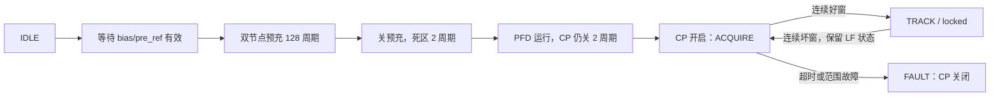

# PLL 环路：PFD、CP、LF、预充与启动监督

> **模块集成**：PLL 已有包含VCO、粗调码接口、分频反馈、PFD/CP/LF的[完整电路顶层](../../analog/pll/top/spice/pll_balanced_core.spice)及[双节点预充启动顶层](../../analog/pll/top/spice/pll_balanced_startup_core.spice)。下面记录已实现参数、分层/原生验证与近期局部迭代；模型用于选参和降低验证成本。层次、边界与迭代可从[设计工作台](../../web/design/index.html#pll)进入。

> **当前候选**：r5／4 bit VCO、k=4 电流转向 CP 和 PDK LF（Rz 4.13 kΩ、Ci 18 pF、无外加 Cf）；原 v0.1 的 50 µA CP 与 6.5 kΩ/40 pF/2 pF LF 保留为历史实现。
> **关键数字**：晶体管 PFD/CP/LF 接校准行为 VCO/÷8 的闭环在 45 条件 × tt/hh/ll 共 135 点锁定，捕获≤322 ns、过冲≤27.2%；原生晶体管 VCO/分频器闭环在 TT、FS 低压热 hh、SS 低压冷 hh 三点锁定，捕获分别为 118/418/254 ns。均为预充后捕获，不是从零上电或原生全角验证。
> **主要缺口**：原生全角闭环和实际启动链、转向CP窗口交接的失配与动态余量、新环路噪声及电源抑制仍待验证；FF 冷角分频器失配工作点不收敛，属于数值缺失。
> **环路选择（模型，2026-11-08）**：k=4（Icp 200 µA）、Rz≈4.1 kΩ、Ci≈18 pF，不另加 Cf（VCO控制端自身175–693 fF起Cf作用）；Vctrl工作区间内全部工作点PM ≥ 52°，CDR后14.07σ最差0.363 UI。前提是粗码策略把2 GHz工作点留在Kvco ≥ 约290 MHz/V的区间，见[环路选择](#环路选择r5--4-bit2026-11-08模型)。
> **收口（I-32）**：k=4 物理 LF 和转向 CP 已接入上述闭环；LF 电容分接的宽带效果、B2 对新负载的建立以及粗码控制器与监测电路接入实际闭环仍待验证。

> **近期局部验证（2026-11-06）**：FF/1.95 V/−40 °C 的 r5 四支路前端，ll/hh 均在偏置就绪初值下跑满 24 ns，VCO约1.989 GHz，三级分频及四路全速/反馈功能检查满足。自动DC仍未完成，原生TX联合缺点和真实上电不因此关闭；初值已登记为 `pll_r5_cold_prebiased_state_v1`。见[分层诊断、边界与波形](../history/pll_cold_convergence.md)。

## 收口计划与进度（2026-11-09）

目标与TX相同：当前版本（r5 VCO＋4 bit阵列、k = 4电流转向CP、PDK环路滤波器）在45条件×RC角上闭环锁定、可从上电启动，各模块局部失配MC与噪声按新环路复核。

| 步 | 内容 | 状态 |
|---|---|---|
| 1 | 环路参数（模型）、粗码策略、电流转向CP | 候选：k = 4、Rz 4.13 kΩ、Ci 18 pF、无Cf；上电温度分档选码＋Vctrl迟滞切码；转向CP接真实偏置。粗码策略的工作区补点及实际闭环验证未完 |
| 2 | PDK环路滤波器与预充门 | 网表完成；电源分接12/6（α 0.667）原按理想控制端数据线性估计最差约122 MHz/V，实测155（第7步：估计漏了控制端寄生经Rz的正交分量）；候选单元`_s7`（11/7）、`_h13`（23/36）；B2按18 pF节点的建立待复核 |
| 3 | 电路闭环（晶体管PFD/CP/LF＋校准行为VCO） | 完成：45条件×tt/hh/ll共135点全部锁定，捕获≤322 ns，过冲≤27.2%，与线性模型逐点差≤7个百分点 |
| 4 | 原生晶体管级VCO/分频器闭环（完成4压力点） | 顶层[pll_core_r5k4](../../analog/pll/top/spice/pll_core_r5k4.spice)与测试台[native_k4](../../analog/pll/top/tb/native_k4/run.py)已写；TT：KLU下工作点经true gmin stepping收敛、但瞬态第一步失败（报在带隙修调B源）；改用默认SPARSE求解器后正常起步（二分定位：偏置节点种子不起作用，求解器是关键）。**三个原生压力点都锁定，输出2.00000 GHz**（预充到码表Vctrl+40 mV，1.5 µs约1.6 h）：TT 118 ns捕获、相差33 ps、Vctrl 1.206 V（码表1.195）；FS 1.65 V 85 °C hh 418 ns、46 ps、1.165 V（码表1.185）；SS 1.65 V −40 °C hh 254 ns、54 ps、0.963 V（码表0.956）。SF 1.65 V 85 °C hh（2026-11-10）386 ns、44.8 ps、0.960 V（码表0.962），输出2.00000 GHz。FS热比同点行为VCO闭环（230 ns）慢，因为原生锁定Vctrl比工作区抛物线低32 mV（工作区测试台是代理负载），同一预充目标的初始误差60 mV对28 mV；预充目标需按实际前端校准（第5步）。结果`results/analog/pll/top/native_k4/20261108T200611Z`、`20261108T221446Z`、`20261109T163009Z` |
| 5 | 启动链：偏置就绪 → 预充 → 选码 → 捕获 | 行为VCO闭环4压力点从±200 mV预充均在306–530 ns锁定（`loop_k4/*_pre_p200`、`*_pre_m200`），该边界内码表与实际前端的约30–60 mV偏差及B2的±40 mV误差不构成捕获限制。粗码控制 RTL 和监测积木已有；启动链顶层[pll_control_top](../../digital/pll/rtl/pll_control_top.sv)（监督器＋粗码＋无计数器锁定检测：PFD脉冲过τ判相位、Vctrl在窗内判频率）对行为环路测试通过：冷启动7.6 µs锁定、只搜一次，升温切码后重新锁定不重搜，码0不够时FAULT 3。温度感测量程已下移（码0–14对应93 → −35 °C，随机σ约11 K）；相位窗口单元`pll_phase_window`门限225–750 ps，每个条件≥3.9倍静态相差上界（见下文[锁定检测相位窗口](#锁定检测相位窗口2026-11-10)）；停止门限在补齐的实测曲线上复算、测量窗长度、实际电路闭环与整链时序未验证（I-18） |
| 6 | 局部失配MC：VCO、CP、PFD、分频器、接收器 | 分频器6点1048样本全部正确（[分频器](pll_divider.md#局部失配2026-11-08)，FF冷角工作点不收敛未完）；VCO 5点频率σ 0.75–1.12%（[VCO](pll_vco.md#局部失配2026-11-09)）；CP 3点见下；反馈接收器按Pelgrom估计输入失调σ约10.6 mV（k·σ约35 mV，输入对nfet_lvt 6/0.15、负载pfet 8/0.15），对÷8输出摆幅均值−kσ约320 mVpp的半摆幅有约4.6倍余量，只表现为约10 ps的静态相差，不另做MC；PFD＋CP零相位附近5点×100样本无死区（> 约3 ps），增益187–230 µA，静态相差|均值|+kσ 51–189 ps（SS冷最大，见下文"PFD＋转向CP零相位附近局部失配"） |
| 7 | 噪声与电源抑制按新环路复核 | 电源单音经实际LF（20 MHz）：现行k = 4环路任何分接都不满足150 MHz/V门槛——12/6最差160（FS 1.8 V 85 °C），23/36全45条件两点超出（153.1、151.0）。k = 8候选（Rz 2.17 kΩ、Ci 33 pF、`pll_loop_filter_k8c`）6个最差点直接仿真最差121.6，PM 53.4°，CDR后0.271–0.348 UI（方案2，未采用，待定）；原因与方案见下文[电源抑制](#电源抑制第7步2026-11-10)。噪声（模型）：现行环路PLL rms 1.86–3.03 ps、CDR后14.07σ 0.284–0.367 UI（门槛0.50）；VCO噪声输入仍是r5七工况，4 bit阵列ISF见WP-007。供电定案与LDO接入见[供电路径与HV18稳压](#供电路径与hv18稳压2026-11-10)：HV18 r4＋尾线滤波，quiet分域顶层原生闭环4点×hv/ext共8条全部锁定；剩余宿主定时Kd、分域连接表 |

| 单元 | 实现 | 关键参数 |
|---|---|---|
| PFD [pfd_cmos.spice](../../analog/pll/pfd/spice/pfd_cmos.spice) | 静态 CMOS 上升沿三态 PFD：两个 D=1 的 DFF，主从锁存都异步清零；UP/DN 同时置位后经 NAND 与两级反相器延迟产生公共清零 | 复位延迟节点各 5 fF（理想）；零相差附近保留公共短脉冲 |
| CP [charge_pump.spice](../../analog/pll/cp/spice/charge_pump.spice) | 长沟道电流镜 + 输出串联开关 | N 镜 W/L = 5/1 µm、P 镜 W/L = 20/1 µm（4 指）；开关 N/P = 2/4 µm；UP 驱动 NFET 0.5/0.88、PFET 2/0.15 µm（TT/1.3 V 附近的名义补偿）；外部理想 N/P 参考各 50 µA |
| 可禁用 CP [charge_pump_enabled.spice](../../analog/pll/cp/spice/charge_pump_enabled.spice) | 实际 CMOS AND 门控 UP/DN | 用于启动序列 |
| LF [passive_rc_precharge.spice](../../analog/pll/loop_filter/spice/passive_rc_precharge.spice) | 二阶无源：Cf = 2 pF 并 (Rz = 6.5 kΩ 串 Ci = 40 pF)；ctrl 与积分节点 z 各一个 CMOS 传输门预充 | 预充门 ctrl 4/8 µm、z 16/32 µm；R/C 为理想元件 |
| 物理 LF 候选 [passive_rc_pdk_candidate.spice](../../analog/pll/loop_filter/spice/passive_rc_pdk_candidate.spice) | `res_high_po_0p69`（W 0.69、L 12.44 µm）；42 个约 1 pF 的 `cap_mim_m3_1`（边长 22.1965 µm），40 个作 Ci、2 个作 Cf | 板面积约 0.0207 mm²（不含间距布线） |
| 启动监督 [pll_startup_supervisor.sv](../../digital/pll/rtl/pll_startup_supervisor.sv) | 参考时钟域状态机 | 预充 128 周期 → 断开 2 周期 → PFD 运行 2 周期 → 开 CP → ACQUIRE/TRACK/FAULT |

UP 高有效、注入电荷；VCO Kvco 为正，反馈偏慢时 Vctrl 上升，方向一致。

### 启动序列

250 MHz 下 128 周期 = 512 ns。监督器的 `quality_valid/frequency_good/phase_good` 是外部接口，频率/细相位测量前端尚未实现。

## 已验证结果

当前k4转向CP的135点独立DC窗口已补齐：与实测粗码上门限的名义最小距离24.37mV（SF低压热ll），尚未包含失配/ctrl−z纹波/决策延迟。见[窗口与门限交接](pll_cp_window.md)；旧50µA窗口不再代替当前CP。

### CP 与 PFD→CP（r3 工况，45 条件）

| 项目 | 结果 |
|---|---|
| CP DC 输出扫描 | 45 条件完成 |
| 真实 PFD→CP，−200/0/+200 ps，250 MHz、Vout = 1.2 V | 45/45 净电荷方向正确且单调 |
| 有效电荷增益（两端割线） | 53.31–59.84 µA |
| 线性插值零电荷相位 | −79.4 到 +93.1 ps |
| SS/1.65 V/85 °C、Vctrl = 1.4 V 的 UP/DN | 40.8 / 49.3 µA |

三个相位点不足以证明无死区。零相差残余电荷在闭环中表现为静态相位偏移。来源：[环路 PVT](../history/pll_loop_pvt.md)、[CP 边界](../history/pll_pfd_cp_lf_next.md)。

真实偏置、45 × tt/hh/ll 的 DC 输出窗口见 [VCO 工作区](pll_vco.md#工作区r5-候选45-条件--tt--hh--ll2026-11-06)：窗口按相对中点电流下垂 5% 定义，UP/DN 失配独立记录。不能用 DC 窗口代替开关电荷验收。

TT/27 °C 名义点（v0.1）：Vout = 1.3 V 时 UP/DN = 48.5/49.9 µA；两者都在 50 µA ± 5% 内的输出区间约 0.36–1.42 V。来源：[CP/LF 原型](../history/pfd_cp_lf_results.md)。

### 分层闭环（r3 选定工况）

真实 MOS PFD/CP + 理想 LF 或 PDK LF，接同工况实测的三点分段线性 VCO→÷8 模型。两颗 LF 电容预置到目标 ±40 mV。下表是最终持续合格区间的起点（还需再观察 0.32 µs 确认）：

| 工况 | 码 / 目标 Vctrl | 理想 LF 低起点 | 理想 LF 高起点 | PDK LF 低起点 |
|---|---|---:|---:|---:|
| TT / 1.8 V / 27 °C | 5 / 1.1792 V | 0.386 µs | 0.802 µs | 0.354 µs |
| SS / 1.65 V / −40 °C | 5 / 1.1093 V | 0.514 µs | 0.802 µs | 0.514 µs |
| SS / 1.65 V / 85 °C | 6 / 1.2912 V | 0.706 µs | 0.962 µs | 0.674 µs |
| FS / 1.65 V / 85 °C | 5 / 1.1132 V | 0.450 µs | 0.802 µs | 0.450 µs |

SS 热角高起点在原 1.2 µs 记录中未通过，延长到 2 µs 后通过；电路和阈值未改。来源：[环路 PVT](../history/pll_loop_pvt.md)、[数据](../data/pll_loop_pvt.json)。

### 环路线性模型

| 模型 | UGB | 相位裕度 | 闭环 −3 dB | 峰化 |
|---|---:|---:|---:|---:|
| v0.1 TT（Kvco 464.55 MHz/V，50 µA） | 2.856 MHz | 65.4° | 4.228 MHz | 1.33 dB |
| r3 四工况（同角 Kvco、1.2 V 处 CP 电荷割线） | 3.0–4.4 MHz | 63–65° | — | — |

三阶 Type-II：Z(s) = (1 + sRCi) / [s(Cp + sRCiCf)]，Cp = Ci + Cf。模型不含反馈链延迟、采样 PFD、CP 有限输出电阻和 VCO 控制端负载。来源：[跟踪研判](../history/pll_tracking_assessment.md)。

### 环路选择（r5 / 4 bit，2026-11-08，模型）

**k = 4：Icp 200 µA、Rz ≈ 4.1 kΩ、Ci ≈ 18 pF，不另加 Cf。** 在Vctrl工作区间内的全部工作点上，UGB 4.2–19.9 MHz，最差PM 52.1°（PFD延迟再加0.5 ns时49.3°）；7个噪声压力点PLL rms 1.83–2.98 ps，CDR后14.07σ 0.281–0.363 UI（门槛0.50 UI，最差FS 1.95 V 85 °C hh）。k = 2 / 3在同样约束下最差rms 3.49 / 3.14 ps，因为VCO控制端电容固定了第三极点，较小的Icp只能靠较大的Rz补增益，第三极点随之下移。

**VCO控制端电容必须计入。** 变容管的阱接Vctrl，振荡时控制节点的小信号电容为175–693 fF（81点，15个工艺×RC段，1.65 V 85 °C与1.95 V −40 °C，Vctrl 1.0 V / 1.15 V / CP上沿；Vctrl越低越大，FS最大）。不计入时搜索给出的Cf只有0.2–0.3 pF，比这个负载还小；计入后最优解不再另加Cf。另加40 fF作为CP开关和预充门寄生的估计，待环路bench实测。

**Kvco范围由粗码策略决定，这是环路设计的前提。** 135条件×可用码在2 GHz处的局部Kvco（三点抛物线导数）跨89–1144 MHz/V，低端全在Vctrl < 1.0 V的平坦区；如果全部纳入，最差PM只能勉强到50°，rms 3.4–3.6 ps。把2 GHz工作点限制在Kvco较高的区间后为286–1125 MHz/V（3.9倍），上面的结果就是在这个范围上得出的。同一码从−40 °C到85 °C，Vctrl漂0.12–0.44 V（中位0.22 V），而1.65 V供电时1.0 V到CP上沿只有0.26 V，所以两种策略都可行，需要二选一：

- 上电时按温度选码后冻结：用带隙的PTAT估计当前温度和漂移方向，选一个三温都在0.85 V到上沿之内、且最小Kvco尽量大的码。按工作区已仿真的码（每个条件2 GHz附近的码及两侧各一个，另加0/6/15）和抛物线插值，41/45组存在这样的码，这些码在三温下的Kvco为297–1125 MHz/V；[VCO工作区](pll_vco.md#工作区r5-候选45-条件--tt--hh--ll2026-11-06)的45/45用线性插值和11-07补测点，两种口径待统一。运行中不切码。
- 运行中切码：Vctrl离开1.0 V到上沿时切到相邻码；半单位约4%频率，难以无扰。

方法：[loop_design.py](../../analog/pll/top/theory/loop_design.py)（线性CP-PLL，N = 8，2 ns PFD采样延迟；搜索Rz × Ci × Cf/Ci；稳定性对象为135条件×工作区内的码×LF角：同RC段的poly/MIM实测R、C，另加hl/lh，R另乘温度系数；CP电流取真实偏置CP窗口在VDD/2处的UP/DN均值；噪声取7个压力点的VCO、CP、偏置线噪声和−125 dBc/Hz带内底噪）。控制端负载：[ctrl_load](../../analog/pll/vco/tb/ctrl_load/run.py)，Vctrl串10 mV、50 MHz正弦，振荡中锁相解调。活动：`results/analog/pll/top/loop_design/20261108T014849Z_band1p0_cload`（搜索）、`20261108T015612Z_eval_k4_rz4.13k_ci18.38p_cf0p`（评估与CDR），`results/analog/pll/vco/ctrl_load/20261108T011936Z`。

**200 µA CP的纹波（2026-11-08，晶体管级，TT 1.8 V 27 °C，Vctrl 1.15 V）。** 现行漏端开关CP按4倍缩放（镜像、开关、驱动×4，50 µA参考），锁定态PFD脉冲450 ps、DN按静态相差补偿：UP/DN失配约7.3%（静态相差33 ps，补偿后每周期残余−0.18 fC）。不加Cf、控制端0.4 pF时Vctrl纹波132 mV峰峰，主要是DN开关导通瞬间电流镜漏端（关断时被拉到地）和控制节点的电荷分享（上升沿后0.1 ns下冲97 mV，约0.3 ns恢复）；换算Kvco 1 GHz/V时为11.1 ps峰峰的250 MHz确定性抖动、参考杂散−35 dBc。外加Cf 0.5 / 1 / 2 pF时为5.9 / 4.0 / 2.4 ps、−41 / −45 / −50 dBc，但同一Rz/Ci下环路最差PM降到44 / 38 / 31°。应改CP结构，而不是靠Cf。测试台：[cp/tb/ripple](../../analog/pll/cp/tb/ripple/run.py)；CP子电路新增缩放参数（默认值不变）。

**电流转向CP（探索候选，[charge_pump_steer](../../analog/pll/cp/spice/charge_pump_steer.spice)）把最差周期抖动从28.6 ps降到4.4 ps。** 电流镜、驱动与现行CP相同；每侧一对互补开关，无脉冲时电流流进假负载节点，该节点由跟随器钳在V(out)，电流镜漏端因此一直在Vctrl附近，开关闭合时没有电荷可分。跟随器就是B2 / serdes_ref_vbuf的5管LVT输入OTA，去掉目标DAC和使能开关，尾电流100 µA（ntail 2，暂用理想10 µA参考），假负载节点0.3 pF吸收静态相差窗口和失配电流。5个压力条件 × Vctrl 0.95 V / 1.15 V / 上沿 × 控制端0.25 / 0.7 pF（Kvco按1 GHz/V上限）：

| | 现行漏端开关CP | 电流转向CP |
|---|---|---|
| 周期抖动峰峰 | 0.98–28.6 ps（最差FF 1.95 V −40 °C、0.95 V、0.25 pF） | 0.46–4.4 ps（最差SF 1.65 V 85 °C、1.24 V、0.25 pF） |
| 参考杂散 | −57.5…−24.7 dBc | −67.6…−41.6 dBc |
| Vctrl纹波峰峰 | 19–320 mV | 8.6–53 mV |

两者等脉宽净电荷都在约±25 fC以内（静态相差≤约130 ps），高Vctrl处UP电流下降使其偏负。跟随器的10 µA改由偏置分配的4指PMOS拷贝（与B2相同）提供后，15点结果与理想参考相差≤0.07 ps（`20261108T*_steer_k4_cf0p_realota`）。后续已补转向CP直流窗口135点；仍未做捕获/切码时跟随器的跟踪与剩余纹波（主要是输出开关的栅馈通）的进一步抵消。结果：`results/analog/pll/cp/ripple/20261108T072026Z_drain_k4_cf0p`、`20261108T072026Z_steer_k4_cf0p`。

**电路闭环核对（2026-11-08）：晶体管PFD＋电流转向CP＋PDK环路滤波器在4个压力点与线性模型一致，都在400 ns内捕获。** 环路滤波器[pll_loop_filter_k4](../../analog/pll/loop_filter/spice/passive_rc_pdk_k4.spice)：poly Rz 7.594 µm = 4.13 kΩ，18个1 pF MIM单元（6接地、12接VDD），不加Cf，双节点预充门。注意PDK的cap_mim_m3_1的mf只进失配项、不乘电容，必须逐个实例化（先用mf时Ci只有2 pF，阶跃过冲55%）。VCO＋÷8为行为模型（[vco_feedback_poly](../../analog/pll/vco/behavioral/vco_feedback_poly.spice)，工作区抛物线和实测控制端电容）。测试台[loop_k4](../../analog/pll/top/tb/loop_k4/run.py)：预充到2 GHz点+40 mV，50 ns释放，参考在2 µs处后移100 ps：

| 点（条件:RC:码） | Kvco MHz/V | 控制端fF | 捕获ns | 阶跃过冲 电路 / 线性 | 2%建立ns 电路 / 线性 |
|---|---:|---:|---:|---|---|
| TT 1.8 V 27 °C tt 6 | 832 | 471 | 118 | 11.9% / 12.9% | 186 / 162 |
| FS 1.95 V −40 °C ll 7（模型最差PM） | 286 | 691 | 318 | 26.6% / 23.4% | 310 / 238 |
| FS 1.65 V 85 °C ll 7 | 987 | 542 | 214 | 14.3% / 13.4% | 146 / 149 |
| FS 1.8 V 85 °C hh 1（最高Kvco） | 1125 | 582 | 226 | 9.8% / 15.3% | 250 / 139 |

捕获判据：PFD误差与最终值相差 < 20 ps，且16个参考周期的平均反馈周期在100 ppm内（单周期锁定后仍有约1 ps逐周期残余，瞬时频率带着CP纹波，都不能直接用）。静态相差13–91 ps。

**45条件（RC tt，码表码）全部锁定：** 捕获110–298 ns（中位170 ns，最慢FS/FF 1.95 V冷角），阶跃过冲10.6–19.8%（线性模型12.6–21.5%，逐点差≤2.8个百分点），2%建立102–242 ns，阶跃终值0.999–1.009，静态相差8–107 ps，Kvco 343–985 MHz/V。阶跃在1.2 µs、记录到2.2 µs。

**RC hh与ll也全部锁定（135条件合计）：** hh捕获150–286 ns，过冲7.1–14.2%（线性12.2–18.1%），终值0.999–1.028，Kvco 477–1000 MHz/V；ll捕获206–322 ns，过冲13.5–27.2%（线性12.2–23.4%，最大差7个百分点在FF 1.95 V −40 °C），终值0.994–1.020，Kvco 286–866 MHz/V。ll的最慢与最大过冲都在1.95 V冷角（Kvco最低）。结果：`results/analog/pll/top/loop_k4/20261108T164651Z_grid_hh`、`results/analog/pll/top/loop_k4/20261108T191900Z_grid_ll`。

结果：`results/analog/pll/top/loop_k4/20261108T075812Z`（TT）、`20261108T080656Z`、`20261108T082022Z_grid_tt`（45条件）。

**电流转向CP局部失配（2026-11-09，[cp/tb/mc](../../analog/pll/cp/tb/mc/run.py)，200样本×3点，等宽450 ps脉冲，控制端0.4 pF）：随机部分σ 1.7–1.9 fC（脉冲电荷90 fC的2%），每周期净电荷主要是确定性的（高Vctrl处UP电流下降）。** 静态相差|均值|+kσ：TT 1.15 V 70 ps，SS 1.65 V −40 °C 1.24 V 148 ps，SF 1.65 V 85 °C 1.24 V 142 ps（参考周期的≤3.7%，时钟对参考无相位要求）；等宽脉冲纹波均值38.6 / 46.5 / 55.8 mV、最大60 mV（未做相差补偿，上界）。结果`results/analog/pll/cp/mc/20261108T224033Z`。

**PFD＋转向CP零相位附近局部失配（2026-11-10，[pfd/tb/pfd_cp_mc](../../analog/pll/pfd/tb/pfd_cp_mc/run.py)，5点×100样本，晶体管PFD＋k = 4转向CP＋真实偏置，−40…+40 ps逐周期一个相位，CP输出钳在Vout）：无死区，增益187–230 µA；静态相差上界189 ps，在慢角冷端。**

| 点 | Vout | 零电荷相位 均值 / σ / \|均值\|+kσ | 外推样本 | ±40 ps增益 均值（范围） | ±5 ps增益÷±40 ps增益 | 直线残差 | UP / DN脉宽 |
|---|---:|---:|---:|---:|---:|---:|---:|
| FF 1.95 V 85 °C | 1.30 V | +24.6 / 7.8 / 51 ps | 3 | 202（187–218）µA | 0.71–1.20 | ≤ 2.7 ps | 326–343 ps |
| TT 1.8 V 27 °C | 1.15 V | +35.7 / 10.9 / 73 ps | 34 | 208（195–220）µA | 0.78–1.24 | ≤ 3.0 ps | 427–464 ps |
| FS 1.65 V 85 °C | 1.15 V | +61.6 / 12.1 / 103 ps | 98 | 198（187–214）µA | 0.76–1.29 | ≤ 2.2 ps | 534–576 ps |
| SF 1.65 V −40 °C | 1.0 V | +94.6 / 21.1 / 167 ps | 99 | 213（195–230）µA | 0.80–1.21 | ≤ 2.3 ps | 543–628 ps |
| SS 1.65 V −40 °C | 1.0 V | +101.7 / 25.6 / 189 ps | 99 | 210（196–224）µA | 0.89–1.10 | ≤ 1.2 ps | 699–808 ps |

- 相位为反馈沿减参考沿，正值即净UP。零相位时每周期净电荷为负（−5.0 / −7.4 / −12.2 / −20.2 / −21.4 fC），锁定时反馈落后；k = 3.42（100样本）。
- 零电荷点落在±40 ps以外的样本按该样本的直线外推。扫描范围内直线残差 ≤ 3 ps，外推可信；首次输出的均值只取了范围内样本，偏小，已改。
- 死区：每点积分噪声约0.2 fC（约1 ps），所以2 ps间隔的局部斜率和严格单调只反映噪声。±5 ps增益相对±40 ps增益没有系统性下降，直线残差 ≤ 3 ps：不存在大于约3 ps的死区（复位脉冲326–808 ps，UP / DN在此期间同时全开）。
- 静态相差上界189 ps，高于此前按CP单独MC估的约150 ps（那次是等宽脉冲、Vout 1.24 V，不含PFD）。锁定检测的τd要按条件比较：慢角的τd同样更长，见下文[相位窗口](#锁定检测相位窗口2026-11-10)。
- 原生闭环的"相差"（TT 33 ps、SS冷54 ps）是分频器输出fb0对参考源，这里是PFD输入处的相位，两者口径不同、未对账。
- SS冷有一块在重启时中断、由`.r2`重跑，分析改用`mc.completed`按完整的尝试选取。结果`results/analog/pll/pfd/pfd_cp_mc/20261109T150210Z`。

### PFD 标准单元版（2026-11-11；2026-11-12 加复位延迟）

**采用 `pll_pfd_sc_dly`：11-11 的标准单元版在复位环路里再加一个 `dlygate4sd1_1`。** 不加时失配 MC 在 SF 1.65 V −40 °C 有 5/100 样本卡死（一路输出常高）。加后 SF/SS 1.65 V −40 °C 各 100 样本无卡死、无死区；代价是静态相差上界从原 PFD 的 167/189 ps 增到 239/256 ps。

- 机理：晚到的 DFF 时钟沿 → Q → `nand2_1` → 2×`inv_1` → `and2_1` → RESET_B 释放，这段复位环路要长于 `dfrtp_1` 的 RESET_B removal 约束，否则晚到的 DFF 在复位释放时重新锁进 D = 1。Liberty 表（小转换时间）removal：ss_n40C_1v60 0.68 ns、tt_025C_1v80 0.30 ns、ff 0.19 ns。不加延迟的环路名义 226–710 ps，只是约束的 1.02–1.2 倍。`dlygate4sd1_1` 在同样三个角是 0.32/0.16/0.10 ns，与约束同比例变化，加上后环路 307–963 ps，为约束的 1.4–1.65 倍。
- 失配 MC（[pfd_cp_mc](../../analog/pll/pfd/tb/pfd_cp_mc/run.py) `--pfd sc_dly`）：

| 点 | 零电荷相位 均值 / σ / \|均值\|+kσ | ±5/±40 ps 增益比 | 增益（最小） | UP / DN 宽度 |
|---|---:|---:|---:|---:|
| SF 1.65 V −40 °C | +124.3 / 33.5 / 239 ps | 0.84–1.28 | 213（167）µA | 713–838 / 742–854 ps |
| SS 1.65 V −40 °C | +124.1 / 38.5 / 256 ps | 0.94–1.08 | 207（184）µA | 892–1016 / 911–1034 ps |

  不加延迟版的同一 MC（`--pfd sc`）：TT 82、FF 85 °C 53、FS 85 °C 106、SS 冷 240 ps，SF 冷 5 个卡死样本（其余可分析）。σ 比原 PFD 大（SS 冷 38 vs 26 ps），来自标准单元的小尺寸器件。
- 名义 7 角（[pfd_cp_sc](../../analog/pll/pfd/tb/pfd_cp_sc/run.py) `sc8` → `sc8_dly`）：零电荷相位 +3…+16 ps（最大在 SS/SF 冷），±5/±40 ps 增益比 0.96–1.14，UP/DN 宽度 TT 483/489、SS 冷 947/963、FF 冷 307/311 ps。
- 锁定检测相位窗口用新 PFD 重测 45 条件（`phase_window --pfd sc_dly`，`results/analog/pll/pfd/phase_window/20261112T053834Z`）：门限 225–750 ps，与原 PFD 逐条件相同（仅一个点 +50 ps，在扫描量化内）；零相位 45/45 不置位，单调 45/45，xor 脉宽偏差 −30…+61 ps。按新的静态相差上界，SF/SS 1.65 V −40 °C 的门限/上界比为 650/239 = 2.7、750/256 = 2.9（原 PFD 3.9/4.0）。门限仍在上界 2.7 倍以上，不改窗口电路。
- 结果：MC `results/analog/pll/pfd/pfd_cp_mc/20261111T154840Z`（sc）、`20261111T183506Z`（sc_dly）；名义 `results/analog/pll/pfd/pfd_cp_sc/20261111T194214Z`。

以下是 11-11 不加延迟版的原始记录。

**版图用 `sky130_fd_sc_hd` 标准单元搭的 PFD（[`pll_pfd_sc`](../../analog/pll/pfd/spice/pfd_sc.spice)），结构与 `pll_pfd` 相同：两个 `dfrtp_1`、`nand2_1`、两个 `inv_1` 作复位延迟（去掉原来各 5 fF 的电容）、`and2_1`，UP/DN 各 `inv_4` → `inv_8`。** 与原 PFD 接同一 k = 4 转向 CP 比较（[pfd_cp_sc](../../analog/pll/pfd/tb/pfd_cp_sc/run.py)，名义模型，7 个角）：

| 角 | 零电荷相位 原 / 标准单元 | ±5/±40 ps 增益比 | UP / DN 宽度（ps） |
|---|---|---|---|
| TT | +34.0 / +36.8 ps | 0.98 / 1.12 | 442/444 → 356/362 |
| SS 1.65 V −40 °C | +99.0 / +106.5 | 1.05 / 1.06 | 738/746 → 688/704 |
| SF 1.65 V −40 °C | +92.9 / +103.8 | 0.93 / 0.98 | 577/589 → 549/571 |
| SS 1.65 V 85 °C | +90.0 / +97.4 | 0.95 / 1.05 | 701/704 → 702/710 |
| FS 1.65 V 85 °C | +58.9 / +58.7 | 1.07 / 1.18 | 553/551 → 417/417 |
| FF 1.95 V 85 °C | +24.2 / +26.3 | 1.07 / 0.82 | 333/333 → 235/238 |
| FF 1.95 V −40 °C | +16.0 / +17.2 | 0.87 / 1.01 | 289/289 → 226/230 |

- 无死区（增益比都接近 1）；复位脉宽比原来短，最快角仍有 226 ps。
- 输出级若用 `inv_2` → `inv_4`，低压角 UP/DN 宽度差 40–54 ps，静态相差多 33–47 ps：较弱的输出级把转向 CP 两路不等的输入负载变成了脉宽差。换成 `inv_4` → `inv_8` 后与原 PFD 只差 0–11 ps。（当时认为不必加 `dlygate4sd1_1`；失配 MC 推翻了这个判断，见上。）
- 未做：标准单元（PMOS 为 hvt）的局部失配 MC，以及锁定检测相位窗口按新静态相差上界复核；库网表没有结面积，延迟偏乐观，以版图提取为准。顶层 `pll_core_r5k4q` 仍用原 `pll_pfd`，接入时一起换。结果 `results/analog/pll/pfd/pfd_cp_sc/20261111T145132Z`、`20261111T145928Z`。

### 锁定检测相位窗口（2026-11-10）

**[pll_phase_window](../../analog/pll/pfd/spice/phase_window.spice)（UP xor DN经6级反相器、每级cd = 10 fF延迟后对自身采样，粘滞到clr_b）由真实PFD驱动，45条件门限225–750 ps，每个条件都在同条件PFD＋CP静态相差上界的3.9倍以上；零相位45/45不置位，单调45/45。** 测试台[phase_window](../../analog/pll/pfd/tb/phase_window/run.py)。

| 条件 | 门限（+ / −） | 静态相差上界（上节MC） | 比值 |
|---|---:|---:|---:|
| FF 1.95 V 85 °C | 255 / 285 ps | 51 ps | 5.0 |
| TT 1.8 V 27 °C | 375 / 375 ps | 73 ps | 5.1 |
| FS 1.65 V 85 °C | 425 / 425 ps | 103 ps | 4.1 |
| SF 1.65 V −40 °C | 650 / 650 ps | 167 ps | 3.9 |
| SS 1.65 V −40 °C | 750 / 750 ps | 189 ps | 4.0 |

- 按工艺角：FF 225–375、TT 325–475、FS 285–425、SF 375–650、SS 425–750 ps；最低FF 1.95 V −40 °C（225 / 255 ps）。门限取仍清零的最大|相位|与置位的最小|相位|的中点；扫描间隔30–100 ps，量化±15–50 ps。
- 上限750 ps是参考周期的19%；捕获期相差为ns级，两者可分。
- 激励：参考与反馈4 ns周期，两个预热周期后，每个测试相位一个周期再接一个零相位间隔周期；测试沿前1.2 ns清零，沿后2.5 ns读。每个测试周期用xor积分核对脉宽：|相位| −29…+60 ps（PFD两路偏斜），45/45在±150 ps内（没有漏沿）。
- 清零后一直为高的xor没有新沿，不会置位；这种情况（UP卡死、VCO停振）Vctrl到轨，由frequency_good的窗口检测覆盖。
- 前两轮作废：首轮（`20261109T161758Z`）读在下一次清零之后；第二轮（`20261109T175741Z`）背靠背+800 / −800 ps让fb低电平只剩0.4 ns，SS 1.65 V −40 °C的PFD（时钟到Q约0.8 ns）漏沿，FF 1.8 V 27 °C零相位读在首周期，为初始状态伪影。结果`results/analog/pll/pfd/phase_window/20261109T191931Z`。

下一步：统一冻结码覆盖口径并补齐粗码策略工作区；复核200µA转向CP窗口交接的失配/动态余量及开关注入；复核已实现物理LF的电源分接宽带效果、预充门与B2建立；扩展原生闭环角点并核实新环路噪声。以上135点使用校准行为VCO，不替代原生全角。

### 电源抑制（第7步，2026-11-10）

**结论：现行k = 4环路（Rz 4.13 kΩ、Ci 18.4 pF）任何分接都不满足20 MHz门槛（|K| ≤ 150 MHz/V，[规格](../overview/spec.md#抖动与相位噪声预算)）；要么加控制端电容并重选环路（模型可行，见方案2），要么降低VCO本身的电源灵敏度。** **更新（2026-11-10）：实际最差频率在3–5 MHz，k = 8对它几乎无改善；方案3（独立稳压）以HV18 r4＋尾线滤波为局部候选，见[供电路径与HV18稳压](#供电路径与hv18稳压2026-11-10)。** 12/6分接最差160.2 MHz/V（FS 1.8 V 85 °C hh），11/7最差155.4（FS 1.65 V 85 °C hh）；23/36（`pll_loop_filter_k4_h13`）在7压力点最差148.4，全45条件（hh）有两点超出：FS 1.8 V 85 °C 153.1、FF 1.65 V 85 °C 151.0。最差点不在原来的7个压力点里。

实测：[psrr_lf](../../analog/pll/vco/tb/psrr_lf/run.py)，4 bit VCO＋缓冲、码表码与Vctrl，VDD上5 mV、20 MHz单音；控制端接实际`pll_loop_filter_k4`与关断的转向CP，另以理想控制端（接地gnd / 跟随VDD vdd）分解。单位MHz/V，括号内为（同相，正交）。

| 点 | 码 | 12/6 | 11/7（`_s7`） | 23/36（`_h13`） | 实部零点α |
|---|---:|---:|---:|---:|---:|
| TT 1.8 V 27 °C tt | 6 | 103（−50，90） | 137（−90，103） | 119（−70，97） | 0.762 |
| SF 1.65 V 85 °C hh | 5 | 97（−11，96） | 122（−53，110） | 108（−32，103） | 0.715 |
| FF 1.95 V −40 °C ll | 12 | 61（42，44） | 56（27，48） | 58（35，46） | —（gnd / vdd首步不收敛） |
| FS 1.95 V 85 °C hh | 0 | **155**（119，100） | 143（86，115） | 148（102，107） | 0.565 |
| SS 1.65 V 85 °C hh | 2 | 102（35，95） | 111（−12，110） | 103（12，103） | 0.659 |
| FS 1.65 V 85 °C hh | 1 | 138（40，133） | **155**（−16，155） | 144（12，144） | 0.678 |
| SS 1.65 V −40 °C hh | 3 | 95（−8，94） | 119（−51，108） | 105（−30，101） | 0.706 |

12/6在50 MHz为107–248 MHz/V（随频率增大的是正交分量）。

**45条件（23/36，hh角，20 MHz）。** 85 °C 59–153、27 °C 99–129、−40 °C 58–144 MHz/V；18点 > 120。最高：FS 1.8 V 85 °C 153.1（100，116）、FF 1.65 V 85 °C 151.0（−47，144）、FS 1.95 V 85 °C 148.4、FS 1.65 V 85 °C 144.1、FF 1.65 V −40 °C 143.9（−60，131）、FS 1.65 V −40 °C 139.0、TT 1.8 V −40 °C 134.0。SF 1.8 V 85 °C只有59（码6、Vctrl 1.295 V，最高的Vctrl，正交分量小）。SF 1.8 V −40 °C瞬态起步失败（无数据；同角1.65 / 1.95 V为88 / 85）；TT 1.95 V −40 °C日志有cosh越界警告、仿真正常结束，取其值102。

另5点分解（gnd / vdd＋12/6 lf）：

| 点 | 码 | 12/6 | 23/36 | 控制线\|K_line\| | 实部零点α |
|---|---:|---:|---:|---:|---:|
| FS 1.8 V 85 °C hh | 0 | **160**（119，107） | **153** | 827 | 0.579 |
| FF 1.65 V 85 °C hh | 4 | 135（−21，133） | **151** | 1093 | 0.734 |
| SS 1.95 V 85 °C hh | 1 | 138（111，82） | 130 | 656 | 0.540 |
| TT 1.8 V 85 °C hh | 3 | 114（−10，114） | 127 | 1004 | 0.715 |
| FS 1.65 V 27 °C hh | 1 | 129（57，115） | 129 | 933 | 0.655 |

**机理。** 控制端自身电容Cp（VCO输入、CP输出、预充门）在20 MHz被Rz与z节点隔开（ωRzCp约0.3–0.45），其约0.9参考VDD；z节点则按分接α参考VDD。两者之差经Rz产生正交分量，约 ωRzCp·(β − α)·K_line，为90–155 MHz/V，分接越低越大。实部的零点α随条件在0.540–0.762之间，单一分接留下约±0.11 × K_line（656–1185 MHz/V）的实部残差。降低分接改善FS 1.95 V热角（实部为主），却加大其余点的正交和实部。

**模型。** [supply_split.py](../../analog/pll/top/theory/supply_split.py)：两节点网络（z：αCi接VDD、(1−α)Ci接地；Rz；控制端Cp，其中Cpv接VDD），每点由两种分接的实测拟合Cp、Cpv。拟合残差 ≤ 0.0015（以控制端/VDD传递为单位），12/6与11/7两组实测都在约2 MHz/V内复现；23/36是拟合之外的预测（148 / 144 / 120 / 108 / 105 / 103），实测逐点差≤1 MHz/V。加上5个新分解点共11点，残差 ≤ 0.0014，Cp 582–834 fF、β 0.86–0.90；23/36按模型最差153.7（实测153.1）。再加8点（只有23/36一种分接，Cp、Cpv恰定）共19点：Cp 582–834 fF不变，零点α扩到0.439（FS 1.95 V −40 °C，控制线只有416 MHz/V）。**拟合的Cp是等效量，比控制端的物理电容大约100 fF**：在同一测试台向控制端注入20 MHz正弦电流、锁相量测阻抗（psrr_lf `zin`），扣除Rz与Ci支路后控制端电容为FS 1.95 V 85 °C hh 735、TT 602、SS 1.65 V 85 °C hh 496、FF 1.65 V 85 °C hh 645 fF；同点、同频的VCO输入（[ctrl_load](../../analog/pll/vco/tb/ctrl_load/run.py)，表码与Vctrl，20 MHz）672 / 536 / 426 / 580 fF，转向CP（开关关断）＋预充门（[out_cap](../../analog/pll/cp/tb/out_cap/run.py)，135点）47–63 fF，两者之和与阻抗测量差 ≤ 15 fF。Rz与MIM单元按PDK实测与模型因子一致（hh 85 °C 4901 Ω对4917 Ω）。所以多出的约100 fF不是节点上的电容，而是VCO电源到控制端的耦合不完全是接VDD的电容，被两节点模型折进了Cp；它对电源单音的预测仍成立（23/36全45条件、k = 8候选直接仿真都在1–2 MHz/V内），但不能当作环路的控制端负载。

| 分接（接VDD / 36） | 控制端加接地电容 | 最差\|K\|（6点，FF冷除外） |
|---|---:|---:|
| 24（现行12/6） | 0 | 154 |
| 23（`pll_loop_filter_k4_h13`：一个VDD单元换成两个半面积单元，各接一侧） | 0 | 148 |
| 22（11/7） | 0 | 157 |
| 23 / 24 | 200 fF | 105 |
| 24 | 300 fF | 89 |

**PM代价。** 用[loop_design.py](../../analog/pll/top/theory/loop_design.py) `--evaluate 4,4130,18.38e-12,Cf --c-extra 150e-15`。loop_design的VCO输入取ctrl_load在50 MHz、粗网格上的插值，4个阻抗测量点上物理节点电容比插值多73–154 fF（TT插值偏低88 fF），所以150 fF是偏保守的一端（原40 fF偏乐观）；按门槛政策PM仍按150 fF计：

| 加的Cf | 最差PM | +0.5 ns延迟时 | 七工况rms |
|---:|---:|---:|---:|
| 0 | 50.3°（原按40 fF为52.1°） | 46.9° | 1.86–3.03 ps |
| 0.1 pF | 48.4° | 45.1° | 1.89–3.08 ps |
| 0.2 pF | 46.7° | 43.5° | 1.92–3.13 ps |
| 0.3 pF | 45.2° | 42.0° | 1.95–3.18 ps |

最差PM都在FS 1.65 V 85 °C ll码7、LF hl（不在阻抗测量点里）。

**可选方案。**
1. ~~23/36分接，不加电容~~：全45条件有两点超出（153.1、151.0），排除。
2. 重选环路，把电源灵敏度加进约束（[loop_psrr.py](../../analog/pll/top/theory/loop_psrr.py)，模型）。约束：PM ≥ 52°（loop_design的全部工作点；控制端 = VCO插值＋150 fF＋3.4 fF × (k − 4)，后者是out_cap实测的CP输出随k的增量：k = 8为60–78 fF，对k = 4多约13 fF），20 MHz |K| ≤ 120 MHz/V（留20%）；分接按1/72步长搜。电源模型用19个分解点（23/36实测 ≥ 120的条件除FF 1.8 V 85 °C外全部在内，该点gnd / vdd首步不收敛）。CDR后抖动用[cdr_jitter.py](../../analog/pll/top/theory/cdr_jitter.py)（门槛0.50 UI）。

   | 环路 | Icp | Rz | Ci | 控制端加电容 | 分接 | UGB | PM（+0.5 ns） | \|K\|最差 | PLL rms | CDR后14.07σ |
   |---|---:|---:|---:|---:|---:|---:|---:|---:|---:|---:|
   | 现行k = 4 | 200 µA | 4.13 kΩ | 18.4 pF | 0 | 24/36 / 23/36 | 4.2–19.5 MHz | 50.3°（46.9°） | 160 / 154 | 1.86–3.03 ps | 0.284–0.367 UI |
   | k = 4 | 200 µA | 3.45 kΩ | 26.0 pF | 0.1 pF | 47/72 | 3.5–16.4 MHz | 52.9°（52.1°） | 119 | 最差3.24 ps | — |
   | k = 6 | 300 µA | 2.61 kΩ | 29.3 pF | 0.1 pF | 48/72 | 4.1–18.7 MHz | 52.4°（51.5°） | 112 | 最差3.00 ps | — |
   | **k = 8**（`pll_loop_filter_k8c`） | 400 µA | 2.17 kΩ | 33.0 pF | 0 | 22/33 | 4.5–21.0 MHz | 53.4°（52.4°） | **121.6（实测）** | 1.70–2.82 ps | 0.271–0.348 UI |
   | k = 8 | 400 µA | 2.17 kΩ | 33.0 pF | 0.1 pF | 48/72 | 4.5–20.8 MHz | 53.0°（51.5°） | 110 | 1.72–2.84 ps | 0.272–0.351 UI |

   **k = 8直接仿真（2026-11-10）：** 候选单元`pll_loop_filter_k8c`（high_po 0.69 × 3.587 µm、33个MIM单元22接VDD / 11接地）＋按k = 8加倍的转向CP（输出镜像、开关、驱动加倍，跟随器不变），在模型最差的6点实测|K|：FS 1.8 V 85 °C 121.6、FS 1.95 V 85 °C 119.9、FS 1.95 V −40 °C 116.0、SS 1.95 V 85 °C 113.1、FF 1.65 V −40 °C 112.0、FF 1.65 V 85 °C 111.7 MHz/V；模型预测120.7 / 118.8 / 115.2 / 112.2 / 112.1 / 112.6，逐点差 ≤ 1 MHz/V。门槛150下余量19%。

   原理：降Rz使正交分量（∝ ωRzCp）按比例减小，控制端极点1/(RzCp)上移，PM反而改善；Ci和Icp随之加大以保持UGB。|K|的下限约100 MHz/V由实部零点α的散布决定（0.439 FS 1.95 V −40 °C … 0.762 TT 1.8 V 27 °C），单一分接去不掉；控制端加接地电容压低β，能再降约10 MHz/V。代价：CP电流＋100%，Ci＋15 pF（每个PLL的MIM约＋0.013 mm²，[面积](../overview/area.md)按0.00087 mm²/pF）。未查：转向CP在400 µA下的窗口、跟随器（dummy节点）、开关电荷注入；预充时间（C大80%）、捕获；26个条件没有分解数据（23/36实测都 < 120）。结果`results/analog/pll/top/loop_psrr/20261110T014436Z`、`results/analog/pll/top/loop_design/20261110T014613Z_eval_*cpmeas`、`results/analog/pll/vco/psrr_lf/20261110T011752Z`（k = 8直接仿真）。
3. 降低VCO本身的电源灵敏度（K_gnd为−420…−800 MHz/V），或给VCO单独供电：结构性改动。

**20 MHz以外。** 按标称环路（[supply_tolerance.py](../../analog/pll/top/theory/supply_tolerance.py)，|K|不随频率变）容限最差在约8 MHz；实际|K|的正交分量随频率下降，且各点环路不同。每点按自身环路（码表Kvco、CP窗口电流、Rz / Ci角、拟合的控制端Cp）算误差传递1/(1 + L)，23/36分接在12 MHz实测：FS 1.95 V 85 °C hh 104 MHz/V（模型116）、TT 113（模型113）、FS 1.65 V 85 °C hh 102（模型111），模型在FS点偏保守 ≤ 12 MHz/V。折成0.05 UI峰值的单音容限：12 MHz为16.2 / 17.5 / 22.2 mV，20 MHz为15.8 / 20.2 / 16.2 mV。规格里"约17 mV"按标称环路；这几点20 MHz处|1/(1 + L)|约1.3，门槛150 MHz/V对应约15.6 mV。

**最差频率在3–5 MHz（2026-11-10更正上段"最差在20 MHz附近"）。** 低Kvco码点环路交越低（FS 1.95 V −40 °C hh码1，UGB约6–8 MHz），|1/(1 + L)|在4 MHz已约0.75。4 MHz实测（12/6分接）：FS 1.95 V −40 °C hh 84.9 MHz/V、SS 1.95 V 85 °C hh 73.3、FS 1.95 V 85 °C hh 76.1、TT 105.0，按实测K的0.05 UI峰值容限9.8 / 16.4 / 17.3 / 16.2 mV。19个分解点按下节含偏置尾线的模型，最差8.8 mV（4.8 MHz，FS 1.95 V −40 °C hh）；0.2–0.5 MHz另有一个弱区（18–28 mV），来自偏置尾线。k = 8候选（2.17 kΩ/33 pF，按loop_psrr缩放LF与CP）在20 MHz把容限从14.0提到21.9 mV，3–5 MHz只从8.8到9.9 mV：**重选环路改善的是20 MHz门槛，不是实际最差频段。**

结果：`results/analog/pll/vco/psrr_lf/20261109T145047Z`（12/6）、`20261109T180645Z`（11/7）、`20261109T192257Z`（23/36，45条件）、`20261109T214035Z`、`20261109T222343Z`、`20261109T225851Z`（另13点分解）、`20261110T011746Z`（控制端阻抗）、`results/analog/pll/cp/out_cap/20261110T010521Z`、`results/analog/pll/vco/ctrl_load/20261110T0109*Z`（表码点20 MHz）、`20261109T203223Z`（23/36，12 MHz）、`results/analog/pll/top/loop_design/20261109T19213*Z_*psrr_cx150`、`results/analog/pll/vco/psrr_lf/20261110T081042Z`（4 MHz）。

### 供电路径与HV18稳压（2026-11-10）

**（2026-11-11更正：本段与下表只计频率路径；加上宿主定时延迟路径后的容限见下文“宿主定时延迟路径”，低压角直供3.9 mV、HV18 5.2 mV。）** **结论：PLL经两条路径受电源影响：自身所在电源（VCO、buffer、CP、LF，K_q）和宿主偏置经PMOS拷贝送来的尾电流线（K_b）。只稳压前者不够。HV18 r4（[LDO r4](ldo_r4.md)）加尾线1 MΩ/16 pF滤波后，宿主1.8 V纹波容限 ≥ 496 mV、3.3 V输入 ≥ 1.05 V（0.05 UI峰值，19点最差），新增噪声 ≤ 0.23 ps rms。1.8 V直供配置仍只有9–10 mV（3–5 MHz），k = 8环路也不改变这一点。**

**尾线路径。** psrr_lf `host` / `quiet`分域（偏置参考与全部PMOS拷贝接host，其余接vdd），4 MHz：FS 1.95 V −40 °C hh host 23.9、quiet 64.8 MHz/V，两者复数和与`lf`实测（79.4，30.0）一致到0.1 MHz/V；TT 26.3、114.2，同样可加。host部分与尾线vbias纹波同相（相差 < 0.1°），比值即kb：2.94 / 2.64 GHz/V。[bias_path_ac](../../analog/pll/vco/tb/bias_path_ac/run.py)对19点做host→vbias小信号：vgi对host的跟随在0.17–0.3 MHz降到0.920–0.936，vbias/host峰值88–146 mV/V（4 MHz 8–15、20 MHz 12–21 mV/V），K_b在0.2–0.3 MHz约260–430 MHz/V。20 MHz拟合把尾线的20 MHz值折进了K_gnd；按频率展开尾线后，[模型](../../analog/pll/top/theory/ldo_supply_tolerance.py)与全部11个实测（12 MHz 3点、4 MHz 4点、分域2点×2）偏差+0.6…+12%，都偏保守（原来−24…+35%）。

容限（mV峰值，0.05 UI，现行k = 4，19点逐频最差）：

| 配置 | 0.3 MHz | 1 MHz | 5 MHz | 20 MHz | 最差 |
|---|---:|---:|---:|---:|---|
| 单电源（现状 / 1.8 V直供） | 20.0 | 20.4 | 8.8 | 14.0 | 8.8（4.8 MHz） |
| 单电源＋尾线滤波 | 70.9 | 23.3 | 10.3 | 16.7 | 9.9（3.9 MHz） |
| HV：3.3 V输入 | 36000 | 9426 | 1121 | 1399 | 1048（9.9 MHz） |
| HV：宿主1.8 V，无尾线滤波 | 16.3 | 38.7 | 20.9 | 37.9 | 15.1（0.37 MHz） |
| HV：宿主1.8 V，r4＋尾线滤波 | 500 | 1878 | 4423 | 19489 | 496（0.28 MHz） |

r4宿主→quiet已含参考端1 MΩ/16 pF（300 kHz 0.021–0.041 V/V）；没有尾线滤波时尾线单独把容限压到约15 mV。噪声（1 kHz–200 MHz，无CDR，最差点）：r4 quiet输出谱（真实BG、2 / 10 mA、6条件）经K_q 0.150 ps，滤后尾线谱经kb 0.079 ps；两者共用BG，线性相加0.229 ps，对现行1.86–3.03 ps按RSS约+0.3%。

**集成要求。**
1. 尾线滤波与LDO同时采用：在本地CML二极管之后、VCO与四个首级buffer尾管栅之前，拷贝和二极管留原节点。−3 dB 7.3–9.5 kHz，bias-ready按约100 µs规划，PLL复位释放条件要含尾线。
2. 码驱动放quiet域（本节测量中cfg位接quiet）。CP偏置拷贝（vbn）也跨域；分域测量中CP开关断开，CP电流纹波只改变环路增益，未计入。
3. 环内宿主域定时单元的延迟灵敏度Kd在环路带宽内1:1成为输出时间误差，0.05 UI峰值对应12.5 ps / Kd；已测（见上文“宿主定时延迟路径”），是两种配置在低压角的主导路径。首级buffer之后的时钟分发在宿主域，全频直通，同现状。
4. quiet引脚：HV配置额外电容 ≤ 100 pF（r4稳定性），板上不贴去耦；1.8 V配置由板上同源电源供vin与quiet。
5. **供电结论（2026-11-10定）：1.8 V直供配置要求板上电源满足常见纹波要求（引脚处约10 mVpp量级）；更差的电源用3.3 V输入的HV18。保持k = 4，不采用k = 8。** 本设计单音最差容限8.8 mV峰值（约17.6 mVpp，4.8 MHz，只计频率路径；加延迟路径后SS 1.65 V −40 °C为3.9 mV峰值即7.8 mVpp，低于10 mVpp，对策待定），精确口径随I-35统一。VCO改由1.5 V低纹波域供电留到下一版，见[下一版迭代候选](../status/next_iteration.md)。

**宿主定时延迟路径（2026-11-11）：此前两种配置都没计，它在低压角主导供电容限。** 开环测试台[host_timing](../../analog/pll/top/tb/host_timing/run.py)：VCO 放在理想 quiet 1.8 V，只扰动宿主电源（±20 mV）和宿主侧单元的 vbias（±5 mV），测 VCO 到预分频输出 d08、到 fb0 的延迟。另用[pfd_cp](../../analog/pll/top/tb/host_timing/pfd_cp.py)测 PFD（宿主）＋CP（quiet）零电荷相位对宿主电压的变化。

| 点 | 到 fb0（ps/mV 宿主） | 其中预分频 | 对 vbias（ps/mV） | 其中预分频 | PFD＋CP | 全速时钟接收器（环外） |
|---|---:|---:|---:|---:|---:|---:|
| SS 1.65 V −40 °C hh | −2.13 | −0.27 | −2.11 | −1.46 | −0.12 | −0.69 |
| FS 1.65 V −40 °C hh | −2.08 | −0.50 | −1.70 | −1.39 | — | −0.43 |
| SS 1.65 V 85 °C hh | −1.16 | — | −1.72 | — | −0.11 | −0.66 |
| FS 1.65 V 85 °C hh | −0.97 | — | −1.41 | — | −0.05 | −0.40 |
| SF 1.65 V 85 °C hh | −0.69 | −0.06 | −1.34 | −0.83 | — | — |
| TT | −0.47 | −0.07 | −1.40 | −0.99 | −0.04 | −0.29 |
| FS 1.95 V −40 °C hh | −0.40 | — | −1.89 | — | −0.002 | −0.23 |

- 对宿主电压的灵敏度 76–91% 来自反馈 CML→CMOS 接收器（`serdes_cml_to_cmos_pvt_candidate`），预分频只占小部分；对 vbias 的灵敏度主要在预分频。PFD 的 ref、fb 两侧相互抵消，PFD＋CP 净值 ≤ 0.12 ps/mV。FF 1.95 V −40 °C 前端开环工作点不收敛，未测。
- 环内：VCO 边沿每伏宿主移动 Kd(f) = Kd_pfd − Kd_h − Kd_b·vbias/host(f)，经闭环传递 |L/(1+L)| 到输出，与频率路径按模值相加（[模型](../../analog/pll/top/theory/ldo_supply_tolerance.py) `--host-timing`）。0.05 UI 峰值容限（mV 峰值，实测点）：

| 点 | 1.8 V 直供：只计 VCO 路径 → 加延迟路径 | HV18＋尾线滤波，加延迟路径 |
|---|---|---:|
| SS 1.65 V −40 °C hh | 16.1 → **3.9** | **5.2** |
| FS 1.65 V −40 °C hh | 18.0 → 4.0 | 5.1 |
| SF 1.65 V 85 °C hh | 10.3 → 6.1 | 13.9 |
| FS 1.95 V −40 °C hh | 8.8 → 6.5 | 20.2 |
| TT | 15.3 → 9.5 | 19.8 |

  先前写的“HV18 宿主 ≥ 496 mV、1.8 V 直供 8.8 mV”只计了频率路径，作废，以本表为准。若反馈接收器的作用被抵消（只剩预分频的延迟，见下），实测点直供回到 9.7–14.7 mV、HV 19–70 mV。
- 环外：全速时钟接收器 −0.23…−0.69 ps/mV，宿主纹波在所有频率上直通到 TX/RX 时钟；TX 时钟链也在宿主域。这部分属于整机供电抖动预算（I-35），HV18 不能保护它。
- 对策：①参考接收器做成反馈路径的复制，两种配置都有效，**已验证，推荐**；②HV 配置把反馈接收器移到 quiet：它后半段是 CMOS，沿上的尖峰电流在 LDO 带宽之外，会进 VCO 电源，不采用；③预分频偏置单独过一个 RC（不与 VCO 共用 vbias_q，避免预分频尾管的开关反冲进 VCO 尾线），去掉剩下的 vbias 灵敏度，只对 HV 配置有意义，备选。
- 复制参考路径（[ref_replica](../../analog/pll/top/tb/host_timing/ref_replica.py)）：CMOS 参考（互补，摆幅 0..宿主）→ 一级 CML（`serdes_cml_buffer` 600 Ω、尾 W11、约 0.46 mA）→ 同款 `serdes_cml_to_cmos_pvt_candidate` → PFD 输入，与反馈路径同电源同偏置。CML 级输出每端加载 CL 调边沿：预分频输出单端摆幅 222–288 mV、差分 20–80% 上升 182–240 ps，CL 170 fF 与之相当。残差 = 反馈路径 − 复制路径（ps/mV）：

| 点 | 反馈路径 宿主 / vbias | 复制路径 CL 170 fF 宿主 / vbias | 残差 宿主 / vbias |
|---|---|---|---|
| SS 1.65 V −40 °C hh | −2.13 / −2.11 | −2.07 / +0.02 | **−0.06** / −2.13 |
| FS 1.65 V −40 °C hh | −2.08 / −1.70 | −1.90 / +0.33 | −0.17 / −2.03 |
| SS 1.65 V 85 °C hh | −1.16 / −1.72 | −0.96 / −0.42 | −0.20 / −1.31 |
| FS 1.65 V 85 °C hh | −0.97 / −1.41 | −0.79 / −0.25 | −0.18 / −1.17 |
| SF 1.65 V 85 °C hh | −0.69 / −1.34 | −0.60 / −0.45 | −0.09 / −0.89 |
| TT | −0.47 / −1.40 | −0.37 / −0.39 | −0.10 / −1.01 |
| FS 1.95 V −40 °C hh | −0.40 / −1.89 | −0.29 / −0.46 | −0.11 / −1.42 |

  对宿主电压的灵敏度抵消 84–97%；边沿越慢抵消越多（CL 0 → 255 fF，SS 冷残差 −0.34 → +0.01）。对 vbias 的灵敏度在预分频，复制路径不含，原样留下，经尾线传递（0.2–0.3 MHz 峰值 0.09–0.15 V/V）起作用。容限（0.05 UI 峰值，实测点，CL 170 fF）：1.8 V 直供 7.9–19.5 mV，最差 FS 1.95 V −40 °C hh 7.9 mV（只计频率路径为 8.8），即延迟路径只再扣约 10%；HV18 31.7–60.9 mV，都落在 0.2–0.3 MHz，由 vbias 残差决定，做③可再提高。19 点包络（未测点按实测最差 Kd）：直供 7.9 mV、HV 19.1 mV。
  未计：两路接收器的局部失配、复制路径自身的噪声、片外参考输入的焊盘接收器（它在参考一侧再加一份同号的延迟灵敏度，设计时一起配平）；代价约 1–1.5 mA 宿主电流和两只约 170 fF 电容。结果 `host_timing_ref_replica/20261111T105327Z`，残差 `host_timing_balanced/20261111T114417Z_cl170`，容限 `ldo_supply_tolerance/20261111T114419Z`。
- 范围：开环直流扰动，带内按准静态处理；未测点按实测最差值；参考输入接收器尚未设计，未计入。结果：`results/analog/pll/top/host_timing/20261111T061902Z`、`20261111T091746Z`，`host_timing_pfd_cp/20261111T090715Z`，容限`ldo_supply_tolerance/20261111T102959Z`（全部）、`20261111T103001Z`（只计预分频）。

**接入闭环（2026-11-11）。** 顶层[pll_core_r5k4q](../../analog/pll/top/spice/pll_core_r5k4q.spice)（VCO、四个首级buffer、转向CP、k = 4 LF在quiet，尾线经`serdes_pll_bias_lowpass_slow_r4`，PFD/预分频/接收器在host，CP vbp二极管在quiet，码驱动quiet电平）、测试台[native_k4_supply](../../analog/pll/top/tb/native_k4_supply/run.py)。hv：r4、vin 3.3 V、按MOS:RC校准码，VCO码取同工艺/温度/RC的1.8 V码表项；ext：vin与quiet接同一理想源（1.8 V直供配置）。原生晶体管级闭环，预充到码表Vctrl+40 mV，1.5 µs。4点8条全部锁定，输出2.00000 GHz（hv TT捕获慢是PFD释放时初始相位不同，+1020对−571 ps；捕获期间quiet最大跌落1.9 mV）：

| 点 | 配置 | quiet | 码 | 捕获 | 相差 | Vctrl（码表） | quiet纹波 |
|---|---|---:|---:|---:|---:|---|---:|
| TT 1.8 V 27 °C tt | ext | 1.800 | 6 | 118 ns | 33.0 ps | 1.206（1.195） | — |
| | hv | 1.8011 | 6 | 310 ns | 33.0 ps | 1.207（1.195） | 1.53 mVpp |
| FS 1.65 V 85 °C hh | ext | 1.650 | 1 | 418 ns | 46.1 ps | 1.165（1.185） | — |
| | hv | 1.7850 | 0 | 378 ns | 17.0 ps | 1.139（1.150） | 1.25 mVpp |
| SS 1.65 V −40 °C hh | ext | 1.650 | 3 | 254 ns | 53.5 ps | 0.962（0.956） | — |
| | hv | 1.7760 | 3 | 350 ns | 24.8 ps | 1.073（1.107） | 1.34 mVpp |
| FS 1.95 V −40 °C hh（码1，供电最差点） | ext | 1.950 | 1 | 334 ns | 7.0 ps | 1.214（1.209） | — |
| | hv | 1.7972 | 1 | 370 ns | 8.4 ps | 1.094（1.117） | 1.28 mVpp |

- ext与原不分域`native_k4`逐项一致（相差差 ≤ 0.05 ps、Vctrl ≤ 0.2 mV），分域网表本身不改变电路。
- hv的quiet 1.776–1.801 V在r4直流1215点范围（1.776–1.815 V）内，SS冷点贴下限。锁定后quiet纹波1.25–1.53 mVpp，在250 MHz及谐波上；滤后尾线vbias_q纹波 ≤ 0.022 mV。
- hv把低宿主压力点的相差从46–54 ps降到17–25 ps（CP在约1.78 V上余量更大），Vctrl回到窗口中部：按quiet算的码窗口[0.90, quiet − 0.44 V]两侧余量 ≥ 173 mV（ext在1.65 V时上沿45 mV / 下沿62 mV）。
- hv的Vctrl比1.8 V码表项低11–34 mV：quiet低于1.8 V（K_gnd为负，频率偏高）和宿主偏置不在1.8 V两者叠加。加上+40 mV预充偏置，初始误差 ≤ 74 mV，在已验证的±200 mV预充捕获范围内。码由上电选码在片上确定，码表只给预充目标；HV配置的预充目标用1.8 V项即可。
- 跨域电平在这些点上都正常工作：宿主比quiet低最多126 mV（PFD→CP开关驱动）、高最多153 mV（quiet上的buffer→宿主接收器共模）。
- vin 3.0/3.6 V不另跑闭环：PLL只经quiet看到vin，quiet直流已由r4的1215点覆盖（含3档HV），vin纹波按上表 ≥ 1.05 V；quiet上端1.815 V介于已跑的1.80 V（hv）与1.95 V（ext）之间。

结果：`results/analog/pll/top/native_k4_supply/20261110T133803Z`（TT）、`20261110T155026Z`（3压力点）。

**适用范围。** 19个20 MHz分解点；Kg、Kl与频率无关（准静态VCO）；尾线按每点AC×单一kb 2.94 GHz/V（实测2.64–2.94）。k = 8行按loop_psrr缩放LF/CP，未在4 MHz直接仿真。LDO传递取r4 255点逐频最坏模值，不与PLL条件配对，宿主两路按模值相加；r4尾线滤波实测3点，其余点用1 MHz最差的一条。参考接收/PFD/分频/分发未计。

结果：`results/analog/pll/vco/psrr_lf/20261110T091040Z`（分域）、`results/analog/pll/vco/bias_path_ac/20261110T101744Z`、`results/analog/pll/top/ldo_supply_tolerance/20261110T131126Z`（k = 4，r4）、`20261110T131739Z`（k = 8，r4）、`20261110T131125Z`（r3及理想RC对照）；LDO输入为r4 `20261110T112415.433032Z_31c78a41`、`r4_dc_noise/20261110T120141.651192Z_9a75685f`、`r4_bias_filter/20261110T113540.869125Z_59f58e7a`。

### 按抖动预算选的环路（r5 候选 VCO，未实现；已被上一节取代）

k 是相对 v0.1 的缩放：Icp 50 µA × k，Ci 40 pF / k，Cf 2 pF / k，Rz 6.5 kΩ 不变。七工况的线性结果（标称环路值，不含 Rz 随电阻角的变化）：

| k | Icp | Ci / Cf | UGB | PM | PLL rms（最差） | CDR 后 14.07σ（最差） |
|---:|---:|---|---:|---:|---:|---:|
| 1 | 50 µA | 40 / 2 pF | 4.3–5.7 MHz | 56–60° | 5.69 ps | 0.563 UI |
| 2 | 100 µA | 20 / 1 pF | 8.5–11.4 MHz | 52–57° | 3.78 ps | 0.425 UI |
| **4** | **200 µA** | **10 / 0.5 pF** | **17–23 MHz** | **44–51°** | **2.75 ps** | **0.323 UI** |
| 6 | 300 µA | 6.7 / 0.33 pF | 26–34 MHz | 36–45° | 2.43 ps | 0.284 UI |
| 8 | 400 µA | 5 / 0.25 pF | 34–45 MHz | 27–39° | 2.43 ps | 0.270 UI |

- k = 4 是当前噪声/面积候选：k 再大抖动改善很少（底噪和 CP 开始抬头），PM 掉得快；k = 1 不满足 0.50 UI 门槛（[规格](../overview/spec.md#抖动与相位噪声预算)），但 k = 2 的 0.425 UI 已满足该模型门槛。实际 CP/LF 收口前比较 k = 2/3/4 的稳定性、捕获、杂散与面积；k = 4 的 Ci 10 pF 约是原来面积的 1/4。七工况的延迟/RC 敏感性复算见[设计耦合评估](../history/design_coupling_review_20261106.md)；模型已有 2 ns PFD 延迟。
- Kvco 比 r3 大 2–4 倍，PM 最差只有 44°，而且 R hh 下 Rz 更大。收口时 Rz、Cf 按角重定，不照搬缩放值。
- 参考杂散手算（k = 4、Kvco 924 MHz/V、UP/DN 失配 5 %）：Cf 上约 8.9 mV 的窄脉冲，基波约 0.9 mV，相位偏移约 0.0033 rad，折合约 0.002 UI 峰峰。B2 关断漏电 186 nA 的影响更小。都没有仿真。
- 电容分接：Ci、Cf 都按约 0.7 : 0.3 分接 VDD 和地，见 [VCO 电源灵敏度](pll_vco.md#电源灵敏度r5-候选)。

### 预充

| 观察量 | 原单点预充 | 双节点预充 |
|---|---:|---:|
| 两状态建立到 1.40 V ± 1 mV（500 Ω 参考源） | 2868 ns | 204.6 ns |
| 参考源峰值电流 | 0.521 mA | 2.619 mA |

上表是普通 CMOS 门和 500 Ω 理想参考源（TT），释放 1 ns 后 ctrl 扰动约 +1.04 mV。来源：[启动优化](../history/pll_startup_optimization.md)。

片内缓冲 [B2](bias.md#lf-预充缓冲-b2)：尾电流 300 µA，到 10 mV ≤ 360 ns，45 条件 × 电阻角。预充门因此改为普通 NMOS + LVT PMOS（原门在 SS / SF 1.65 V −40 °C 有死区），释放扰动变为 1 ns 后 +1.7…+2.3 mV（1.1 V 目标）；关断漏电最差 186 nA。闭环未复验。

### 原生接回

- **v0.1，TT。** 预充 LF 并对齐参考相位后，原生 PLL 满足持续判据：最后 512 UI 频差 +1.6 ppm，展开相差跨度 0.0008 UI。这是近锁初始化，不是上电捕获。来源：[实际时钟分发](../history/physical_clock_distribution_results.md)。
- **r3，TT。** 预充开关 40 ns 断开、48 ns 释放 PFD，观察到 96 ns；反馈相差从约 1.206 ns 降到约 168 ps。48 ns 不满足 320 ns 保持判据。

### 物理 LF 角

| 条件 | R | Ci | Cf |
|---|---:|---:|---:|
| tt / 27 °C | 6.508 kΩ | 40.00 pF | 2.000 pF |
| ll / 27 °C | 5.508 kΩ | 35.21 pF | 1.761 pF |
| hh / 27 °C | 7.508 kΩ | 44.93 pF | 2.246 pF |
| tt / −40 °C | 6.332 kΩ | 40.00 pF | 2.000 pF |
| tt / 85 °C | 6.714 kΩ | 40.00 pF | 2.000 pF |

MIM 模型的温度系数为 0。来源：[首轮 PVT](../history/pll_pvt_first_results.md)。

## 适用范围

- r3 分层闭环用实测 VCO 曲线模型，不含 VCO 噪声、控制端负载、分频状态和传播延迟；r5/k4 行为闭环计入实测控制端电容，仍不含原生分频状态与传播延迟。
- 上述闭环测试将 LF 电容预偏置在目标附近；不是从零充电或全频段捕获。
- 旧 r3 分层结果采用理想参考和典型无源段；r5/k4 的 tt/hh/ll 覆盖与真实偏置边界见各结果段。
- 锁定是无噪声工程判据，不是抖动签核。

## 待解决

- r5/k4 原生闭环扩至全角，验证从零捕获（[问题清单](../status/open_issues.md) I-08）。
- 转向 CP 高 Vctrl 处 UP/DN、输出窗口与动态开关注入（I-12）。
- 原生闭环覆盖 LF RC 极限角，复核物理 LF 电源分接宽带效果（I-13）。
- 启动监督、B2、粗码 RTL 和监测电路接入实际启动链，验证时序和看门狗（I-21）。
- 新环路噪声与供电抑制、带内底噪及 CP 占空比复核（I-32、I-05）。
- 参考输入接收器按复制路径设计（含焊盘接收器配平、失配与噪声），接回原生闭环验证；预分频单独偏置滤波（HV 配置，备选）；分域连接表（监测比较器与粗码窗口门限按quiet还是host、CP偏置拷贝跨域）。
