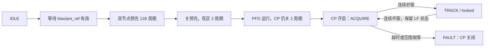
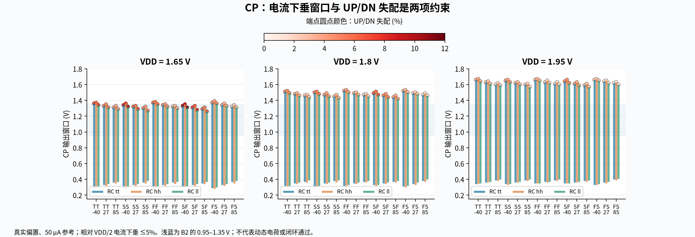

# PLL 环路：PFD、CP、LF、预充与启动监督

> **模块集成**：PLL 已有包含VCO、粗调码接口、分频反馈、PFD/CP/LF的[完整电路顶层](../../analog/pll/top/spice/pll_balanced_core.spice)及[双节点预充启动顶层](../../analog/pll/top/spice/pll_balanced_startup_core.spice)。下面记录已实现参数、分层/原生验证与近期局部迭代；模型用于选参和降低验证成本。层次、边界与迭代可从[设计工作台](../../web/design/index.html#pll)进入。

> **当前修订**：v0.1 电路（PFD、50 µA CP、6.5 kΩ/40 pF/2 pF LF、双节点预充、启动监督 RTL），在 r3 工况下复测。物理 LF 候选尚未采用。
> **关键数字**：PFD→CP 45/45 工况电荷方向正确，有效电荷增益 53.3–59.8 µA；4 个选定工况 × 3 种初值的分层闭环均锁定；线性估计 UGB 3.0–4.4 MHz、相位裕度 63–65°。
> **主要缺口**：r3 原生 PLL 只接回 48 ns，没有持续锁定与从零捕获；LF 的 RC 极限角没有接入闭环；SS 低压高 Vctrl 处 CP 上拉电流不足。
> **环路选择（模型，2026-11-08）**：k=4（Icp 200 µA）、Rz≈4.1 kΩ、Ci≈18 pF，不另加 Cf（VCO控制端自身175–693 fF起Cf作用）；Vctrl工作区间内全部工作点PM ≥ 52°，CDR后14.07σ最差0.363 UI。前提是粗码策略把2 GHz工作点留在Kvco ≥ 约290 MHz/V的区间，见[环路选择](#环路选择r5--4-bit2026-11-08模型)。
> **待改（PLL 收口，I-32）**：VCO r5 候选下比较 k=2/3/4 的实际 CP/LF，k=2 已满足现行抖动模型门槛；LF 电容分接 VDD/地仍待验证。下面的已实现电路还是 50 µA、40 pF、2 pF、全接地。

> **近期局部验证（2026-11-06）**：FF/1.95 V/−40 °C 的 r5 四支路前端，ll/hh 均在偏置就绪初值下跑满 24 ns，VCO约1.989 GHz，三级分频及四路全速/反馈功能检查满足。自动DC仍未完成，原生TX联合缺点和真实上电不因此关闭；初值已登记为 `pll_r5_cold_prebiased_state_v1`。见[分层诊断、边界与波形](../history/pll_cold_convergence.md)。

## 收口计划与进度（2026-11-08）

目标与TX相同：当前版本（r5 VCO＋4 bit阵列、k = 4电流转向CP、PDK环路滤波器）在45条件×RC角上闭环锁定、可从上电启动，各模块局部失配MC与噪声按新环路复核。

| 步 | 内容 | 状态 |
|---|---|---|
| 1 | 环路参数（模型）、粗码策略、电流转向CP | 完成：k = 4、Rz 4.13 kΩ、Ci 18 pF、无Cf；上电按温度选码＋Vctrl迟滞切码；转向CP接真实偏置 |
| 2 | PDK环路滤波器与预充门 | 网表完成；电源分接12/6（α 0.667）按20 MHz单音数据线性估计最差约122 MHz/V（理想0.69为104，13/5为124），待仿真复核；B2按18 pF节点的建立待复核 |
| 3 | 电路闭环（晶体管PFD/CP/LF＋校准行为VCO） | 完成：45条件×tt/hh/ll共135点全部锁定，捕获≤322 ns，过冲≤27.2%，与线性模型逐点差≤7个百分点 |
| 4 | 原生晶体管级VCO/分频器闭环 | 顶层[pll_core_r5k4](../../analog/pll/top/spice/pll_core_r5k4.spice)与测试台[native_k4](../../analog/pll/top/tb/native_k4/run.py)已写；TT：KLU下工作点经true gmin stepping收敛、但瞬态第一步失败（报在带隙修调B源）；改用默认SPARSE求解器后正常起步（二分定位：偏置节点种子不起作用，求解器是关键）。**TT原生闭环锁定：从+40 mV预充118 ns捕获（行为VCO闭环同为118 ns），静态相差33.1 ps（峰峰0.01 ps），Vctrl 1.206 V（码表1.195 V），输出2.00000 GHz**；1.5 µs约1.6 h（`results/analog/pll/top/native_k4/20261108T200611Z`）。FS热、SS冷待跑 |
| 5 | 启动链：偏置就绪 → 预充 → 选码 → 捕获 | 待做 |
| 6 | 局部失配MC：VCO、CP、PFD、分频器、接收器 | 分频器测试台已写（[divider/tb/mc](../../analog/pll/divider/tb/mc/run.py)），待跑 |
| 7 | 噪声与电源抑制按新环路复核 | 待做 |

| 单元 | 实现 | 关键参数 |
|---|---|---|
| PFD [pfd_cmos.spice](../../analog/pll/pfd/spice/pfd_cmos.spice) | 静态 CMOS 上升沿三态 PFD：两个 D=1 的 DFF，主从锁存都异步清零；UP/DN 同时置位后经 NAND 与两级反相器延迟产生公共清零 | 复位延迟节点各 5 fF（理想）；零相差附近保留公共短脉冲 |
| CP [charge_pump.spice](../../analog/pll/cp/spice/charge_pump.spice) | 长沟道电流镜 + 输出串联开关 | N 镜 W/L = 5/1 µm、P 镜 W/L = 20/1 µm（4 指）；开关 N/P = 2/4 µm；UP 驱动 NFET 0.5/0.88、PFET 2/0.15 µm（TT/1.3 V 附近的名义补偿）；外部理想 N/P 参考各 50 µA |
| 可禁用 CP [charge_pump_enabled.spice](../../analog/pll/cp/spice/charge_pump_enabled.spice) | 实际 CMOS AND 门控 UP/DN | 用于启动序列 |
| LF [passive_rc_precharge.spice](../../analog/pll/loop_filter/spice/passive_rc_precharge.spice) | 二阶无源：Cf = 2 pF 并 (Rz = 6.5 kΩ 串 Ci = 40 pF)；ctrl 与积分节点 z 各一个 CMOS 传输门预充 | 预充门 ctrl 4/8 µm、z 16/32 µm；R/C 为理想元件 |
| 物理 LF 候选 [passive_rc_pdk_candidate.spice](../../analog/pll/loop_filter/spice/passive_rc_pdk_candidate.spice) | `res_high_po_0p69`（W 0.69、L 12.44 µm）；42 个约 1 pF 的 `cap_mim_m3_1`（边长 22.1965 µm），40 个作 Ci、2 个作 Cf | 板面积约 0.0207 mm²（不含间距布线） |
| 启动监督 [pll_startup_supervisor.sv](../../digital/pll/rtl/pll_startup_supervisor.sv) | 参考时钟域状态机 | 预充 128 周期 → 断开 2 周期 → PFD 运行 2 周期 → 开 CP → ACQUIRE/TRACK/FAULT |

UP 高有效、注入电荷；VCO Kvco 为正，反馈偏慢时 Vctrl 上升，方向一致。

### 启动序列

250 MHz 下 128 周期 = 512 ns。监督器的 `quality_valid/frequency_good/phase_good` 是外部接口，频率/细相位测量前端尚未实现。

## 已验证结果

### CP 与 PFD→CP（r3 工况，45 条件）

| 项目 | 结果 |
|---|---|
| CP DC 输出扫描 | 45 条件完成 |
| 真实 PFD→CP，−200/0/+200 ps，250 MHz、Vout = 1.2 V | 45/45 净电荷方向正确且单调 |
| 有效电荷增益（两端割线） | 53.31–59.84 µA |
| 线性插值零电荷相位 | −79.4 到 +93.1 ps |
| SS/1.65 V/85 °C、Vctrl = 1.4 V 的 UP/DN | 40.8 / 49.3 µA |

三个相位点不足以证明无死区。零相差残余电荷在闭环中表现为静态相位偏移。来源：[环路 PVT](../history/pll_loop_pvt.md)、[CP 边界](../history/pll_pfd_cp_lf_next.md)。

真实偏置、45 × tt/hh/ll 的 DC 输出窗口见 [VCO 工作区](pll_vco.md#工作区r5-候选45-条件--tt--hh--ll2026-11-06)：窗口按相对中点电流下垂 5% 定义，UP/DN 失配独立记录。不能用 DC 窗口代替开关电荷验收。

TT/27 °C 名义点（v0.1）：Vout = 1.3 V 时 UP/DN = 48.5/49.9 µA；两者都在 50 µA ± 5% 内的输出区间约 0.36–1.42 V。来源：[CP/LF 原型](../history/pfd_cp_lf_results.md)。

### 分层闭环（r3 选定工况）

真实 MOS PFD/CP + 理想 LF 或 PDK LF，接同工况实测的三点分段线性 VCO→÷8 模型。两颗 LF 电容预置到目标 ±40 mV。下表是最终持续合格区间的起点（还需再观察 0.32 µs 确认）：

| 工况 | 码 / 目标 Vctrl | 理想 LF 低起点 | 理想 LF 高起点 | PDK LF 低起点 |
|---|---|---:|---:|---:|
| TT / 1.8 V / 27 °C | 5 / 1.1792 V | 0.386 µs | 0.802 µs | 0.354 µs |
| SS / 1.65 V / −40 °C | 5 / 1.1093 V | 0.514 µs | 0.802 µs | 0.514 µs |
| SS / 1.65 V / 85 °C | 6 / 1.2912 V | 0.706 µs | 0.962 µs | 0.674 µs |
| FS / 1.65 V / 85 °C | 5 / 1.1132 V | 0.450 µs | 0.802 µs | 0.450 µs |

SS 热角高起点在原 1.2 µs 记录中未通过，延长到 2 µs 后通过；电路和阈值未改。来源：[环路 PVT](../history/pll_loop_pvt.md)、[数据](../data/pll_loop_pvt.json)。

### 环路线性模型

| 模型 | UGB | 相位裕度 | 闭环 −3 dB | 峰化 |
|---|---:|---:|---:|---:|
| v0.1 TT（Kvco 464.55 MHz/V，50 µA） | 2.856 MHz | 65.4° | 4.228 MHz | 1.33 dB |
| r3 四工况（同角 Kvco、1.2 V 处 CP 电荷割线） | 3.0–4.4 MHz | 63–65° | — | — |

三阶 Type-II：Z(s) = (1 + sRCi) / [s(Cp + sRCiCf)]，Cp = Ci + Cf。模型不含反馈链延迟、采样 PFD、CP 有限输出电阻和 VCO 控制端负载。来源：[跟踪研判](../history/pll_tracking_assessment.md)。

### 环路选择（r5 / 4 bit，2026-11-08，模型）

**k = 4：Icp 200 µA、Rz ≈ 4.1 kΩ、Ci ≈ 18 pF，不另加 Cf。** 在Vctrl工作区间内的全部工作点上，UGB 4.2–19.9 MHz，最差PM 52.1°（PFD延迟再加0.5 ns时49.3°）；7个噪声压力点PLL rms 1.83–2.98 ps，CDR后14.07σ 0.281–0.363 UI（门槛0.50 UI，最差FS 1.95 V 85 °C hh）。k = 2 / 3在同样约束下最差rms 3.49 / 3.14 ps，因为VCO控制端电容固定了第三极点，较小的Icp只能靠较大的Rz补增益，第三极点随之下移。

**VCO控制端电容必须计入。** 变容管的阱接Vctrl，振荡时控制节点的小信号电容为175–693 fF（81点，15个工艺×RC段，1.65 V 85 °C与1.95 V −40 °C，Vctrl 1.0 V / 1.15 V / CP上沿；Vctrl越低越大，FS最大）。不计入时搜索给出的Cf只有0.2–0.3 pF，比这个负载还小；计入后最优解不再另加Cf。另加40 fF作为CP开关和预充门寄生的估计，待环路bench实测。

**Kvco范围由粗码策略决定，这是环路设计的前提。** 135条件×可用码在2 GHz处的局部Kvco（三点抛物线导数）跨89–1144 MHz/V，低端全在Vctrl < 1.0 V的平坦区；如果全部纳入，最差PM只能勉强到50°，rms 3.4–3.6 ps。把2 GHz工作点限制在Kvco较高的区间后为286–1125 MHz/V（3.9倍），上面的结果就是在这个范围上得出的。同一码从−40 °C到85 °C，Vctrl漂0.12–0.44 V（中位0.22 V），而1.65 V供电时1.0 V到CP上沿只有0.26 V，所以两种策略都可行，需要二选一：

- 上电时按温度选码后冻结：用带隙的PTAT估计当前温度和漂移方向，选一个三温都在0.85 V到上沿之内、且最小Kvco尽量大的码。按工作区已仿真的码（每个条件2 GHz附近的码及两侧各一个，另加0/6/15）和抛物线插值，41/45组存在这样的码，这些码在三温下的Kvco为297–1125 MHz/V；[VCO工作区](pll_vco.md#工作区r5-候选45-条件--tt--hh--ll2026-11-06)的45/45用线性插值和11-07补测点，两种口径待统一。运行中不切码。
- 运行中切码：Vctrl离开1.0 V到上沿时切到相邻码；半单位约4%频率，难以无扰。

方法：[loop_design.py](../../analog/pll/top/theory/loop_design.py)（线性CP-PLL，N = 8，2 ns PFD采样延迟；搜索Rz × Ci × Cf/Ci；稳定性对象为135条件×工作区内的码×LF角：同RC段的poly/MIM实测R、C，另加hl/lh，R另乘温度系数；CP电流取真实偏置CP窗口在VDD/2处的UP/DN均值；噪声取7个压力点的VCO、CP、偏置线噪声和−125 dBc/Hz带内底噪）。控制端负载：[ctrl_load](../../analog/pll/vco/tb/ctrl_load/run.py)，Vctrl串10 mV、50 MHz正弦，振荡中锁相解调。活动：`results/analog/pll/top/loop_design/20261108T014849Z_band1p0_cload`（搜索）、`20261108T015612Z_eval_k4_rz4.13k_ci18.38p_cf0p`（评估与CDR），`results/analog/pll/vco/ctrl_load/20261108T011936Z`。

**200 µA CP的纹波（2026-11-08，晶体管级，TT 1.8 V 27 °C，Vctrl 1.15 V）。** 现行漏端开关CP按4倍缩放（镜像、开关、驱动×4，50 µA参考），锁定态PFD脉冲450 ps、DN按静态相差补偿：UP/DN失配约7.3%（静态相差33 ps，补偿后每周期残余−0.18 fC）。不加Cf、控制端0.4 pF时Vctrl纹波132 mV峰峰，主要是DN开关导通瞬间电流镜漏端（关断时被拉到地）和控制节点的电荷分享（上升沿后0.1 ns下冲97 mV，约0.3 ns恢复）；换算Kvco 1 GHz/V时为11.1 ps峰峰的250 MHz确定性抖动、参考杂散−35 dBc。外加Cf 0.5 / 1 / 2 pF时为5.9 / 4.0 / 2.4 ps、−41 / −45 / −50 dBc，但同一Rz/Ci下环路最差PM降到44 / 38 / 31°。应改CP结构，而不是靠Cf。测试台：[cp/tb/ripple](../../analog/pll/cp/tb/ripple/run.py)；CP子电路新增缩放参数（默认值不变）。

**电流转向CP（探索候选，[charge_pump_steer](../../analog/pll/cp/spice/charge_pump_steer.spice)）把最差周期抖动从28.6 ps降到4.4 ps。** 电流镜、驱动与现行CP相同；每侧一对互补开关，无脉冲时电流流进假负载节点，该节点由跟随器钳在V(out)，电流镜漏端因此一直在Vctrl附近，开关闭合时没有电荷可分。跟随器就是B2 / serdes_ref_vbuf的5管LVT输入OTA，去掉目标DAC和使能开关，尾电流100 µA（ntail 2，暂用理想10 µA参考），假负载节点0.3 pF吸收静态相差窗口和失配电流。5个压力条件 × Vctrl 0.95 V / 1.15 V / 上沿 × 控制端0.25 / 0.7 pF（Kvco按1 GHz/V上限）：

| | 现行漏端开关CP | 电流转向CP |
|---|---|---|
| 周期抖动峰峰 | 0.98–28.6 ps（最差FF 1.95 V −40 °C、0.95 V、0.25 pF） | 0.46–4.4 ps（最差SF 1.65 V 85 °C、1.24 V、0.25 pF） |
| 参考杂散 | −57.5…−24.7 dBc | −67.6…−41.6 dBc |
| Vctrl纹波峰峰 | 19–320 mV | 8.6–53 mV |

两者等脉宽净电荷都在约±25 fC以内（静态相差≤约130 ps），高Vctrl处UP电流下降使其偏负。跟随器的10 µA改由偏置分配的4指PMOS拷贝（与B2相同）提供后，15点结果与理想参考相差≤0.07 ps（`20261108T*_steer_k4_cf0p_realota`）。未做：捕获/切码时跟随器的跟踪，转向CP的直流窗口，剩余纹波（主要是输出开关的栅馈通）的进一步抵消。结果：`results/analog/pll/cp/ripple/20261108T072026Z_drain_k4_cf0p`、`20261108T072026Z_steer_k4_cf0p`。

**电路闭环核对（2026-11-08）：晶体管PFD＋电流转向CP＋PDK环路滤波器在4个压力点与线性模型一致，都在400 ns内捕获。** 环路滤波器[pll_loop_filter_k4](../../analog/pll/loop_filter/spice/passive_rc_pdk_k4.spice)：poly Rz 7.594 µm = 4.13 kΩ，18个1 pF MIM单元（6接地、12接VDD），不加Cf，双节点预充门。注意PDK的cap_mim_m3_1的mf只进失配项、不乘电容，必须逐个实例化（先用mf时Ci只有2 pF，阶跃过冲55%）。VCO＋÷8为行为模型（[vco_feedback_poly](../../analog/pll/vco/behavioral/vco_feedback_poly.spice)，工作区抛物线和实测控制端电容）。测试台[loop_k4](../../analog/pll/top/tb/loop_k4/run.py)：预充到2 GHz点+40 mV，50 ns释放，参考在2 µs处后移100 ps：

| 点（条件:RC:码） | Kvco MHz/V | 控制端fF | 捕获ns | 阶跃过冲 电路 / 线性 | 2%建立ns 电路 / 线性 |
|---|---:|---:|---:|---|---|
| TT 1.8 V 27 °C tt 6 | 832 | 471 | 118 | 11.9% / 12.9% | 186 / 162 |
| FS 1.95 V −40 °C ll 7（模型最差PM） | 286 | 691 | 318 | 26.6% / 23.4% | 310 / 238 |
| FS 1.65 V 85 °C ll 7 | 987 | 542 | 214 | 14.3% / 13.4% | 146 / 149 |
| FS 1.8 V 85 °C hh 1（最高Kvco） | 1125 | 582 | 226 | 9.8% / 15.3% | 250 / 139 |

捕获判据：PFD误差与最终值相差 < 20 ps，且16个参考周期的平均反馈周期在100 ppm内（单周期锁定后仍有约1 ps逐周期残余，瞬时频率带着CP纹波，都不能直接用）。静态相差13–91 ps。

**45条件（RC tt，码表码）全部锁定：** 捕获110–298 ns（中位170 ns，最慢FS/FF 1.95 V冷角），阶跃过冲10.6–19.8%（线性模型12.6–21.5%，逐点差≤2.8个百分点），2%建立102–242 ns，阶跃终值0.999–1.009，静态相差8–107 ps，Kvco 343–985 MHz/V。阶跃在1.2 µs、记录到2.2 µs。

**RC hh与ll也全部锁定（135条件合计）：** hh捕获150–286 ns，过冲7.1–14.2%（线性12.2–18.1%），终值0.999–1.028，Kvco 477–1000 MHz/V；ll捕获206–322 ns，过冲13.5–27.2%（线性12.2–23.4%，最大差7个百分点在FF 1.95 V −40 °C），终值0.994–1.020，Kvco 286–866 MHz/V。ll的最慢与最大过冲都在1.95 V冷角（Kvco最低）。结果：`results/analog/pll/top/loop_k4/20261108T164651Z_grid_hh`、`results/analog/pll/top/loop_k4/20261108T191900Z_grid_ll`。

结果：`results/analog/pll/top/loop_k4/20261108T075812Z`（TT）、`20261108T080656Z`、`20261108T082022Z_grid_tt`（45条件）。

仍是模型结果，下一步：统一冻结码覆盖的口径（必要时在三温边缘补点），定粗码策略；200 µA CP单元可行区（窗口、UP/DN、开关注入，因为没有显式Cf）；物理LF（poly 4.1 kΩ、MIM 18 pF，按约0.69分接VDD/地），预充门和B2按新电容重定；实际CP＋LF＋校准的VCO模型做瞬态阶跃，核对PM。

### 按抖动预算选的环路（r5 候选 VCO，未实现；已被上一节取代）

k 是相对 v0.1 的缩放：Icp 50 µA × k，Ci 40 pF / k，Cf 2 pF / k，Rz 6.5 kΩ 不变。七工况的线性结果（标称环路值，不含 Rz 随电阻角的变化）：

| k | Icp | Ci / Cf | UGB | PM | PLL rms（最差） | CDR 后 14.07σ（最差） |
|---:|---:|---|---:|---:|---:|---:|
| 1 | 50 µA | 40 / 2 pF | 4.3–5.7 MHz | 56–60° | 5.69 ps | 0.563 UI |
| 2 | 100 µA | 20 / 1 pF | 8.5–11.4 MHz | 52–57° | 3.78 ps | 0.425 UI |
| **4** | **200 µA** | **10 / 0.5 pF** | **17–23 MHz** | **44–51°** | **2.75 ps** | **0.323 UI** |
| 6 | 300 µA | 6.7 / 0.33 pF | 26–34 MHz | 36–45° | 2.43 ps | 0.284 UI |
| 8 | 400 µA | 5 / 0.25 pF | 34–45 MHz | 27–39° | 2.43 ps | 0.270 UI |

- k = 4 是当前噪声/面积候选：k 再大抖动改善很少（底噪和 CP 开始抬头），PM 掉得快；k = 1 不满足 0.50 UI 门槛（[规格](../overview/spec.md#抖动与相位噪声预算)），但 k = 2 的 0.425 UI 已满足该模型门槛。实际 CP/LF 收口前比较 k = 2/3/4 的稳定性、捕获、杂散与面积；k = 4 的 Ci 10 pF 约是原来面积的 1/4。七工况的延迟/RC 敏感性复算见[设计耦合评估](../history/design_coupling_review_20261106.md)；模型已有 2 ns PFD 延迟。
- Kvco 比 r3 大 2–4 倍，PM 最差只有 44°，而且 R hh 下 Rz 更大。收口时 Rz、Cf 按角重定，不照搬缩放值。
- 参考杂散手算（k = 4、Kvco 924 MHz/V、UP/DN 失配 5 %）：Cf 上约 8.9 mV 的窄脉冲，基波约 0.9 mV，相位偏移约 0.0033 rad，折合约 0.002 UI 峰峰。B2 关断漏电 186 nA 的影响更小。都没有仿真。
- 电容分接：Ci、Cf 都按约 0.7 : 0.3 分接 VDD 和地，见 [VCO 电源灵敏度](pll_vco.md#电源灵敏度r5-候选)。

### 预充

| 观察量 | 原单点预充 | 双节点预充 |
|---|---:|---:|
| 两状态建立到 1.40 V ± 1 mV（500 Ω 参考源） | 2868 ns | 204.6 ns |
| 参考源峰值电流 | 0.521 mA | 2.619 mA |

上表是普通 CMOS 门和 500 Ω 理想参考源（TT），释放 1 ns 后 ctrl 扰动约 +1.04 mV。来源：[启动优化](../history/pll_startup_optimization.md)。

片内缓冲 [B2](bias.md#lf-预充缓冲-b2)：尾电流 300 µA，到 10 mV ≤ 360 ns，45 条件 × 电阻角。预充门因此改为普通 NMOS + LVT PMOS（原门在 SS / SF 1.65 V −40 °C 有死区），释放扰动变为 1 ns 后 +1.7…+2.3 mV（1.1 V 目标）；关断漏电最差 186 nA。闭环未复验。

### 原生接回

- **v0.1，TT。** 预充 LF 并对齐参考相位后，原生 PLL 满足持续判据：最后 512 UI 频差 +1.6 ppm，展开相差跨度 0.0008 UI。这是近锁初始化，不是上电捕获。来源：[实际时钟分发](../history/physical_clock_distribution_results.md)。
- **r3，TT。** 预充开关 40 ns 断开、48 ns 释放 PFD，观察到 96 ns；反馈相差从约 1.206 ns 降到约 168 ps。48 ns 不满足 320 ns 保持判据。

### 物理 LF 角

| 条件 | R | Ci | Cf |
|---|---:|---:|---:|
| tt / 27 °C | 6.508 kΩ | 40.00 pF | 2.000 pF |
| ll / 27 °C | 5.508 kΩ | 35.21 pF | 1.761 pF |
| hh / 27 °C | 7.508 kΩ | 44.93 pF | 2.246 pF |
| tt / −40 °C | 6.332 kΩ | 40.00 pF | 2.000 pF |
| tt / 85 °C | 6.714 kΩ | 40.00 pF | 2.000 pF |

MIM 模型的温度系数为 0。来源：[首轮 PVT](../history/pll_pvt_first_results.md)。

## 适用范围

- 分层闭环用实测 VCO 曲线模型，不含 VCO 噪声、控制端负载、分频状态和传播延迟。
- LF 电容预偏置在目标附近；不是从零充电或全频段捕获。
- 偏置参考为理想 50 µA/0.85 mA；PDK LF 用典型无源段。
- 锁定是无噪声工程判据，不是抖动签核。

## 待解决

- r3 原生持续锁定与从零捕获（[问题清单](../status/open_issues.md) I-08）。
- CP 高 Vctrl 处 UP/DN 失配与输出窗口（I-12）。
- LF RC 极限角接入闭环；决定是否采用物理 LF（I-13）。
- 启动测量前端、片内预充参考、看门狗、自动粗搜（I-21）。
- 按上面的预算改环路值、LF 分接，闭环重验证（I-32）；核实带内底噪和 CP 占空比（I-05）。
