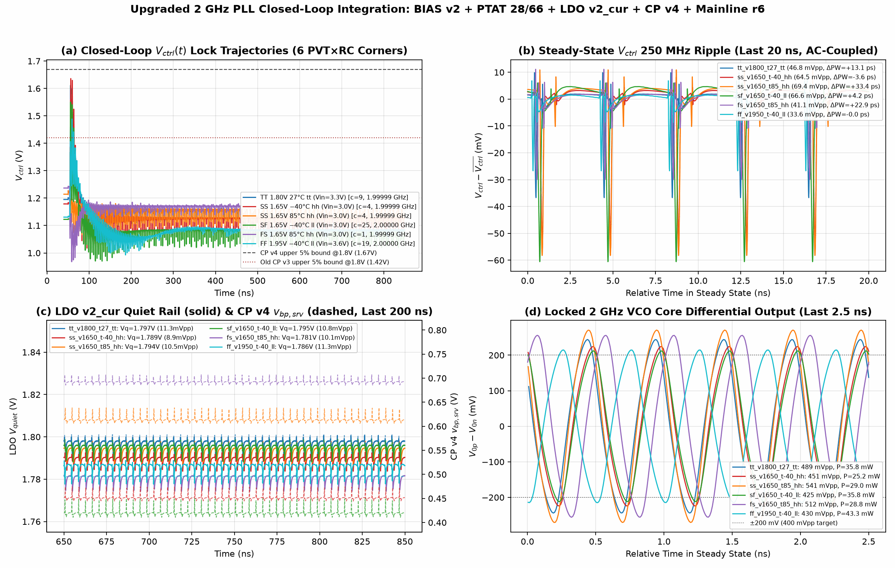
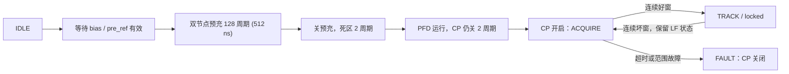

# PLL 环路架构：PFD、CP v4、融合 LF k4、启动与双速演进

项目级最新验证数字与采用边界统一见 [current.md](../status/current.md)，固定签核台账见 [v1.0 证据目录](../../results/catalog/v1_0_subsystem_evidence.json) 与 [5G 签核台账](../../results/catalog/serdes_5g_signoff_20261126.json)。本页汇总共享的 Type-II CP-PLL 环路核心（`PFD sc_dly` + `CP v4` + 融合 `LF k4` + `HV18 LDO` 供电分域 + 数字启动监督），并衔接 **4 Gb/s 环振 VCO (`r6` + PTAT `28/66`)** 与 **5 Gb/s 双速八边形 LC-VCO (`lc_vco_5g_oct_pdk`)** 两条振荡器/分频器路线。

---

## 1. 当前架构与核心模块组成

两代主线共用同一套 `250 MHz` 参考域 `PFD / CP / LF` 环路核心、启动监督协议与 `HV18` 安静供电架构，区别集中在 VCO 核与高频分频反馈链：

| 模块 | 4.0 Gb/s 主线（PLL v4） | 5.0 Gb/s 双速 Plan-C（4/5 Gb/s） | 源码与详细文档 |
|---|---|---|---|
| **振荡器（VCO）** | 四级差分环振 `vco_ring4_r6`（2.0 GHz，5-bit 电容阵 + BIAS v2 PTAT `28/66` 温补，`sym9_clean` CPEX） | 八边形电感 `lc_vco_5g_oct_pdk` + 同步 `÷2` I/Q 发生器（4.469–5.350 GHz 公共交集，125 °C 冻码 PASS） | [r6/PTAT 码窗](pll_vco_r6_ptat.md) · [r6 性能与相噪](pll_vco_r6_perf.md) · [analog/pll/vco_5g](../../analog/pll/vco_5g/README.md) |
| **分频与反馈接收** | 片级采用 `r5` v6 CML→CMOS + SAFF-TSPC 重定时 `÷8`（发布 7 角闭环台暂用冻结 `clock_frontend_r6q` CML `÷8`，v4.2 台已接入 `r5 + v2_cand`） | 双速独立 A/B 分频器 `div_ab_5g_v2_pdk`（`÷8 / ÷10`，6/6 角 + 50/50 SS 冷角 MC 100% PASS，`M5 = 0%`） | [SAFF-TSPC ÷8](pll_tspc_reclock_divider.md) · [反馈 A 与精准分频 B](pll_feedback_data_dividers.md) · [时钟接收器](clock_receiver.md) |
| **鉴频鉴相器（PFD）** | `pll_pfd_sc_dly`（`sky130_fd_sc_hd` 标准单元 + 复位环路 `dlygate4sd1_1`、`inv_4→inv_8` 输出缓冲） | 同左（共用 `pdk` 版图宏） | [pfd_sc.spice](../../analog/pll/pfd/spice/pfd_sc.spice) · [analog/pll/pfd](../../analog/pll/pfd/README.md) |
| **电荷泵（CP）** | `pll_cp_steer_v4`（`Icp = 200 µA`，1/4 单位指副本主动伺服 + 宽摆幅 PMOS 转向开关；`v4.1` 含降毛刺微修） | 同左（共用 `v4_pdk` 宏，8 端口兼容） | [CP v4/v4.1](pll_cp_v4.md) · [charge_pump_steer_v4.spice](../../analog/pll/cp/spice/charge_pump_steer_v4.spice) |
| **环路滤波器（LF）** | 融合二阶无源 `lf_k4_fused`（`Rz = 4.13 kΩ`、`Ci = 18.38 pF` 12/6 电源分接、不另加 `Cf`、双节点 CMOS 预充门，`6,382 µm²`） | 同左（共用 `fused_pdk` 宏） | [passive_rc_pdk_k4.spice](../../analog/pll/loop_filter/spice/passive_rc_pdk_k4.spice) · [fused_pdk](../../analog/pll/loop_filter/layout/variants/fused_pdk/README.md) |
| **供电与偏置** | HV18 LDO `v2_cur` + 慢尾偏置滤波 `bias_filter_r4`（`1 MΩ / 16 pF`）+ `BIAS v2` | HV18 LDO Kelvin 加固版 `v2_cur_kelvin_pdk` + 叠层慢尾滤波 + `BIAS v2` | [LDO v2/Kelvin](ldo_v2.md) · [BIAS v2](bias_v2.md) |
| **启动监督与粗码控制** | `serdes_digital_top_v3` 内置 `pll_control_top`（5-bit 粗调 + `pll_startup_supervisor` + 无计数器锁定检测） | `serdes_digital_top_v4` (`v4p1`) 内置双速 `pll_control_top`（`250 MHz` 参考域 ÷4 同步控制） | [pll_control_top.sv (v3)](../../digital/pnr/rtl_v3/pll_control_top.sv) · [pll_control_top.sv (v4)](../../digital/pnr/rtl_v4_32b/pll_control_top.sv) · [监测工具包](monitor.md) |

UP 高有效、注入电荷；VCO `Kvco` 为正，反馈偏慢时 `Vctrl` 上升，环路为负反馈。

### 启动与捕获序列

- **双节点预充**：对 `ctrl` 与积分节点 `z` 同时经普通 NMOS + LVT PMOS 传输门预充（规避 `SS/SF 1.65 V −40 °C` 传输门死区），由 [BIAS v2](bias_v2.md) 真 4→16 CMOS 译码 `ref_pbuf_v2` 驱动，512 ns 内建立至 `0.1–3.0 mV` 误差且对 `Vbg` 反冲 `≤ 0.005 mV`。
- **无毛刺模拟控制口**：`serdes_digital_top_v3` (v3.1) 与 `v4p1` 将直接驱动模拟开关的 `precharge_en`、`pfd_rst_b`、`cp_en`、`locked` 均改为纯触发器直出，彻底消除状态切换与异步 `abort` 导致的组合毛刺。

---

## 2. 环路参数选型（`k = 4` + 融合 LF + 电流转向 CP v4）

环路核心按 [loop_design.py](../../analog/pll/top/theory/loop_design.py)、[pll_noise.py](../../analog/pll/top/theory/pll_noise.py) 与 [cdr_jitter.py](../../analog/pll/top/theory/cdr_jitter.py) 联合优化，核心设计依据：

1. **为什么定档 `k = 4`（`Icp = 200 µA`, `Rz = 4.13 kΩ`, `Ci = 18.38 pF`, `Cf_ext = 0`）**：
   - VCO 变容控制端在振荡下的物理小信号电容本身已达 `389–718 fF`（叠加 CP v4 输出 `19.9 fF` 与预充门寄生后 `C_ctrl ≈ 449–778 fF`），天然构成第三极点；因此不再外挂显式 `Cf`，避免在 `Rz_hh` 下压低相位裕度。
   - `k = 2/3` 为维持带宽需更大 `Rz`，会把第三极点拉低并导致最差闭环抖动升至 `3.1–3.5 ps`；`k = 8` 虽可改善 20 MHz 电源抑制，但对 3–5 MHz 主导频段改善甚微且面积/电流翻倍，因此最终保留 **`k = 4` + HV18 LDO 独立稳压**。
   - 在 **4G `r6` + PTAT `28/66` + `CP v4` + `LDO v2 CPEX`** 下，5 代表角线性环路 `UGB = 7.46–18.16 MHz`、`PM = 49.3°–65.1°`（TT `11.75 MHz / 60.0°`），闭环积分抖动 `1.83–2.29 ps (10 kHz–100 MHz)`，4 Gb/s CDR 滤波后 `14.07σ = 0.272–0.296 UI`（门槛 `0.500 UI`，详见 [pll_vco_r6_perf.md](pll_vco_r6_perf.md)）。
2. **电流转向 + 副本主动伺服（`CP v4`）取代漏端开关 CP**：
   - 早期漏端开关 CP 在无显式 `Cf` 时因电流镜漏端电荷分享导致最差周期抖动 `28.6 ps`、参考杂散 `−24.7 dBc`；切换至电流转向拓扑后将周期抖动压低至 `0.46–4.4 ps`、杂散 `−41.6..−67.6 dBc`。
   - 升级至 [CP v4](pll_cp_v4.md) 后，1/4 单位指副本伺服把 135 角 UP/DN 电流失配从 `11.29%` 压缩 **58×** 至 **`0.193%`**，并将 `1.65 V` 线性上限从 `1.26 V` 拓宽至 **`1.49 V`**（距 `vhi` 裕量 `+251 mV`），彻底消除低压高温偏角的静态相差恶化。
3. **融合电容版图 `lf_k4_fused`（`fused_pdk`）**：
   - 将 18 颗 1 pF `cap_mim_m3_1`（12 接 `VDD` / 6 接 `VSS`，分接比 `α = 2/3`）融合排布，版图面积缩至 **`6,382 µm²`**，且 `ctrl` 节点提取寄生较离散 MIM 降低 **`−41.4%`**；注意 SKY130A 中 `cap_mim_m3_1` 的 `mf` 参数仅进入失配项而不乘名义电容（见 [统计与蒙特卡洛](../verification/statistics.md#sky130a-失配与高阻多晶硅热噪声边界pdk-实测核对)），网表与版图均须显式实例化全部电容单元。

---

## 3. PFD `sc_dly` 与锁定检测相位窗口

- **标准单元复位延迟加固（`pll_pfd_sc_dly`，[pfd_sc.spice](../../analog/pll/pfd/spice/pfd_sc.spice)）**：
  - 采用 `sky130_fd_sc_hd` `dfrtp_1` + `nand2_1` + `2×inv_1` + **`dlygate4sd1_1`** + `and2_1` 及 `inv_4 → inv_8` 输出驱动。
  - 若省略 `dlygate4sd1_1`，复位环路名义延迟仅 `1.02–1.2×` `dfrtp_1` removal 约束，在 `SF 1.65 V −40 °C` 局部失配 MC 下出现 `5/100` 卡死样本；加入 `dlygate4sd1_1` 后环路延迟达 `1.4–1.65×` removal 约束（TT `483/489 ps`，SS 冷 `947/963 ps`，FF 冷 `307/311 ps`）。
  - 失配 MC（[pfd_cp_mc/run.py](../../analog/pll/pfd/tb/pfd_cp_mc/run.py) `--pfd sc_dly`，`SF/SS 1.65 V −40 °C` 各 100 样本）：**0/200 卡死、无死区**（`±5 ps / ±40 ps` 增益比 `0.84–1.28`），静态相差上界 `|均值| + kσ` 为 `239 / 256 ps`（名义 7 角见 [pfd_cp_sc/run.py](../../analog/pll/pfd/tb/pfd_cp_sc/run.py)）。
- **锁定检测相位窗口（[phase_window_pdk.spice](../../analog/pll/pfd/spice/phase_window_pdk.spice)）**：
  - 45 条件门限为 `225–750 ps`（45/45 零相位不置位、45/45 单调）；在最慢 `SF/SS 1.65 V −40 °C` 下门限与 `sc_dly` 静态相差上界比值仍达 **`2.7× / 2.9×`**，可干净区分锁定态与失锁态。

---

## 4. 供电分域、尾偏置滤波与宿主延迟路径

电源抑制分析（[psrr_lf/run.py](../../analog/pll/vco/tb/psrr_lf/run.py)、[bias_path_ac/run.py](../../analog/pll/vco/tb/bias_path_ac/run.py)、[supply_split.py](../../analog/pll/top/theory/supply_split.py)、[ldo_supply_tolerance.py](../../analog/pll/top/theory/ldo_supply_tolerance.py)）确立了三项跨模块架构原则：

1. **独立安静域（`VDD_Q`）+ 慢尾偏置滤波必须成对使用**：
   - PLL 频率受两条电源路径共同调制：VCO/CP/LF 所在安静域（`K_q`）与宿主偏置经 PMOS 拷贝送来的尾偏置线（`K_b = 2.28–3.67 GHz/V`）。
   - 单靠 `12/6` 电容分接（`α = 2/3`）无法消除 `3–5 MHz` 环路交越附近的灵敏度峰，1.8 V 直供单音容限仅 ~`8.8 mV` 峰值；引入 **HV18 LDO（`v2_cur` / `v2_cur_kelvin_pdk`）** 独立稳压 `VDD_Q` 并配接 **`1 MΩ / 16 pF` 慢尾滤波**（`fc ≈ 9.95 kHz`，`bias_filter_r4` / `bias_filter_stacked`）后，不仅将偏置线高频耦合与噪声压至 `< 0.03 ps`，还把 `3.3 V` 输入纹波容限提升至 `> 1 V` 量级。
2. **宿主域定时延迟路径（`Kd`）与纯 CMOS 重定时收益**：
   - 早期 CML 反馈链（`clock_frontend_r6q`）中，宿主域反馈 CML→CMOS 接收器与级联预分频在 `SS 1.65 V −40 °C` 下延迟灵敏度高达 `−2.13 ps/mV`，在环路带宽内 1:1 折为输出相移，成为低压宿主纹波主导瓶颈。
   - 切换至 **SAFF-TSPC 同构重定时 ÷8**（[pll_tspc_reclock_divider.md](pll_tspc_reclock_divider.md)）后，分频器宿主敏感度 `Kd` 较级联纹波降低 **`2.3×–2.85×`**（TT `0.120`、FS85 `0.153`、SS-40 `0.353 ps/mV`）；参考输入侧进一步可采用匹配接收路径抵消共模供电延迟。
3. **跨电源域电平边界**：
   - `VCO`、`4× 首级缓冲`、`CP v4`、`融合 LF` 与粗码驱动置于 `VDD_Q`（HV18 LDO 输出 `1.78–1.80 V`）；`PFD`、分频与数字控制置于宿主 `1.8 V` 域。闭环验证确认宿主与 `VDD_Q` 间最大 `±150 mV` 压差下跨域接口正常工作。

---

## 5. 闭环验证与 5G 双速演进摘要

| 验证台 / 架构 | 顶层网表与脚本 | 已验证结论 | 未覆盖边界 |
|---|---|---|---|
| **4G PLL v4 发布闭环台** | [pll_top_r6_v4_upgrade.spice](../../analog/pll/top/spice/pll_top_r6_v4_upgrade.spice) · [verify_pll_v4_closed_loop.py](../../analog/pll/top/tb/lock_v4/verify_pll_v4_closed_loop.py) | **7/7 角通过 320 ns 锁定合同**（[pll_lock_screen.toml](../../verification/contracts/pll_lock_screen.toml)）：保持 `416–640 ns`，频偏 `−4.75..+2.25 ppm`，TT 静态相差 `+12.2 ps`，250 MHz 杂散估计 `−40..−59 dBc`，`TIE_pp 0.74–4.11 ps`，TT `35.8 mW`；6 点接入真实 `HV18 v2_cur`（`VDD_Q = 1.781–1.797 V`） | 原理图固定粗码、预充后捕获；冻结台使用 `clock_frontend_r6q` CML 反馈，SF 热点直供 1.65 V |
| **4G PLL v4.2（SAFF 反馈候选）** | [pll_top_r6_v4p2_saff.spice](../../analog/pll/top/spice/pll_top_r6_v4p2_saff.spice) · [verify_pll_v4p2_saff.py](../../analog/pll/top/tb/verify_pll_v4p2_saff.py) | `4× r5` + 加固 SAFF ÷8 `v2_cand` 直接反馈：TT、SS 冷、FS 热 **3/3 通过 140 ns 预充后短窗筛查**（末 40 ns 频差 `+597 / −229 / −200 ppm`） | 尚缺 320 ns 正式工程保持记录、实际 TX/RX 负载、顶层 RCX 与从零自动粗搜 |
| **5G 双速 LC-PLL 单元签核** | [lc_5g_div2_oct_pdk.spice](../../analog/pll/vco_5g/spice/lc_5g_div2_oct_pdk.spice) · [pll_div_ab_5g_v2.spice](../../analog/pll/divider/spice/pll_div_ab_5g_v2.spice) | 八边形 LC-VCO `lc_vco_5g_oct_pdk` 6/6 角 + **125 °C 冻码 3/3 PASS**（公共交集 `4.469–5.350 GHz`、24/24 SS85 MC 锁定 `I/Q σ = 0.65 ps`）；`div_ab_5g_v2_pdk` 6/6 角（12/12 `÷8/÷10`）+ 50/50 SS 冷角 MC PASS；已与共享 `PFD / CP v4 / LF k4 / HV18 Kelvin` 完成 Plan-C 全片物理装配（`DRC=0`、层级提取通过） | 5G LC-VCO + `div_ab_5g_v2_pdk` + `CP v4` + `LF k4` 的长时原生闭环锁定与全片带载 I/Q 寄生回归仍在片顶收口队列（见 [open_issues.md](../status/open_issues.md)） |

---

## 适用范围与待收口事项

- 本页记录的闭环仿真均为固定粗码、双节点预充后的原理图瞬态，不替代从零上电自动粗搜与全片 RCX 锁定签核。
- 4G 环路 `FS 1.65 V 85 °C hh` 下线性 PM 贴近 `49.3°`（见 [pll_vco_r6_perf.md](pll_vco_r6_perf.md)），后续全片集成可按需微调 `Rz` 或核对实际提取负载。
- 待收口项（采用反馈链 320 ns 判锁、参考输入复制接收路径、5G LC-PLL 原生闭环、Pad/ESD 与带载联调）统一追踪于 [open_issues.md](../status/open_issues.md) 与 [prelayout_plan.md](../status/prelayout_plan.md)。
