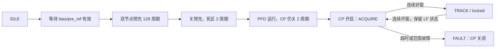

# PLL 环路：PFD、CP、LF、预充与启动监督

> **当前修订**：v0.1 电路（PFD、50 µA CP、6.5 kΩ/40 pF/2 pF LF、双节点预充、启动监督 RTL），在 r3 工况下复测。物理 LF 候选尚未采用。
> **关键数字**：PFD→CP 45/45 工况电荷方向正确，有效电荷增益 53.3–59.8 µA；4 个选定工况 × 3 种初值的分层闭环均锁定；线性估计 UGB 3.0–4.4 MHz、相位裕度 63–65°。
> **主要缺口**：r3 原生 PLL 只接回 48 ns，没有持续锁定与从零捕获；LF 的 RC 极限角没有接入闭环；SS 低压高 Vctrl 处 CP 上拉电流不足。

## 电路

| 单元 | 实现 | 关键参数 |
|---|---|---|
| PFD [pfd_cmos.spice](../../analog/pll/pfd/spice/pfd_cmos.spice) | 静态 CMOS 上升沿三态 PFD：两个 D=1 的 DFF，主从锁存都异步清零；UP/DN 同时置位后经 NAND 与两级反相器延迟产生公共清零 | 复位延迟节点各 5 fF（理想）；零相差附近保留公共短脉冲 |
| CP [charge_pump.spice](../../analog/pll/cp/spice/charge_pump.spice) | 长沟道电流镜 + 输出串联开关 | N 镜 W/L = 5/1 µm、P 镜 W/L = 20/1 µm（4 指）；开关 N/P = 2/4 µm；UP 驱动 NFET 0.5/0.88、PFET 2/0.15 µm（TT/1.3 V 附近的名义补偿）；外部理想 N/P 参考各 50 µA |
| 可禁用 CP [charge_pump_enabled.spice](../../analog/pll/cp/spice/charge_pump_enabled.spice) | 实际 CMOS AND 门控 UP/DN | 用于启动序列 |
| LF [passive_rc_precharge.spice](../../analog/pll/loop_filter/spice/passive_rc_precharge.spice) | 二阶无源：Cf = 2 pF 并 (Rz = 6.5 kΩ 串 Ci = 40 pF)；ctrl 与积分节点 z 各一个 CMOS 传输门预充 | 预充门 ctrl 4/8 µm、z 16/32 µm；R/C 为理想元件 |
| 物理 LF 候选 [passive_rc_pdk_candidate.spice](../../analog/pll/loop_filter/spice/passive_rc_pdk_candidate.spice) | `res_high_po_0p69`（W 0.69、L 12.44 µm）；42 个约 1 pF 的 `cap_mim_m3_1`（边长 22.1965 µm），40 个作 Ci、2 个作 Cf | 板面积约 0.0207 mm²（不含间距布线） |
| 启动监督 [pll_startup_supervisor.sv](../../digital/pll/rtl/pll_startup_supervisor.sv) | 参考时钟域状态机 | 预充 128 周期 → 断开 2 周期 → PFD 运行 2 周期 → 开 CP → ACQUIRE/TRACK/FAULT |

UP 高有效、注入电荷；VCO Kvco 为正，反馈偏慢时 Vctrl 上升，方向一致。

### 启动序列

250 MHz 下 128 周期 = 512 ns。监督器的 `quality_valid/frequency_good/phase_good` 是外部接口，频率/细相位测量前端尚未实现。

## 已验证结果

### CP 与 PFD→CP（r3 工况，45 条件）

| 项目 | 结果 |
|---|---|
| CP DC 输出扫描 | 45 条件完成 |
| 真实 PFD→CP，−200/0/+200 ps，250 MHz、Vout = 1.2 V | 45/45 净电荷方向正确且单调 |
| 有效电荷增益（两端割线） | 53.31–59.84 µA |
| 线性插值零电荷相位 | −79.4 到 +93.1 ps |
| SS/1.65 V/85 °C、Vctrl = 1.4 V 的 UP/DN | 40.8 / 49.3 µA |

三个相位点不足以证明无死区。零相差残余电荷在闭环中表现为静态相位偏移。来源：[环路 PVT](../history/pll_loop_pvt.md)、[CP 边界](../history/pll_pfd_cp_lf_next.md)。

TT/27 °C 名义点（v0.1）：Vout = 1.3 V 时 UP/DN = 48.5/49.9 µA；两者都在 50 µA ± 5% 内的输出区间约 0.36–1.42 V。来源：[CP/LF 原型](../history/pfd_cp_lf_results.md)。

### 分层闭环（r3 选定工况）

真实 MOS PFD/CP + 理想 LF 或 PDK LF，接同工况实测的三点分段线性 VCO→÷8 模型。两颗 LF 电容预置到目标 ±40 mV。下表是最终持续合格区间的起点（还需再观察 0.32 µs 确认）：

| 工况 | 码 / 目标 Vctrl | 理想 LF 低起点 | 理想 LF 高起点 | PDK LF 低起点 |
|---|---|---:|---:|---:|
| TT / 1.8 V / 27 °C | 5 / 1.1792 V | 0.386 µs | 0.802 µs | 0.354 µs |
| SS / 1.65 V / −40 °C | 5 / 1.1093 V | 0.514 µs | 0.802 µs | 0.514 µs |
| SS / 1.65 V / 85 °C | 6 / 1.2912 V | 0.706 µs | 0.962 µs | 0.674 µs |
| FS / 1.65 V / 85 °C | 5 / 1.1132 V | 0.450 µs | 0.802 µs | 0.450 µs |

SS 热角高起点在原 1.2 µs 记录中未通过，延长到 2 µs 后通过；电路和阈值未改。来源：[环路 PVT](../history/pll_loop_pvt.md)、[数据](../data/pll_loop_pvt.json)。

### 环路线性模型

| 模型 | UGB | 相位裕度 | 闭环 −3 dB | 峰化 |
|---|---:|---:|---:|---:|
| v0.1 TT（Kvco 464.55 MHz/V，50 µA） | 2.856 MHz | 65.4° | 4.228 MHz | 1.33 dB |
| r3 四工况（同角 Kvco、1.2 V 处 CP 电荷割线） | 3.0–4.4 MHz | 63–65° | — | — |

三阶 Type-II：Z(s) = (1 + sRCi) / [s(Cp + sRCiCf)]，Cp = Ci + Cf。模型不含反馈链延迟、采样 PFD、CP 有限输出电阻和 VCO 控制端负载。来源：[跟踪研判](../history/pll_tracking_assessment.md)。

### 预充

| 观察量 | 原单点预充 | 双节点预充 |
|---|---:|---:|
| 两状态建立到 1.40 V ± 1 mV（500 Ω 参考源） | 2868 ns | 204.6 ns |
| 参考源峰值电流 | 0.521 mA | 2.619 mA |

释放 1 ns 后 ctrl 扰动约 +1.04 mV。片内预充参考/缓冲（需承担约 2.6 mA 峰值）尚未设计。来源：[启动优化](../history/pll_startup_optimization.md)。

### 原生接回

- **v0.1，TT。** 预充 LF 并对齐参考相位后，原生 PLL 满足持续判据：最后 512 UI 频差 +1.6 ppm，展开相差跨度 0.0008 UI。这是近锁初始化，不是上电捕获。来源：[实际时钟分发](../history/physical_clock_distribution_results.md)。
- **r3，TT。** 预充开关 40 ns 断开、48 ns 释放 PFD，观察到 96 ns；反馈相差从约 1.206 ns 降到约 168 ps。48 ns 不满足 320 ns 保持判据。

### 物理 LF 角

| 条件 | R | Ci | Cf |
|---|---:|---:|---:|
| tt / 27 °C | 6.508 kΩ | 40.00 pF | 2.000 pF |
| ll / 27 °C | 5.508 kΩ | 35.21 pF | 1.761 pF |
| hh / 27 °C | 7.508 kΩ | 44.93 pF | 2.246 pF |
| tt / −40 °C | 6.332 kΩ | 40.00 pF | 2.000 pF |
| tt / 85 °C | 6.714 kΩ | 40.00 pF | 2.000 pF |

MIM 模型的温度系数为 0。来源：[首轮 PVT](../history/pll_pvt_first_results.md)。

## 适用范围

- 分层闭环用实测 VCO 曲线模型，不含 VCO 噪声、控制端负载、分频状态和传播延迟。
- LF 电容预偏置在目标附近；不是从零充电或全频段捕获。
- 偏置参考为理想 50 µA/0.85 mA；PDK LF 用典型无源段。
- 锁定是无噪声工程判据，不是抖动签核。

## 待解决

- r3 原生持续锁定与从零捕获（[问题清单](../status/open_issues.md) I-08）。
- CP 高 Vctrl 处 UP/DN 失配与输出窗口（I-12）。
- LF RC 极限角接入闭环；决定是否采用物理 LF（I-13）。
- 启动测量前端、片内预充参考、看门狗、自动粗搜（I-21）。
- 环路带宽需按相噪预算重新选取（I-05）。
