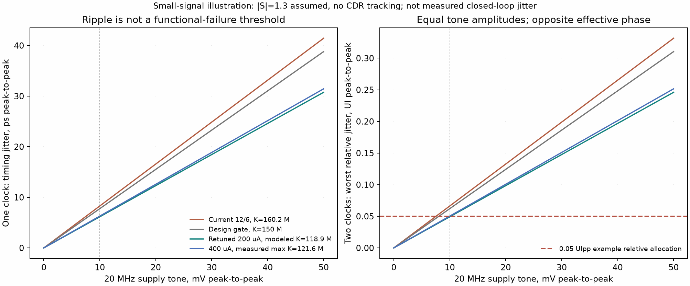

# 电源纹波的量级与抖动预算口径

**当前“超过150MHz/V”表示供电抖动预算的设计门槛未过，不表示5mV测试纹波已经造成链路功能失败。** 仓库还没有给实际供电网络定出纹波谱与上限。设计要同时约束供电噪声和电路灵敏度，不能仅凭其中一个数判断能否工作，也不能以短序列功能正常代替BER和PVT验收。

现有LF已使用电容分接来抵消供电耦合，不是完全未做抑制的VCO。保持理想ctrl不随VDD变化的分解实验得到约数百MHz/V的耦合；接实际LF后当前最差约160MHz/V。单独给VCO加LDO并非唯一方法，见[候选空间](pll_supply_options.md)。

## 5mV是什么口径

PSRR测试台的激励为`SIN(VDD 0.005 20MHz ...)`：5mV是**峰值**，即VDD在名义值上下各摆5mV，总计**10mVpp**。这是一个确定频率的正弦，不等于实际宽带电源噪声；也不是对全频段10mVpp的验证。

量级参考：AMD的[Versal GTY/GTYP供电要求](https://docs.amd.com/r/en-US/am002-versal-gty-transceivers/Power-Supply-and-Filtering)将芯片引脚处总供电噪声限制为10mVpp，同时列出稳压器、供电网络和其他电路耦合作为来源。该限制针对特定商用器件，不能直接移作本项目规格；它说明10mVpp并非不现实的严苛激励，商用SerDes正常工作也有明确的供电前提。

是否需要额外片上稳压由接口预算决定。片外供电、去耦和布线能够把噪声控制在接口允许值内时，可以不增加专用片上LDO；如果供电噪声超过允许值，就需要改善供电、降低耦合或两者同时做。不能把“没有专用LDO”视为“没有供电处理”。

## 换算成时间误差

单音小信号下，令`K`为已有LF负载下、闭环外加误差灵敏度之前的供电到频率增益，`S=1/(1+L)`为闭环误差灵敏度，纹波频率为`fr`，载波为`f0`：

`单PLL时间抖动峰峰值 = |K| × VDD纹波峰峰值 × |S| / (2π × fr × f0)`。

频率扰动积分成相位，因此不能直接用瞬时周期误差代替累积的边沿时间误差。2GHz时钟的周期是500ps，而4Gb/s数据的UI是250ps；换算UI使用数据位宽。

以下**仅作量级估算**：K=160.2MHz/V，fr=20MHz，f0=2GHz，假设|S|=1.3，CDR不跟踪这个单音，只看一个PLL的VCO/LF通路。不是已经测出的锁定态抖动，也不包括CP供电、buffer和接收器的附加响应。

| VDD正弦纹波 | 单PLL时间抖动峰峰值 | 单PLL时间抖动峰值 | 4Gb/s数据UI峰峰值 |
|---|---:|---:|---:|
| 5mVpp | 4.14ps | 2.07ps | 0.0166UIpp |
| **10mVpp（当前测试激励）** | **8.29ps** | **4.14ps** | **0.0331UIpp** |
| 20mVpp | 16.57ps | 8.29ps | 0.0663UIpp |
| 30mVpp | 24.86ps | 12.43ps | 0.0994UIpp |
| 50mVpp | 41.43ps | 20.72ps | 0.1657UIpp |
| 100mVpp | 82.86ps | 41.43ps | 0.3315UIpp |

5mV峰值处以外均为线性缩放示例，尤其50/100mVpp没有电路线性度或功能证据。单音幅度相同时，纹波频率和PLL/CDR响应不同，时间误差会不同；不能把20MHz数据直接拿去判断开关电源基波、谐波或瞬态跌落。

同样假设下，150MHz/V门槛对应10mVpp时7.76pspp；160.2对应8.29pspp，只差约0.53pspp。因此150附近不存在物理的功能悬崖。若完全不利用LF抵消、K约800MHz/V，相同假设下10mVpp约41pspp（0.166UIpp），会吃掉更多时序余量；仍不能仅凭这个数宣布链路一定失败或通过。

## 峰值、峰峰值，以及两个PLL

眼宽是一个总宽度。一个正弦时间误差的峰值为A时，遍历相位造成的时间分布宽度是2A。**0.05UI峰值=12.5ps峰值=25ps峰峰值=0.10UIpp**；它不能与0.05UIpp混用。

TX的发射时钟与RX的采样时钟还要取差。如果两个PLL的通路完全相同，且VDD单音幅度相同：

- 有效相位相同，模型中可以抵消；这需要相同的复数传递和噪声相位，不能预设。
- 有效相位差90°，相对抖动峰峰值为单PLL的√2倍。
- 有效相位相反，相对抖动峰峰值为单PLL的2倍。

确定性正弦不能直接按独立高斯随机抖动做峰峰值RSS。在实际链路中应使用`相对时间误差 = TX时间误差 − RX时间误差`，再通过CDR的误差传递。随机宽带源可以在明确相关性后合并PSD，属于另一个计算。

上述10mVpp、K=160.2示例，最坏相对抖动为16.57pspp、0.0663UIpp。如果**暂把0.05UI解释为整个链路的相对峰峰值分配**，且两个PLL都承受10mVpp、|S|=1.3且CDR不跟踪，则K需要约≤120.8MHz/V。这个数是替代预算口径的审计示例，**不替换现行150MHz/V规格**。

现行[规格](../overview/spec.md#抖动与相位噪声预算)存在一个待对齐接口：总眼宽预算直接减去0.05UI供电项，但150MHz/V的推导使用单PLL的0.05UI峰值，并将其换算成约17mV正弦幅度。闭环|S|=1.3时，150MHz/V对应0.05UI峰值的纹波约16.1mV峰值、32.2mVpp；若要求单PLL0.05UIpp，则只有约16.1mVpp；再分给两个相同PLL的最坏相对误差，每路约8.1mVpp。三者不能作为同一个供电接口。

该差异不证明链路没有余量：已计算随机抖动可能小于其0.50UI分配上限，且总体仍有其他预留。但原预算没有把这些口径统一，因此不能用旧余量数字证明供电预算已闭合。

## 本轮结论与后续边界

1. 保留现行150MHz/V门槛，不因“可能仍能工作”放宽它，也不因153/151超门槛直接判为功能失败。
2. 继续比较200µA重选与其他局部改进；在此之前先统一电源项的单PLL/相对链路、峰值/峰峰值和CDR口径，再明确允许的纹波谱与测量位置。不能仅凭降低20MHz K就采用400µA方案。
3. 后续用锁定态晶体管/校准行为边界验证供电到时间误差的频率响应，并补充明确幅度下的功能、噪声和BER证据。芯片引脚与VCO局部电源之间的PDN仍需建模。

供电容限扫频可以按厂商实际使用的方法组织：对各电源域注入单音，随频率扫描容限幅度，观察抖动/合规或功能哪个先失败。[ADI的JESD204B验证说明](https://www.analog.com/en/resources/technical-articles/new-faster-jesd204b-standard-for-high-speed-data-converters-comes-with-verification-challenges.html)说明了这种测试；本项目尚未完成该验收。

[数据](../data/pll_ripple_budget.json)、[索引](../../results/catalog/pll_ripple_budget.json)、[换算脚本](../../verification/analysis/pll_ripple_budget.py)。实际计算目录`results/verification/pll_ripple_budget/20261110T052204.772594Z`，含当次runner副本。所有量均明确标出峰值、峰峰值或RMS；不把换算结果记作新的电路仿真通过。
