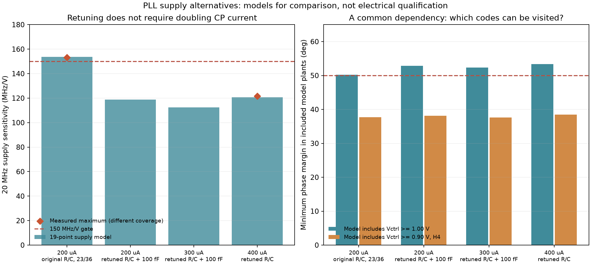

# PLL 电源抑制：候选空间与下一轮比较

**不必先采用k = 8。优先验证保持200µA的R/C重选，并与现有400µA候选对照；同时把粗码落点、局部Kvco与环路稳定性对齐。** k是CP电流相对50µA的倍率，与VCO四位码K和反馈÷8分开。当前电路默认值未改，本轮没有启动ngspice。

现有[环路文档](pll_loop.md#电源抑制第7步2026-11-10)的“现行k4任何分接不过”是指保持4.13kΩ/18.38pF、只改固定分接的网络；不能扩大成“200µA一定不能满足”。以下比较把可行性、证据和返工成本一起列出。

## 已有候选的同口径比较

| 候选 | Rz / Ci / 新加ctrl对地电容 | 分接到VDD比例 | 20MHz最差灵敏度 | 最差PM | CDR后14.07σ | 新增MIM粗估 |
|---|---|---|---|---|---|---|
| 当前200µA，只改23/36 | 4.13kΩ / 18.38pF / 0 | 23/36 | 模型153.7；实测153.1MHz/V | 50.25° | 本轮未重复 | 0 |
| **200µA重选** | **3.446kΩ / 26.002pF / 100fF** | **47/72** | **模型118.9MHz/V** | **52.87°** | **模型0.297–0.387UI** | **+0.00672mm²** |
| 300µA折中 | 2.612kΩ / 29.302pF / 100fF | 48/72 | 模型112.4MHz/V | 52.36° | 本轮未算 | +0.00959mm² |
| 400µA、已有候选LF | 2.170kΩ / 33pF / 0 | 22/33 | 模型120.7；六点实测121.6MHz/V | 53.37° | 模型0.271–0.348UI | +0.01272mm² |

200µA重选和400µA同用seed1、2^20个CDR tick（4.194ms）、延迟4tick、9ps边沿噪声，七组历史噪声输入。100fF是ctrl上的电容，Ci在积分节点z；两者不能合并成一个位置。200µA候选的数值来自原搜索的具体点，尚未映射成新PDK单元，不能将理想100fF当作无寄生的物理元件。MIM面积按项目0.00087mm²/pF估算，具有版图前粗估误差。

400µA相对200µA，单个持续工作的转向输出支路名义电流增加200µA，在1.8V下约多0.36mW；这不是PLL总功耗翻倍，也不是最终CP功耗预算，跟随器和驱动调整另算。200µA方案可以保留现有CP尺寸/直流窗口证据，但新LF下的纹波、动态交接、预充与捕获仍需重验。

## 可以发散的方向

### 1. 降Rz、重配Ci与小电容，保持CP电流

电源残差不只是PLL带宽不够。实际供电扰动通过VCO自身和LF控制端两条路径相加：

`Keff(f) = Kgnd(f) + Kline(f) · Hctrl/VDD(f)`。

两项都是复数。Rz把积分节点z和ctrl隔开；ctrl原有电容大部分参考VDD，z按Ci分接参考VDD，两者相位不同，产生正交残差。降Rz、小幅调整ctrl到地的电容，能改变这个残差；Ci用于恢复环路阻尼。无需先把CP电流翻倍。200µA重选是目前返工范围较小、值得先做电路比较的一条路线。

代价是带宽稍低、历史噪声模型的残余抖动较大。它并非最终最优点；后续可在器件可实现值附近局部搜R/C，不必只用k = 4/6/8的粗网格。

### 2. 将单一分接改成具有频率形状的供电前馈

现有α只有一个实数自由度，无法同时抵消随条件变化的同相与正交分量。可研究小型两节点RC/电容分接，在不改变主要直流调谐范围的情况下调整`Hctrl/VDD(f)`的幅度和相位；必要时加少量可校准支路。100fF对地候选已经是增加一个自由度的最简单例子。

这是待建模的结构方向，不保证只加一颗电容就能全频段抵消。约束必须同时包括PM、20MHz附近更宽频段、元件误差、开关寄生和新噪声。联合供电/控制偏置补偿有实物研究先例：[JSSC 2009，Minimizing the Supply Sensitivity…](https://doi.org/10.1109/JSSC.2009.2025406)；该文只能证明方法存在，不能将其数值转给本项目。

### 3. 可调分接：可以研究，单独使用的余量很小

用当前4.13kΩ/18.38pF、19点分解模型补算：单一固定分接在1/72步长下最优仍为23/36，最差153.72MHz/V。即便允许每个条件独立知道自身的最优α，连续可调的乐观下界也只是149.43MHz/V；1/72量化后149.47MHz/V。离150门槛只剩约0.5MHz/V，不能支持考虑失配、寄生和模型误差后的设计。

因此，不应把新增分接码和校准状态机作为单独的主修复。它可以和降Rz、两节点补偿结合。上述逐条件调节还假定知道当前PVT；并非一颗芯片只在上电校准一次就自然得到这些结果。按MOS/RC分组、组内固定一个α的乐观计算，FS/hh仍为151.70MHz/V。

### 4. 在VCO内部识别并减少敏感路径

当前四级CML环的负载接VDD，变容栅接振荡节点、阱接ctrl；输出共模随供电移动会改变变容偏置。尾偏置、输入对、阵列开关驱动以及buffer供电也各有耦合路径。下一轮先分别给负载供电、偏置支路、阵列码驱动与buffer注入相同单音，测复数灵敏度并检查独立激励相加能否重建公共VDD结果。码位驱动是否跟随局部供电必须写入边界。

若偏置路径主导，可先研究偏置RC/参考抑制；若共模—变容路径主导，可研究共模跟随的细调参考或复制单元前馈。仅净化尾偏置不能自动去掉负载共模路径。此处提出的是诊断和候选，尚无分端口电路结果。

### 5. 局部稳压或电源隔离，作为结构备选

只给环核心加局部稳压，理论上可以避开给全部分频器/数字负载供电；但是必须重验1.65V下的余量、摆幅、2GHz范围、buffer接口，以及LF和码驱动应参考哪一路电源。稳压器自己的宽带噪声、启动和环路稳定性也会成为新工作。

简单串R加大去耦不一定便宜。例如仅作量级计算：若环耗3.4mA、串10Ω，直流压降34mV；想在20MHz衰减5倍，一阶RC需约3.9nF，远大于本次增加15pF的LF。该数字不是本项目实际电流测量，也不表示需要5倍衰减，只用于说明主电源无源隔离的面积/压降取舍。局部稳压与粗细调分离已有研究：[JSSC 2009，Low-Power Supply-Regulation Techniques…](https://ieeexplore.ieee.org/document/5173751/)。

## 一个共同接口：粗码选点和PM模型的范围

本表52–53°的PM沿用原模型`Vctrl >= 1.0V、上沿VDD−0.39V`，包含134个条件、831个“条件×码×LF段”工作点。它没有证明所有135条件都能在这个范围内选到码。

独立补算把下沿放到0.90V、上沿改为H4的VDD−0.44V后，模型纳入135条件、918个工作点；如果要求纳入的所有码都满足，则200µA重选/400µA候选的最差PM分别约38.10°/38.50°。两者同在TT1.95V85°C、RCtt、码3、LF lh；该三点二次模型的交点0.90055V、Kvco约89.5MHz/V。

这不是实测失败，也不是实际控制器必然选择码3：同条件可能有更好的邻码。它说明不能把“窗口里存在码”“某选码策略能保持足够Kvco”“给定Kvco范围的PM过门槛”合并成一句通过。下一步用实测局部曲线核对真正会进入的码与迟滞边界；快端K15无更慢码的情形单列。不可为了套用PM结论直接把下门限抬到1.0V。

## 下一轮筛选顺序

1. 把200µA重选和400µA候选作为对照，先在有限压力点验证实际小电容/R/C、纹波与供电传递；同时补低压低Kvco处的真实曲线/局部环路。不要先为任一候选启动135点长闭环。
2. 做VCO分端口灵敏度，判断两节点前馈或偏置修补是否比增加CP电流更合算；先模型，再局部电路。
3. 有明确动态与噪声余量后再选主线。200µA不够时再比较300µA和400µA。采用新CP尺寸时重做窗口、跟随器/开关注入与失配；仅改变LF时保留原CP直流证据并重做其动态接口。
4. 候选收敛后完成45×RC闭环、预充/从零捕获、粗码动态和当前四位噪声。局部稳压保留为结构备选。

## 证据与复现

- [比较小数据](../data/pll_supply_choices.json)、[结果索引](../../results/catalog/pll_supply_choices.json)、[独立分析脚本](../../verification/analysis/pll_supply_choice.py)。运行目录`results/verification/pll_supply_choice/20261110T050559.291444Z`，记录输入与代码SHA256。
- 原23/36数据逐点重读：47个计划点包含45个hh条件及TT/tt、FF冷/ll两个附加边界，实际46条波形，即44/45 hh有数据；SF1.8V−40°C/hh缺失。另TT1.95V−40°C/hh波形完整但日志有数值错误，保留为ungraded。两处超过150的结果重测一致，不能将该campaign写成45/45干净完成。
- 原400µA六点全部读到完整163ns和两周期拟合，未见执行失败，最大121.5671MHz/V，重测与汇总一致。原execution的`inputs_sha256`为空；本轮验证raw/deck/execution身份，不能补造历史include文件身份。
- 分接自由度：[脚本](../../verification/analysis/pll_supply_split_options.py)，`results/verification/pll_supply_split_options/20261110T050858.920948Z/summary.json`。
- 模型边界：供电拟合只有19点、20MHz；测量是关断CP加真实LF/VCO，实际锁定态的周期性CP负载与闭环供电传递待验。PM使用历史三点曲线和旧CP电流比例。噪声仍用旧三位ISF/CP占空比等假设，不代表当前四位相噪通过。400µA六点通过也不能直接称135条件通过。
