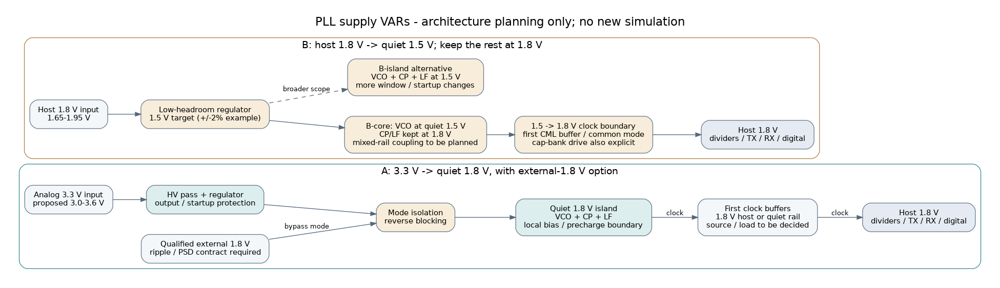
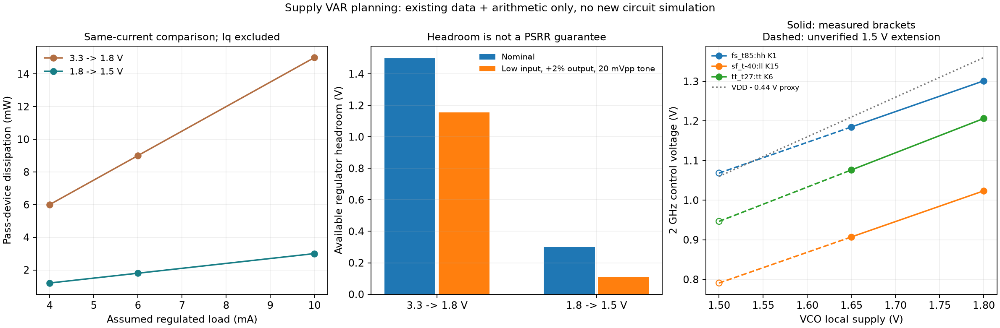

# PLL供电VAR：3.3→1.8 V与1.8→1.5 V

**优先规划“3.3 V输入稳压至1.8 V，并保留外供1.8 V旁路”。1.8→1.5 V有探索价值，VCO本体不一定需要换拓扑；先把仅VCO降压和整块模拟域降压分开，避免把分频器、TX、RX一并拖入返工。** 本轮只重读既有数据并计算规划量，没有新仿真，没有更改现行DUT、45条件规格或工作修订。

VAR登记在[配置](../../config/pll_supply_variants.toml)，状态全部为`planning_only`：

| VAR | 电源与范围 | 目的 | 当前判断 |
|---|---|---|---|
| `hv18` | 3.3 V→安静1.8 V；VCO、CP、LF及相关本地偏置/预充 | 保持电路设计点，隔离宿主电源噪声 | 优先架构；新增稳压、模式控制与供电接口 |
| `bypass18` | 外部合格1.8 V→同一安静域 | 无3.3 V或集成方已有更好电源时复用 | 与hv18配套；需要隔离、反灌处理及纹波/PSD约定 |
| `lv15_core` | 1.8 V→VCO局部1.5 V；CP/LF及其余模块保留1.8 V | 不增加高压电源，缩小降压改动范围 | 低压路线先研究这个范围；混合供电耦合必须重新规划 |
| `lv15` | 1.8 V→1.5 V，VCO/CP/LF均在低压域 | 统一安静模拟域，减少控制端从宿主供电进入的路径 | 比仅VCO降压多出CP窗口、跟随器、预充与门限调整 |

## 接口与器件基础

Caravel的[官方引脚表](https://caravel-harness.readthedocs.io/en/latest/pinout.html)明确列出用户区vdda1/vdda2为3.3 V、vccd1/vccd2为1.8 V，足以支持把3.3 V作为优先集成接口来规划；它并不证明每个SKY130宿主都具备该接口，也不保证该电源足够安静。没有统计依据的宿主占比不参与设计判断。

本轮hv18的输入范围暂列**3.0–3.6 V**、输出1.8 V±2%作为比较假设；不据Caravel某电源域的允许范围自动承诺支持5.5 V。SKY130有`pfet_g5v0d10v5`/`nfet_g5v0d10v5`等高压模型，可用于3.3 V侧候选；普通1.8 V器件不能直接接3.3 V。官方[器件说明](https://skywater-pdk.readthedocs.io/en/main/rules/device-details.html#v-10-5v-pmos-fet)给出了模型电压范围，模型有效范围本身不等于启动/瞬态应力已验证。

## 同负载下的功耗与压差

以下按**同样4 mA规划负载、忽略LDO静态电流**比较。它是电源架构的归一化比较，不是测得的整个PLL电流，也不包含宿主上游电源转换损耗。

| 模式 | 负载功耗 | 输入端功耗 | 调整管损耗 | 理想线性效率 |
|---|---:|---:|---:|---:|
| 外供1.8 V旁路 | 7.2 mW | 7.2 mW | 0 | 约100% |
| 3.3→1.8 V | 7.2 mW | 13.2 mW | **6.0 mW** | **54.5%** |
| 1.8→1.5 V | 6.0 mW | 7.2 mW | **1.2 mW** | **83.3%** |

6 mA时两条稳压路线的调整管损耗分别9.0/1.8 mW；10 mA时为15/3 mW。两个独立PLL需要分别计入。4/6 mA量级与当前尺寸的名义预算相符：212.5µA参考、二极管W5/0.5、环尾管W20/0.5，四级约3.4mA；四个W12/0.5输出buffer另约2.04mA。CP、局部参考、预充和PVT增量另算，不能以此替代实际供电电流测量。

**CML保持原电流时，1.8→1.5 V不会自动降低宿主1.8 V输入端的静态功耗。** 少掉的核心功耗转为LDO耗散。要节省系统功耗，还需要降低尾电流或改变供电转换方式。对同C、同频率、同活动率的电容性动态负载，核心功耗比例为(1.5/1.8)²≈69.4%；但通过1.8 V线性稳压后的输入动态功耗比例约83.3%，也不是直接省30.6%。本设计的环主要是恒流负载。

压差按输入最低、输出容差最高计算：

| 路线 | 名义压差 | 最低输入与+2%输出时 | 再叠20mVpp输入单音时 |
|---|---:|---:|---:|
| 3.3→1.8 V | 1.50 V | **1.164 V** | **1.154 V** |
| 1.8→1.5 V | 0.30 V | **0.120 V** | **0.110 V** |

低压路线4/6/10mA时，调整管导通电阻至少须低于约27.5/18.3/11Ω，才能不把这110mV全吃掉；这是必要上界，**不是PSRR足够的条件**。压差越靠近dropout，环路增益与抑制能力可能明显下降，[ADI的低压差说明](https://www.analog.com/en/resources/analog-dialogue/articles/ldo-operational-corners.html)给出了机制及实测实例。其具体器件数值不转给本项目。

## VCO降到1.5 V，电容与频率会发生什么

当前[四位VCO](../../analog/pll/vco/spice/vco_ring4_4b.spice)的电容有三类：

1. MIM阵列由几何和开关档位确定，不会因VDD从1.8降至1.5 V就按比例缩小。
2. 累积型变容管的栅接振荡节点、阱接ctrl。关键是两端相对偏置，供电降低、振荡共模下移时，**可以同时下移ctrl**，而不是假设电容必然变小。
3. 开关和晶体管寄生还受偏置影响；阵列开关若从1.8 V栅驱动改成1.5 V，Ron与损耗/Q也会变化，不能只看电容值。

在其他条件相同时，电容变小通常使振荡更快；风险首先是慢端“降不下来”。“抬不到2GHz”还可能来自电容过大、gm/负载损耗或堆叠余量不足。这几种机制需要分别判断。

既有119组同码配对中，供电从1.8降到1.65 V，2GHz交点的ctrl均随之降低，供电轴割线约0.513–1.047 V/V。下表两个已测供电点的交点均来自实测电压夹区内插；1.5 V列只是**同码、沿供电轴线性延伸的假设**，没有用邻码斜率，也不作可达性验收。

| 条件、码 | 1.8 V供电时ctrl | 1.65 V供电时ctrl | 1.5 V假设落点 |
|---|---:|---:|---:|
| TT27°C、Rtt、K6 | 1.206 V | 1.076 V | **约0.946 V** |
| FS85°C、Rhh、K1 | 1.301 V | 1.185 V | **约1.068 V** |
| SF−40°C、Rll、K15 | 1.024 V | 0.907 V | **约0.791 V** |

因此，现有数据支持“VCO本体值得尝试1.5 V”，不支持“必然需要换拓扑”，也不证明全角无需调整。快端K15已经到阵列端点，失配下的慢端范围仍要单列；控制端负载、Kvco、相噪和码开关损耗都未在1.5 V测过。

还重读了一个明确的TT原始波形：1.8 V、K6、ctrl1.195 V、真实偏置、四buffer/每端30fF，最后5ns中环尾节点最低**0.8841 V**。仅作节点整体下移0.3 V的示意，尾节点仍约**0.5841 V**。这说明TT下未显出立即用尽堆叠余量的迹象，但它不是1.5 V工作点，不是尾管VDS−VDSAT检查，也不能转给其他PVT。相同电流下，输入对两端一起下移时其VDS不必同比下降，尾电流源对地的余量则确实会减少。

## 方案3不必同时降低CP与分频器电压

`lv15_core`优先保留CP/LF在1.8 V，避免先收窄其输出窗口。VCO是通过电容性端口受控，并不因局部供电变成1.5 V，就要求CP电源也必须为1.5 V。合法ctrl范围应按变容器及连接器件端电压与控制范围定义；新域必须有明确的上电/断电约束。

但当前供电抑制依靠LF分接与VCO供电路径抵消。VCO接安静1.5 V、LF仍参考嘈杂1.8 V后，原抵消关系会改变；CP、LF电容参考端和bias仍可把宿主噪声送进ctrl。因此这个VAR须用两路供电的传递矩阵规划，不直接沿用160/150MHz/V。给LF的参考端重分配也不等于“LF整个电路都必须降压”。

若选择`lv15`整块模拟域降压，按旧CP上沿VDD−0.39V、H4上门限VDD−0.44V作规划，1.5 V下分别约1.11/1.06 V；固定下门限0.90 V的窗口从1.8 V下0.46 V缩为0.16 V。届时门限、预充DAC与Kvco工作区应重新规划，不能只平移电源后继续沿用旧控制规则。这些上沿值本身也没有1.5 V电路证据；它们**不适用于CP仍在1.8 V的lv15_core**。

分频器/接收器此前已有冷角余量问题，先保持在宿主1.8 V。以第一级buffer重新建立时钟共模，评估其对1.5 V VCO输出的输入余量和附加噪声。这样可把改动限制在PLL局部，避免重做整个SerDes。

## 两条路线都需要处理的接口

- **偏置源域。** 当前vgi相对供电定义PMOS拷贝Vsg。不能把拷贝source改接安静1.8/1.5 V，却继续直接用来自另一电源域的vgi。可保留源域的电流输出并在本地形成偏置，或把相关参考/分配一起纳入安静域；其供电噪声需要单独计入。
- **LF参考端与码驱动。** LF分接接哪路电源、阵列开关栅高电平来自哪路电源都必须明确。开关驱动留在1.8 V可减少Ron变化，但会保留一条宿主噪声路径。
- **旁路隔离。** hv18关闭、外部1.8 V开启时，单个PMOS调整管的寄生二极管可能反灌3.3 V输入；只关栅并不足够。要规划反向隔离、井连接、互锁及启动顺序。
- **边界范围。** hv18保持原设计点，可复用更多DC、尺寸与时钟接口证据，但仍须验证LDO容差、噪声、输出阻抗与启动。低压VAR需要对应局部范围重验，不能将1.65 V结果写成1.5 V通过。

## 抑制能力与面积，现阶段能估到哪

两种稳压路线如果都能提供相同的局部供电谱，其隔离收益可以相近；3.3 V方案主要赢在压差和保持原设计点，不是“输入3.3 V就天然在20MHz抑制得更好”。高压器件寄生、门极驱动、控制环路与输出去耦仍决定高频响应。

以局部单音≤2mVpp作**规划示例而非新增规格**：输入20mVpp需要20dB衰减；嘈杂I/O轨若为100mVpp，需要约34dB。LDO自身噪声和旁路耦合还应另分配，不能把低频PSRR直接套到20MHz。具体指标需与[相对抖动预算](pll_ripple_budget.md)对齐。

面积现在不能只按厚氧调整管估。举例，若负载突然增加0.1mA，5ns内调整管没能补给，要求电压下降≤10mV，则电荷守恒给出C≥50pF，按项目面积系数约0.0435mm²；若增量1mA则为500pF、约0.435mm²。这不是所需Cout的设计结论，实际由负载增量、供给响应、输出阻抗及允许跌落共同决定，但说明去耦可能比调整管更占面积。CML较连续的电流是有利条件；不应把TX或大量数字切换负载随手放进同一安静域。

## 规划建议

先保留hv18＋bypass18作为供电宏的优先架构，原PLL保持1.8 V。lv15_core作为可比较的局部探索，不先连带修改CP、分频器或SerDes其他模块；lv15整块降压仅作为更大范围的对照。**本轮不定型LDO尺寸，不声称某个VAR已达到噪声/调谐门槛，也不启动仿真。**

[规划数据](../data/pll_supply_architectures.json)、[结果索引](../../results/catalog/pll_supply_architectures.json)、[计算工具](../../verification/analysis/pll_supply_architectures.py)。目录`results/verification/pll_supply_architectures/20261110T055223.357682Z`保存当次runner。119组同码供电配对均重新核对原source/fill数据；全部1.5 V落点保留“超出已测供电范围”的标签。原TT波形的deck、execution、raw及分析输入SHA256均保存。
