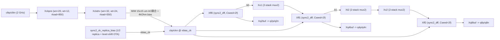

# `pll_sync_prescaler8_2stack`（2-Stack 同步 2/4/8 分频器）设计、验证与版图准备

## 结论与当前状态

为消除原三叠层异步纹波/源随器分频器（`pll_cml_prescaler8`）在低电压/强多晶电阻角落的尾管三极管区塌陷、级联累积偏斜与 `RCX` 后仿摆幅失效，已完成 **2-Stack 同步二进制 CML 分频器** [`sync_prescaler8_2stack.spice`](../../analog/pll/divider/spice/sync_prescaler8_2stack.spice)（与 `pll_cml_prescaler8` 引脚完全兼容）的电路定型、全角 PVT、本地失配 MC、PLL 前端边界集成及核心 PDK 版图单元验证：

- **90 角全 PVT（45 `hh` + 45 `ll`）全通过**：0 次分频错误；最差差分摆幅 `515.9 mVpp`（`q2 @ fs_v1650_t85:ll`，高出 `400 mVpp` 目标 `+115.9 mVpp`）；全部尾管过驱动裕量 `Vds - Vdsat >= +0.230 V`；`q4-q2` 与 `q8-q4` 同步边沿偏斜总跨度分别不超过 `3.98 ps`（`ll`）/ `8.79 ps`（`hh`）。
- **本地失配 Monte Carlo（5 个关键角 × 48 样本 = 240 样本）全通过**：`divide_fail = 0/240`，5 个角单边容差下界 `mean - 3.66*sd` 最低为 `471.9 mVpp`（`fs_v1650_t85:hh`），所有样本实测最小摆幅 `501 mVpp`，`mux2` 尾管最小余量 `>= 0.604 V`。
- **PLL 前端边界集成（`pll_clock_frontend_r6q`，移除 `Ikick`）全通过**：5 个关键边界角下均在无外加启动踢脉冲条件下自启动并精准 `/8`（`fb_ratio = 7.9998–8.0000`）；与相等输入容性负载假负载（`sync2_eq`）配合时，VCO 抽取缓冲器 8 相位格点误差由 `+-0.92..+-5.15 ps` 降至 `+-0.68..+-1.93 ps`（改善约 2–3.3 倍）。
- **PDK 版图准备与单元级 CPEX/RCX 验证全通过**：5 个统一列宽（`25.8 µm`）核心 PDK 单元均通过 Magic 全 DRC（`DRC=0`）及 Netgen LVS（`LVS=True, PROP_ERR=False`）；将全部 14 个核心子电路替换为抽取后的 `_pex.spice`（CPEX）与 `_rcx.spice`（Magic `extresist` R+C）在 4 个角进行 2 GHz 分频仿真，`schematic / cpex / rcx` 全部正常 `/8`，最差 `fs_v1650_t85:hh` 满 `rcx` 下摆幅仍达 `q2=443.4 mVpp, q4=506.8 mVpp, q8=510.6 mVpp`。

## 架构设计

核心结构改进（对照原 `pll_cml_prescaler8` 根因）：

1. **全 2-Stack 无尾管 D-Latch（`sync2_latch`）+ 副本栅偏（`sync2_ck_replica_bias`）**：去掉原三叠层锁存器尾电流管，以 `serdes_nfet_lvt`（`wclock=20, wdata=16, whold=14, nf=4, rload=480 Ω`）构成双层结构，并由半比例副本回路将高频时钟共模 `vbias_ck` 伺服在 `Vref = VDD - Iref*(580 Ω)`，使锁存器在 1.65–1.95 V 整个 PVT 范围内保持近似恒定尾电流与 `> 500 mVpp` 摆幅。
2. **去除源随器的 2-Stack `sync2_mux2`**：原 `mux2` 内置三叠层 `Xsp/Xsn` 源随器导致尾管 `mux_tail` 在 `fs_1650_m40_ll` 跌入三极管区（`0.040 V`）；重构后采用直耦 2-stack 选择级与数据级（`wdata=12, wselect=24, wtail=6 l=0.5 nf=2, rload=1100 Ω`），全 PVT 下 `mux_tail` 过驱动余量抬升至 `>= +0.281 V`。
3. **两级时钟预整形（`Xckpre -> Xckdrv`）+ AC 耦合**：避免小信号正弦时钟在 `FF 1.95 V 85 °C ll` 低 `Vth(lvt)` / 高 `vbias_ck` 下发生差分关断，将时钟边沿先陡化再耦合进各 DFF。
4. **PDK 固定宽电阻卡标准化**：全部小电阻（`<= 2 kΩ`）直接调用 `sky130_fd_pr__res_high_po_2p85`（`sync2_res_lo`），全部大电阻（`4 kΩ / 12 kΩ`）直接调用 `sky130_fd_pr__res_high_po_1p41`（`sync2_res_hi`）。
5. **确定性自启动**：在每个 `sync2_dff` 内部主锁存器节点 `mp` 加 `2 fF` 对地确定性不对称电容（`Cseed`），消除无噪声瞬态的亚稳态死锁，移除外置 `Ikick`。

## 验证边界与适用范围

- **PDK 与工具**：SKY130A（`libs.tech/ngspice/sky130.lib.spice`），`ngspice-47` 单线程仿真，Magic 8.3.685 全 DRC，Netgen LVS。
- **激励与负载（PVT / MC / Block-PEX）**：正弦输入 `300 mVpp` 经标准 `serdes_cml_buffer` 缓冲进入 `Xpre`；输出 `d02/d04/d08` 各挂 `5 fF`，`d08` 另接反馈接收机 `serdes_cml_to_cmos_pvt_candidate`（输出挂 `20 fF`）；实偏置网络由 `0.85 mA` 主基准镜提供。
- **前端边界（`frontend_r6_sync2`）**：在 `pll_clock_frontend_r6q` 中用 `pll_sync_prescaler8_2stack` 替换 `pll_cml_prescaler8`（移除 `Ikickd02/d04/d08`）；`sync2_eq` 在 VCO `b1..b3` 端挂载与 `Xckpre` 输入级匹配的 `pll_sync2_dummy_load`。
- **Block-PEX 适用声明**：当前 `pex_blocks.py` 替换为**5 个核心子模块各自版图提取的 CPEX/RCX 内部寄生**，尚未包含顶层单元间互联（`Xckdrv -> C -> Xff0/1/2` 与反馈跨线）电阻电容；另因 MOS 单元外侧保留的物理 dummy poly 在当前测试子模块中浮空纯电容耦合，仿真加入 `.options rshunt=1e12` 以消除 DC OP 奇异矩阵（顶层合拢前应将外侧 dummy poly 与电阻外护环明确接 `vss`）。

## 实测验证结果汇总

### 1. 90 角全 PVT（[`sync2_pvt/run.py`](../../analog/pll/divider/tb/sync2_pvt/run.py)）

| 电阻角 | 完成角数 | 分频错误 | `q2` 最小摆幅 | `q4` 最小摆幅 | `q8` 最小摆幅 | `sk4_ps` 区间 / 跨度 | `sk8_ps` 区间 / 跨度 | 最小尾管 `Vds-Vdsat` | 电源电流区间 | 证据目录 |
|---|---|---|---|---|---|---|---|---|---|---|
| `hh` | 45 / 45 | 0 | `535.7 mVpp` (`fs_v1650_t85`) | `543.4 mVpp` (`fs_v1650_t85`) | `554.9 mVpp` (`ss_v1650_t-40`) | `[-10.63, -7.49]` / `3.15 ps` | `[-6.43, +2.35]` / `8.79 ps` | `+0.295 V` (`fs_v1650_t85` `ckdrv`) | `8.10–11.70 mA` | hh summary (`results/analog/pll/divider/sync2_pvt/hh_20261115T184418Z/summary.json`) |
| `ll` | 45 / 45 | 0 | `515.9 mVpp` (`fs_v1650_t85`) | `521.0 mVpp` (`fs_v1650_t85`) | `528.1 mVpp` (`fs_v1650_t85`) | `[-10.43, -6.45]` / `3.98 ps` | `[-6.19, -3.83]` / `2.36 ps` | `+0.230 V` (`fs_v1650_t85` `ckdrv`) | `10.48–14.87 mA` | ll summary (`results/analog/pll/divider/sync2_pvt/ll_20261115T185818Z/summary.json`) |

### 2. 本地失配 Monte Carlo（[`sync2_mc/run.py`](../../analog/pll/divider/tb/sync2_mc/run.py)，`n=48/角, k=3.66`）

证据：MC summary (`results/analog/pll/divider/sync2_mc/20261115T200049Z/summary.json`)

| 工艺角 | `divide_fail` | 95% 置信区间 | `q2` mean/sd (min) | `q4` mean/sd (min) | `q8` mean/sd (min) | `mean - k*sd`（门槛 400 mVpp） | `mux_tail` 最小值 | `vbias_ck` mean ± sd |
|---|---|---|---|---|---|---|---|---|
| `tt_v1800_t27:tt` | 0 / 48 | `[0.926, 1.000]` | `564 / 15.8 (533) mV` | `561 / 15.4 (531) mV` | `574 / 16.3 (540) mV` | `504.5 mV` (PASS) | `0.844 V` | `0.654 V ± 7.2 mV` |
| `fs_v1650_t85:hh` | 0 / 48 | `[0.926, 1.000]` | `540 / 18.6 (504) mV` | `545 / 17.1 (511) mV` | `558 / 17.7 (520) mV` | `471.9 mV` (PASS) | `0.677 V` | `0.705 V ± 7.9 mV` |
| `ss_v1650_t-40:hh` | 0 / 48 | `[0.926, 1.000]` | `558 / 22.5 (522) mV` | `553 / 21.2 (516) mV` | `562 / 22.4 (524) mV` | `475.1 mV` (PASS) | `0.604 V` | `0.742 V ± 7.4 mV` |
| `ff_v1950_t85:ll` | 0 / 48 | `[0.926, 1.000]` | `569 / 14.1 (540) mV` | `567 / 13.2 (542) mV` | `577 / 15.6 (546) mV` | `517.2 mV` (PASS) | `1.063 V` | `0.555 V ± 7.4 mV` |
| `fs_v1650_t-40:ll` | 0 / 48 | `[0.926, 1.000]` | `532 / 14.2 (501) mV` | `531 / 13.4 (509) mV` | `543 / 14.3 (518) mV` | `479.8 mV` (PASS) | `0.616 V` | `0.777 V ± 7.4 mV` |

### 3. PLL 前端边界集成（[`run_sync2_cmp.py`](../../analog/pll/top/tb/frontend_r6/run_sync2_cmp.py)）

证据：frontend summary (`results/analog/pll/top/frontend_r6_sync2/20261115T191208Z/summary.json`)

| 边界工况 (`cond:rc:code:vctrl`) | `r3_lean` 格点误差 / `b0_late` / `I_host` | `sync2_eq`（无 `Ikick`）格点误差 / `b0_late` / `fb_ratio` / `I_host` |
|---|---|---|
| `tt_v1800_t27:tt:12:1.1` | `±3.36 ps` / `+4.45 ps` / `6.46 mA` | `±1.32 ps` / `-1.76 ps` / `8.0000` / `12.14 mA` |
| `fs_v1650_t85:hh:0:1.21` | `±3.75 ps` / `+4.95 ps` / `5.03 mA` | `±1.93 ps` / `-2.57 ps` / `7.9998` / `8.58 mA` |
| `ss_v1650_t-40:hh:6:1.1` | `±5.15 ps` / `+6.79 ps` / `4.84 mA` | `±1.55 ps` / `-2.06 ps` / `7.9998` / `10.11 mA` |
| `ff_v1950_t-40:ll:28:1.1` | `±0.92 ps` / `+1.22 ps` / `8.16 mA` | `±0.87 ps` / `-1.16 ps` / `8.0000` / `16.09 mA` |
| `ff_v1950_t85:ll:28:1.1` | `±1.91 ps` / `+2.50 ps` / `8.20 mA` | `±0.68 ps` / `-0.90 ps` / `8.0000` / `14.01 mA` |

注：`sync2_eq` 在 `b1..b3` 端当前放置了有源 `sync2_buf` 假负载（贡献额外偏置电流，致使 `I_host` 上升）；若后续改为无直流功耗的 MOS 栅容匹配假负载，可收回这部分电流同时保持相当的相位平衡。

### 4. PDK 核心模块版图检查与 CPEX/RCX 后仿对比

生成器：[`build_sync_prescaler8_pdk.py`](../../analog/pll/divider/layout/build_sync_prescaler8_pdk.py)；单元级 DRC/LVS：pdk_blocks_r5 summary (`results/layout/sync2_divider/pdk_blocks_r5/summary.json`)；后仿脚本：[`pex_blocks.py`](../../analog/pll/divider/tb/sync2_pvt/pex_blocks.py)（pex summary (`results/analog/pll/divider/sync2_block_pex/20261115T214630Z/summary.json`)）。

全部 5 个核心 PDK 单元均实现双端多晶栅条连接（`trim_top_gate=False`）、左右匹配虚设多晶电阻及 `M4` 宽电源干线，均实现 **`DRC = 0`、`LVS = True`、`LVS_PROPERTY_ERRORS = False`**，宽度统一为 `25.8 µm`：

- `sync2_buf_out_pdk`：`25.8 × 32.51 µm`（`838.76 µm²`）
- `sync2_buf_ckpre_pdk`：`25.8 × 34.19 µm`（`882.10 µm²`）
- `sync2_buf_ckdrv_pdk`：`25.8 × 37.51 µm`（`967.76 µm²`）
- `sync2_latch_pdk`：`25.8 × 39.88 µm`（`1028.90 µm²`）
- `sync2_mux2_pdk`：`25.8 × 52.43 µm`（`1352.69 µm²`）

2 GHz 全分频链替换核心单元网表后实测对比（全部正常输出 `q2=1000.0 MHz, q4=500.0 MHz, q8=250.0 MHz`）：

| 工况 | 模式 | `q2` (mVpp) | `q4` (mVpp) | `q8` (mVpp) | `fb` (mVpp) | `sk4_ps` | `Id` (mA) |
|---|---|---|---|---|---|---|---|
| `tt_v1800_t27:tt` | `schematic` / `cpex` / `rcx` | `560.5 / 565.7 / 548.4` | `558.3 / 563.3 / 551.5` | `570.4 / 571.8 / 560.5` | `3816.4 / 3816.7 / 3816.5` | `-8.62 / -8.19 / -8.57` | `11.17 / 10.82 / 10.14` |
| `fs_v1650_t85:hh` | `schematic` / `cpex` / `rcx` | `535.7 / 521.1 / 443.4` | `543.4 / 532.9 / 506.8` | `555.5 / 548.2 / 510.6` | `3449.8 / 3450.0 / 3450.4` | `-10.61 / -8.75 / -7.58` | `8.10 / 7.89 / 7.48` |
| `ss_v1650_t-40:hh` | `schematic` / `cpex` / `rcx` | `550.0 / 559.5 / 545.1` | `546.7 / 557.1 / 546.3` | `554.9 / 564.5 / 553.7` | `3645.5 / 3646.1 / 3643.8` | `-9.35 / -8.75 / -8.80` | `9.52 / 9.18 / 8.64` |
| `ff_v1950_t85:ll` | `schematic` / `cpex` / `rcx` | `566.2 / 566.7 / 506.2` | `564.2 / 566.9 / 535.7` | `574.3 / 573.8 / 538.2` | `4061.1 / 4060.9 / 4061.1` | `-8.37 / -7.93 / -8.80` | `12.64 / 12.33 / 11.40` |

## 下一步顶层版图合拢建议

1. **列排布**：按 `25.8 µm` 统一单元宽纵向拼接三行核心列（Col-0: `Xff0` + `Xq2buf`；Col-1: `Xx1` + `Xff1` + `Xq4buf`；Col-2: `Xt2` + `Xx2` + `Xff2` + `Xq8buf`），顶端放置 `Xckpre`、`Xckdrv`、`sync2_ck_replica_bias`（横向 `1p41` `XRls` `12 kΩ` 电阻 + `20×20 µm` / `15×15 µm` MIM 补偿/耦合电容）。
2. **时钟脊线屏蔽**：`ckp/ckn` 采用对称 `M3` 差分对沿三列中轴水平分发至各 `sync2_latch`，两侧加 `M3 VSS` 屏蔽线以控制 `Xckdrv -> DFF` RC 压降与串扰。
3. **顶层待收尾物理细节**：在 `tail` 源极 `M2` 汇流条正上方补充 `M4 -> M2` 堆叠通孔以降低 `rcx` 中的约 `6–8%` 尾电流退化；将 MOS 外侧保护多晶及虚设电阻外护环明确接至 `vss`，消除浮空纯电容节点。
4. **整链签核前移**：顶层拼版通过全 DRC/LVS 后，使用 `pex_blocks.py` 同款测试台跑完整顶层 `_pex.spice` 与 `_rcx.spice`（重点关注 `fs_v1650_t85:hh`），并补跑闭环 `native_r6` 锁定验证与 `pll_sync2_dummy_load` 降功耗改版。
