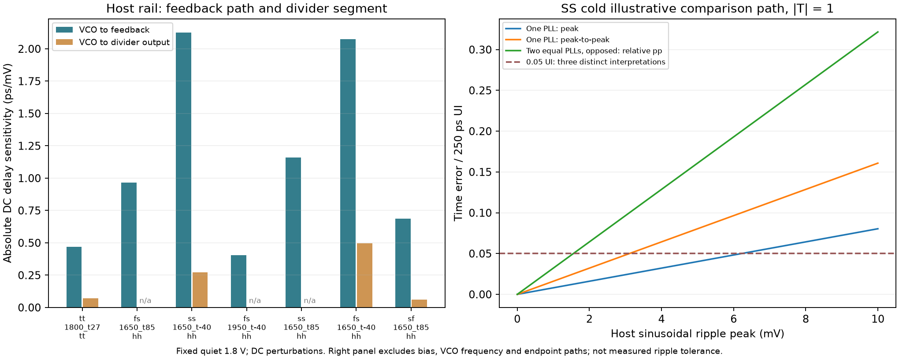
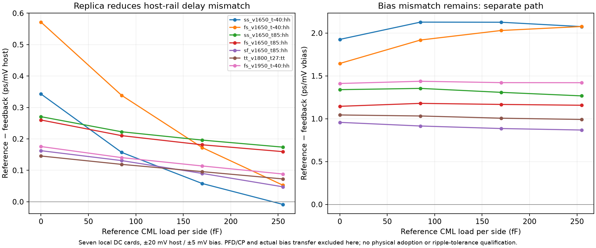

# 宿主供电引起的延迟误差：独立复核与设计顺序

**新发现成立：只稳住VCO，不能保护宿主域反馈接收路径的延迟。优先比较参考/反馈匹配及关键单元的供电归属，再决定是否改环路。** 这属于局部接口设计问题，现有PLL集成和已完成的锁定结果继续有效；尚不能把剩余工作概括为纯参数微调。

本轮独立重测两个固定campaign中的原始交越，复现7个工况的延迟导数，补边沿数、中点非线性及明确的峰值/峰峰值换算。Claude随后完成参考接收副本实验，本轮也独立重算其7点×4负载的原始延迟/导数。没有启动ngspice，没有改DUT、k4参数或验收门槛。

## 延迟分成三类

| 量 | 影响 | 本项目应怎样检查 |
|---|---|---|
| 名义传播延迟 | 锁定点的静态相差、跨模块的位号/相位归属 | 固定偏移可由PLL调节，但TX仍须检查位映射与数据/关闭关系；不能无限制增加 |
| 延迟随宿主电源/偏置的变化Kd | 供电纹波变成时间误差，参考与反馈不匹配时无法抵消 | 分别测宿主与vbias导数，匹配实际共模、slew、负载、占空比；在关键频率校准复数响应 |
| 反馈路径群延迟 | 环路交越处额外相位损失 | 从事件索引或小信号动态响应确定；不能由模VCO周期后的相位直接推算 |

当前环路模型已有2ns的PFD采样等效延迟。真实反馈传播的群延迟是否包含其中还要核对；先查模型分配，避免漏计或重复计入。某个单元的DC Kd很大，不等于环路相位裕量已经失败。

## 时间域没有额外的八倍放大

令参考接收路径、反馈路径及PFD/CP零电荷点的时间变化分别为`δτref`、`δτfb`、`δτzero`，`S=1/(1+L)`、`T=L/(1+L)`。低频、同一事件分支的小扰动下：

`δtout = T(s)·[δtref + δτref + δτzero − δτfb] + S(s)·δtVCO_free`。

反馈相位弧度在输出端乘N，但换成时间时输出载频也乘N，因此抵消。÷8前的10ps误差对应输出约10ps的带内时间误差，而非80ps。输出全速接收器和TX分发的延迟在此基础上直接加入端点时刻；它们没有上述PLL闭环抑制。

对于同源供电，真正需要的比较项是`Kd_ref + Kd_zero − Kd_fb`。同一纹波的通路须先按复数响应相加再取幅度；相位未知时可对已纳入路径用模值和保守估计，不能把确定性单音按独立随机源RSS合并。

## 原始波形复核

| 工况 | VCO→fb0，ps/mV宿主 | VCO→d08，ps/mV宿主 | 中点弯曲量/半跨变化 | 每次反馈边沿数 |
|---|---:|---:|---:|---:|
| TT 1.8V/27°C tt | −0.470 | −0.069 | 2.4% | 3–4 |
| SS 1.65V/−40°C hh | −2.126 | −0.270 | 9.1% | 4 |
| FS 1.65V/−40°C hh | −2.076 | −0.495 | 11.5% | 4 |
| SF 1.65V/85°C hh | −0.686 | −0.059 | 2.8% | 4 |
| SS 1.65V/85°C hh | −1.161 | 未保存 | 5.0% | 4 |
| FS 1.65V/85°C hh | −0.967 | 未保存 | 5.3% | 2–3 |
| FS 1.95V/−40°C hh | −0.405 | 未保存 | 2.4% | 3–4 |

可分拆的四点中，d08→fb0段贡献宿主导数的76–91%。它含分频输出共模/slew随电源变化的作用，不能全归因于接收器自身PSRR。SS冷角±20mV的延迟变化为−38.64/+46.38ps，半跨42.50ps，中点弯曲3.87ps；该点远离模周期的半周跳变，但仍未证明绝对事件索引。记录内标准差很小只证明这些少量边沿稳定，不证明更长时间或小扰动线性度。

优先在两个低压冷角补±10mV宿主、±2.5mV偏置，增加反馈事件数并检查8:1分频及同一事件身份；随后选模型最差频率做局部动态校准。无需为这一步重跑整个PLL捕获过程。

SS冷角只看反馈接收/分频路径，5mV峰值给出10.63ps峰值；再计PFD/CP零点导数，假设`|T|=1`、偏置项为0，则为10.05ps峰值，即0.0804UI峰峰值。两个完全相同、有效相位相反的PLL对应0.1608UI相对峰峰值。**这只是清楚口径的换算示例，未含VCO频率项、偏置项或环外分发，也不是实测锁定态纹波抖动。**

在相同5mV峰值、`|T|=1`假设下，若0.05UI分配分别指单PLL峰值、单PLL峰峰值、两个等幅PLL最坏相对峰峰值，允许的比较路径残余导数分别为2.5、1.25、0.625ps/mV。三者是不同预算，不能用同一个“0.05UI”互换；I-35保持待对齐。

## 对现有供电容限的解释

固定模型中SS冷角直供容限16.1→3.9mV峰值、HV加尾线滤波为5.2mV峰值，说明延迟路径足以改变选型。原“HV宿主496mV”只能描述先前频率路径，不能再称整个IP供电容限。

但3.9/5.2也还不是产品签核值：本轮Kd卡的quiet固定1.8V，而真实直供低压点quiet=1.65V，HV实测SS冷quiet约1.776V；该旧模型尚未计入刚完成的参考副本；FS冷/SF热缺PFD零点项，模型在这些已测host点填0；其他缺host点取导数包络；环外接收与TX/RX分发仍未加入。现有模值相加对已纳入的未知相位通路保守，不代表整个未完成模型已构成严格上界。

## 参考副本：已看到的改进及剩余限制

新固定campaign `host_timing_ref_replica/20261111T105327Z`：250MHz互补CMOS参考→一个WN12/WT11/R600的CML级→与反馈相同的CML→CMOS接收器→实际PFD输入。每侧附加0/85/170/255fF，宿主±20mV、vbias±5mV。**主agent独立复算全部7点、四负载的原始交越及导数，数值与发布结果一致。** 该测试未提供电流测量，不据此宣布功耗收益。

Claude当前推荐170fF/侧，以接近分频输出slew；下表255fF只是更慢边沿的对照，不替换推荐。170fF的残差也已逐点和原始波形核对：新固定模型`ldo_supply_tolerance/20261111T114419Z`在七个实测host点的直供容限7.9–19.5mV峰值、HV为31.7–60.9mV峰值；扩到19个供电点、缺测填包络时为7.9/19.1mV。该容限仍是沿用模型的计算结果，尚未覆盖下面的缺项，不能称供电签核已完成。

| 255fF/侧候选 | 参考−反馈，ps/mV宿主 | 加已测PFD零点项，ps/mV宿主 | 参考−反馈，ps/mV vbias |
|---|---:|---:|---:|
| SS 1.65V/−40°C hh | −0.008 | −0.124 | +2.075 |
| FS 1.65V/−40°C hh | +0.053 | 未测PFD | +2.077 |
| SS 1.65V/85°C hh | +0.174 | +0.066 | +1.267 |
| FS 1.65V/85°C hh | +0.160 | +0.110 | +1.157 |
| SF 1.65V/85°C hh | +0.048 | 未测PFD | +0.868 |
| TT 1.8V/27°C tt | +0.073 | +0.029 | +0.992 |
| FS 1.95V/−40°C hh | +0.088 | +0.087 | +1.421 |

相比SS冷原反馈−2.126ps/mV，副本明显减小宿主导数差，支持继续匹配路线；但偏置导数差仍大，且不能把ps/mV vbias直接乘宿主纹波。它要乘两侧各自实际偏置网络的复数传递。把分频单独接vbias_q会改变匹配关系，必须与参考路径的偏置归属一起计算，不能只在旧总导数上减掉一个项。

优化目标应包含PFD/CP零点项，不能只追求参考−反馈为0。例如SS冷角170fF的总宿主比较导数约−0.058ps/mV，255fF却约−0.124ps/mV；边沿更慢并不保证每点总误差都更小。实际参考引脚还会加一条路径，因此不能仅根据这张局部匹配曲线定最终CL。

255fF是局部比较候选，不是已采用参数。每PLL实际只会选一个参考路径，这档共增加0.51pF；对比零附加负载，名义参考传播多147–211ps，受检总延迟约483–895ps。参考输入路径的固定延迟不直接等同于反馈环路额外群延迟，但会改变参考→输出相位、启动与杂散边界。下一步比较实际接口、差分参考生成的有限slew/偏斜、两输入负载/相位、偏置滤波、噪声与功耗；再在关键频率做局部动态校准，尚不能宣告供电预算闭合。

## 改进的优先顺序

1. **参考/反馈路径匹配。** 不只匹配名义延迟，还要匹配供电/偏置导数、输入共模/slew、实际PFD负载和边沿极性。复制接收器有根据，但增加CML转换器也可能引入新的导数；以整条差分路径的结果判断。
2. **接收器移quiet降为后备比较。** CMOS恢复段的尖峰电流可能在LDO带宽以外污染VCO quiet，Claude因此暂不采用。若以后比较，应先量化quiet注入与PDN、噪声/杂散，再检查负载稳定性和宿主PFD电平接口；直供模式没有同等隔离收益。
3. **分频使用独立的偏置RC。** 可处理vbias导数；与VCO尾线分开，避免分频开关反冲进入VCO偏置。先复核I-10余量、加载、RC热噪声及偏置建立时间，并与参考副本的偏置归属一起算残差。它不能单独消除接收段的宿主导数。
4. **TX补相对时序卡。** sizing除了电流、幅度、slew，也加`d(tclose−tdata)/dV`及跨级/多相间隔导数。旧45点可先筛压力角；新卡在固定输入边界下分域扰动，最后用动态纹波校准。

上述改变先比较模型和局部电路，未采用新结构。哑预分频支路的PPA机会另行处理，不能为了省电直接改变VCO四相负载对称性。

## 适用范围与复算

固定输入：host_timing `20261111T061902Z`、`20261111T091746Z`；PFD/CP `20261111T090715Z`；参考副本`20261111T105327Z`；旧容限`20261111T102959Z`及仅预分频假设`20261111T103001Z`；170fF残差`host_timing_balanced/20261111T114417Z_cl170`与新容限`20261111T114419Z`。本轮独立复算原始host/副本交越/导数、执行状态、完整终点及deck身份，并核对170fF残差；PFD仅复算已发布零点的差分，未重新积分CP电荷；容限模型数值为引用，不伪称独立重跑。

[分析器](../../verification/analysis/pll_timing_supply_review.py)、[数据](../data/pll_timing_supply_review.json)、[索引](../../results/catalog/pll_timing_supply_review.json)。运行`uv run python verification/analysis/pll_timing_supply_review.py`只读取旧结果，分析和源码快照写入新目录。当前PLL电路、闭环锁定和其他供电验证见[环路文档](pll_loop.md)。
