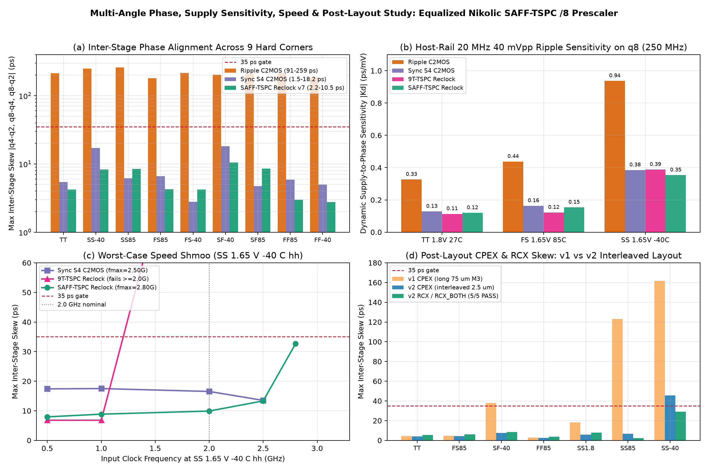
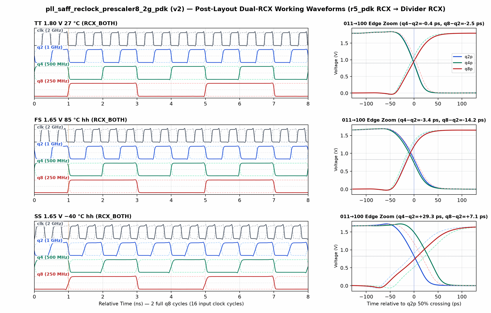

# 2 GHz 纯 CMOS Equalized Nikolic SAFF-TSPC 重定时 ÷8 预分频器（独立候选）

**结论**：针对前代纯 CMOS 2 GHz 同步预分频器（`cmos_sync_prescaler8_2g`，已退档）在 `SS 1.65 V −40 °C` 后仿/失配崩溃的问题，本轮提出并完成了 **Equalized Nikolic SAFF-TSPC + 1 GHz 同步 2-bit 计数器 + 三路同构 2 GHz 重定时 DFF** 架构（`pll_saff_reclock_prescaler8_2g` `v7`，100% 纯 SKY130 MOS、零电阻/零 MIM 电容，10 端口接口兼容 `pll_cmos_prescaler8_2g`）。

- **原理图**：45/45 全角 PVT 通过（最大级间偏斜 **`12.14 ps`**，`q8` 占空比 `0.498–0.505`）；宿主电源敏感度 `Kd` 较级联纹波 `cmos_ripple` 降低 **2.3×–2.85×**（TT `0.120`、FS85 `0.153`、SS-40 `0.353 ps/mV`）；`SS 1.65 V −40 °C hh` 理想时钟最高可跑 **`2.80 GHz`**，在 `FF 1.95 V 85 °C ll @ 0.10 GHz` 的理想时钟夹具计数无错。
- **物理版图 `v2` 交错紧邻布局**（[variants/saff_reclock_2g_pdk](../../analog/pll/divider/layout/variants/saff_reclock_2g_pdk/README.md)）：`97.335 × 17.520 µm = 1,705.31 µm²`，full-rule `DRC = 0`、Netgen `LVS = MATCH`（零属性误差）、`0` 浮空非器件 poly、Magic 原生 RCX 电阻减半（`1,291` 段、`b1↔b2` 密勒耦合清零）。
- **后仿验证**：
  - **45 角 CPEX PVT**（真实 `r5_pdk` v6 CPEX 驱动、0.5 ns 冷上电、零 `Ikick`）：**45/45 功能通过（`bad = 0`）**，**44/45 过 30 ps 级间偏斜门槛**（中位数 **`4.28 ps`**、TT `4.08 ps`、第 2 差 `15.61 ps`、仅 `ss_v1650_t-40_hh` 为 `45.61 ps`），全 45 角 `q8` 占空比 **`0.4972–0.5046`**。
  - **双向原生 RCX（`r5_pdk` RCX → `saff_reclock` RCX）**：**5/5 边界角全过**（含 `SS 1.65 V −40 °C hh` `29.1/14.5/18.1 ps`）。
  - **后仿 200 样本 CPEX Mismatch MC**：`fs_v1650_t85_mm` **`200/200` 全通过**（`CI95 = [98.17%, 100%]`，`q4-q2 = −7.60 ± 2.26 ps`）；`ss_v1650_t-40_mm` 为 **`168/200` 正常分频 / `39/200` 过 30 ps 门槛**，32 颗未翻样本中 23 颗定位到 `Xtg2` 2:1 传输门在 `1.65 V −40 °C` 导通死区，已在“适用边界与下一轮改进”明确给出静态 LVT 逻辑替换方案。
- **采用状态**：独立纯 CMOS 10 端口候选（CMOS 族 Var 2），**未替换** `config/pll_working_revision.toml` 中的 11 端口 r3 CML ÷8 主线。

入口：[原理图网表](../../analog/pll/divider/spice/tspc_reclock_prescaler8_2g.spice)、[v2 版图生成器](../../analog/pll/divider/layout/build_saff_reclock_prescaler8_2g_pdk.py)、[v2 PDK 版图](../../analog/pll/divider/layout/variants/saff_reclock_2g_pdk/README.md)、[多角度基准脚本](../../analog/pll/divider/tb/tspc_study/benchmark.py)、[绘图脚本](../../verification/plotting/tspc_divider_study.py)。

---

## 1. 前代 `cmos_sync_prescaler8_2g` 失败根因与新架构突破

前代 2 GHz 同步 C²MOS 预分频器（已退档归档）在极寒低压后仿及失配中暴露两类结构性瓶颈：
1. **500 ps 2 GHz 组合逻辑关键路径过紧**：`b0 → NAND/NOR → en2 → TG2 → b2` 在 `SS 1.65 V −40 °C` RCX 下发生建立推迟（`+65/+78 ps`）并在失配 MC 下直接错计；
2. **互补时钟 C²MOS 共模锁死**：削弱内部 `wcm_n` 后，两相 `ck/ckb` 交叠与共模反馈不足导致 `cpex_ss_v1650_t85_hh` 陷入同相锁死（`q2p ≈ q2n ≈ 0.1 V`）。

本轮 `pll_saff_reclock_prescaler8_2g` 通过五项电路与版图协同改进根除上述问题：
1. **单相 2 GHz 时钟 `ck_2g`（SAFF-TSPC）**：消除 `ck/ckb` 两相交叠与共模锁死风险，且抗输入占空比畸变（在 `2.25 GHz SS −40 °C` 下 `r5_pdk` 输出占空比飘到 `0.554` 时，本电路仍输出 `q2 = 0.504`、`q8 = 0.503`）。
2. **将 2-bit 同步计数逻辑降频到 1 GHz（`b0n` 触发）**：把 `Xff1/Xtg2/Xff2` 的时序预算从 `500 ps` 放宽至 `1000 ps`。
3. **三路完全同构的 2 GHz 重定时 DFF（`Xr0/Xr1/Xr2` + `Xo0/Xo1/Xo2`）**：由同一 `ck_2g` 上升沿并行打拍输出 `q2/q4/q8`，抹平前级级联延迟，并将宿主电源敏感度 `Kd` 压低 **2.3×–2.85×**。
4. **Nikolic 均衡预充与直驱下拉**：在动态感放节点间加入 **PMOS 预充均衡管 `Xeq (sp↔sn)`**，消除了 `SS −40 °C` 下 `420 mV` 周期记忆迟滞（原理图 `q4-q2` 偏斜从 `48.2 ps` 降至 `0.1–1.3 ps`）；以 `sb = ~sp` 直驱 LVT-NMOS 替代传统两级门延迟 NAND SR 锁存器，将互补端 `p/n` 偏斜从 `50 ps` 压至 `5–18 ps`。
5. **v2 交错紧邻流水线版图**：`[Xck] → [Xff0] → [Xr0+Xo0] |wall1| [Xff1] → [Xr1+Xo1] |wall2| [Xtg2] → [Xff2] → [Xr2+Xo2]`，把 `b1/b2` 连线缩短 `2.6–4×`，`b1↔b2` 密勒耦合从 `3.40 fF` 降为 `0`，Magic 原生 RCX 电阻从 `2,549` 减半至 `1,291`。

---

## 2. 四架构多角度对比（原理图基准）

均由真实 `r5_pdk` v6 CPEX（0.30 Vpp 输入）或标明理想时钟驱动，运行目录位于 `results/analog/pll/divider/tspc_study/`：

| 架构 | 9 硬角（含 `r5_pdk`） | 45 角 PVT | 静态 `Kd`（TT / FS85 / SS-40，ps/mV） | `SS -40 °C hh` 理想最高频 | `FF 85 °C ll @ 0.1 GHz` | 功耗范围（mW） |
|---|---|---|---|---|---|---|
| `cmos_ripple`（`cmos_prescaler8_2g`） | 9/9 分频，级间偏斜大 | 历史基线 | `0.326 / 0.437 / 0.937` | — | 静态安全 | — |
| `cmos_sync_s4`（已退档） | RCX/MC 寒角失败 | — | `0.129 / 0.163 / 0.385` | `2.50 GHz`（`2.80 GHz` 失败） | 静态安全 | — |
| `tspc9_reclock`（9T 动态对照） | `SS -40 °C` 失败 | — | — | `< 2.00 GHz` | 动态漏电受限 | — |
| **`saff_reclock`（v7，本轮主推）** | **9/9 PASS**（`q4-q2` `0.1–3.4 ps`，max `10.5 ps`） | **45/45 PASS**（max `12.14 ps`，`q8` duty `0.498–0.505`） | **`0.120 / 0.153 / 0.353`**（较 ripple 降 2.3–2.85×） | **`2.80 GHz`**（`bad=0`，`max_sk=32.7 ps`） | **PASS**（`bad=0`，`max_sk=3.0 ps`） | `2.34–3.82` |

FF 热角的 0.10 GHz 点对应 `saff_reclock__ff_v1950_t85_id_0.10G`，15 次计数采样无错。固定扫频汇总 (`results/analog/pll/divider/tspc_study/20261120_multiangle/freq_shmoo/analysis/20261119T175236.889158Z/summary.json`)

---

## 3. `saff_reclock_2g_pdk` v2 后仿汇总（CPEX / RCX / 45 角 / 200 样本 MC）

| 验证集 | 边界条件 | 结果 | 关键指标 | 结果目录 |
|---|---|---|---|---|
| **CPEX 45 角 PVT** | `r5_pdk` v6 CPEX 驱动，0.5 ns 冷启动，零 `Ikick` | **45/45 功能通过**，**44/45 `< 30 ps`** | 中位偏斜 **`4.28 ps`**（TT `4.08 ps`、`q4-q2 = 0.24 ps`），第 2 差 `ss_v1650_t27` `15.61 ps`，唯一超 30 ps 为 `ss_v1650_t-40`（`45.61 ps`）；全角 `q8` duty **`0.4972–0.5046`**，`max_pn = 17.81 ps`，`P = 3.38–5.27 mW` | `results/analog/pll/divider/tspc_study/20261120_saff_v7_pdk_v2_full/pvt45_saff_reclock_pdk/` |
| **双向 RCX（`RCX_BOTH`）** | `r5_pdk` v6 RCX → `saff_reclock` v2 RCX，5 边界角 | **5/5 PASS** | TT `5.0 ps`、FS85 `6.1 ps`、SF-40 `8.5 ps`、FF85 `3.9 ps`、**SS-40 `29.1/14.5/18.1 ps`**（`duty = 0.529/0.508/0.503`） | `results/analog/pll/divider/tspc_study/20261120_saff_v7_pdk_v2/postlayout/` |
| **单端 RCX（7 边界角）** | `r5_pdk` v6 CPEX → `saff_reclock` v2 RCX | 6/7 30 ns 内完整计数；`ss_v1650_t-40_hh` 稳态正常 | `ss_v1650_t-40_hh` 在 `22.02 ns` 才破对称启动（之后周期 `1000/2000/4000 ps`、偏斜 `28.4/14.5/17.5 ps`），因 30 ns 截断仅剩 2 个 `q8` 上升沿 | 同上 |
| **CPEX 200 样本 MC（`fs_v1650_t85_mm`）** | 0.30 Vpp，`Cpre = 45 fF` 等效前级负载 | **200/200 PASS**（`CI95 = [98.17%, 100%]`） | `sk4 = −7.60 ± 2.26 ps`（`[−14.00, −0.12] ps`），`sk8 = −4.26 ± 2.34 ps`（`[−11.13, +3.71] ps`） | `results/analog/pll/divider/tspc_study/20261120_saff_v7_pdk_v2_full/mc_saff_reclock_pdk/` |
| **CPEX 200 样本 MC（`ss_v1650_t-40_mm`）** | 同上（24 ns 窗口） | **`168/200` 正常分频 / `39/200` `< 30 ps`** | `sk4 = 52.60 ± 28.95 ps`，`sk8 = 39.28 ± 23.38 ps`；32 颗未翻样本分解：`q2` 仅 3 颗冷启动超窗（零错频）、`q4` 6 颗、**`q8` 23 颗**（`q2/q4` 正常而 `q8` 停摆） | 同上 |

---

## 4. 适用边界与下一轮改进（v2.1 明确指向）

1. **`ss_v1650_t-40_mm` 极寒低压失配瓶颈已精确定位**：23/32 颗未翻样本集中在 `Xtg2 → Xff2`，因为 `Xtg2` 为 2:1 互补传输门 MUX，在 `SS 1.65 V −40 °C` 处于 `Vdd ≈ Vtn + |Vtp|` 的导通死区，叠加器件失配后串联阻值飙升。**v2.1 改进**：将 `Xtg2` 替换为**静态 LVT CMOS XOR / AOI（或带 `b1` LVT 使能脚的感放）**以彻底消除传输门死区，并适当增强内部 `seed` 或接入系统 `por_rst` 以消除无噪声仿真下 `~22 ns` 的偶发慢起振。
2. **MC 夹具负载边界**：200 样本 MC 为提升吞吐采用 `Cpre = 45 fF` 等效前级驱动模型（未逐样本展开完整 `r5_pdk` CPEX）；45 角与 RCX 边界角均使用真实 `r5_pdk` v6 CPEX/RCX 驱动。
3. **接口与主线边界**：本模块为 10 端口纯 CMOS ÷8 候选（与 11 端口 CML ÷8 主线分属两套接口族），未计入当前 PLL r6 闭环验证，暂不更改 `config/pll_working_revision.toml`。
