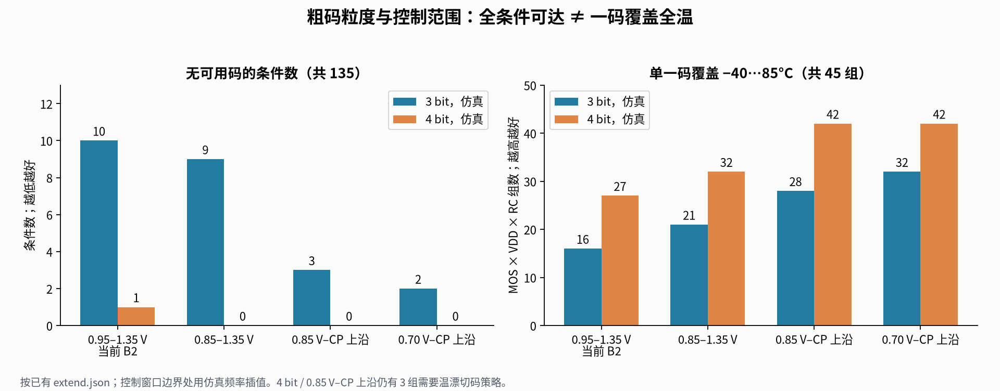
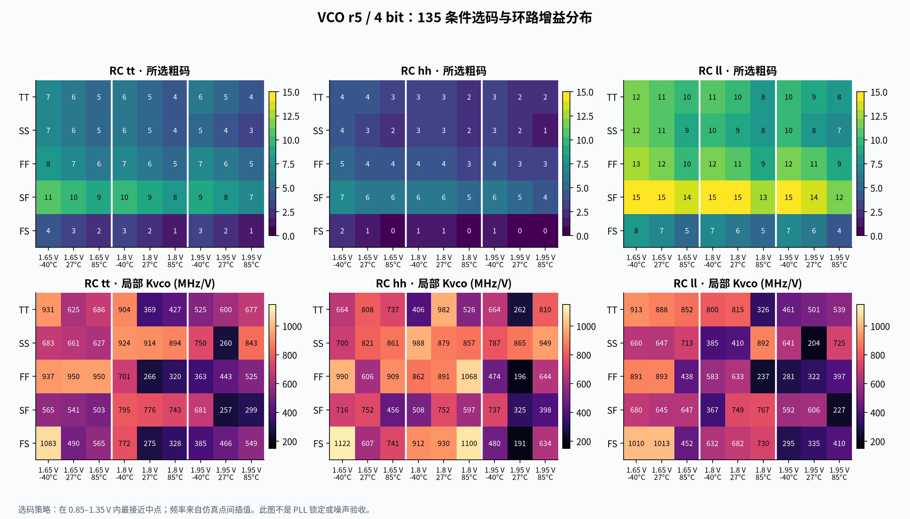
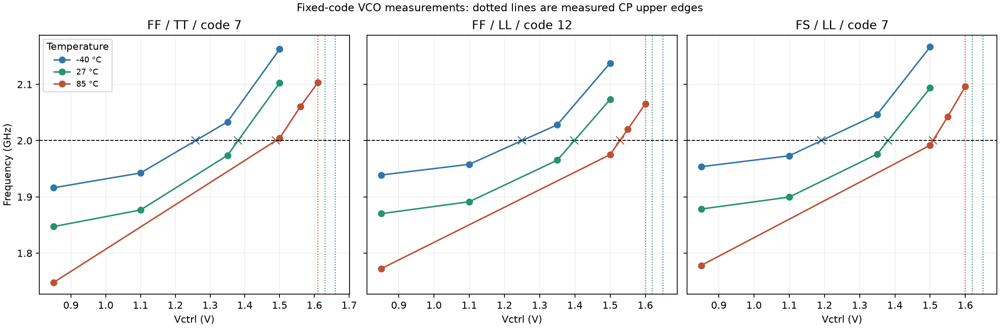

# VCO：四级差分 CML 环振

> **当前修订**：PLL r5 候选 `pll_vco_ring4_pvt_candidate`（[网表](../../analog/pll/vco/spice/vco_ring4_pvt_candidate.spice)）。相对 r3 只改节点无源件：电容阵列开关 W 1 → 5 µm，变容管 W 18 单指 → 4.5 µm × 4 指，去掉固定 MIM。
> **关键数字**：七个压力工况（真实偏置、PDK 电阻）开环都调到 2 GHz，差分摆幅 389–493 mVpp（r3 最差 237），L(1 MHz) −84.9 … −90.2 dBc/Hz（r3 最差 −77.2），局部 Kvco 721–1001 MHz/V。
> **主要缺口**：4 bit 的 `pll_vco_ring4_4b` 已接入 r5 原生前端＋TX v3 静态 bench，10 个压力点中 8 个完整且连续计数，2 个 FF 冷角未完成；原生闭环未重验证。局部 Kvco 跨 191–1122 MHz/V，运行中切码未验证（[工作区](#工作区r5-候选45-条件--tt--hh--ll2026-11-06)）。

## 电路

四个电阻负载 CML 反相延迟单元成环，偶数级环路中有一次差分交叉，保证直流负反馈。四路差分输出给出八个极性（顺序见 [架构](../overview/architecture.md#vco-八相顺序)）。粗调为每节点 3 bit 电容阵列，细调为累积型变容管；码增大 → 电容增大 → 频率降低，Kvco 为正。

| 部分 | 参数 |
|---|---|
| 延迟单元 [serdes_cml_delay](../../analog/common/cml_buffer/spice/cml_delay_resistive.spice) | 输入对 LVT W = 40 µm、8 指、L = 0.15 µm；尾管 W = 20 µm、4 指、L = 0.5 µm；负载每端 400 Ω（理想电阻） |
| 变容管 | 每节点 `sky130_fd_pr__cap_var_lvt` W/L = 4.5/0.5 µm × vm 4，栅接振荡节点，阱接 Vctrl |
| 粗调阵列 [cap_bank_3b](../../analog/pll/vco/spice/cap_bank_3b.spice) | 7 个相同 MIM 单元 2.35 × 5 µm（约 25.9 fF），分组 1:2:4；底板接 NMOS 开关 W = 5 µm |
| 偏置 | 真实偏置：212.5 µA 拷贝进 `serdes_bias_cml`（nfet 5/0.5，[偏置](bias.md)）；旧 bench 为理想 0.85 mA 进 20/0.5 |

### 为什么是这组尺寸（r5）

r3 在 SF 1.65 V 85 °C、R hh 只有 237 mVpp、−77.2 dBc/Hz，CDR 后 14.07σ（k = 4）= 0.805 UI，几乎吃掉整个窗口。原因是节点损耗，不是电流不够：

- `cap_var_lvt` 的串联电阻含多晶项 ∝ W/L，并按 `vm` 并联。W 18 单指在该角 593–1064 Ω、Q 1.7–1.9，等效并联电导约 0.36 mS。4.5 µm × 4 指：179–587 Ω、Q 3–6，0.14–0.23 mS。
- 开关 W 1（Ron 估约 2.5 kΩ，未单独测）串 25.9 fF：Q 约 1.5，每个接通单元约 0.16 mS。码 4 共约 0.64 mS，而负载电导只有约 2.2 mS。
- 损耗压低 gm·R，环工作在起振门限附近：差分摆幅接近 Vsw，输入对一直不完全换向，平均 gm 高，输入管噪声主导。串联电阻还把电容"藏"了一部分，所以 r3 才需要固定 MIM 补。

选择（真实偏置 + PDK R）：开关 W 3 慢端多约一码，但按频率比估算 FF 冷角码 7 会高过 2 GHz；W 5 带固定 MIM 在 FS 1.95 V 85 °C R hh 到不了 2 GHz（码 0、1.45 V 只有 1.985 GHz）。所以取 W 5、无固定 MIM（同点 2.195 GHz）。

### 抽出与负载

每路差分输出接一个 `serdes_cml_buffer`，再接一个全速 CML→CMOS 接收器和一条 ÷8 prescaler。支路 0 是真实反馈，支路 1–3 是带偏置的供电 dummy，负载完全相同，保证八相负载对称。每根线另有 0.5 fF 残余布线电容。见 [clock_frontend_lowov.spice](../../analog/pll/top/spice/clock_frontend_lowov.spice)。

## 已验证结果

### 相位噪声（r5 候选）

真实偏置 + PDK 电阻，开环调到 2 GHz，四个 buffer 负载。方法见 [验证方法](../verification/methods.md#相位噪声)；k 是环路相对 v0.1（50 µA、40 pF、2 pF）的缩放，Rz 6.5 kΩ 不变，底噪 −125 dBc/Hz。

| 工况 | 码 / Vctrl | 摆幅 mVpp | L 1 MHz / 10 MHz dBc/Hz | Kvco / Kb / Kvdd（直流） | PLL rms ps（k = 2 / 4 / 8） | CDR 后 14.07σ UI（k = 2 / 4 / 8） |
|---|---|---:|---|---|---|---|
| SF 1.65 V 85 °C R hh | 3 / 1.071 | 389 | −85.0 / −105.2 | 721 M / 2.60 G / −604 M | 3.78 / 2.75 / 2.33 | 0.425 / 0.323 / 0.269 |
| FS 1.65 V 85 °C R hh | 1 / 1.287 | 415 | −84.9 / −105.3 | 924 M / 2.86 G / −782 M | 3.55 / 2.64 / 2.43 | 0.400 / 0.306 / 0.270 |
| FS 1.95 V 85 °C R hh | 0 / 1.260 | 433 | −85.4 / −105.7 | 741 M / 2.82 G / −613 M | 3.71 / 2.66 / 2.25 | 0.420 / 0.319 / 0.263 |
| SS 1.65 V 85 °C R hh | 1 / 0.980 | 422 | −85.4 / −105.7 | 960 M / 2.83 G / −817 M | 3.38 / 2.52 / 2.38 | 0.384 / 0.297 / 0.268 |
| SS 1.65 V −40 °C R hh | 2 / 1.067 | 490 | −88.6 / −109.7 | 1001 M / 3.64 G / −868 M | 2.58 / 1.86 / 1.84 | 0.328 / 0.261 / 0.241 |
| FF 1.95 V −40 °C R ll | 7 / 1.475 | 493 | −90.2 / −111.0 | 790 M / 2.88 G / −673 M | 2.32 / 1.67 / 1.55 | 0.314 / 0.255 / 0.233 |
| TT 1.8 V 27 °C R tt | 3 / 1.162 | 457 | −87.7 / −108.2 | 762 M / 2.74 G / −643 M | 2.93 / 2.10 / 1.84 | 0.360 / 0.282 / 0.244 |

- 主要来源（SF 热角 1 MHz）：输入管热噪声 −86.9，负载 R −91.5，尾管热噪声 −96.3，尾管闪烁 −97.7 dBc/Hz。100 kHz 处尾管闪烁接近输入管热噪声（−69.3 对 −66.9）。
- 偏置线噪声主要来自 CML 二极管 5/0.5 的闪烁噪声，k = 4 时贡献 0.8–1.0 ps，不主导。
- 带宽的影响和 VCO 本身的影响要分开看：SF 热角 k = 4 从 8.37 降到 2.75 ps，其中 Kvco 变大使 UGB 约翻倍；带宽相近（约 8 MHz）时是 8.37 → 3.78 ps。

### 电源灵敏度（r5 候选）

VDD 上 5 mV 正弦，Vctrl 带 α 倍同一正弦（[psrr_tone.py](../../analog/pll/vco/tb/phase_noise/psrr_tone.py)），α 对应 LF 电容接 VDD 的比例。

| 工况 | 20 MHz 下 K 实部（MHz/V）：α = 0 / 1 | 抵消点 α |
|---|---|---:|
| FS 1.65 V 85 °C R hh | −584 / +340 | 0.632 |
| SF 1.65 V 85 °C R hh | −506 / +215 | 0.702 |
| FF 1.95 V −40 °C R ll | −649 / +141 | 0.822 |
| FS 1.95 V 85 °C R hh | −410 / +330 | 0.555 |
| SS 1.65 V 85 °C R hh | −628 / +331 | 0.656 |
| SS 1.65 V −40 °C R hh | −760 / +241 | 0.760 |
| TT 1.8 V 27 °C R tt | −567 / +195 | 0.744 |

全部接地最大 |K| 762 MHz/V（k = 4 只容忍约 3.3 mV 正弦，0.05 UI 峰值），全部接 VDD 342 MHz/V。**α = 0.69 最大约 109 MHz/V**（FF 冷角和 FS 1.95 V 热角直接仿真 109、105，符号相反），容限约 23 mV。Ci、Cf 要按同一比例分开，总电容不变。电路还没改（[PLL 环路](pll_loop.md)）。

### 工作区（r5 候选，45 条件 × tt / hh / ll，2026-11-06）

**结论：4 bit（15 个半单元，[vco_ring4_4b](../../analog/pll/vco/spice/vco_ring4_4b.spice)）配 0.85 V 到 CP 上沿的控制窗口，135 个条件都能到 2 GHz；原工作图42组加上11-07的12点补测，45/45组（MOS×VDD×RC）均存在一个码在三档温度跨越2 GHz；不同组允许不同码。原扩展记录42/45来自候选码缺测，已由后续补测补齐。3 bit 是 3 个条件无解、28 个芯片。** 4 bit 已接入原生前端静态 bench，闭环尚未验证，见[原生联合结果](../history/clocking_progress_20261106.md#原生联合仿真恢复)。

四个代表工况的[调谐曲线](../figures/clocking/vco/vco_r5_4b_tuning_examples.png)与[CP 窗口图](../figures/clocking/pll/charge_pump/cp_real_bias_dc_windows.png)来自同批数据；[全部图与复现](../figures/clocking/README.md)。

[workmap.py](../../analog/pll/vco/tb/tuning/workmap.py)：真实偏置 + PDK 电阻，每条件先跑 3 个码，1 / f 对码做抛物线拟合，再仿真拟合选中的码（`--bank 4` 用码 0、6、15）。下表都是仿真点，拟合只用来选点；4 bit 拟合对其余半码平均差 0.04 %，最大 0.44 %。CP 窗口 [window.py](../../analog/pll/cp/tb/dc/window.py)：UP、DN 各在 VDD / 2 处电流的 ±5 % 内。

| 控制窗口 | 3 bit：无解条件 / 固定码跨全温 | 4 bit：无解条件 / 固定码跨全温 | 4 bit：固定码跨冷和常温 / 常温和热 |
|---|---:|---:|---:|
| 0.95–1.35 V（现 B2） | 10 / 16 | 1 / 27 | 40 / 42 |
| 0.85–1.35 V | 9 / 21 | 0 / 32 | 41 / 43 |
| **0.85 V–CP 上沿** | **3 / 28** | **0 / 42** | **45 / 45** |
| 0.7 V–CP 上沿 | 2 / 32 | 0 / 42 | 45 / 45 |

共 135 个条件；芯片 = MOS × 电压 × 电阻电容角，共 45 个。固定码指校准后不再切码（I-18 未实现）。原先未确认共同固定码的3组为FF 1.95 V tt、FF 1.95 V ll、FS 1.95 V ll。复核发现，原扩展扫描最高只到1.50 V，并筛选旧近目标码；`np.interp`在CP上沿超出测点时钳位到末端值。因此42/45是现有测点给出的覆盖下界，不是其余三组无解的证明。共同候选码分别为7、12、7；三组冷/常温已有可用点，但原扫描中这些码的高温段缺测。[12点补测](../../analog/pll/vco/tb/tuning/cp_edge_fill.py)已完成，并找到三组全温共同码，见下节；无需为这三个旧缺口先增加码位或强制温漂切码。表内CP上沿统计保留原算法口径。

### 固定码三温补测（2026-11-07）

三组共同候选码的高温点原先没有进入`extend`筛选。补测仍用相同四位阵列、真实偏置、PDK R、四缓冲及每端30 fF；原/新物理deck前缀归一化后相同，所有include内容hash一致。新增12点完整24 ns，末5 ns测频，三个deck与冒烟执行均无失败；旧冷/常温逐点raw重读，所属旧deck的cosh等日志记录保留，不称为干净重跑。

| 1.95 V组合 | 固定码 | 冷/常温2 GHz插值 / V | 高温已测夹点 / V | 高温2 GHz插值 / V | 到CP上沿插值余量 / mV |
|---|---:|---|---|---:|---:|
| FF、R tt | 7 | 1.258 / 1.381 | 0.85–1.50 | 约1.489 | 约121 |
| FF、R ll | 12 | 1.250 / 1.398 | 1.50–1.55 | 约1.528 | 约72 |
| FS、R ll | 7 | 1.192 / 1.380 | 1.50–1.55 | 约1.508 | 约92 |

交点仅在相邻实际电压点之间插值，FF tt热角的650 mV区间较宽，只证明静态可达，不能将三位小数当精确设定值。三组夹点上界仍分别低于实测CP上沿110/50/50 mV。CP上沿按DC电流下垂5%定义，尚无动态/失配余量证明。工作点再细化、实际B2/CP/LF交接和原生持续锁定仍是后续任务；0.85–1.35 V窄窗口的旧32/45结论未改变。

运行`results/analog/pll/vco/cp_edge_fill/20261107T102145236159Z`，[小数据](../data/vco_cp_edge_fill.json)、[索引](../../results/catalog/vco_cp_edge_fill.json)保留新12点、旧24点、CP上沿、完整性、源码/实际deck/raw hash和每个插值夹区。上方旧控制窗口图仍为11-06原统计，未改写历史数据。[实验与复核](../history/vco_fixed_code_coverage.md)。

4 bit、0.85–1.35 V 下选落点最靠近窗口中间的码：2 GHz 落在 0.907–1.271 V，摆幅 365–529 mVpp，码 0–15 两头都用到（慢端 FS 热 hh 码 0，快端 SF 冷 ll 码 15），量程刚好够，没有富余。多数条件有 2–5 个码可用，只有 1 个码的 13 个。

- **快端：** 3 bit 时 SF −40 °C ll 码 7 在 0.7 V 才到约 2.00 GHz。15 个半单元最大电容多约 7 %，SF 1.65 V −40 °C ll 码 15 在 0.907 V 到 2 GHz。
- **慢端：** FS 1.95 V 85 °C hh 码 0 在 1.27 V，FS 1.65 V 85 °C hh 码 0 在 1.02 V。
- **3 bit 的码间缺口：** 0.95–1.35 V 窗口内 6 个无解条件是缺口，全在 1.95 V（例：FF 1.95 V −40 °C tt，码 3 最低 2.047 GHz，码 4 最高 1.977 GHz）。
- **局部 Kvco** 仍跨 191–1122 MHz/V（4 bit，所选码，250 mV 割线），135 个条件中 39 个低于 500、13 个低于 300 MHz/V，都在调谐曲线平坦的低 Vctrl 处。现在按落点选码，没有考虑 Kvco；环路带宽随之变化，定环路时要按斜率选码。
- **CP 窗口：** 电流下垂 5 % 的上沿，1.65 V ≥ 1.26 V、1.8 V ≥ 1.42 V、1.95 V ≥ 1.57 V，都约为 VDD − 0.39 V；下沿 ≤ 0.41 V。UP / DN 失配另算：SF 1.65 V −40 °C ll 最大 11 %，从 0.6 到 1.2 V 基本不变，来自偏置拷贝，不是余量问题。它在 PLL 里造成静态相差和纹波，不丢电荷。

噪声工作点（上表）里 FF 冷角的码 7、1.475 V 不是必需的：码 6 在 1.193 V 就到 2 GHz。

### r3 原生回接（固定理想 Vctrl，开环）

| 工况 | 码 / Vctrl | VCO 频率 | 三级分频 / 反馈 | 四相全速 CMOS |
|---|---|---:|---|---|
| TT / 1.8 V / 27 °C | 5 / 1.205 V | 2.0129 GHz | 正常 | 正常 |
| SS / 1.65 V / 85 °C | 6 / 1.320 V | 2.0121 GHz | 正常 | 正常 |
| FS / 1.65 V / 85 °C | 5 / 1.100 V | 1.9906 GHz | 正常 | 正常 |
| SS / 1.65 V / −40 °C | 5 / 1.112 V | 2.0019 GHz | 正常 | **失败** |

来源：[r3 记录](../history/pll_buffered_pvt.md)、[数据](../data/pll_buffered_pvt.json)。SS 冷角原用码 6 时在 1.32/1.55 V 只有约 1.936/1.970 GHz，改用码 5 后达到 2 GHz，没有再改尺寸。

### r3 调谐覆盖（5 个选定工况，理想 R）

| 工况 | 码 | 已测频率区间 |
|---|---:|---:|
| TT / 1.80 V / 27 °C | 5 | 1.949–2.153 GHz |
| SF / 1.80 V / 27 °C | 7 | 1.905–2.020 GHz |
| SF / 1.65 V / 85 °C | 7 | 1.992–2.076 GHz |
| FS / 1.95 V / −40 °C | 4 | 1.850–2.045 GHz |
| SS / 1.65 V / 85 °C | 6 | 1.904–2.034 GHz |

TT 码 4/5 有约 88.7 MHz 的已测重叠；若两码都只用 1.1–1.55 V，会留下约 31.4 MHz 的间隙，所以细调范围不能过早缩窄。局部 Kvco（1.1–1.3 V 割线）：TT 码 5 约 495 MHz/V，SF 低压热角约 245 MHz/V。来源：[VCO/接收器修整](../history/pll_pvt_refinement.md)。

### 早期特性（v0.1 几何，TT）

| 项目 | 数值 |
|---|---:|
| 名义点（码 7、Vctrl 1.48 V、每端 20 fF 代理） | 2.0083 GHz、415 mVpp |
| 核心功耗（不含参考支路） | 6.06 mW |
| 八相间隔 | 约 62.24 ps |
| 变容管小信号 Q（1.0 / 1.4 / 1.8 V） | 2.76 / 2.91 / 23.3 |

变容管在常用偏置下 Q 很低，这正是 r5 修的问题。来源：[首轮结果](../history/vco_ring4_first_results.md)。

### 节点摆幅

r2 原生回接时 VCO 节点差分摆幅：TT 约 360 mVpp、SS 1.65 V/85 °C 约 310 mVpp、FS 1.65 V/85 °C 码 6 约 316 mVpp；r3 SS 冷角约 416 mVpp。抽出 buffer 后通常更大（例如 TT 约 504 mVpp）。来源：[r2 记录](../history/pll_lowov_pvt.md)、[r3 记录](../history/pll_buffered_pvt.md)。

## 粗细调交接策略

计划的首次捕获：Vctrl 固定在可用范围中部，按频差逐次 ±1 改码（太快 +1、太慢 −1），进入目标窗口后交给 PLL 细调；锁定后冻结粗码。背景再校准需要 Vctrl 迟滞门限、越界确认次数、切码后最短保持时间、端点"范围不足"状态。当前 1:2:4 二进制分组在 011 → 100 时切换三组开关，要想每次只切一个单元需改为温度计译码。控制器尚未实现。详见 [粗调校准](../history/vco_coarse_calibration.md)。

### 运行中切码：迟滞与预充（2026-11-08，模型）

**带迟滞的Vctrl窗口切码在全温度往返下成立，但每次切码不预充时链路要受约1.8 UI的相位冲击；预充到预测电压时，误差每1 mV约4.3 ps，用室温曲线加温度缩放模型预测，误差中位3.6 mV、p90 17 mV、最大56 mV。** 均为基于工作区三点抛物线的模型结果。

切码规则：Vctrl高过VDD − 0.41 V（CP上沿留20 mV）换快一档的码，低于下门限换慢一档。切码后Vctrl回跳约一个码间压差（66–286 mV，中位138 mV），只要窗口宽于这一跳，切回所需的温度就低于切出时，即施密特特性，不需要温度传感器。[recode_policy.py](../../analog/pll/vco/tb/tuning/recode_policy.py)对每颗芯片（MOS×VDD×RC）走−40→85→−40、85→−40→85、27→85→−40→27三种温度路径：

| 下门限 | 守住窗口的芯片 | 每次全程往返切码 | 最小迟滞 |
|---|---:|---:|---:|
| 0.90 V | 44/45 | ≤ 3 | 79 K |
| 0.95 V | 44/45 | ≤ 3 | 34 K |
| 1.00 V | 42/45 | ≤ 3 | 23 K |

工作区每个条件只仿真了2 GHz附近的码（0.85/1.10/1.35 V三点），87个码只有一个温度的数据，靠本芯片其他码的温度斜率外推；0.9 V以下和1.35 V以上的抛物线外推不可靠。数字需要补点后再定。

单次切码的时域冲击（[recode_transient.py](../../analog/pll/top/theory/recode_transient.py)，行为模型：三态PFD、200 µA CP、4.13 kΩ / 18.4 pF、控制端0.5 pF、÷8，VCO取工作区抛物线；TT 1.8 V 85 °C码7→6，频率跳5.49%）：

| 情况 | 输出时钟TIE峰值 | PFD回到5 ps内 | 滑参考周期 |
|---|---:|---:|---:|
| 不预充 | 440 ps（1.76 UI） | 314 ns | 0 |
| 预充误差0 / 5 / 10 mV | 3 / 22 / 43 ps | 0 / 118 / 166 ns | 0 |
| 预充误差30 / 70 mV | 129 / 304 ps | 234 / 294 ns | 0 |

环路本身不滑周期，约0.3 µs回到原相位；但链路看到的TIE超过0.5 UI时，远端CDR（跟踪约0.1 MHz）会丢位。

**预测切码后的电压。** 同一码的f(V,T)/f(V,27 °C)在0.9–1.3 V内只变0.40%（中位，p90 0.95%，567条曲线），即温度主要整体缩放调谐曲线。于是切码瞬间的目标Vctrl只取决于两个码在室温的曲线和切码门限：F_{k−1}(V′) = F_k(V_hi)。上电时用计数器在几个预充电平下测相邻码的频率即可得到曲线。对工作区有数据的232个情形，预测误差中位3.6 mV、p90 17 mV、最大56 mV（直接减室温码间压差：17 / 57 / 158 mV）。对应TIE约15 / 73 / 240 ps。预充源需要mV级精度：现有B2是16档、约27 mV一档，最终误差±40 mV，不够。

## 适用范围

- 结果是固定理想 Vctrl 的开环工作点，频差不是 PLL 锁定误差。
- r5 相噪数据是七个压力工况；4 bit 工作区为 45 × tt/hh/ll，原生前端＋TX v3 只有 8 个完整静态压力点。r3 小节用理想 R 和理想偏置，只作记录。
- 无失配、版图寄生；八相间隔来自匹配原理图。
- 启动使用已建立的直流偏置和有限扰动，不代表上电启动。

## 待解决

- 4 bit 调谐映射已覆盖 45 × tt/hh/ll；补 hl/lh、共同码的精确工作点/实际B2与CP/LF交接及运行中切码（[问题清单](../status/open_issues.md) I-09）。
- 低 Vctrl 时 Kvco 变平（FF、FS），码选择要避开。
- r5 原生前端 FF 冷角收敛、实际 CP/LF 闭环重验证，VCO 和 CP 的失配 MC（I-05 / I-32）。
- 粗调控制器、温度计译码、无扰切码（I-18）。
