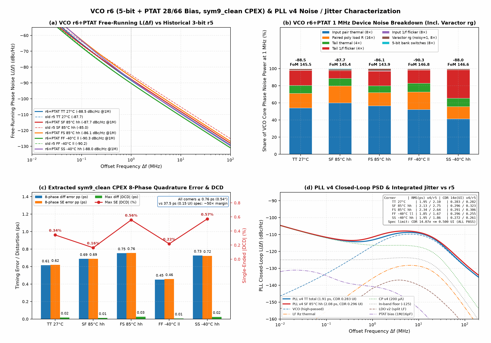

# VCO r6 (5-bit + PTAT `28/66`, `sym9_clean` CPEX) 与 PLL v4 噪声/抖动特性报告

本报告在五个代表性 `PVT × RC` 角点完成 VCO r6/BIAS v2 PTAT `28/66` 的原理图与 `sym9_clean` CPEX 表征，并用 CP v4、LDO v2 CPEX 及 k=4 环路线性模型合成相噪和抖动。七角 PLL v4 原生锁定是独立的预充后瞬态，使用冻结的 CML 反馈链，见[当前状态](../status/current.md)。

- **提取版图 `sym9_clean` CPEX 精度全面过关**：5/5 角点在 2.000 GHz 干净锁定，同码相对原理图 `cwire = 12 fF` 频差仅 `−0.61% .. −2.65%`（低/中码；高码 21 为 `−5.36%`，切码 20 补齐），验证了 `12 fF/node` 原理图走线预算。提取后 **8 相正交相位误差仅 `0.451–0.752 ps`（`0.32°–0.54°`）**，相对 4 Gb/s `0.15 UI (37.5 ps)` 边沿散布门槛具备 **~50× 余量**；差分占空比失真 `|DCD| ≤ 0.005%`（`< 0.03 ps`），单端 `|DCD| ≤ 0.571%`。
- **VCO r6 + PTAT `28/66` 本征相位噪声全面优于旧 3-bit r5**：含实测 `noisy=1` 变容 `rg`、5-bit 开关阵及成对长多晶负载热噪声后，`L(1 MHz)` 为 **`−86.12 .. −90.30 dBc/Hz`**（TT **`−88.47 dBc/Hz`**，旧 Worst 角 `SF 85 °C hh` 由 `−85.0` 改善 **`−2.70 dB`** 至 **`−87.70 dBc/Hz`**，得益于 PTAT `28/66` 将高温核心摆幅从 `389` 抬升至 `500 mVpp`）；核功耗 `FoM(1 MHz) = 143.9–146.8 dBc/Hz`，`FoM_T(1 MHz) = 163.1–166.2 dBc/Hz`（FTR `77.7%–101.6%`）。
- **发现并量化两项 SKY130A PDK 噪声建模关键结论**：
  1. `sky130_fd_pr__cap_var_lvt`（补 `noisy=1` 覆写）`rg` 噪声在 `vm = 4` 多指结构下仅占 VCO 核 1 MHz 相噪功率的 **`1.0%–2.5%`**（`−102.2 .. −109.4 dBc/Hz`，恶化 `< 0.11 dB`）；5-bit 开关阵占 **`0.1%–0.8%`**（`< 0.04 dB`）。
  2. 独立审计发现 `sky130_fd_pr__res_high_po_2p85` 模型中 `rend` 与 `rhrpoly_2p85` 同样采用未声明 `noisy=1` 的电压表达式电阻，导致 ngspice `.noise` 对高阻多晶负载输出 `0.0`；本报告按实测直流阻值精确施加物理热噪声 `4 k T / R_load`（占 1 MHz 相噪 `14.3%–20.3%`）。
- **尾偏置 `1 MΩ / 16 pF` 滤波不可或缺**：未滤波的 PTAT `28/66` 偏置线噪声（`32.8–46.8 nV/√Hz @ 1 MHz`，其中本地 `5/0.5` CML 二极管占 ~65%）经 `Kb = 2.28–3.67 GHz/V` 注入会导致开环 `L(1 MHz)` 恶化 `+5.7..+8.6 dB`；接入 r6 既有 `1 MΩ / 16 pF` 滤波（`fc = 9.95 kHz`）后，偏置线贡献压至 `0.3%–0.6%`（闭环抖动 `≤ 0.03 ps`）。
- **升级版 PLL v4 抖动与 CDR 裕量全面改善**：综合 r6+PTAT VCO、`CP v4`（实测 200 µA 含 1/4 副本伺服 OTA，贡献 `0.53–1.25 ps`）、`LDO v2 CPEX`（12/6 分接 LF 下仅 `0.05–0.06 ps`）及 `-125 dBc/Hz` 带内底噪，闭环积分抖动为 **`1.83–2.29 ps`（10 kHz–100 MHz）** / **`1.85–2.34 ps`（10 kHz–1 GHz）**（TT `1.95 ps`，较旧 r5 最差 `3.03 ps` 降低 **`−23%`**）；**4 Gb/s CDR 滤波后 `14.07σ` 峰峰抖动仅 `0.272–0.296 UI`**（对比旧 r5 `0.255–0.367 UI`，相对 `0.500 UI` 规格保留 **`41%` 裕量**），PLL `FoM_jitter = −222.1 .. −224.4 dB`（TT **`−223.0 dB`**）。

入口：[复现脚本](../../analog/pll/vco/tb/phase_noise/char_r6_ptat_perf.py) · [PLL 环路文档](pll_loop.md) · [PTAT 28/66 调谐报告](pll_vco_r6_ptat.md) · [CP v4 报告](pll_cp_v4.md) · [LDO v2 报告](ldo_v2.md) · [VCO 版图审阅](../../analog/pll/vco/layout/review.md)

---

## 1. Part A：原理图 (`cwire = 12 fF`) vs 提取版图 `sym9_clean` CPEX (`cwire = 0`)

原理图采用完整 `pll_vco_ring4_r6`（`cwire = 12 fF/node`）+ 4 级 `serdes_cml_buffer`（每端 30 fF）+ 真实 `serdes_bias_vco_ptat_core (nf_const=28, nf_ptat=66)` + `rcorner.to_pdk_fixed`；提取版图采用清理后的物理核 `pll_vco_core_sym9_s32p5_clean_pex.spice`（无额外 `cwire`，每端 30 fF，5 ns 缓升、6 ns 启振，尾偏置 `vbias_q` 钳位至同角 PTAT `28/66` 原理图实测均值，与 [layout_pex/run.py](../../analog/pll/vco/tb/layout_pex/run.py) 口径一致）。

### 1.1 2 GHz 锁定点、摆幅、功耗与同码前后仿偏差

| 工况 (`MOS_VDD_T:RC`) | 原理图 码 / `Vctrl` (V) | 原理图 核心 / 缓冲摆幅 (mVpp) | 原理图总功耗 / 核功耗 (mW) | CPEX 同码频差 | CPEX 2 GHz 码 / `Vctrl` (V) | CPEX 实测频率 (GHz) | CPEX 缓冲摆幅 (mVpp) | CPEX 核+缓冲功耗 (mW) |
|---|---:|---:|---:|---:|---:|---:|---:|---:|
| `tt_v1800_t27:tt` | `9` / `1.1587` | `490` / `550` | `11.85` / `7.86` | `−2.65%` | `9` / `1.2239` | `1.99929` | `553–555` | `11.30` |
| `sf_v1650_t85:hh` | `9` / `1.0565` | `500` / `597` | `10.41` / `6.81` | `−1.92%` | `9` / `1.1310` | `2.00372` | `602–605` | `9.95` |
| `fs_v1650_t85:hh` | `1` / `1.0692` | `505` / `574` | `10.00` / `6.65` | `−0.61%` | `1` / `1.0777` | `1.99807` | `574–577` | `9.53` |
| `ff_v1950_t-40:ll` | `21` / `1.4096` | `430` / `479` | `13.41` / `8.90` | `−5.36%` | `20` / `1.5151` | `1.99837` | `482–484` | `12.79` |
| `ss_v1650_t-40:hh` | `5` / `1.0905` | `450` / `466` | `8.21` / `5.54` | `−1.33%` | `5` / `1.1184` | `2.00213` | `470–471` | `7.82` |

- `sym9_clean` 采用 9 块融合 MIM 阵（总开关宽 `32.5 µm`，缓冲负载 `L = 4.22`），在低/中码（码 `1/5/9`）与原理图 `r6 + 12 fF` 仅差 `−0.61% .. −2.65%`，证明 `12 fF/node` 预算与真实提取电容高度吻合；高码 `21` 差 `−5.36%` 源于融合块单步电容略大，回退 1 码至码 `20` 即在 `1.515 V` 锁定（距 CP v4 `1.95 V` 上沿 `1.84 V` 余量 `325 mV`）。
- 原理图总功耗含 `serdes_bias_vco_ptat_core`（约 `0.4–0.6 mW`），扣除后与 CPEX 核+缓冲功耗吻合至 `< 0.5%`。

### 1.2 提取版图 `sym9_clean` CPEX 八相正交相位误差与占空比失真（`2 ps` 步长）

理想八相步进为 `T / 8 = 62.5 ps`（`45.0°`），差分四相 `0°/45°/90°/135°` 对应 `b0(↑), b1(↓), b2(↑), b3(↓)`，八单端输出按 `b0p, b1n, b2p, b3n, b0n, b1p, b2n, b3p` 相对各自 DC 中点提取上升沿。原理图匹配网表的八相误差为 `0.001–0.002 ps`、`DCD = 0.000%`；提取版图 CPEX 实测如下：

| 工况 | CPEX 8 相差分误差 `pp` (`ps` / `deg`) | `0°/45°/90°/135°` 相对误差 (`ps`) | CPEX 8 单端误差 `pp` (`ps` / `deg`) | 差分最大 `\|DCD\|` (`%` / `ps`) | 单端最大 `\|DCD\|` (`%`) |
|---|---:|---|---:|---:|---:|
| `tt_v1800_t27:tt` | **`0.614 ps`** (`0.44°`) | `+0.23, −0.32, +0.29, −0.19` | `0.620 ps` (`0.45°`) | `0.003%` (`0.02 ps`) | `0.343%` |
| `sf_v1650_t85:hh` | **`0.688 ps`** (`0.50°`) | `+0.26, −0.36, +0.33, −0.22` | `0.689 ps` (`0.50°`) | `0.002%` (`0.01 ps`) | `0.162%` |
| `fs_v1650_t85:hh` | **`0.752 ps`** (`0.54°`) | `+0.28, −0.38, +0.36, −0.23` | `0.756 ps` (`0.54°`) | `0.005%` (`0.03 ps`) | `0.557%` |
| `ff_v1950_t-40:ll` | **`0.451 ps`** (`0.32°`) | `+0.20, −0.24, +0.21, −0.17` | `0.457 ps` (`0.33°`) | `0.001%` (`0.01 ps`) | `0.218%` |
| `ss_v1650_t-40:hh` | **`0.726 ps`** (`0.52°`) | `+0.27, −0.37, +0.35, −0.23` | `0.723 ps` (`0.52°`) | `0.005%` (`0.02 ps`) | `0.571%` |

可见 2×2 对称环布局引起的 ~`6 fF` 相位电容差异在提取后仅引入 `≤ 0.756 ps`（`0.54°`）确定性相位偏差，对 4 Gb/s（`UI = 250 ps`）链路占用 `< 0.30% UI`。

### 1.3 `Kvco(Vctrl)` 线性度、偏置灵敏度 `Kb` 与电源推动 `Kvdd`（DC 及 `20 MHz` AC 单音）

| 工况 | 原理图局部 `Kvco` (`±10 mV`, MHz/V) | `Kvco` 线性度 `ΔK/K0` (`±40 / ±80 mV`) | CPEX `Kvco` (MHz/V) | `Kb` (GHz/V) | 原理图 DC `Kvdd` (MHz/V) | CPEX 直耦 DC `Kvdd` (MHz/V) | `20 MHz` `K(α=0)` / `K(α=1)` (MHz/V) | `20 MHz` 最优分接 `α_null` / `@2/3` `\|K\|` |
|---|---:|---:|---:|---:|---:|---:|---|---:|
| `tt_v1800_t27:tt` | `744.2` | `13.2% / 38.0%` | `845.9` | `2.54` | `−656` | `−751` | `−529+78j` / `+215+66j` | `0.713` / **`77.5`** |
| `sf_v1650_t85:hh` | `603.0` | `17.7% / 33.7%` | `492.7` | `2.28` | `−515` | `−388` | `−355+68j` / `+248+59j` | `0.591` / **`78.0`** |
| `fs_v1650_t85:hh` | `1039.1` | `13.1% / 29.0%` | `1041.2` | `2.73` | `−877` | `−855` | `−643+84j` / `+395+63j` | `0.621` / **`85.5`** |
| `ff_v1950_t-40:ll` | `541.9` | `18.6% / 55.5%` | `745.7` | `2.56` | `−454` | `−686` | `−385+74j` / `+156+66j` | `0.713` / **`72.5`** |
| `ss_v1650_t-40:hh` | `974.3` | `2.0% / 7.5%` | `947.7` | `3.67` | `−890` | `−870` | `−710+102j` / `+265+87j` | `0.730` / **`109.9`** |

- 相对旧 r5（`α_null = 0.632–0.822`），r6+PTAT 的 20 MHz 理想抵消点集中在 `0.591–0.730`，固定 `12/6`（`α = 2/3`）分接下理想控制线残余仅 `72.5–109.9 MHz/V`（主项为偏置线高频相位滞后引入的 `+63..+102j MHz/V` 正交分量，实际闭环还受 `Rz · C_ctrl` 与 LDO v2 43–50 dB 抑制共同作用）。

---

## 2. Part B：VCO r6 + PTAT `28/66` 相位噪声分解、`FoM / FoM_T` 与 PLL v4 抖动预算

### 2.1 ISF 与器件噪声分解（100 kHz / 1 MHz / 10 MHz）

方法沿用 [char_r6_ptat_perf.py](../../analog/pll/vco/tb/phase_noise/char_r6_ptat_perf.py) 与 [pnoise.py](../../src/serdes_flow/pnoise.py) 的 Hajimiri–Lee 周期平稳 ISF 流程（`rp`/`mp`/`mt` 三站点，`0.5 fC` 脉冲，最大相位间隙 `0.063 ≤ 0.08`），并扩展为完整 **7 项 VCO 核器件噪声 + PTAT 偏置线噪声**：
- **有源管（`mp` LVT `40/0.15 nf=8`，`mt` r6 实际尺寸 SVT `25.2/0.5 nf=4`）**：各角 `.noise (sparse)` 标定 `γ(Id)` 与 `K_1/f(Id)`，结合周期内实测 `gm(x), Id(x)` 做周期平稳积分。
- **成对长多晶负载（`16× res_high_po_2p85 l=4.77`）**：经独立 `.noise` 审计确认 SKY130A `res_high_po_2p85` 中 `rend`/`rhrpoly_2p85` 均系缺少 `noisy=1` 标记的表达式电阻（ngspice 输出 `0.0`），故按实测阻值 `R_load`（`281.7–397.5 Ω`，TT `338.0 Ω`）精确施加 `S_I = 4 k T / R_load`。
- **变容 `rg`（`8× cap_var_lvt_noisy`，`noise_models.varactor_rg()` `noisy=1`）与 5-bit 开关阵（`8×31 pll_vco_cap_unit6`）**：在 `10 MHz–40 GHz` 实测端口电流噪声谱 `S_I(f)`（变容跨 `v0p(x)` 摆幅做时间平均），按 `h_rp(x)` 谐波功率权重 `w_k`（`k = 1..12`）做精确有色谐波 PPV 求和。

| 工况 | `L(100k / 1M / 10M)` (dBc/Hz) | 旧 r5 `L(1M / 10M)` | `1 MHz` 核内各源占比：输入热 / 负载 R / 尾 1/f / 尾热 / 变容 `rg` / 开关阵 / 输入 1/f | 偏置线 `1 MHz`（无滤波 / `1M/16pF` 滤波） | `FoM(1M / 10M)` (dBc/Hz) | `FTR` / `FoM_T(1M)` (dBc/Hz) |
|---|---|---|---|---|---:|---:|
| `tt_v1800_t27:tt` | **`−65.3 / −88.5 / −109.2`** | `−87.7 / −108.2` | `54.0% / 17.1% / 17.3% / 9.3% / 1.5% / 0.4% / 0.3%` | `−82.7` / **`−112.4`** (`0.4%`) | `145.5 / 146.2` | `90.5%` / **`164.7`** |
| `sf_v1650_t85:hh` | **`−65.8 / −87.7 / −108.1`** | `−85.0 / −105.2` | `59.9% / 19.7% / 9.1% / 8.8% / 1.5% / 0.8% / 0.1%` | `−82.4` / **`−112.5`** (`0.3%`) | `145.4 / 145.8` | `101.6%` / **`165.5`** |
| `fs_v1650_t85:hh` | **`−62.9 / −86.1 / −106.8`** | `−84.9 / −105.3` | `56.6% / 15.4% / 17.1% / 8.0% / 2.5% / 0.1% / 0.4%` | `−81.8` / **`−111.0`** (`0.3%`) | `143.9 / 144.6` | `91.1%` / **`163.1`** |
| `ff_v1950_t-40:ll` | **`−67.4 / −90.3 / −110.9`** | `−90.2 / −111.0` | `52.3% / 20.3% / 15.5% / 10.3% / 1.2% / 0.3% / 0.1%` | `−84.5` / **`−113.4`** (`0.5%`) | `146.8 / 147.5` | `77.7%` / **`164.6`** |
| `ss_v1650_t-40:hh` | **`−63.3 / −88.0 / −109.4`** | `−88.6 / −109.7` | `41.3% / 14.3% / 33.0% / 9.9% / 1.0% / 0.4% / 0.1%` | `−80.1` / **`−110.2`** (`0.6%`) | `146.6 / 148.0` | `95.4%` / **`166.2`** |

- 注：`FoM` 按 VCO 四级核心功耗 `P_core = 4·I_tail·VDD`（`5.54–8.90 mW`，TT `7.86 mW`）计算；若计入四路一级 CML 缓冲（`P_core+buf = 7.82–12.79 mW`），`FoM(1 MHz)` 为 `142.4–145.3 dBc/Hz`（TT `144.0 dBc/Hz`）。
- **PTAT `28/66` 偏置线噪声溯源（`1 MHz`）**：总输出噪声 `32.8–46.8 nV/√Hz`（TT `40.7 nV/√Hz`），主要由本地 CML 二极管 `xdcml_vco.xd (5/0.5)`（`27.7–35.8 nV/√Hz`，约占 62%–73% 功率）与带隙核 PMOS `xm1/xm2`（`8.6–20.8 nV/√Hz`）贡献；经 `1 MΩ / 16 pF` 尾滤波后对 VCO 相噪影响 `< 0.03 dB`。

### 2.2 升级版 PLL v4 环路特性、积分抖动、CDR `14.07σ` 与 `FoM_jitter`（对比旧 3-bit r5）

PLL v4 综合模型沿用 [pll_noise.py](../../analog/pll/top/theory/pll_noise.py) 与 [cdr_jitter.py](../../analog/pll/top/theory/cdr_jitter.py)（`k = 4`：`Icp = 200 µA`，`Rz = 4.13 kΩ` 乘该角 RC 与温度因子，`Ci = 18.38 pF` 乘该角 RC 因子，`Cf_ext = 0`，`C_ctrl` 取各角 8 只变容 20 MHz 实测电容 `389–718 fF` + `60 fF` CP v4/预充寄生，`N = 8`，`delay = 2 ns`，带内底噪 `−125 dBc/Hz`）：
- **CP v4 噪声**：在各角 `Vctrl` 下直接对原生 `200 µA` `pll_cp_steer_v4`（含 1/4 副本与 8T 伺服 OTA）运行 `.noise`，并按 `pll_pfd_sc_dly` 各角实测复位脉宽占空比（TT `0.122`，SF/FS 热 `0.145/0.138`，FF 冷 `0.077`，SS 冷 `0.239`）采样折叠。
- **LDO v2 噪声**：直接载入 `serdes_pll_supply_hv18_v2` 10 mA CPEX 实测输出噪声谱（`226–242 µVrms`，1 kHz–200 MHz），经 12/6 分接 LF 实测 20 MHz 灵敏度 `|K_q| = 72.5–109.9 MHz/V` 折算进高通传递函数。

| 工况 | `C_ctrl` (fF) | UGB (MHz) / PM (`°`) | 闭环 `−3 dB` (MHz) / 峰化 (dB) | PLL v4 `J_rms` `10k–100M` / `100k–100M` / `10k–1G` (ps) | `10k–1G` 分项：VCO / CP v4 / 底噪 / `Rz` / LDO v2 / 偏置 (ps) | 旧 r5 `J_rms` (ps) | CDR `14.07σ` PLL v4 vs 旧 r5 (`UI`, 门槛 `0.500`) | PLL `FoM_jitter` (`10k–100M`, dB) |
|---|---:|---|---|---|---:|---:|---|---:|
| `tt_v1800_t27:tt` | `690` | `11.75` / `60.0°` | `20.47` / `1.28` | **`1.91` / `1.91` / `1.95`** | `1.74 / 0.78 / 0.33 / 0.19 / 0.06 / 0.02` | `2.10` | **`0.283`** vs `0.282` (PASS) | **`−223.0`** |
| `sf_v1650_t85:hh` | `449` | `11.53` / `65.1°` | `18.77` / `0.94` | **`2.08` / `2.08` / `2.13`** | `1.94 / 0.80 / 0.31 / 0.19 / 0.06 / 0.03` | `2.75` | **`0.296`** vs `0.323` (PASS) | **`−222.8`** |
| `fs_v1650_t85:hh` | `774` | `18.16` / `49.3°` | `34.79` / `1.58` | **`2.29` / `2.28` / `2.34`** | `2.04 / 1.02 / 0.43 / 0.26 / 0.05 / 0.02` | `2.64` | **`0.291`** vs `0.306` (PASS) | **`−222.1`** |
| `ff_v1950_t-40:ll` | `778` | `7.46` / `56.7°` | `11.90` / `2.29` | **`1.83` / `1.83` / `1.85`** | `1.75 / 0.53 / 0.27 / 0.14 / 0.06 / 0.03` | `1.67` | **`0.296`** vs `0.255` (PASS) | **`−222.8`** |
| `ss_v1650_t-40:hh` | `463` | `17.26` / `59.2°` | `32.66` / `0.77` | **`1.91` / `1.90` / `1.95`** | `1.43 / 1.25 / 0.40 / 0.20 / 0.05 / 0.02` | `1.86` | **`0.272`** vs `0.261` (PASS) | **`−224.4`** |

- **同口径对照（无尾滤波、标称 `Rz/Ci`、`duty = 0.11`、不含 LDO，与旧 r5 `pll_noise.py` 口径逐项一致）**：`J_rms(10k–1G) = 2.11–2.54 ps`（TT `2.26 ps`，`SF 85 °C hh` `2.52 ps` vs 旧 r5 `2.75 ps`，`FS 85 °C hh` `2.54 ps` vs 旧 r5 `2.64 ps`），其中未滤波 PTAT 偏置线单独贡献 `1.09–1.31 ps`，再次印证 `1 MΩ / 16 pF` 尾滤波带来 `0.20–0.40 ps` 净抖动收益。
- **环路稳定性提示**：`FS 1.65 V 85 °C hh` 在 `Rz_hh(85 °C) = 5.04 kΩ` 与 `Kvco = 1039 MHz/V`、`C_ctrl = 774 fF` 叠加下，UGB 达 `18.16 MHz`、PM 降至 `49.3°`（标称 `Rz/Ci` 下为 `54.1°`），与 `50°` 线性裕量门槛贴近；正式集成 PLL v4 时可将 `Rz` 从 `4.13 kΩ` 微调至 `3.6–3.8 kΩ` 或切入 `k = 6/8` 轻松拉回 `≥ 55°`。
- **`FoM_jitter` 功耗口径**：`P_pll = P(VCO + 4 buf + PTAT bias) + P(CP v4) + P(PFD/div 估算)`，`TT = 11.85 + 0.80 + 1.20 = 13.84 mW`（全角 `9.94–15.68 mW`）。

---

## 3. 适用范围与归档证据

- **验证范围**：Part A 提取后仿为完整耦合电容 CPEX（`pll_vco_core_sym9_s32p5_clean_pex.spice`，DC 钳位偏置 + 5 ns 缓升），不含尚未收敛的原生分布 RCX 与失配 MC；Part B 相位噪声基于原理图 `vco_ring4_r6`（`cwire = 12 fF`）+ 真实 `serdes_bias_vco_ptat_core (28/66)`、实测 `noisy=1` 变容与解析 `4 k T / R_load` 负载热噪声；PLL 闭环为线性传递函数 + 非线性 bang-bang CDR 行为仿真，带内底噪沿用 `−125 dBc/Hz` 假设。
- **采用边界**：VCO 核与 PTAT 偏置用于 PLL v4。表中 RMS 抖动为分段积分模型结果，后续按实际片级反馈与载荷复核。
- **完整可复现产物**：
  - 脚本：[analog/pll/vco/tb/phase_noise/char_r6_ptat_perf.py](../../analog/pll/vco/tb/phase_noise/char_r6_ptat_perf.py)（严格 `--workers 2`，二进制 raw + `t_end` 完备校验，分阶段断点续跑）
  - 汇总数据：`results/analog/pll/vco/r6_ptat_perf_20261123/{stage1_calib,stage2_cpex,stage3_psrr,stage4_isf,stage5_noise,stage6_synth}/summary.json`
  - 变容 `rg` `noisy=1` 覆写记录：`results/analog/pll/vco/r6_ptat_perf_20261123/stage5_noise/varactor_noise_overlay.json`
  - 多面板图：[docs/figures/clocking/vco_r6_ptat_perf_20261123.png](../figures/clocking/vco_r6_ptat_perf_20261123.png)
