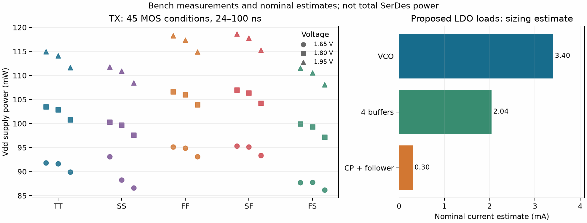

# 现有功耗与 LDO 负载审计

当前完整 TX 45 点的测试台 Vdd 功耗为 **86.15–118.67 mW**，TT 1.8 V 27 °C 为 **102.86 mW**。当前 RX 的真实偏置 FS 1.65 V −40 °C hh 读出单点为 **30.36 mW**。拟供 VCO、CP、LF 和四个一级 buffer 的 LDO，按器件尺寸的名义负载估算约 **5.74 mA**；尚无该供电域的实测电流或 PVT 上界。

## 边界和方法

- TX 是当前 extra5 完整链、真实偏置、固定 tt 电阻和理想时钟，包含捕获、分发、串化器、线驱动及测试台偏置；45 点对 Vdd 的 `−V×I` 在 24–100 ns 做时间加权平均。最小值是 FS 1.65 V 85 °C，最大值是 SF 1.95 V −40 °C。理想时钟、输入源的供能不在 Vdd 结果内；无原生 PLL、实际启动和电阻角验证。
- RX 是当前 W40、PI20/trim32、真实偏置、C2 输入回放与理想四相源；对 Vdd 在 24–44 ns 做时间加权平均。独立 Vref、0.7 V 参考负载及其他理想源不在 Vdd 结果内。原报告 30.16 mW 是完整保存窗口的采样点算术均值，窗口和权重不同。
- 历史 RX 45 点使用理想 0.85 mA 参考且不含其独立 Vref 的功率，8–44.75 ns 的采样点算术平均为 31.90–52.06 mW、TT 42.42 mW；它不代表当前真实偏置、PDK 电阻的 W40 读出全角。
- TX 与 RX 的测试台各自包含偏置，直接相加会重复偏置，且遗漏 PLL、CDR、其他数字和理想激励的供能；这些数据不能作为完整 SerDes 总功耗。

## 拟议 LDO 子域

名义 CML 参考 212.5 µA 对应 W/L 5/0.5：VCO 四级 W20 的尾电流按比例约 3.40 mA；四个一级 buffer W12 约 2.04 mA。转向 CP 与 follower 约 0.3 mA，合计约 5.74 mA、1.8 V 下约 10.33 mW。CP 两支转向路径的电流不能简单重复相加。该估算不包括偏置拷贝、PFD、预充、跨域驱动、启动及动态余量，也未覆盖镜像误差与 PVT；它既不是保证下界，也不是上界。LF 的静态电流近似为零，不涵盖漏电与动态充放电。

原生 r5/k4 TT 预充闭环原始波形只保存 ref、fb0、ctrl、z 和 c0p，没有电源电流。其 Vdd、Vdummy、Vbias 与理想预充分别供电，Vdd 还包含目标以外电路；现有数据不能分离目标子域。后续需拆分电源并测量启动、切码、锁定及全部 PVT 的电流。

## 证据与复核

[数据](../data/power_audit.json)记录45个 TX 点与功耗审计源文件哈希，详细边界、原始波形与 deck 哈希见[交付记录](../work_packages/deliveries/POWER-20261110/summary.md)及其 `evidence.json`。[绘图脚本](../../verification/plotting/power_audit.py)重核代表性 TT TX 和当前 RX 波形与 deck 哈希、execution 中的 deck 哈希、退出状态、超时与日志失败字段，以及 raw 大小和终点。两者均为退出码0、无超时/记录错误，分别到达 120 ns 和 44.75 ns；哈希均匹配。

复核仅覆盖这两个代表性运行的执行状态和终点；其余44个 TX 点的状态、所有向量数值正确性、包含文件完整性与物理规格没有在本次独立检查中重验。功耗采集与绘图均离线读取既有结果，没有启动仿真。
