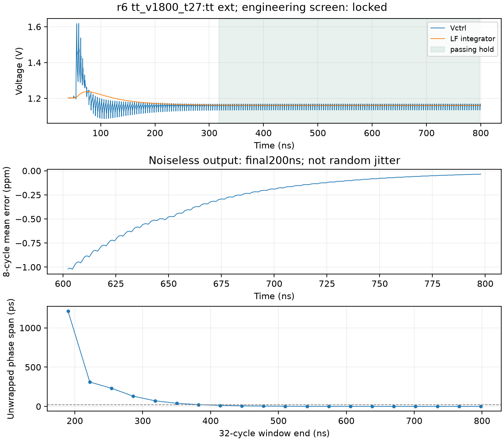

# r6持续锁定与加载续做（2026-11-14）

**TT/ext码9完成0.8 µs原生预充捕获，末200 ns频差约−0.43 ppm、持续合格480 ns，通过本点32周期/320 ns工程锁定合同。** 0.6 µs记录保持288 ns不足的历史保留；压力角、真实启动与动态TX仍待承接。同时完成当前r6的局部控制导纳校准，并发现、局部修正了变容器模型的热噪声缺项。120 ns完整TX静态加载卡作为接口校准，不计完整动态TX通过。

## 适用范围与输入身份

当前r6五bit VCO、轻dummy前端、延迟复位标准单元PFD、200 µA转向CP、4.13 kΩ/18 pF LF，TT/1.8 V/27°C，码9/ext。理想250 MHz参考直接进PFD，host/quiet各用理想1.8 V，真实共享BG及1 MΩ/16 pF尾偏置滤波。预充从模型Vctrl1.162562 V加40 mV开始，50 ns释放预充、52 ns释放PFD复位，保留原节点初值和振荡/分频kick。

电路尺寸、采用参数和进行中版图均未改。这里不覆盖真实焊盘参考、从零启动/ready链、PEX、完整PVT、动态TX眼图、随机相噪/抖动或失配良率。未改单元旧证据按原边界保留；历史r5噪声数不转给本版。

## 频率与持续锁定

[工程合同](../../verification/contracts/pll_lock_screen.toml)要求32参考周期窗、步进8周期，平均频差≤100 ppm、展开相位变化≤20 ps，末尾持续≥320 ns。由[公共评分](../../src/serdes_flow/pll_lock.py)执行；旧16周期/末60沿字段只作诊断。

| TT/ext记录 | 结果 |
|---|---|
| 100 ns历史短窗 | 末20 ns平均2.01063 GHz；时长不足，不能评分保持 |
| 600 ns历史完整记录 | 末200 ns平均1.999980197 GHz，约−9.90 ppm |
| 600 ns末尾持续合格区间 | 约310.015–598.015 ns，共288 ns；**保持不足** |
| **800 ns当前完整记录** | 末200 ns平均**1.999999143 GHz，约−0.429 ppm** |
| **800 ns末尾持续合格区间** | **318.015–798.015 ns，共480 ns；通过本TT点合同** |
| 合格区间全部评分窗的最大平均频差/展开相位变化 | 60.801 ppm / 7.783 ps；配对错误0 |
| 800 ns末200 ns控制电压 | 时间加权均值1.161150 V、峰峰33.786 mV |
| 800 ns末200 ns输出差分幅度 | 约582.812 mVpp；内部幅度仍按既有I-17边界解释 |
| 800 ns相对固定2 GHz格点的末200 ns边沿偏移峰峰值 | 0.272 ps；含确定性调制/漂移，不是随机抖动 |

600 ns的执行耗时3174.52 s，完整保存40–600 ns；不是截断/数值失败，频率已接近目标，但不能把288 ns改记为320 ns。800 ns为独立运行，不从只保存部分节点的raw重建内部电荷状态来冒充连续仿真。其首个交互驱动收到SIGTERM，未生成raw/execution，不能记作失锁或数值失败；原attempt留有中断记录，冻结campaign用独立会话续跑至`.r2`，实际终点和合同要求不变。800 ns正式求解3889.62 s，完整保存40–800 ns，退出0、无超时/求解错误。两份共同40–590 ns的ctrl/z/b0p/b0n/fb0/up/dn逐点最大差均为0；保持起点按末参考沿锚定的评分网格计算，不将旧记录补记为通过。

周期数：2 GHz周期0.5 ns，因此20 ns含40个VCO周期、5个250 MHz参考周期；100 ns才含200个VCO周期、25个参考周期。工程评分的32个参考周期本身就是128 ns，20 ns连一个完整评分窗口也不够；合格后还要核持续保持。本测试台52 ns才释放PFD复位，所以前100 ns实际闭环捕获约48 ns、约12次参考比较。600 ns记录的末20 ns实测参考、UP、DN各5个上升沿；锁定后仍有PFD/CP修正脉冲。600 ns记录末20 ns的UP/DN逻辑脉宽约524/484 ps，每参考周期两者都有脉冲；不能将某一路的脉冲数量等同于净校正次数或注入电荷。

若2.011 GHz持续不变，对应4.022 Gb/s、约5500 ppm频差，相对理想4 Gb/s采样格点约45.5 ns漂移1 UI。它可以产生翻转数据，但不能据此声明项目链路的频率/时序资格。长窗检查还要确认相位不持续漂移；随机噪声另按预算验证。

## 当前r6控制导纳

独立夹具为当前ring＋四buffer，每个buffer输出端30 fF代理、真实BG与慢尾滤波，TT码9、模型Vctrl1.162562 V；采用2 ps最大步长、完整PDK。它不是完整前端plant。正弦在20 ns开始，丢弃首周期，再用两个精确周期的时间加权相量提取；DC/趋势项独立拟合，防止自适应采样密度造成偏差。

| 激励 | 控制电容等效值 | 导纳实部 |
|---|---:|---:|
| 50 MHz / 5 mV | 631.866 fF | 2.974 µS |
| 50 MHz / 10 mV | 631.906 fF | 3.011 µS |
| 20 MHz / 10 mV | 632.279 fF | 0.491 µS |

两档50 MHz电容差约0.0063%；各频点无激励本底/受激电流≤0.032%。两份零激励记录共同时间段的VCO电压、控制电压和端口电流逐点一致。±10 mV DC卡得到Kvco746.207 MHz/V，与码表750.059 MHz/V接近；模型电压处局部自由振荡约1.99722 GHz，不声称该局部卡已经精确校到2 GHz。

取20 MHz电容和实测Kvco、名义200 µA/4.13 kΩ/18 pF及假设2 ns延迟，局部线性模型交越约11.8 MHz、PM约60.6°。它未包含实际完整前端、控制导纳实部、CP/LF PVT、全部可用码和非线性，不能作为全角稳定性或噪声通过。

测试与复跑见[控制端卡片](../../analog/pll/vco/tb/ctrl_load/README.md)。

## 变容器热噪声模型审计

安装PDK的[冻结模型](../../results/analog/pll/vco/varactor_noise/20261114T123118.337085Z/source/sky130_fd_pr__cap_var_lvt.model.spice)含电压表达式电阻 `rg`。单只W5.2/L0.5/vm4、TT27°C、Vgate1.55 V/Vwell1.166 V的纯DC卡中，端口有非零耗散导纳，但ngspice `.noise` 输出为零：

| 频点 | 端口实部导纳 | 按被动热平衡4kT·Re(Y)应有的电流PSD | 模型 `.noise` |
|---|---:|---:|---:|
| 20 MHz | 0.02569 µS | 4.258×10⁻²⁸ A²/Hz | 0 |
| 50 MHz | 0.16053 µS | 2.661×10⁻²⁷ A²/Hz | 0 |

同deck独立100 Ω/80 fF RC参考支路使用相同1 Ω CCVS电流噪声提取，1 MHz–1 GHz内实测/4kT·Re(Y)为0.99999964–0.99999974，确认提取链正常。低频实部远小于虚部、存在数值消减，未用1 kHz附近约3%的实部数值误差否定噪声链；初次过严全频校验及首次分析导出错误保留，最终只重做分析，未重跑或覆盖波形。

[ngspice手册§3.3.4](https://ngspice.sourceforge.io/docs/ngspice-45-manual.pdf)说明，表达式电阻需要显式`noisy=1`才生成热噪声。[局部模型工具](../../src/serdes_flow/noise_models.py)复制原变容模型，只改`rg`噪声开关和子电路别名，保留全部参数名与电气表达式；安装PDK和采用网表未改。

补标志的独立DC卡在1 MHz、20 MHz、50 MHz、1 GHz的噪声/4kTRe(Y)均约0.99999965，原卡与修正卡AC表逐值相同。再将该副本用于相同ring/四buffer的1 ns冒烟及20 ns无噪声瞬态：10–19 ns对照区间两相最大电压差9.44×10⁻¹¹ V、控制电压差0、端口电流差6.51×10⁻¹⁵ A。局部修正已验证不会改变本卡无噪声电气行为。

这是该模型在明确DC点的缺项及修正，不是PLL相噪指标失败。M4仍需结合振荡周期内偏置/相位响应，不能把单点端口PSD直接乘八当作总相噪。bank开关、当前输入对/尾管及真实参考/CP/PFD/分频噪声也仍需纳入本版预算。副本的全PVT/MC及整机噪声资格未由本卡给出，旧r5噪声记录保持原适用边界。

## 当前r6局部失配初筛

新增[TT失配卡](../../analog/pll/vco/tb/mc/README.md)复制明确50 MHz控制导纳母本的固定源：完整`tt_mm`库、真实共享BG/定宽电阻、慢尾及四个30 fF buffer，码9、Vctrl1.162562 V固定。seed6/chunk4的八个样本均完整到24 ns，14 ns后第2至第12个上升沿测10周期均频。原变容模型用于MC，不将noisy副本冒充已验证的统计配对输入。

| 八样本读数 | 数值 |
|---|---:|
| 名义点频率 | 1.997220 GHz |
| 样本均值 | 1.998832 GHz |
| 样本标准差 | 25.302 MHz，约1.266% |
| 样本范围 | 1.960930–2.031682 GHz |
| 按名义Kvco换算的控制电压σ | 约33.9 mV，仅局部一阶等效 |

另跑的同种子首样本频率及尾偏置输出与首样本逐值复现；名义点与CG母本同一14–24 ns十周期窗口的频差仅约0.025 ppm。八个样本不是精确尾部/良率估计，频散没有本轮独立验收门槛，记为**ungraded**。它说明当前r6也需通过调码和细调吸收失配，未证明逐芯片选码、控制窗口、保码跨温或失配下闭环锁定；旧r5的200样本结果仍只属于旧源。PNP模型缺少失配项的限制保留。

两块实际程序大小从第1至第4样本约532→778→1024→1270 MB，追加约246 MB/样本；保持本轮chunk4/单worker，不按旧45 MB估计扩并发。先完成1 ns冒烟，再由公共MC执行器完成单样本pilot、两正式块和名义/复跑；准备时未执行的旧目录不计样本。

## 完整TX接口的局部加载卡

当前v3只用b0的2 GHz有效输入，低频输入级保留为负载；完整字入口、extra5、末级WT16/R240、driver `rpre=120 wtpre=60 wout=192`及既有外围均放在同deck。单BG共享，TX另有本地n85拷贝；PLL/BG保留冻结的定宽电阻，TX保留原完整台的通用PDK转换。TX100/120/133 Ω负载不能直接套单只2p85（端头137.6 Ω），原全定宽准备未运行；channel模型继续保留原理想RLC，未转作巨大宽度的PDK电阻。

新卡51个include、793个子电路实例端口核对无错；展开的TX时钟/驱动电阻长度均有效。执行使用显式exploratory模式：母本最后一个32周期窗合格，但仍保留其 `contract_passed=false`、288 ns保持不足，结果只作≤120 ns静态接口校准，不释放M2或算作动态TX通过。0.8 µs主线已独立通过TT点，不能因此把这份120 ns加载卡补记为带载持续锁定。运行与边界见[加载台](../../analog/tx/input_register/tb/native_r6/README.md)。

120 ns probe已完整结束，1 ns冒烟耗时165.5 s、正式求解1579.4 s。末100–119 ns的37次计数采样均按0–7循环，错误步进0。源时钟差分551.1 mVpp、占空49.974%，字时钟CMOS峰峰1.921 V、占空49.890%；该捕获阶段的短窗平均频率分别约1.99356 GHz和249.061 MHz，不作为稳态频率资格。所有并行字固定为零，没有动态眼图或位映射验收。

该加载波形按同一合同为`insufficient_hold_record`。后续仍需加载后的持续锁定记录、锁定后实际字时钟的RTL事件边界，以及完整动态串化/位映射/75 mV与0.15 UI验收；压力角按对应点逐步承接。

## 固定证据

[小数据](../data/r6_lock_confirmation.json)、[索引](../../results/catalog/r6_lock_confirmation.json)保存各输入与波形/执行/模型清单的SHA256。600 ns及全部局部卡的完整中间汇总保留在[追加分析](../../results/analog/pll/top/lock_confirmation/20261114T140058.381774Z/summary.json)。100 ns入口复核保留在[前一轮记录](r6_mainline_review.md)。所有新结果追加目录，未替换当前采用组合。
