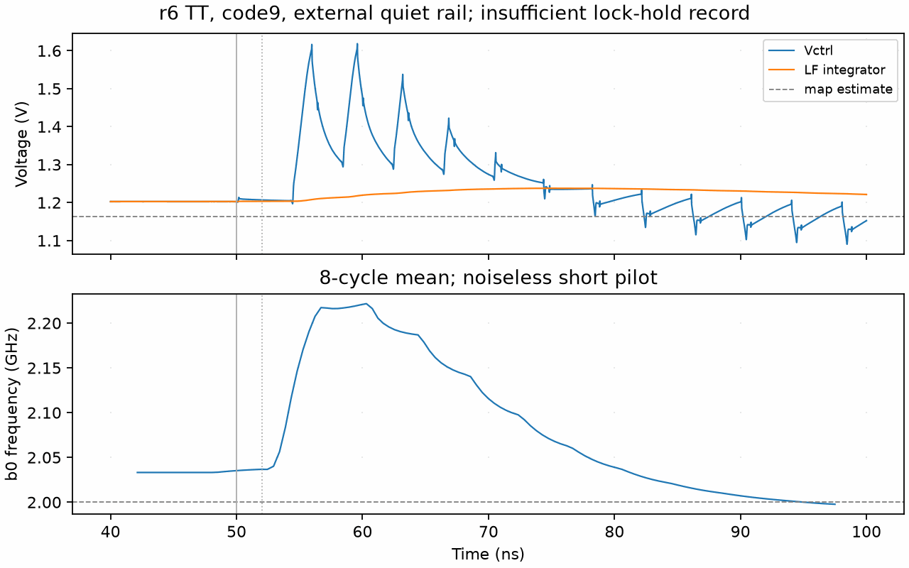
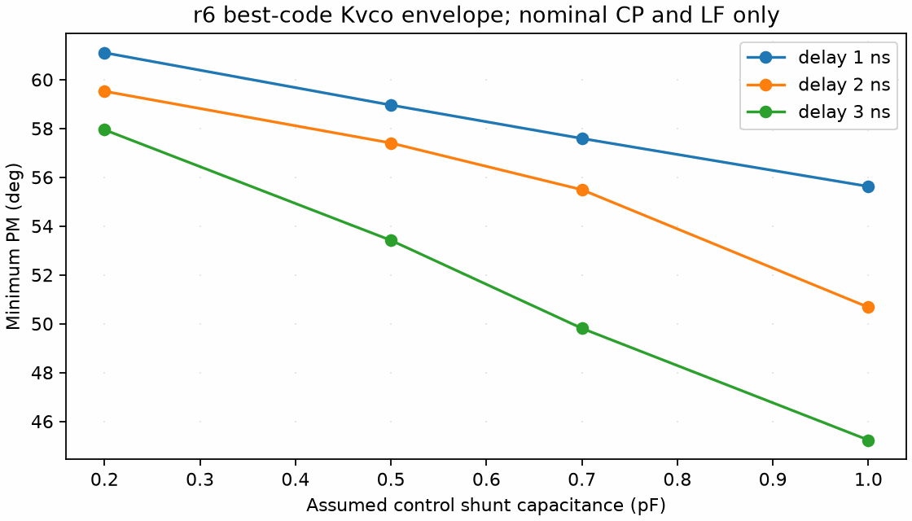

# r6闭环、动态TX与噪声入口复核（2026-11-14）

> 后续持续锁定、控制导纳及实际加载进展转到[续做记录](r6_lock_confirmation.md)；本页保留入口复核和100 ns短窗的实际边界。

**近期先补当前r6原生闭环，再接完整动态TX；噪声/失配先校准当前r6输入。** 这三项可以在带隙/LDO版图继续推进时开展：M1首先使用外部理想quiet电源、真实共享参考和定宽PDK电阻，明确是原理图级预充捕获。版图及整机启动资格随后按对应物理版本承接。

## 当前边界与继承

当前顶层为[pll_core_r6k4q](../../analog/pll/top/spice/pll_core_r6k4q.spice)：r6五bit VCO、轻dummy前端、标准单元延迟复位PFD、200 µA转向CP、4.13 kΩ/18 pF环路滤波。quiet域供给VCO/首级buffer/CP/LF，host域供给PFD/预分频/反馈接收器；尾偏置保留1 MΩ/16 pF。

输入为135条件r6映射表 (`results/analog/pll/vco/r6/map_20261112T062237Z/table.json`)。码由映射表选定，Vctrl为其模型估计；不是芯片实际粗搜。50 ns释放预充、52 ns释放PFD复位，保留已有振荡/分频kick与nodeset；250 MHz参考直接进入PFD。没有从零上电、ready链、焊盘参考路径、PEX、动态TX或随机抖动资格。

旧r5原生闭环、TX静态联合、CP/分频局部失配记录按原源/负载边界保留。当前代码/负载变化需要自己的记录，不能将这些点加到r6覆盖中。未改采用参数，也未触碰正在进行的Bias/LDO/PLL版图。

## 3：当前r6原生闭环

开始核对时尚无 `results/analog/pll/top/native_r6/` campaign。旧runner两处把 `Path` 与字符串直接相加，即使零code-offset也会在创建工况路径前抛TypeError，已修复。

新[固定输入runner](../../analog/pll/top/tb/native_r6/campaign.py)增加prepare/check/resume/analyse，保留源、映射、deck与库身份；重启只补缺测，终点变化另建campaign。独立1 ns冒烟保留全部输入/输出，不把“输出从40 ns保存”误解为只模拟1 ns。长跑仍需先按短窗成本设置timeout，按工况断点续跑。

旧测量器使用16周期均频、相位相对末40沿中值及末60沿筛查，短记录会自动缩短评分尾段；最近沿配对还可能重复/跳过反馈沿。修复后该诊断至少需要完整历史，并检查一一配对；项目评分另由[公共工程判据](../../src/serdes_flow/pll_lock.py)按[合同](../../verification/contracts/pll_lock_screen.toml)计算：32周期窗、步进8、频差≤100 ppm、展开相位变化≤20 ps，末尾持续≥320 ns。窗口从最后参考沿向前按8周期步进，覆盖末尾完整区间；反馈沿计数连续展开，短窗记为unassessed。合成缺边沿/倍频/晚相位跳变用例及旧r5完整波形用于独立交叉核对。

本轮TT/1.8 V/27°C、码9、ext完成自己的1 ns冒烟与100 ns短窗：模型Vctrl为1.16256 V，初始预充+40 mV；末20 ns的b0平均约2.01063 GHz，Vctrl范围1.090–1.233 V。频率正在向2 GHz收敛，捕获过程中仍有明显周期纹波。100 ns实际终点完整，保存40–100 ns；主运行534.15 s，冒烟38.20 s。不能把这段末窗的均值/纹波称为稳态值，按项目合同为 `insufficient_hold_record`。



新工程评分另对固定旧r5 TT的两条1.5 µs完整波形作离线核对：ext/hv的末尾持续合格区间分别约1.376/1.216 µs，均满足320 ns。该交叉检查只复核测量器，不增加当前r6覆盖。

具体源、终点、读数及运行身份见[固定数据](../data/r6_mainline_review.json)。下一步仍是TT长窗和FS低压热hh、SS低压冷hh、SF低压冷ll；通过对应点再释放M2。已有100 ns与旧r5实测成本表明长窗属于小时量级，不能按波形文件大小估算速度，也不能缩短保持时长来报通过。

## 4：锁定PLL→当前完整动态TX

已有两条入口，实际边界不同：

| 入口 | 现有实际作用 | 承接方式 |
|---|---|---|
| [r5_v3](../../analog/tx/serializer/tb/native_clock/r5_v3.py) | 旧r5开环前端＋v3分配＋静态并行数据，核计数和加载 | 复用原生源/负载经验，不当作动态功能通过 |
| [完整TX](../../analog/tx/input_register/tb/full_serializer/run.py) | 理想2 GHz相关源、v3计数器、实际字入口/串化/驱动/外围，已有MOS45动态证据 | 复用extra2g=5、末级WT16/R240、driver `rpre=120 wtpre=60 wout=192`及RTL/测量链 |

当前[dist_v3](../../analog/tx/serializer/tb/clock_replay/variants/dist_v3.py)实际由一对2 GHz抽头驱动同步计数器和clk→q复制单元，内部生成250/500 MHz及1 GHz。外部低频输入只保留旧输入级负载。因此r6的b0足以提供有效时钟，不需要恢复旧的三份完整dummy分频支路；连接时仍须对保留的低频输入负载给出明确接法，并记录它们对反馈分频抽头的新增加载。

最小联调按以下顺序：

1. 在M1已成立的TT点，将b0接当前v3的2 GHz输入，显式记录P/N极性和真实输入级；保留完整字入口/串化/驱动负载。先静态probe核PLL频率、反馈及计数器，避免先跑长动态再定位时钟问题。
2. 在**锁定后的实际加载字时钟**上登记新的边界id、源/负载签名、有效窗口与RTL事件表；不从旧理想源时间表或数据输出反推激励。明确计数器`.ic`仍是bench辅助，非硬件复位资格。
3. 同deck动态运行，数据与评分窗位于确认锁定之后；检查实际字入口捕获、训练/标记、位映射、丢位/多位与串化器/焊盘的75 mV和0.15 UI门槛，同时检查PLL加载后的持续锁定。
4. TT成立后补FS低压热及SS低压冷，再按边界扩角。保留无源角、原生参考路径和噪声缺口。

这是可承接的接口路径，本轮尚未生成或运行当前r6的完整动态TX资格。

## 5：相噪、抖动与失配

旧[相噪角点](../../analog/pll/vco/tb/phase_noise/corner.py)、[四bit ISF pilot](../../analog/pll/vco/tb/phase_noise/isf_4b_pilot.py)及[VCO MC](../../analog/pll/vco/tb/mc/run.py)仍按旧三/四bit模板、旧码表或r5尺寸构造。它们的方法可复用，数值不能转给r6。当前r6的尾宽、变容、五bit bank、成对长电阻、实际前端负载和quiet供电均改变了所需输入。

优先补三类局部输入：

- **控制导纳与环路模型**：在当前工作点振荡时测控制端导纳、Kvco及有效延迟，连同当前CP/LF角点校准稳定性。r6表中的Kvco约242–1025 MHz/V，旧控制端0.2–0.7 pF不能直接作为本版实测值。
- **当前r6噪声**：先TT工作点频率校准，再做相位响应及器件噪声。每个输出负载由两只独立电阻并联，噪声功率按实际器件合并；输入对/尾管的实例路径已变化。五bit bank开关噪声、真实尾偏置滤波与参考/CP/PFD/分频贡献需纳入或量化排除，不能只改bit数后复用旧ISF结果。随后按10 kHz–1 GHz的既定积分与CDR模型闭合预算。
- **当前r6失配**：完整PDK、固定seed/chunk及输入身份，先名义与小样本复现、跨样本变化，再统计工作点移动和码范围端点。旧200样本仍是r5边界；当前逐芯片选码/保码跨温及控制窗口余量需单独验证。

离线先用r6表中135个**best-code** Kvco，固定名义Icp=200 µA、Rz=4.13 kΩ、Ci=18 pF、N=8，扫描假设控制并联电容和有效延迟。该模型不含CP/LF PVT、全部可用码、非线性或噪声，不作为全角稳定性通过；用途是说明下一项该测什么。

| 假设控制并联电容 | 延迟2 ns时最小PM | 最大UGB |
|---|---:|---:|
| 0.2 pF | 59.52° | 16.74 MHz |
| 0.5 pF | 57.40° | 16.20 MHz |
| 0.7 pF | 55.49° | 15.78 MHz |
| 1.0 pF | 50.67° | 15.11 MHz |

同为0.7 pF，假设延迟增至3 ns时最小PM降至49.81°。这些是敏感度模型值，说明控制导纳和有效延迟对选择有实际影响，尚不能据此采用或否定当前环路。



因此当前动作是测准plant并建立r6噪声/统计输入，尚无新的r6 RMS抖动、BER或良率结论。

## 证据与复跑

局部runner及命令见[测试台说明](../../analog/pll/top/tb/native_r6/README.md)。主线核对导出只接受显式map与native分析路径：

```bash
uv run python verification/analysis/r6_mainline_review.py \
  --map results/analog/pll/vco/r6/map_20261112T062237Z/table.json \
  --native-summary results/analog/pll/top/native_r6/<run_id>/analysis/<analysis_id>/summary.json
```

[小数据](../data/r6_mainline_review.json)与[索引](../../results/catalog/r6_mainline_review.json)保留具体输入SHA256。正文手写，导出仅生成指标和图。
