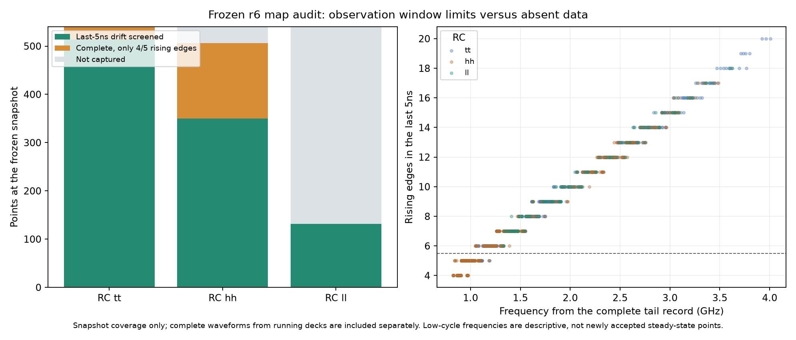

# r6 工作图：低频点的观测窗口缺口

当前读取器会跳过一部分已经完整仿真的低频点，不能把这些点记成振荡或 PVT 失败。135 条件工作图仍在运行；本页是一次固定快照的测量审计，不是最终覆盖率或规格结论。

## 冻结结果

审计对象为 `results/analog/pll/vco/r6/map_20261112T062237Z`，预期 45 个 MOS 条件 × 3 个 RC 角 × 码 0/15/31 × 4 个 Vctrl，共 1620 点。冻结清单及逐点结果在 `results/verification/r6_map_wave_audit/20261112T102203.726234Z_2b793c00/`，紧凑索引见 [数据](../data/r6_map_wave_audit.json)。

| 快照状态 | 点数 | 含义 |
|---|---:|---|
| 完整至 14 ns，末 5 ns 至少 6 个上升沿且通过漂移筛查 | 996 | 仅通过此项测量筛查 |
| 完整至 14 ns，末 5 ns 只有 4 或 5 个上升沿 | 182 | 当前读取器返回 `None` |
| 未捕获 | 442 | 运行中尚无可用记录，不作设计判断 |

1178 个完整波形中有 206 个在冻结时所属多工况 deck 尚未结束，因此“波形完整”和“整组执行成功”单独记录。已筛查的 996 点最大绝对末段漂移为 3.256×10⁻⁵，低于现行 5×10⁻⁴；没有观测到超过该门槛的点。

182 个被跳过的点全部在码 31，hh 为 156 个、tt 为 26 个，涉及 56 组条件×RC。按可用沿描述的频率约 0.823–1.194 GHz。最慢例子为 FS、1.95 V、85 °C、hh、码 31、Vctrl=0.90 V，末段有 4 个上升沿。



## 原因与下一步

当前 `tuning/r6.py` 在最后 5 ns 测量，并要求至少 6 个上升沿；低于约 1.2 GHz 时，固定窗口不能保证达到沿数要求。`model()` 又要求每组所有输入点都有数值，因而一个低频点被跳过就会使整组模型缺输入。

保留现行沿数与漂移门槛。先对慢点补充更长观测的独立证据，再选择补跑缺点或验证另一种估计器。冻结快照中最慢频率对应的六周期约为 7.3 ns，可从 8 ns 尾窗、16–20 ns 结束时间起规划；这只是依据已观测频率的窗口估算，仍须验证启动与稳定性。不会用本页的低沿数频率直接生成合格码表。

读取器对至少 6 个沿但漂移超限的点目前只打印 `UNSETTLED`，仍返回数值。该行为也应在后续建模前明确处理；本次快照没有出现这种点。

## 复现与边界

只读审计验证逐点激励、分析终点、MOS/RC 库段、deck、包含文件、工具和模型身份，并冻结原始文件清单。正在写入或截断的文件不能冒充完整结果。运行中的原 campaign、读取器、DUT 和表均未修改。

```bash
uv run python verification/analysis/r6_map_wave_audit.py --campaign results/analog/pll/vco/r6/map_20261112T062237Z
uv run python verification/plotting/r6_map_wave_audit.py --summary results/verification/r6_map_wave_audit/20261112T102203.726234Z_2b793c00/summary.json
```

第一条创建新的快照，不会重现相同计数；第二条按固定清单校验原始波形哈希、重算指标并发布本页所用数据和图。两项单元测试覆盖沿数分界及漂移超限的分类。频率筛查不替代摆幅、调谐范围、噪声、失配或闭环验收。
