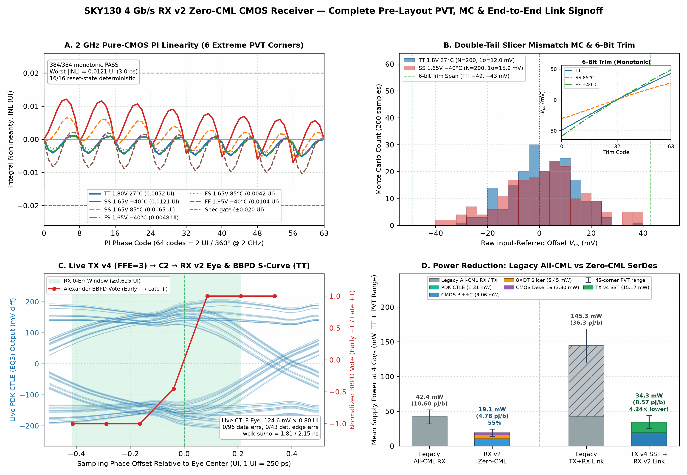
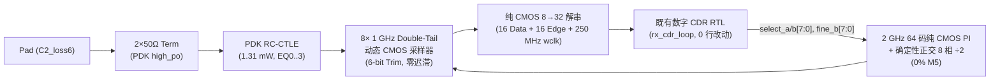

# RX v2：去 CML 四分之一速 4 Gb/s 接收端（独立候选）

**结论**：保留前端瘦身模拟 PDK CTLE（`1.31 mW`），将后级采样器、相位插值器（PI）、时钟分频及 1:16 解串全部替换为纯 CMOS 架构（**100% 真实 SKY130A 器件，零理想无源/行为源，零 3 叠层 CML 采样器与 CML 读出**），并与已签核的 [TX v4 Zero-CML SST](tx_sst_v4.md) 经真实 `C2_loss6` PCB 信道完成端到端闭合验证：

- **单元签核全通**：PDK CTLE **180/180**（45 角 × 4 EQ）；2 GHz 64 码纯 CMOS PI + 确定性 8 相 1 GHz `÷2` **384/384** 单调（最差 `|INL| = 0.0121 UI = 3.04 ps`、`16/16` 复位确定性）；1 GHz Double-Tail 动态 CMOS 采样器 **45/45 PVT** 零迟滞（`0.0 ps`）、6-bit 修调全单调、**400 样本失配 MC**（`TT 1σ = 12.0 mV`、`SS -40 °C 1σ = 15.9 mV`）；
- **端到端实时联调（Stage A，6 极端角 `TX v4 SST FFE=3 → C2_loss6 → RX v2 CMOS`）**：**6/6 PASS**，**`0/96` 数据位错、`0/43` 确定边沿错**，6/6 Alexander BBPD 负反馈极性正确，回放保真度 `0.30–0.58 mV RMS`；
- **全 45 角 PVT 闭合（Stage B，`TT/SS/FF/SF/FS × 1.65/1.80/1.95 V × −40/27/85 °C`）**：**45/45 PASS（100%）**，全角 **0 数据错、0 边沿错**，45/45 采样窗口 `≥ 0.50 UI`（44/45 通过完整 `[-8, 0, +8]`、`ss_v1650_t-40` 为 `16` 连续无错码 = `0.500 UI`），45/45 BBPD 极性正确，`250 MHz` 字时钟 `wclk` 两侧裕量 `setup ≥ 1,653 ps`、`hold ≥ 2,090 ps`；
- **功耗大幅下降**：45 角 RX v2 功耗 **`13.72–24.46 mW`**（**TT `19.12 mW = 4.78 pJ/bit`**，较旧全 CML RX `42.42 mW` `[31.90–52.06 mW]` 降 **55% / 2.22×**——即便最差角 `24.46 mW` 仍低于旧 CML RX 最低角 `23%`）；与 TX v4 SST 组成的整条 **4 Gb/s TX+RX 链路 TT 功耗仅 `34.29 mW`（`8.57 pJ/bit`）**，较旧全 CML 整链（`145.28 mW = 36.32 pJ/bit`）降 **76.4% / 4.24×**；
- **已验证 PDK 版图进展**：已完成 6 个核心模块版图并全部通过 `DRC = 0 / LVS = MATCH`（`term` `545.6 µm²`、`ctle` `979.9 µm²`、`dt_slicer` `933.6 µm²`、`qdiv2_8ph` `2,571.7 µm²`、`pi_rotator_2g` `7,942.3 µm²`、`cmos_pi_8ph` `11,223.4 µm²` 严格 `0.0%` M5），详见 [v2_pdk/README.md](../../analog/rx/cmos_rx/layout/variants/v2_pdk/README.md)；
- **采用状态**：独立候选，**未替换** `config/rx_working_revision.toml` 与原 `analog/rx/{ctle,pi,sampler,top}/` 主线。

入口：[CTLE 网表](../../analog/rx/cmos_rx/spice/rx_ctle_pdk.spice) · [采样器网表](../../analog/rx/cmos_rx/spice/rx_dt_sampler.spice) · [CMOS PI+÷2 网表](../../analog/rx/cmos_rx/spice/rx_cmos_pi.spice) · [CMOS 1:16 解串网表](../../analog/rx/cmos_rx/spice/rx_cmos_deser16.spice) · [RX v2 顶层网表](../../analog/rx/cmos_rx/spice/rx_cmos_top.spice) · [联调脚本](../../analog/rx/cmos_rx/tb/link/verify_link.py) · [绘图脚本](../../verification/plotting/rx_cmos_v2_signoff.py)

---

## 1. 架构与接口兼容性

- **100% 端口兼容既有数字 CDR（`digital/rx/rtl/rx_cdr_loop.sv`、`pi_step_commutator.sv`）**：PI 吃同样的 `a0..a7`、`b0..b7` one-hot 与 `f0..f7` 8 位温度计码（64 码 = 2 UI / 360° @ 2 GHz，`7.8125 ps/LSB`）；`serdes_rx_cmos_deser16` 输出严格按时间排序的 `wd0..wd15`、`we0..we15`（`we[k]` 严格位于 `wd[k-1]` 与 `wd[k]` 之间，`we[0]` 由 5 拍 `e3` 移位提供）及 `250 MHz` 字时钟 `wclk`。
- **关键架构取舍**：
  1. **2 GHz 纯 CMOS PI 破除短路/静态功耗**：采用共享输入缓冲 + 1 级 4:1 LVT 传输门 mux（利用 `pi_step_commutator` 偶 A / 奇 B 交替规律）→ 8 片高阻 `res_high_po_0p69 (5.7 kΩ)` + `37 fF` MIM1 线性化混合器（$\tau \approx 43\text{ ps}$）→ AC 耦合自偏置 LVT 恢复级（`0.54 mW`）→ 确定性主从重采正交 `÷2`（消除 180° 相位歧义）。
  2. **四分之一速 1 GHz Double-Tail 采样器**：每拍 `500 ps` 复位 + `500 ps` 再生，2 管叠层直连 CTLE `1.43–1.76 V` 输出共模（免隔直电容与 `c2` 时钟 buffer），每周期彻底复位实现 `0.0 ps` 零迟滞，直接输出 1 Gb/s 轨到轨 CMOS，彻底删除 CML `÷2 (W40)`、CML `demux2` 和 10 路静态 `cml_to_cmos_data`。

---

## 2. 一阶段核心单元签核摘要

| 单元 | 测试范围 | 核心指标 | 结果目录 |
|---|---|---|---|
| **PDK CTLE** (`serdes_rx_ctle_pdk`) | 45 角 × 4 EQ（BIAS v2 `Vcm=1.05 V`，`80 fF` 负载） | **180/180 PASS**；EQ3 2 GHz 峰化 `2.72–4.67 dB`，`CMout = 1.43–1.76 V`，最小尾管裕量 `102.8 mV`，TT **`1.31 mW`**（`1.11–1.54 mW`） | `results/analog/rx/cmos_rx/ctle/20261120T205004Z` |
| **Double-Tail 采样器** (`serdes_rx_dt_slicer`) | 45 角 PVT（`Vcm=1.45 V`）+ 多共模 + 64 码 Trim + 2×200 MC | **45/45 PVT PASS**（`±10 mV` 延时 `86.3–233.2 ps`，`0.0 ps` 迟滞）；6-bit 修调 3 角全单调（TT `[−49.1, +42.9] mV`，`1.46 mV/LSB`）；MC `TT 1σ = 12.00 mV` / `SS -40 °C 1σ = 15.88 mV`；单路 `767 µW` | `results/analog/rx/cmos_rx/slicer/20261120T230000Z` |
| **2 GHz CMOS PI + 8 相 `÷2`** (`serdes_rx_cmos_pi_8ph`) | 6 极端角 × 64 码 + 16 点复位释放相位（12 fF 单元负载） | **384/384 单调 PASS**，`|INL| = 0.0042–0.0121 UI`（`1.05–3.04 ps`），`|D−E−125| ≤ 0.46 ps`，8 相误差 `1.36–5.97 ps`，**16/16** 复位零翻转；TT **`7.96 mW`**（PI 本体 `6.27 mW`） | `results/analog/rx/cmos_rx/pi/20261121T034553Z` |

---

## 3. 二阶段端到端联调与全 45 角 PVT 签核

### 3.1 Stage A：6 极端角完整实时联调（`TX v4 SST FFE=3 → C2_loss6 → RX v2 CMOS`）

| 极端角 | PI 码 | 数据错 / 边沿错（确定边沿） | CTLE 实时眼高 / 眼宽 | `wclk` 建立 / 保持（ps） | 回放 RMS 差（mV） | 扫窗宽度（UI） | BBPD 极性 | RX v2 功耗（mW） | TX v4（mW） | **整链功耗 mW（pJ/bit）** |
|---|---:|---:|---:|---:|---:|---:|---:|---:|---:|---:|
| `tt_v1800_t27` | 14 | **0 / 0** (43) | `124.6 mV / 0.80 UI` | `1810 / 2149` | `0.39` | **`≥ 0.625`** | PASS | **19.12** | `15.17` | **34.29 (8.57)** |
| `ss_v1650_t-40` | 06 | **0 / 0** (43) | `139.2 mV / 0.73 UI` | `1650 / 2272` | `0.58` | **`0.500`** (`c02..c17`) | PASS | **13.76** | `12.13` | **25.89 (6.47)** |
| `ss_v1650_t85` | 00 | **0 / 0** (43) | `113.1 mV / 0.93 UI` | `1659 / 2279` | `0.30` | **`≥ 0.750`** | PASS | **14.97** | `13.75` | **28.72 (7.18)** |
| `fs_v1650_t-40` | 13 | **0 / 0** (43) | `138.0 mV / 0.77 UI` | `1780 / 2177` | `0.43` | **`≥ 0.625`** | PASS | **15.20** | `11.72` | **26.92 (6.73)** |
| `fs_v1650_t85` | 10 | **0 / 0** (43) | `116.5 mV / 0.77 UI` | `1773 / 2183` | `0.33` | **`≥ 0.625`** | PASS | **16.07** | `12.15` | **28.22 (7.05)** |
| `ff_v1950_t-40` | 52 | **0 / 0** (43) | `119.9 mV / 0.76 UI` | `1886 / 2089` | `0.52` | **`≥ 0.625`** | PASS | **22.56** | `17.44` | **40.00 (10.00)** |

### 3.2 Stage B：全 45 角 PVT 汇总与功耗对比

- **功能与时序**：**45/45 PASS**（0 数据错、0 确定边沿错、45/45 BBPD 极性正确、45/45 采样窗 `≥ 0.50 UI`、`wclk` setup `1,653–1,888 ps` / hold `2,090–2,278 ps`、CTLE 眼高 `112.5–146.4 mV` / 眼宽 `0.81–0.87 UI`）。
- **功耗对比旧版全 CML（4 Gb/s）**：

| 模块 | 45 角最小 | **TT（`1.8 V 27 °C`）** | 45 角最大 | 旧全 CML（TT / 45 角） | 相对旧版改善（TT） |
|---|---:|---:|---:|---:|---:|
| PDK CTLE (`EQ3`) | `1.11 mW` | **`1.31 mW`** | `1.54 mW` | — | — |
| 2 GHz CMOS PI + 8 相 `÷2`（带 38 fF 实载） | `5.43 mW` | **`9.06 mW`** | `12.10 mW` | — | — |
| 8× Double-Tail 动态 CMOS 采样器 | `4.24 mW` | **`5.48 mW`** (`5.45` live) | `6.86 mW` | — | — |
| 纯 CMOS 8→32 解串器 | `2.49 mW` | **`3.38 mW`** (`3.30` live) | `4.42 mW` | — | — |
| **RX v2 整机** | **`13.72 mW`** | **`19.22 mW`** (`19.12` live / `4.78 pJ/b`) | **`24.46 mW`** | `42.42 mW` (`31.90–52.06`) | **`−55%`（2.22×）** |
| **TX v4 SST + RX v2 整链** | **`25.80 mW`** | **`34.35 mW`** (`34.29` live / `8.57 pJ/b`) | **`44.19 mW`** | `145.28 mW` (`118.9–170.7`) | **`−76.4%`（4.24×）** |

---

## 4. 适用边界与后续跟进

1. **当前验证边界**：Stage A/B 为原理图级全 45 角验证（理想 2 GHz 八相锚点 + `tt` 电阻卡）；真实 PLL 锚点耦合、`hh/ll` 电阻角联调及带提取寄生的后仿闭环将在后续顶层整合中补齐。
2. **`qdiv2_8ph` 输出缓冲版图同步说明**：Phase 2 联调为驱动真实 `~38 fF` 采样器 + 解串器时钟负载，将 [rx_cmos_pi.spice](../../analog/rx/cmos_rx/spice/rx_cmos_pi.spice) 内 `serdes_rx_qdiv2_8ph` 末级输出缓冲由 `1.1/2.9` 放大至 `2.6/6.8`（`Xop/Xon` `1.0/2.7 → 1.25/3.30`）；已提交的 `serdes_rx_cmos_pi_8ph_pdk` 版图对应 Phase 1 缓冲尺寸，待后续构建 `rx_cmos_deser16_pdk` 与 `rx_cmos_top_pdk` 顶层版图时一并同步更新末级缓冲指宽并重新签核 LVS/PEX。
3. **证据路径**：
   - Stage A：`results/analog/rx/cmos_rx/link/20261121T112319Z_stageA/summary.json`
   - Stage B：`results/analog/rx/cmos_rx/link/20261121T152322Z_stageB/summary.json`
