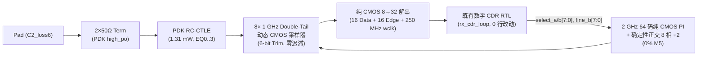

# RX v2：四分之一速 CMOS 4 Gb/s 接收端

**结论**：保留前端瘦身模拟 PDK CTLE（`1.31 mW`），将后级采样器、相位插值器（PI）、时钟分频及 1:16 解串全部替换为纯 CMOS 架构（**100% 真实 SKY130A 器件，零理想无源/行为源，零 3 叠层 CML 采样器与 CML 读出**），并与已签核的 [TX v4 Zero-CML SST](tx_sst_v4.md) 经真实 `C2_loss6` PCB 信道完成端到端闭合验证：

- **单元签核全通**：PDK CTLE **180/180**（45 角 × 4 EQ）；2 GHz 64 码纯 CMOS PI + 确定性 8 相 1 GHz `÷2` **384/384** 单调（最差 `|INL| = 0.0121 UI = 3.04 ps`、`16/16` 复位确定性）；1 GHz Double-Tail 动态 CMOS 采样器 **45/45 PVT** 零迟滞（`0.0 ps`）、6-bit 修调全单调、**400 样本失配 MC**（`TT 1σ = 12.0 mV`、`SS -40 °C 1σ = 15.9 mV`）；
- **端到端实时联调（Stage A，6 极端角 `TX v4 SST FFE=3 → C2_loss6 → RX v2 CMOS`）**：**6/6 PASS**，**`0/96` 数据位错、`0/43` 确定边沿错**，6/6 Alexander BBPD 负反馈极性正确，回放保真度 `0.30–0.58 mV RMS`；
- **全 45 角 PVT 闭合（Stage B，`TT/SS/FF/SF/FS × 1.65/1.80/1.95 V × −40/27/85 °C`）**：**45/45 PASS（100%）**，全角 **0 数据错、0 边沿错**，45/45 采样窗口 `≥ 0.50 UI`（44/45 通过完整 `[-8, 0, +8]`、`ss_v1650_t-40` 为 `16` 连续无错码 = `0.500 UI`），45/45 BBPD 极性正确，`250 MHz` 字时钟 `wclk` 两侧裕量 `setup ≥ 1,653 ps`、`hold ≥ 2,090 ps`；
- **功耗大幅下降**：45 角 RX v2 功耗 **`13.72–24.46 mW`**（**TT `19.12 mW = 4.78 pJ/bit`**，较旧全 CML RX `42.42 mW` `[31.90–52.06 mW]` 降 **55% / 2.22×**——即便最差角 `24.46 mW` 仍低于旧 CML RX 最低角 `23%`）；与 TX v4 SST 组成的整条 **4 Gb/s TX+RX 链路 TT 功耗仅 `34.29 mW`（`8.57 pJ/bit`）**，较旧全 CML 整链（`145.28 mW = 36.32 pJ/bit`）降 **76.4% / 4.24×**；
- **已验证 PDK 版图进展**：已完成 6 个核心模块版图并全部通过 `DRC = 0 / LVS = MATCH`（`term` `545.6 µm²`、`ctle` `979.9 µm²`、`dt_slicer` `933.6 µm²`、`qdiv2_8ph` `2,571.7 µm²`、`pi_rotator_2g` `7,942.3 µm²`、`cmos_pi_8ph` `11,223.4 µm²` 严格 `0.0%` M5），详见 [v2_pdk/README.md](../../analog/rx/cmos_rx/layout/variants/v2_pdk/README.md)；
- **采用状态**：`v1.0` 主线采用 CMOS RX v2.2，早期 CML 子模块按原试验边界留存。[当前状态](../status/current.md)

入口：[CTLE 网表](../../analog/rx/cmos_rx/spice/rx_ctle_pdk.spice) · [采样器网表](../../analog/rx/cmos_rx/spice/rx_dt_sampler.spice) · [CMOS PI+÷2 网表](../../analog/rx/cmos_rx/spice/rx_cmos_pi.spice) · [CMOS 1:16 解串网表](../../analog/rx/cmos_rx/spice/rx_cmos_deser16.spice) · [RX v2 顶层网表](../../analog/rx/cmos_rx/spice/rx_cmos_top.spice) · [联调脚本](../../analog/rx/cmos_rx/tb/link/verify_link.py) · [绘图脚本](../../verification/plotting/rx_cmos_v2_signoff.py)

---

## 1. 架构与接口兼容性

- **100% 端口兼容既有数字 CDR（`digital/rx/rtl/rx_cdr_loop.sv`、`pi_step_commutator.sv`）**：PI 吃同样的 `a0..a7`、`b0..b7` one-hot 与 `f0..f7` 8 位温度计码（64 码 = 2 UI / 360° @ 2 GHz，`7.8125 ps/LSB`）；`serdes_rx_cmos_deser16` 输出严格按时间排序的 `wd0..wd15`、`we0..we15`（`we[k]` 严格位于 `wd[k-1]` 与 `wd[k]` 之间，`we[0]` 由 5 拍 `e3` 移位提供）及 `250 MHz` 字时钟 `wclk`。
- **关键架构取舍**：
  1. **2 GHz 纯 CMOS PI 破除短路/静态功耗**：采用共享输入缓冲 + 1 级 4:1 LVT 传输门 mux（利用 `pi_step_commutator` 偶 A / 奇 B 交替规律）→ 8 片高阻 `res_high_po_0p69 (5.7 kΩ)` + `37 fF` MIM1 线性化混合器（$\tau \approx 43\text{ ps}$）→ AC 耦合自偏置 LVT 恢复级（`0.54 mW`）→ 确定性主从重采正交 `÷2`（消除 180° 相位歧义）。
  2. **四分之一速 1 GHz Double-Tail 采样器**：每拍 `500 ps` 复位 + `500 ps` 再生，2 管叠层直连 CTLE `1.43–1.76 V` 输出共模（免隔直电容与 `c2` 时钟 buffer），每周期彻底复位实现 `0.0 ps` 零迟滞，直接输出 1 Gb/s 轨到轨 CMOS，彻底删除 CML `÷2 (W40)`、CML `demux2` 和 10 路静态 `cml_to_cmos_data`。

---

## 2. 一阶段核心单元签核摘要

| 单元 | 测试范围 | 核心指标 | 结果目录 |
|---|---|---|---|
| **PDK CTLE** (`serdes_rx_ctle_pdk`) | 45 角 × 4 EQ（BIAS v2 `Vcm=1.05 V`，`80 fF` 负载） | **180/180 PASS**；EQ3 2 GHz 峰化 `2.72–4.67 dB`，`CMout = 1.43–1.76 V`，最小尾管裕量 `102.8 mV`，TT **`1.31 mW`**（`1.11–1.54 mW`） | `results/analog/rx/cmos_rx/ctle/20261120T205004Z` |
| **Double-Tail 采样器** (`serdes_rx_dt_slicer`) | 45 角 PVT（`Vcm=1.45 V`）+ 多共模 + 64 码 Trim + 2×200 MC | **45/45 PVT PASS**（`±10 mV` 延时 `86.3–233.2 ps`，`0.0 ps` 迟滞）；6-bit 修调 3 角全单调（TT `[−49.1, +42.9] mV`，`1.46 mV/LSB`）；MC `TT 1σ = 12.00 mV` / `SS -40 °C 1σ = 15.88 mV`；单路 `767 µW` | `results/analog/rx/cmos_rx/slicer/20261120T230000Z` |
| **2 GHz CMOS PI + 8 相 `÷2`** (`serdes_rx_cmos_pi_8ph`) | 6 极端角 × 64 码 + 16 点复位释放相位（12 fF 单元负载） | **384/384 单调 PASS**，`|INL| = 0.0042–0.0121 UI`（`1.05–3.04 ps`），`|D−E−125| ≤ 0.46 ps`，8 相误差 `1.36–5.97 ps`，**16/16** 复位零翻转；TT **`7.96 mW`**（PI 本体 `6.27 mW`） | `results/analog/rx/cmos_rx/pi/20261121T034553Z` |

---

## 3. 二阶段端到端联调与全 45 角 PVT 签核

### 3.1 Stage A：6 极端角完整实时联调（`TX v4 SST FFE=3 → C2_loss6 → RX v2 CMOS`）

| 极端角 | PI 码 | 数据错 / 边沿错（确定边沿） | CTLE 实时眼高 / 眼宽 | `wclk` 建立 / 保持（ps） | 回放 RMS 差（mV） | 扫窗宽度（UI） | BBPD 极性 | RX v2 功耗（mW） | TX v4（mW） | **整链功耗 mW（pJ/bit）** |
|---|---:|---:|---:|---:|---:|---:|---:|---:|---:|---:|
| `tt_v1800_t27` | 14 | **0 / 0** (43) | `124.6 mV / 0.80 UI` | `1810 / 2149` | `0.39` | **`≥ 0.625`** | PASS | **19.12** | `15.17` | **34.29 (8.57)** |
| `ss_v1650_t-40` | 06 | **0 / 0** (43) | `139.2 mV / 0.73 UI` | `1650 / 2272` | `0.58` | **`0.500`** (`c02..c17`) | PASS | **13.76** | `12.13` | **25.89 (6.47)** |
| `ss_v1650_t85` | 00 | **0 / 0** (43) | `113.1 mV / 0.93 UI` | `1659 / 2279` | `0.30` | **`≥ 0.750`** | PASS | **14.97** | `13.75` | **28.72 (7.18)** |
| `fs_v1650_t-40` | 13 | **0 / 0** (43) | `138.0 mV / 0.77 UI` | `1780 / 2177` | `0.43` | **`≥ 0.625`** | PASS | **15.20** | `11.72` | **26.92 (6.73)** |
| `fs_v1650_t85` | 10 | **0 / 0** (43) | `116.5 mV / 0.77 UI` | `1773 / 2183` | `0.33` | **`≥ 0.625`** | PASS | **16.07** | `12.15` | **28.22 (7.05)** |
| `ff_v1950_t-40` | 52 | **0 / 0** (43) | `119.9 mV / 0.76 UI` | `1886 / 2089` | `0.52` | **`≥ 0.625`** | PASS | **22.56** | `17.44` | **40.00 (10.00)** |

### 3.2 Stage B：全 45 角 PVT 汇总与功耗对比

- **功能与时序**：**45/45 PASS**（0 数据错、0 确定边沿错、45/45 BBPD 极性正确、45/45 采样窗 `≥ 0.50 UI`、`wclk` setup `1,653–1,888 ps` / hold `2,090–2,278 ps`、CTLE 眼高 `112.5–146.4 mV` / 眼宽 `0.81–0.87 UI`）。
- **功耗对比旧版全 CML（4 Gb/s）**：

| 模块 | 45 角最小 | **TT（`1.8 V 27 °C`）** | 45 角最大 | 旧全 CML（TT / 45 角） | 相对旧版改善（TT） |
|---|---:|---:|---:|---:|---:|
| PDK CTLE (`EQ3`) | `1.11 mW` | **`1.31 mW`** | `1.54 mW` | — | — |
| 2 GHz CMOS PI + 8 相 `÷2`（带 38 fF 实载） | `5.43 mW` | **`9.06 mW`** | `12.10 mW` | — | — |
| 8× Double-Tail 动态 CMOS 采样器 | `4.24 mW` | **`5.48 mW`** (`5.45` live) | `6.86 mW` | — | — |
| 纯 CMOS 8→32 解串器 | `2.49 mW` | **`3.38 mW`** (`3.30` live) | `4.42 mW` | — | — |
| **RX v2 整机** | **`13.72 mW`** | **`19.22 mW`** (`19.12` live / `4.78 pJ/b`) | **`24.46 mW`** | `42.42 mW` (`31.90–52.06`) | **`−55%`（2.22×）** |
| **TX v4 SST + RX v2 整链** | **`25.80 mW`** | **`34.35 mW`** (`34.29` live / `8.57 pJ/b`) | **`44.19 mW`** | `145.28 mW` (`118.9–170.7`) | **`−76.4%`（4.24×）** |

---

## 4. 适用边界与后续跟进

PLL 驱动的新增联合台使用 CML 反馈 PLL，四路 `r5` 接收器产生同源八相 CMOS 锚点。Stage 2 回放的 PI 中心及 ±8 码支持离散门槛和 BBPD 极性检查，TT 单 deck 验证了短窗模拟字输出。系统频偏、长时间 CDR 与当前 RCX 在独立任务验收。 [集成证据](../../results/catalog/chip_integration_20261124.json)

1. **当前验证边界**：Stage A 的六个原理图压力点包含同 deck TX→C2→RX，扫窗另做回放。Stage B 用逐角 TX→C2 的 PWL 去驱动原理图 RX，采用理想 2 GHz 八相锚点与 `tt` 电阻卡。CPEX 三点沿用 TX→C2 回放，PI 相位条件按各点校准。
2. **物理版本说明**：早期 Phase 2 联调为驱动采样器与解串负载放大了 `serdes_rx_qdiv2_8ph` 输出缓冲。现行 `v2_pdk` 物理套件包含解串、PI 和 RX 顶层；尺寸与端口查各自 [v2_pdk 版本说明](../../analog/rx/cmos_rx/layout/variants/v2_pdk/README.md)。真实 PLL 锚点耦合、剩余 CPEX 工况与失配下门限校准由[执行计划](../status/prelayout_plan.md)承接。
3. **证据路径**：
   - Stage A：`results/analog/rx/cmos_rx/link/20261121T112319Z_stageA/summary.json`
   - Stage B：`results/analog/rx/cmos_rx/link/20261121T152322Z_stageB/summary.json`
   - TX→C2 波形驱动 RX v2.2 CPEX 和 PI 独立逐码验证见[发布证据索引](../../results/catalog/v1_0_subsystem_evidence.json)。

## 5. 5 Gb/s 候选的 CTLE 电感与面积

目前 5G RX 装配采用 **M4/M2 串联叠层的中心抽头差分电感**，CTLE 宏由 `11,477` 缩至 `5,259 µm²`，节省约 54%，且其线圈不占 M5。下一步优先降低 CTLE 输出对的互容，再对比去线圈和更低电感值的方案。4G 已验证前端为 RC 退化 CTLE。 [5G RX 装配](../../analog/rx/cmos_rx/layout/variants/rx_top_5g_pdk/summary.json) · [四角 AC 对照](../../results/analog/rx/ctle_compact_ind_ab_20261125/summary.json)

### 配置与同负载对照

中心抽头接 `VDD`，每臂经线圈与串联 poly 负载电阻接 CTLE 差分漏极。差模电流的磁通相加，模型中每臂有效电感为差分端间电感的一半。源极的 `Rdeg` 与可切换 MIM 决定均衡档位，漏端电感补偿输出电容造成的额外高频衰减。线圈串阻可纳入负载电阻预算，调 poly 时须核对绝对增益、共模及电流。以下电感和串阻为几何模型估算，衬底和耦合电容由 Magic 提取。 [5G 原理图](../../analog/rx/cmos_rx/spice/rx_ctle_shunt_5g_pdk.spice)

| 布局 | 线圈 | 含保护环外框 | 差模每臂 L / 直流串阻 | CTLE 宏面积 |
|---|---|---|---|---:|
| M5/M3 | 外边长 74 µm，各 5 匝，线宽/间距 1.8/1.6 µm | 91.6 × 91.6 µm | 4.13 nH / 24.7 Ω | 11,477 µm² |
| M4/M2 | 外边长 48 µm，各 6 匝，线宽/间距 1.2/0.4 µm | 57.6 × 57.6 µm | 4.10 nH / 66.7 Ω | 5,259 µm² |

四角 AC 使用相同的有源 CPEX、`EQ11` 与两种线圈模型。每端外载 `30 fF` 时，紧凑版 2.5 GHz 相对低频增益提升 `4.57–6.05 dB`，四角差值在 `0.17 dB` 内。每端外载 `88 fF` 时，`SS / 1.65 V / 85 °C` 下大/小线圈的相对提升为 `2.73/2.24 dB`，对应绝对增益 `2.32/2.60 dB`，由原始曲线插值的低频基准 −3 dB 带宽为 `7.10/6.19 GHz`。这组数据中，线圈减面带来带宽损失，热角 Nyquist 处绝对增益仍由紧凑版略高。用复数 AC 曲线的两点负载模型插值，按相对提升 `≥3 dB` 与带宽 `≥7.5 GHz` 的筛选口径，紧凑版的热角外载目标约 `68 fF/端`，大线圈约 `81 fF/端`。此单电容代理用于定方向。 [原始 AC](../../results/analog/rx/ctle_compact_ind_ab_20261125/summary.json) · [负载插值](../../results/analog/rx/ctle_ind_review_20261125_IbhaCC/summary.json) · [对照图](../../results/analog/rx/ctle_ind_review_20261125_IbhaCC/ctle_ind_tradeoffs.png)

### 版图和电路优化顺序

1. **先减 CTLE→采样阵列的差分互容。** 5G RX 顶层 open PEX 中 `ctle_p/n` 的电容算术和为 `84.45/83.74 fF`。其中 P/N 直接互容 `28.40 fF`，对地 `25.89/24.62 fF`。对称差模下每侧只计这两项就折为 `82.69/81.43 fF`。当前中心馈线的两根 M3 平行约 `126 µm`，中心节距 `0.85 µm`，版图还有东向监测分支。优先试缩短并行段、加间距或对称换层。可把 P/N 互容约 `20 fF` 定为首轮目标，减少的 `8.4 fF` 互容相当于每侧少约 `17 fF` 的差模负载，收益以新增对地及对时钟耦合后的 PEX 衡量。采样管的器件电荷与时变负载由接齐八个采样器的电路验证。 [片顶馈线](../../analog/rx/cmos_rx/layout/build_rx_cmos_top_5g_pdk.py#L313) · [互容提取](../../results/analog/rx/ctle_ind_review_20261125_IbhaCC/summary.json)
2. **有感小面积对照优先扫每臂 2.5–3 nH。** 简化峰化模型使用无量纲比值 `L_arm / (R_total² C_out)`，其中 `R_total` 含线圈串阻。总负载从约 `480 Ω` 调到 `360 Ω` 时，保持同一比值只需原来的约 56% 电感。台上 `2.5 nH/臂` 的低阻重定尺寸候选在 `88 fF` 热角达到约 `3.07 dB` 相对提升和 `8.9 GHz` 带宽，绝对 Nyquist 增益约 `1.84 dB`，TT 电流约 `0.95 mA`，原版约 `0.73 mA`。保留层栈和线宽/间距的五匝方案，几何估算外边长 `42–46 µm` 对应每臂约 `2.6–3.0 nH`，含同样保护间距的线圈面积较现版少约 `230–655 µm²`。继续缩线圈前先核对带载眼图与功耗收益。 [重定尺寸 AC](../../results/analog/rx/ctle_peaking_q_sweep_20261125/expB_ss_85.cir)
3. **更大幅的面积机会来自重新定尺寸的纯 RC CTLE。** 直接拿掉线圈、保留现有器件的初筛不足。另一组按 `gm/Id` 调整输入对、尾管、负载电阻和退化网络后，热角纯 RC 在 `75.4 fF` 外载加 `8.7 fF` 有源布线代理下达到约 `4.40 dB` 相对提升、`3.39 dB` 绝对增益、`10.6 GHz` 带宽。TT 功耗由当组紧凑版的 `1.32 mW` 增至 `1.76 mW`，热角输出共模约 `1.38 V`。其面积锚点可先用现有 `1,081 µm²` 有源子宏估量，重定尺寸后的实际面积和电性需重新提取。验证优先用同 TX FFE、C2/C3 信道和含耦合的八采样器，比较眼中心有符号余量、边沿分布、EQ 档、噪声、共模和功耗。 [纯 RC 重定尺寸测试台](../../results/analog/rx/ctle_peaking_q_sweep_20261125/win_ac_ss_85.cir)

首个热角 `C2_loss6 + FFE` 回放保存至 `33 ns`。以实际发射比特计算 82 位的最佳静态采样相位，现有紧凑版和重定尺寸纯 RC 的最小有符号幅度分别约 `297/242 mV`，两者的 `75 mV` 扫相窗口分别约 `146/154 ps`。这组原理图加电容代理回放表明两者的眼图取舍不同。 [短窗比特复核](../../results/analog/rx/ctle_ind_review_20261125_IbhaCC/first_hot_eye.json)

紧凑线圈模型家族的角点 AC 用集中参数回灌，原 5G 端到端联调使用大线圈模型。闭合小线圈或无电感方案需要同一 RX 顶层的相同负载与动态台。磁场求解应覆盖自谐振、损耗和 P/N 对称性，尤其在旋绕层与周边高速金属重叠时。 [首版整链证据](../../results/verification/top_cosim_5g_20261124/summary.json)

### 面积优先的候选取舍

下一轮 5G 集成候选先做**现有有源尺寸的纯 RC**。把 `7.5 GHz` 保留为 AC 观测指标，采用决定按带载采样和眼图筛查。若 C2 关闭 FFE 或 C3 压力点的余量下降，再比较沿用现有退化控制接口的重定尺寸纯 RC。

在同一台 `EQ11`、每端 `75.4 fF` 外载加 `8.7 fF` 有源布线代理下，复读 C2+FFE 的 SS 热角与 FF 冷角、C2 无 FFE 的 SS 热角、C3+FFE 的 SS 热角。用第 `38–74` 位定静态相位并固定，评分第 `75–124` 位，按 `75 mV` 和 `0.15 UI` 作眼图筛查。四候选均通过这四组短窗。 [逐位与边沿复算](../../results/analog/rx/ctle_tradeoff_20261125_7mRSG8/summary.json) · [角点 AC 与偏置](../../results/analog/rx/ctle_peaking_q_sweep_20261125/winners_summary.json)

| 候选 | 热角 −3 dB 带宽（插值） | 四场景最小有符号幅度 / 最大边沿散布 | TT 功耗 | 热角输出共模 |
|---|---:|---:|---:|---:|
| 现有有源尺寸，纯 RC | 7.17 GHz | 149 mV / 0.132 UI | 1.31 mW | 1.433 V |
| 现有紧凑线圈，每臂 4.1 nH | 6.66 GHz | 168 mV / 0.132 UI | 1.31 mW | 1.398 V |
| 重定尺寸，纯 RC | 10.57 GHz | 164 mV / 0.111 UI | 1.76 mW | 1.380 V |
| 重定尺寸，每臂 3.0 nH | 11.18 GHz | 152 mV / 0.095 UI | 2.12 mW | 1.341 V |

现有纯 RC 与紧凑线圈同功耗，最差短窗幅度少 `19 mV`，保留了线圈区域的减面机会。重定尺寸纯 RC 在 C2 无 FFE 时把有符号幅度从 `149 mV` 提到 `188 mV`，边沿散布从 `0.113 UI` 降至 `0.063 UI`，代价是 `0.45 mW` 额外 TT 功耗及偏置重配。优先让前者经八个有时钟的采样器、输出耦合 PEX 与实际 TX 幅度做短窗，沿相同边界比较后者。当前表中的面积机会用现有有源宏 `1,081 µm²` 估量，纯 RC 需要实际布置与提取。
