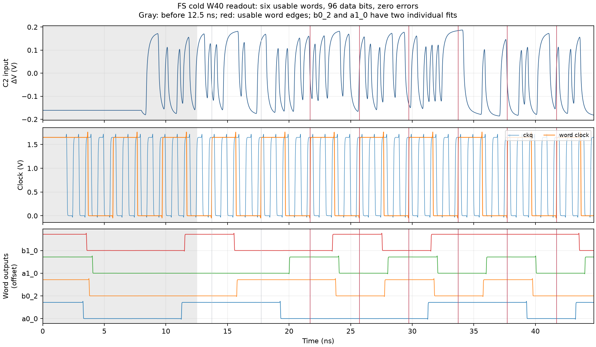
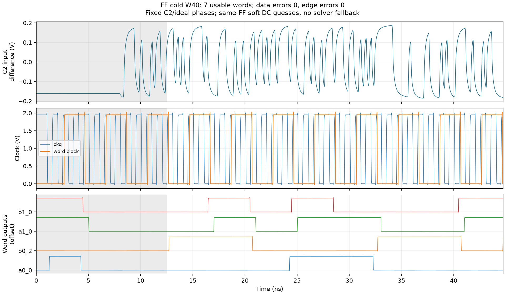

# RX 冷角：偏置与读出的分层收敛诊断

当前W40的FS/FF两个冷角hh均已完成独立Newton DC与44.75ns完整读出：FS为6字/96数据位/49确定边沿零错，FF为7字/112数据位/55确定边沿零错。两者合同位映射正确，FF16路单独映射均唯一，FS两路仍有短窗拟合歧义。使用各自同条件电压软初猜，无gmin/source/OPtran回退或硬初值。当前W40全网格、原生锚点和真实启动仍开。

## 偏置单层

固定来源为 `readout_deser/20261105T195801Z_ac_trim32_realbias_rhh` 的 FS 冷角 deck 和其 PDK 电阻单元快照。保留真实带隙、四个0.7 V输出负载、CML/CTLE电流拷贝及二极管/内部去耦，去掉所有RX下游实例。每点比较原始六节点软初猜和历史 `dist_pvt` 的四个顶层电压初猜；没有引入硬初值或电压钳位。

| 条件 | 原始 / 软初猜耗时 | vbg | vgi | vbias | vctle | CML / CTLE 电流 |
|---|---:|---:|---:|---:|---:|---:|
| FS 1.65 V −40 °C hh | 19.4 / 22.0 s | 1.22656 V | 0.97705 V | 1.05157 V | 0.72180 V | 192.55 / 45.72 µA |
| FF 1.95 V −40 °C hh | 22.7 / 18.4 s | 1.23674 V | 1.23627 V | 0.97127 V | 0.66009 V | 193.96 / 45.98 µA |

四次均有非零正常方向的支路电流；两种初猜收敛到相同数值。FF 是同一单元快照下新设置的条件，不是找到了历史 FF W40 完整运行。初猜登记为 `rx_cold_bias_dist_seed_v1`，只代表求解辅助，不是可被下游当作理想偏置源的激励合同；历史种子负载与RX不同。

## FS 逐层恢复

全部使用原始六节点 `.nodeset`、真实偏置、固定 PI20/修调32、rb2k、历史 C2 输入在t=0的值和原相位源。仅把求解器从原 KLU 改为默认 SPARSE，四层的单元参数与源相同。每层明确删除后级及其显式输出电容，因此不是完整加载等效模型。

| 保留电路 | SPARSE 工作点 | 耗时 | 电源电流幅值 |
|---|---|---:|---:|
| 偏置 + CTLE | 已观察 | 24.3 s | 1.000 mA |
| 再加 PI | 已观察 | 29.7 s | 3.321 mA |
| 再加 ac_trim_rk 采样器 | 已观察 | 40.7 s | 10.795 mA |
| 再加 W40 完整读出 / CMOS 字寄存器 | 120 s 超时，无 OP 表 | 120.1 s | 未知 |

前三层的偏置电压/支路电流在保存精度内相同。最后一层保留原测试台的 `Ikick`，t=0为1µA，注入 `xro.xf.dqp→dqn`；它不是新增的求解初值。该层停在动态gmin过程，没有可用于功能或偏置误差判断的输出。进一步拆分见下节；不通过强制锁存状态替代真实工作态。

## 读出内部的负载拆分

保留CML分路/转换front、去掉CMOS字寄存器lane后，SPARSE 57.7s获得OP；再保留Johnson字时钟、仍去掉八条lane，61.4s获得OP。两组bias数值不变，ckq/ckqb为1.65V/约85nV；第二组j0/j1约1.65V、w约85nV，电源电流约15.724mA。它们只表示各部分的静态解，没有证明分频、字时钟启动或字流正确。

首轮拆分测试删除lane后残留32个输出电容，造成悬空节点；两次结果标为fixture_invalid。修正后的两组删除未连接输出电容，front-only再去掉w负载；Xf的参数、原Ikick和其余真实电路不变。负载变化会改变OP根，部分解不等效于完整RX。

历史完整KLU的2400s记录已进入瞬态OP并打印初始解（原日志1812/1814行），随后没有完整波形。因此不能把原超时一概解释为“OP未解”。本轮SPARSE120s和旧KLU不是同一个完成范围；后续完整原电路/原始软提示、KLU、从0保存的1ns短瞬态及其对照结果见下节。软hint、静态解和真实上电保持分开。

## 一条与四条 lane 的工作点对照

在同一 FS 冷角真实偏置及上游边界下，保留一条或四条物理 CMOS lane，删除其余 lane 及相应输出电容。单 lane 约 67 s 经 **source stepping completed** 得到 OP 表：vbg 1.22656 V、vgi 0.97705 V、vbias 1.05157 V，与上述局部偏置数值一致。四 lane 约 106 s 在 gmin 和 source stepping 均失败后，以默认 10 µs **OPtran 到达终点**产生 OP 表：vbg 1.22680 V、vgi 0.968125 V、vbias 1.064698 V；这个终点不是独立收敛的 DC 稳态证明，10 µs 也不保证稳定。两种删减负载均不等效于完整 RX，不证明启动或功能。

现有日志路径复核：FS 偏置、CTLE、PI 为直接 OP；FF 偏置与 sampler 层经 true gmin stepping；front-only 和 front+Johnson 经 source stepping；八 lane 的 120 s 尝试停在 dynamic gmin，仍未完成。这些标签及各节点/电流随原始数据保存在采集结果中。

## 完整电路 SPARSE OP

完整 W40 电路的 SPARSE OP 在 152.4 s 返回一组 8016 向量、1 个点的 `op.raw`。日志显示 gmin 和 source stepping 失败，随后默认 10 µs OPtran 到达终点：vbg 1.2268015 V、vgi 0.9681286 V、vbias 1.0646933 V，CML 偏置支路 206.136 µA，比偏置单层 DC 解的 192.549 µA 高约 7.1%。该结果接近四 lane OPtran 终点，不构成独立 DC 残差、稳定性或功能证明；RX 冷角依旧未关闭。

证据固定为 `cold_readout_full_sparse_op/20261109T133404.020641Z_42c4ada0`，分析 `20261109T133712.461495Z`。采集器核对原 runner 的计划和快照、deck、执行记录、日志、全部原始向量完整性及摘要所列数值；状态 ungraded。

## 完整读出数值对照

完整 FS/1.65 V/−40 °C/hh、W40、真实偏置、KLU 的原始软提示与额外读出节点软提示两次 1 ns 瞬态均在 600 s 上限内停在 transient OP，未产生 raw。固定 1 ns 的 OPtran 最大步长时，内部终点 100 ns 的尝试进入正式瞬态且输出覆盖 0–1 ns；内部终点 1 µs 的尝试在 600 s 内未完成，未产生 raw。默认 10 µs 的实验使用不同内部最大步长，不能作为单变量终点对照。

100 ns 结果的 vbg 从 0.6692 V 升至 0.6734 V，vgi 约 1.2366 V，vbias 从 0.6234 V 升至 0.6246 V；电源电流幅值从 0.2566 mA 升至 0.2581 mA。前述局部正确偏置解为 vbg 1.22656 V、vgi 0.97705 V、vbias 1.05157 V；含 front 与 Johnson 的部分电路电流约 15.724 mA。两者负载不同，但完整电路该短暂态的偏置与局部解明显不符，不能视为有效偏置工作点。正式 1 ns 波形完成只证明数值推进及输出完整，未证明偏置恢复、真实启动、数据映射或功能；RX 冷角仍未关闭，所有结果 ungraded。

本机 ngspice 47 源码中，OPtran 推进局部 `optime`，B 源表达式 `time` 读取的 `CKTtime` 在初始工作点阶段保持零；因此依赖 `time` 的时钟不会因 OPtran 局部时间而翻转。回退到终点也没有独立的 DC 稳定性验收，见[源码诊断](../work_packages/deliveries/rx-optran-diagnostic.md)。

## 完整电路的独立直接DC解

从完整SPARSE结果的7943个有限电压节点提取软初猜，保留同一个DUT、激励在t=0的值、原始Ikick和全部负载。原六条重复节点提示由候选值替换；没有硬`.ic`、`uic`、节点钳位或理想偏置。数值边界登记为`rx_fs_w40_full_optran_raw_newton_seed_v1`，节点文件、原始raw/deck/execution及负载身份均固定。

执行`optran 1 0 0 0 0 0`只保留初始Newton，禁用gmin、source stepping及OPtran。日志确认`Optran is deselected`，没有任何回退；95.8s完成，其中约93s为模型准备、DC分析约2.7s。保存8016个向量、全部有限：

| 量 | 直接DC结果 |
|---|---:|
| vbg / vgi | 1.22656164 / 0.97705115 V |
| vbias / vctle | 1.05157017 / 0.72179604 V |
| CML / CTLE电流 | 192.5485 / 45.7155 µA |
| 整个完整RX电源电流幅值 | 16.5472 mA |

相对OPtran候选，vgi变化+8.923mV、vbias变化−13.123mV；7943个节点最大变化76.04mV，位于带隙内部`xbias_ref.xbg.s`。这个差异也说明10µs OPtran终点不能当作准确DC值。新解证明存在完整加载下的DC根；字流验证见下节，真实上电不在此次边界内。

## 正常偏置下的完整读出瞬态

从直接DC raw提取相同电路的软节点初猜，数值边界为`rx_fs_w40_full_direct_newton_dc_seed_v1`。先完成0–1ns健康检查，再运行原0–44.75ns PRBS；两者均直接求初始工作点，没有回退或硬`.ic/uic`。完整运行908.7s，22560个实际时间点，所有所需向量有限。

沿用原12.5–44.75ns测量窗和原PRBS对齐算法：窗内8个字时钟上升沿，起始offset=14；索引2–7的6个字满足原合法索引条件，时间为21.719–41.716ns。96个数据位、49个确定边沿均零错，`map_ok=true`。单路`b0_2`与`a1_0`各自仍可匹配[6,15]两处，不称16路均已唯一确定。

字输出建立/保持最小值1662.44/1557.96ps，第0级数据捕获最小余量359.81ps；平均测试台功耗30.16mW。vbg初末差约1nV，vgi约0.16µV，vbias/vctle末值较初值变动约−0.13/−0.26mV。它证明当前固定PI20/trim32、rb2k、真实偏置、理想相位源及原C2输入边界下的短窗功能；未验收原生PLL锚点、PI动态、真实启动、失配/噪声、BER或全PVT。

[独立复算数据](../data/rx_cold_readout.json)、[索引](../../results/catalog/rx_cold_readout.json)与[采集器](../../verification/plotting/rx_cold_readout.py)保存波形/执行/计划身份、全部字沿和有效索引，不改动原测量窗。

## FF冷角的当前W40恢复

FF1.95V/−40°C/hh使用原FF测试台与固定名义C2回放、PI20/trim32/rb2k、真实偏置、理想相位源。先将已明确W40的冻结单元逐个与当前源码作PDK电阻映射比较：七个文本差异均由该映射解释，整个闭包映射后一致。原FF五次W80失败仍保留，不转为本次W40失败或通过。

普通OP在gmin/source失败后返回10µs OPtran候选。以其自身7943个有限电压作软`.nodeset`，关闭所有求解回退后独立Newton成功：vbg/vgi为1.23673667/1.23626939V、vbias/vctle为0.97126810/0.66008921V。相对候选最大节点改变量14.51mV，位于`xbias_ref.xbg.s`；不将原OPtran终点追认为准确DC。

新数值边界登记为`rx_ff_w40_optran_newton_seed_v1`与`rx_ff_w40_direct_newton_dc_seed_v1`。冻结原始源、父运行、PDK、输入、节点列表与单元；只核对本次依赖的注册条目，新增其他边界不改变既有条目身份。没有复用FS节点电压作FF种子，没有`.ic/uic`或强制逻辑状态。

健康1ns后完成44.75ns正式瞬态，耗时944.8s。沿用12.5–44.75ns测量窗和原读出测量器，7字、112数据位、55确定边沿均零错，`map_ok=true`，全部16路单独位序唯一。字输出建立/保持最小1646.58/1587.90ps，第0级数据捕获最小384.11ps；该窗功耗的采样点算术均值45.356mW。主要偏置初末稳定，完整波形无回退、截断或缺向量。

[FF逐点数据](../data/rx_ff_cold_readout.json)、[索引](../../results/catalog/rx_ff_cold_readout.json)与[独立采集器](../../verification/plotting/rx_ff_cold_readout.py)记录source/deck/execution/raw身份与原测量窗。这是当前固定C2/理想锚点下的短窗功能证据，不是全PVT、实际SAR校准、真实上电、原生PLL或BER资格。

## 证据与适用范围

[工作点复核数据](../data/rx_cold_op.json)和[索引](../../results/catalog/rx_cold_op.json)保留各次诊断与失败；OP量对RX功能为ungraded。新瞬态单独记录上述短窗功能，不把OP成功、旧45点或此单点合成当前全网格资格。数据眼图、PI动态、CDR、失配与噪声仍按各自边界推进。

运行前缀为 `results/analog/rx/sampler/`：

- 偏置：`cold_bias_op/20261107T171335.226592Z_4e1d4df2`，执行及分析于2026-11-09完成。
- 完整直接DC：`cold_readout_full_dc_newton/20261109T134022.118325Z_0e2ea2f8`，分析`20261109T134300.886399Z`。
- 完整瞬态：`cold_readout_full_transient_dc/20261109T134623.873301Z_0c20ee1d`，pilot/full分析为`20261109T134921.992550Z`和`20261109T140521.539625Z`。
- FF普通OP：`cold_readout_ff_current/20261110T125113.199628Z_8f15432e`；独立DC：`cold_readout_ff_direct_dc/20261110T130130.446962Z_0943ba28`，分析`20261110T130311.931588Z`。
- FF完整瞬态：`cold_readout_ff_transient_dc/20261110T130359.865093Z_9bbc587f`，pilot/full分析为`20261110T130715.271029Z`和`20261110T161234.977317Z`。
- lane 对照：`cold_readout_lane_op/20261109T132857.690692Z_6c4b5a34`，分析 `20261109T133038.816191Z` 与 `20261109T133117.956436Z`。
- 读出部分：`cold_readout_parts/20261109T084345.824625Z_321a922a`，分析`20261109T084624.763139Z`；旧`20261109T083933.889249Z_dd8e579f`为夹具失败，不计设计结果。
- 逐层：`cold_readout_layers/20261109T083205.422134Z_5cb6b16b`，分析 `20261109T083633.378024Z`。

脚本：[偏置OP](../../analog/rx/sampler/tb/cold_bias_op/run.py)、[分层OP](../../analog/rx/sampler/tb/cold_readout_layers/run.py)、[只读采集器](../../verification/plotting/rx_cold_op.py)。原完整网格缺口仍见[RX设计](rx_pi_sampler.md)。
