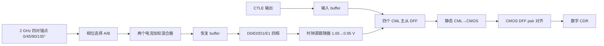

# RX 相位插值器、采样器与 CMOS 读出

> **当前修订**：首版 64 码 PI [pi_rotator](../../analog/rx/pi/spice/pi_rotator.spice)、四相静态 CML 采样 [rx_half_rate_samples](../../analog/rx/sampler/spice/rx_half_rate_samples.spice)、静态 CMOS 读出与 pair 对齐 [rx_cmos_pair_align](../../analog/rx/sampler/spice/rx_cmos_pair_align.spice)（[配置](../../config/rx_cdr.toml)）。
> **关键数字**：PI 64 码全部单调前进，DNL −0.134…+0.122 LSB，最大 |INL| 0.0096 UI；真实 PI + CTLE + 采样器在码 0/4/8 下 51 位比较全部正确，早晚票方向与负反馈一致。
> **采样器候选 ac**（2026-11-02，时钟 buffer c2）：[rx_half_rate_samples_ac](../../analog/rx/sampler/spice/rx_half_rate_samples_ac.spice)，低过驱动尾管 + 隔直时钟；45 条件采样窗口 ≥ 0.5 UI（压力角完整扫描 0.88–1.00 UI；原设计 SS/FS 1.65 V 85 °C 为 0.06 UI），栅极时钟 325–866 mVpp（≥ 300 mVpp）。
> **读出候选 demux2**（2026-11-02）：[rx_readout_demux2](../../analog/rx/sampler/spice/rx_readout_demux2.spice)，CML 1:2 分路（÷2 的 q/m 两个 1 GHz 域）+ 匹配 CML→CMOS 转换；45 条件数据逐位正确、边沿判定正确；默认尺寸 p2（恒定 τ 半尺寸）数据 CML 余量 ≥ 170 ps、CMOS 采样余量 334–452 ps，读出约 10 mA（测试台 31–51 mW）。
> **读出到 16 UI 字 deser16**（2026-11-02）：[rx_readout_deser16](../../analog/rx/sampler/spice/rx_readout_deser16.spice)，demux2 前端 + 每路 CMOS 4 级移位/字寄存器 + Johnson 计数器选通；精简 CMOS DFF（clk→q 37–159 ps）；45 条件 4960 个数据位与 2466 个确定边沿全部正确，位映射处处相同，字时钟 w 两侧窗口 ≥ 1.5 ns；测试台功耗 30.6–50.0 mW（与 demux2 持平）。
> **主要缺口**：PI 压力角已过（下文），读出 PVT 失败（原设计）；锚点是理想相关多相源，没接原生 PLL；pair 对齐依赖全速 CML→CMOS（SS 冷角失效）；孔径/失调/亚稳态未表征。

## 电路

| 部分 | 参数 |
|---|---|
| PI 输入 | 四对锚点各经 CML 隔离 buffer；互补极性补齐 8 个锚点 |
| PI 混合器 | 8 个等权真实 MOS 尾电流单元，温度计码分配 A/B；负载 600 Ω、每腿 200 fF；两个混合器锚点相差 90° |
| PI 恢复 buffer | 输入 W = 48 µm、尾 12 µm、600 Ω |
| 码 → 相位 | c = 8q + f，每码 7.8125 ps = 0.03125 UI；偶数扇区 A = q、B = q + 1，奇数扇区交换 |
| 采样输入 buffer | W = 24 µm、尾 12 µm、600 Ω |
| 采样 DFF | 数据/保持/时钟/尾 = 16/48/32/12 µm，600 Ω；四相顺序 D1 → E0 → D0 → E1，每段 125 ps |
| CMOS 读出 | 静态数据接收器（源跟随 + 镜像负载差分级 + 两级反相器），支持长同码 |
| pair 对齐 | 公共时钟取自 EDGE 相位经全速 CML→CMOS 和两级 buffer；四个 CMOS DFF 重定时；E0 加两反相器 + 20 fF 延迟 |

## 已验证结果

### PI 静态 64 码（理想 2 GHz、400 mVpp 锚点，每腿 20 fF）

| 量 | 结果 |
|---|---:|
| 步长 | 6.765–8.768 ps（名义 7.8125 ps） |
| DNL | −0.134…+0.122 LSB |
| 最大 \|INL\| | 2.394 ps = 0.0096 UI |
| 输出差分摆幅 | 365.5–393.2 mVpp |
| bank 功耗 | 5.04 mW（不含参考支路 1.53 mW） |

规定序列（62 → 63 → 0 → 1 → 2 → 1 → 0 → 63 → 62）的正反向回卷没有多余/缺失过零或窄脉冲；不是任意时刻跳码无毛刺的证明。来源：[PI 首版](../history/rx_pi_first_design.md)。

### 真实 PI + CTLE + 采样器（理想锚点、理想 PRBS7 输入）

| PI 码 | 错误 | 最小输出判决裕量 | 早/晚票 |
|---|---:|---:|---:|
| 0 | 0/51 | 196.4 mV | 0/22 |
| 4 | 0/51 | 197.3 mV | 11/11 |
| 8 | 0/51 | 190.6 mV | 22/0 |

采样组功耗约 9.3 mW（含输入 buffer、时钟移位、四个 DFF）。RTL 交接器的正/反向回卷轨迹驱动真实 PI/CTLE/采样器，144 位比较全部正确。来源：[采样与控制](../history/rx_sampler_control.md)。

### PI 64 码 PVT（压力角，理想锚点）

**结论：6 个压力角全部单调，|INL| ≤ 0.011 UI（门槛 0.02 UI），正交误差 0.001 UI；热慢角输出摆幅降到 233–263 mVpp。**

[rotation/pvt.py](../../analog/rx/pi/tb/rotation/pvt.py)：每个工艺角一个 ngspice，64 码各 4 ns，后 2 ns 量相位；锚点共模随电源（VDD − 0.15 V），控制电平随电源。

| 条件 | 步长（LSB） | DNL（LSB） | \|INL\|（UI） | 正交误差（UI） | 最小摆幅（mVpp） | 功耗 |
|---|---|---|---|---|---|---|
| TT 1.8 V 27 °C | 0.87–1.12 | 0.14 | 0.0090 | 0.001 | 366 | 5.04 mW |
| SS 1.65 V −40 °C | 0.85–1.16 | 0.16 | 0.0110 | 0.001 | 352 | 4.29 mW |
| SS 1.65 V 85 °C | 0.87–1.17 | 0.17 | 0.0112 | 0.001 | **233** | 4.44 mW |
| FS 1.65 V −40 °C | 0.84–1.13 | 0.17 | 0.0098 | 0.001 | 392 | 4.24 mW |
| FS 1.65 V 85 °C | 0.87–1.16 | 0.16 | 0.0109 | 0.001 | **263** | 4.40 mW |
| FF 1.95 V −40 °C | 0.92–1.03 | 0.08 | 0.0031 | 0.001 | 475 | 5.64 mW |

64 码跨度 1.97 UI（= 2 UI − 1 LSB）。摆幅是数据、边沿两路时钟中的较小者；它经源跟随器驱动采样器时钟对，是否够用由采样器 PVT 检验。

### 采样器 PVT（C2 回放 → CTLE EQ3 → PI → 四相采样）

**结论：原设计在 SS/FS 1.65 V 85 °C 只剩 0.06 UI 无错窗口，根因是锁存器尾管被时钟共模挤进线性区；候选 ac（低过驱动尾管 + 隔直时钟）在 45 个条件下窗口 ≥ 0.75 UI。**

[link_pvt/pvt.py](../../analog/rx/sampler/tb/link_pvt/pvt.py)：PI 码扫一个 UI，判决与 PRBS7 比较，窗口 = 最长连续无错码段。`--dut stock|ac`。

**根因。** 锁存器是三层堆叠（数据/保持对 → 时钟对 → 尾管）。时钟共模由 PI 输出（约 VDD − 0.15 V）经 LVT 源跟随器下移约 0.7 V 得到，随工艺和温度漂；而可行窗口的下沿由 VGS(时钟) + Vdsat(尾) 决定，基本不随 VDD，上沿随 VDD。
- 链路工作点（[headroom_op/op.py](../../analog/rx/sampler/tb/headroom_op/op.py)）：45 条件里 21 个尾管余量 < 50 mV，最差 −225 mV（FS 1.65 V 85 °C）；路径上其他电流源 ≥ 315 mV。
- 时钟共模可行窗口（[headroom_op/window.py](../../analog/rx/sampler/tb/headroom_op/window.py)，所有导通器件 Vds − Vdsat ≥ 50 mV）：原设计 45 条件交集只有 1.150–1.245 V。加宽源跟随器只能补约 80 mV，需要 200–280 mV，属于结构问题。

**候选 ac。**
- 尾管 W72 × 24 指，接本地低过驱动参考（PLL r2 的 `pll_cml_tail_bias`），Vdsat 约 0.38 → 0.18 V；窗口交集变为 0.890–1.245 V（时钟单端 80 mV）。
- 时钟：CML buffer（300 Ω、1 mA，每路时钟一个）→ 0.6 pF 串联电容 → 栅极，栅极经 50 kΩ 接 k·VDD（k = 0.634，规划见 [clock_interface_plan.py](../../analog/rx/sampler/theory/clock_interface_plan.py)）。共模不再取决于 PI 输出，上游静态失调（及其造成的占空比误差）被隔掉。测试台 rb 取 2 kΩ 以缩短隔直建立时间（稳态平均电平与 rb 无关）。
- 工作点：45/45 余量 ≥ 50 mV，最差 157 mV；时钟共模 = 0.634·VDD。尾电流 327–485 µA（名义 510 µA，本地镜像偏差）。

压力角（码步 1/16 UI）：

| 条件 | 原设计窗口 | ac 窗口 | ac 栅极时钟 |
|---|---|---|---|
| TT 1.8 V 27 °C | 0.94 UI | 0.94 UI | 327 mVpp |
| SS 1.65 V −40 °C | 0.88 | 0.94 | 327 |
| SS 1.65 V 85 °C | **0.06** | 0.81 | 198 |
| FS 1.65 V −40 °C | 0.81 | 0.94 | 341 |
| FS 1.65 V 85 °C | **0.06** | 0.81 | 216 |
| FF 1.95 V −40 °C | 0.94 | 1.00 | 409 |

45 条件（码步 1/8 UI）：窗口全部 ≥ 0.75 UI，最差 FS 1.65 V 85 °C（0.75 UI），其余 0.88–1.00 UI。栅极时钟 198–409 mVpp；低于 300 mVpp 的 19 个条件是全部 85 °C 点以及 SS/FS 的 27 °C 点。整个测试台功耗 14.3–20.3 mW，比原设计高 1.5–4 mW（原设计低压角尾管在线性区、电流偏低）。

**时钟幅度。** buffer 在 2 GHz 下增益约 1.27（TT：PI 331 → buffer 421 → 栅极 330 mVpp；SS 85 °C：207 → 260 → 200），器件卡显示直流 gm·R = 2.24，损失来自输出极点和大信号压缩。300 mVpp 是保留的中间指标（为寄生、失配、噪声和隔离电阻缩小留余量），需重做 buffer。时钟通路测试台 [clock_ac/sweep.py](../../analog/rx/sampler/tb/clock_ac/sweep.py)（真实 PI、静态数据，每组约 1 分钟）在压力角上与链路结果一致：ac 栅极 197–408 mVpp，占空比 0.500；D0 主锁存器的时钟导向比例在 SS/FS 85 °C 只有 0.67–0.71（其余约 1.0–1.1）。原设计 SS/FS 低温的锁存器尾电流只有 131–173 µA（TT 418 µA），即尾管线性区。

**时钟 buffer c2**（尺寸设计第二轮，见 [sizing](../verification/sizing.md#第二轮时钟-buffer同日)）：输入管 40 µm 不变，负载 300 → 600 Ω，尾电流 1 → 1.53 mA（`ck_wt` 24 → 36），Cc 0.6 → 0.45 pF；2026-11-02 起为单元默认值（无覆盖参数复跑压力角，结果与覆盖参数运行逐项相同）。工作点 45/45，buffer 尾管余量 ≥ 293 mV。压力角（1/16 UI）：

| 条件 | 窗口（基点 → c2） | c2 栅极时钟 |
|---|---|---|
| TT 1.8 V 27 °C | 0.94 → 1.00 UI | 600 mVpp |
| SS 1.65 V −40 °C | 0.94 → 0.94 | 610 |
| SS 1.65 V 85 °C | 0.81 → **0.88** | **325** |
| FS 1.65 V −40 °C | 0.94 → 0.94 | 660 |
| FS 1.65 V 85 °C | 0.81 → **0.88** | **359** |
| FF 1.95 V −40 °C | 1.00 → 1.00 | 866 |

栅极 ≥ 300 mVpp 在压力角全部满足；FF 冷角 866 mVpp（单端约 0.22 V）仍在共模窗口内（窗口卡扩到单端 0.3 V，该点余量约 0.33 V）。测试台功耗 +1.8–3.1 mW。

45 条件（压力角完整扫描、1/8 UI；其余 39 个条件门槛模式，码 12/20/28 = 中心 ± 0.25 UI，见 [link_pvt/pvt.py](../../analog/rx/sampler/tb/link_pvt/pvt.py) `--gate-codes`）：压力角窗口 0.88–1.00 UI，其余 39 个条件门槛码全部无错（窗口 ≥ 0.5 UI，前提是无错码连续，所有完整扫描都满足）。栅极时钟 325–866 mVpp，最低 SS 1.65 V 85 °C，其余 ≥ 357 mVpp；测试台功耗 16.2–22.6 mW。

### CMOS 读出（2026-11-02）

**结论：在 2 GHz 直接转 CMOS 再采样，是结构性失败；改为 CML 1:2 分路 + 匹配转换后，压力角数据逐位正确，时序余量数百 ps。**

**基线。** 读出接到 ac 采样器后（[readout_pvt/pvt.py](../../analog/rx/sampler/tb/readout_pvt/pvt.py) `--dut ac --code 20`），从 PI 输出直接转出的 2 GHz CMOS 时钟在 SS 1.65 V 冷/热（两种转换器）、FS 冷（原版）、FS 热（r4）不翻转：PI 输出在热慢角只有约 200 mVpp，又要驱动 c2 时钟 buffer。

**读出时钟。** [rx_half_rate_samples_ac_rk](../../analog/rx/sampler/spice/rx_half_rate_samples_ac.spice) 从边沿时钟 buffer 的输出取点（`serdes_rx_clock_ac_tap`），经一级小 CML buffer 恢复成 PLL 的标准时钟输入（共模 VDD − 0.15 V，摆幅由 I·R 限定），r4 转换器和 PLL ÷2 都在这个边界上验证过。[readout_clock/sweep.py](../../analog/rx/sampler/tb/readout_clock/sweep.py)：2 GHz 直转和 ÷2 后 1 GHz 两条链在 6 个压力角都满摆幅翻转，占空比 0.49–0.53；取点输入对 W8 时采样器边沿栅极时钟在 SS 85 °C 为 313 mVpp（W16 为 304）。

**时序卡。** [readout_timing/card.py](../../analog/rx/sampler/tb/readout_timing/card.py)（真实 PRBS，压力角）：采样器 clk→q 60–101 ps；**数据转换器 99–341 ps（FF → SS 冷）**；读出时钟链（PI 边沿 → CMOS 时钟）63–352 ps，漂移方向与数据转换器不同（FS 最慢）。两条路径组成不同，在 2 GHz 的 500 ps 窗口里相对位置散布约 370 ps，多个角有通道恰好在跳变处被采（如 SS 85 °C 的 D0 建立/保持 2/0 ps），固定对中无法满足。

**结构 demux2。** [rx_readout_demux2](../../analog/rx/sampler/spice/rx_readout_demux2.spice)：
- 时钟：`pll_cml_div2` 对读出时钟二分频，主锁存器输出 m（读出时钟上升沿翻转）和从锁存器输出 q（下降沿翻转）是相差 250 ps 的两个 1 GHz 时钟；各经一级 CML buffer 隔离后作为两个域的时钟。
- 分路：四路采样输出依次在 0 / 125 / 250 / 375 ps（D0、E1、D1、E0）后跳变；Q 域采 D0 和 E1，M 域采 D1 和 E0。每路两个 CML DFF（PLL r2 分频器的低过驱动锁存器，外部数据），分别在域时钟的两个沿采样，得到 8 路 1 Gb/s、各保持 1 ns。
- 转换：8 路数据和两个域时钟都经同一种静态接收器（`serdes_cml_to_cmos_data`），转换延迟在数据和时钟之间抵消；每路由 CMOS DFF 在域时钟的另一沿（窗口中间）采回。

测试台 [readout_demux/run.py](../../analog/rx/sampler/tb/readout_demux/run.py)：数据子通道每路携带每 4 位中的 1 位，逐位与 PRBS7 比较；边沿子通道只在数据无跳变的位置检查（有跳变处边沿锁存器常处于亚稳态，晚判出且任一值都是合法鉴相票）。压力角：

| 条件 | 数据子通道错误 | 边沿判定错误 | 数据 CML 余量 | 数据 CMOS 余量 | 测试台功耗 |
|---|---|---|---|---|---|
| FS 1.65 V 85 °C | 0 | 0 | 183 ps | 354 ps | 44.4 mW |
| FS 1.65 V −40 °C | 0 | 0 | 207 | 381 | 39.8 |
| SS 1.65 V 85 °C | 0 | 0 | 191 | 434 | 45.5 |
| SS 1.65 V −40 °C | 0 | 0 | 217 | 454 | 41.8 |
| TT 1.8 V 27 °C | 0 | 0 | 236 | 404 | 55.0 |
| FF 1.95 V −40 °C | 0 | 0 | 230 | 407 | 62.4 |

过程中的两处修正：
- 边沿通道最初按估算分为 Q：D0+E0、M：D1+E1，TT 下边沿保持余量只有 52 ps；按实测位置对调。
- 分频器输出直接驱动 8 个分路 DFF 的时钟输入（W80 源跟随器）和两个转换器时，SS/FS 1.65 V 下分频错乱（1 GHz 时钟过零数 36–44，应为 64）：m 在分频环路内部，负载把环路拖慢。加隔离 buffer 并把分路 DFF 的时钟侧减半（源跟随器 W40、时钟对 W32）后正常。静态负载检查（`serdes_flow.loading`）显示原接法分频节点约 390 fF / 600 Ω，极点约 0.68 GHz，低于时钟本身。

45 条件（每条件一个工况，码 20）：全部数据子通道逐位正确、边沿判定无错；数据 CML 余量 183–244 ps（最差 FS 1.65 V 85 °C），数据 CMOS 余量 354–454 ps，测试台功耗 39.8–66.6 mW。

**功耗：p2 为默认尺寸。** 首版分路锁存器沿用了 2 GHz 分频器的尺寸（保持对 W80、尾电流 510 µA），负载检查显示保持对自身占锁存器节点电容的大部分。按恒定 τ 缩放到一半（管宽、尾电流减半，负载 600 → 1200 Ω，节点电容 133 → 66–73 fF，极点仍约 1.8–2.0 GHz）；时钟源跟随器和下拉减半；转换器（数据和时钟同步）减半；隔离 buffer 电流减半。读出电流约 18 → 10 mA。压力角 p1（不缩转换器）和 p2 都通过，p2 在 45 条件：数据和边沿零错误，数据 CML 余量 170–245 ps（最差 FS 1.65 V 85 °C），数据 CMOS 余量 334–452 ps，测试台功耗 31.1–50.5 mW（首版 39.8–66.6 mW）。

### CMOS 1:4 到 16 UI 字（2026-11-02）

**结论：[rx_readout_deser16](../../analog/rx/sampler/spice/rx_readout_deser16.spice) 把 8 路 1 Gb/s 转成 32 位（16 数据 + 16 边沿）、250 MHz 字时钟 w；位映射由结构固定，45 条件逐位正确、映射处处相同，字时钟窗口两侧 ≥ 1.5 ns，测试台功耗与 demux2 持平（−0.9…+0.4 mW）。**

**单元。** 原 CMOS DFF（`serdes_cmos_dff_reset`：两级都带复位、NOR 互锁使能）的 clk→q 在 45 条件为 171–635 ps（SS 1.65 V −40 °C 最慢，低压温度反转），超过 1 GHz 的半个周期：凡是"X 上升沿发出、半周期后在 X̄ 上升沿采"的路径在 SS 冷角会竞争。新增无复位的精简静态 TG 主从 DFF [`serdes_cmos_dff`](../../analog/common/devices/spice/cmos_dff.spice)（18 管）：clk→q 37–159 ps，建立 31–89 ps，保持 −12…+10 ps（采样点在时钟沿前）。卡片：[cmos_dff_card](../../analog/common/devices/tb/cmos_dff_card/card.py)（`--cell reset|dff`，45 条件约 3 分钟）。数据通路不需要复位（4 拍冲刷）；Johnson 计数器的 4 个状态都合法，上电自启动。

**结构。**
- 前端 `serdes_rx_readout_front`：demux2 的 CML 部分、转换器和时钟反相器（demux2 = 前端 + 8 个复位 DFF，展平后与原网表逐器件相同）。时钟末级反相器加大（wn 8 / wp 16，ck̄ 级 6 / 12），每相时钟网约 64–89 fF，逻辑努力每级扇出约 3.5–4。
- 每路（`serdes_rx_cmos_lane4`）：第 0 级在本相位 X（ckq / ckqb / ckm / ckmb）上升沿采转换后的数据（窗口中间），1–3 级同沿移位；4 位字寄存器在本相位的选通上升沿装载，选通落在移位寄存器窗口中间（约半个时钟周期后）。
- 字时钟（`serdes_rx_cmos_wordclk`）：ckq 上 2 位 Johnson 计数器 J0/J1。选通 kq = J0 @ ckqb（ckq 路）、km = J0 @ ckm（ckmb 路）、J1（ckqb 路）、kmb = km @ ckmb（ckm 路），每段重定时路径 ≥ 约 500 ps；w = ¬J1 在最后一次装载后约 1.6 ns、下一次装载前约 1.6 ns 上升。
- ckqb 路用 J1 而不是 J0：规划时手推每个字寄存器装到的位，用 J0 时 ckqb 路比 ckm 路少移一拍，16 位不构成连续窗口（按 mod 4 可证无解）；改 J1 后窗口连续。仿真前由模型发现。

**位映射**（字内时间位置，0 最早；k = 0 是该路最新）：数据 a0_k → 12 − 4k、b1_k → 13 − 4k、b0_k → 14 − 4k、a1_k → 15 − 4k，即每 4 位一组依次是 a0、b1、b0、a1；边沿与同相位、同级的数据配对（ae1–a0、be1–b0、ae0–a1、be0–b1），是该数据位之后的边沿。数字侧 [rx_word_map](../../digital/rx/rtl/rx_word_map.sv) 按此排序，edge[0] 取上一字；字边界由 [rx_word_align16](../../digital/rx/rtl/rx_word_align16.sv) 训练找到（见 [RX 数字](rx_cdr_digital.md)）。

**规划**（[readout_deser_plan.py](../../analog/rx/sampler/theory/readout_deser_plan.py)：DFF 卡 + p2 实测时钟半周期 H 494–620 ps，逐条件算每类路径余量，已扣孔径）：

| 路径 | 最小建立余量 | 最小保持余量 |
|---|---|---|
| 移位寄存器（同沿） | 762 ps（SS 1.65 V −40 °C） | **42 ps**（FF 1.95 V −40 °C） |
| Johnson 计数器 | 724 | 59 |
| 选通重定时 kq / km / kmb | 256 / 512 / 256 | ≥ 292 |
| 字寄存器装载 | ≥ 352 | ≥ 302 |
| 输出对 w | 1447 | 1521 |

同沿移位寄存器的保持余量（42 ps）最紧，版图里同一相位时钟网内的偏斜要压在这之内。TT 下模型预测输出对 w 1577 / 1578 ps，实测（扣孔径）1580 / 1619 ps。

**仿真**（[readout_deser/run.py](../../analog/rx/sampler/tb/readout_deser/run.py)：每个 w 上升沿读 32 位；按预期映射联合拟合字起点，数据逐位对 PRBS7，边沿只查确定位置；输出对 w 的建立/保持；第 0 级捕获余量；单工况约 13 min）：

| 条件 | 字 | 数据 / 边沿错误（确定边沿数） | 输出对 w 建立 / 保持 | 第 0 级捕获余量 | 测试台功耗 |
|---|---|---|---|---|---|
| FS 1.65 V 85 °C | 7 | 0 / 0（56） | 1572 / 1645 ps | 359 ps | 33.6 mW |
| FS 1.65 V −40 °C | 7 | 0 / 0（56） | 1655 / 1565 | 396 | 30.6 |
| SS 1.65 V 85 °C | 7 | 0 / 0（55） | 1546 / 1664 | 360 | 34.8 |
| SS 1.65 V −40 °C | 6 | 0 / 0（47） | 1615 / 1581 | 397 | 32.0 |
| SF 1.65 V −40 °C | 7 | 0 / 0（56） | **1518** / 1693 | **336** | 36.9 |
| TT 1.8 V 27 °C | 7 | 0 / 0（56） | 1613 / 1612 | 418 | 40.8 |
| FF 1.95 V −40 °C | 7 | 0 / 0（55） | 1650 / 1583 | 405 | 46.7 |

45 条件（每条件一个工况，码 20，C2 名义回放）：共 310 个字、4960 个数据位、2466 个确定边沿，**全部正确**；位映射在 45 条件都与预期相同（字起点联合拟合零错误）；输出对 w 建立 1518–1656 ps（最差 SF 1.65 V −40 °C）、保持 1565–1693 ps；第 0 级数据捕获余量 336–450 ps（最差 SF 1.65 V −40 °C）；计数器、选通、w 每 4 ns 一次。测试台功耗 30.6–50.0 mW，比 demux2 p2 同条件 −0.9…+0.4 mW：新增 56 个精简 DFF 和计数器的功耗被第 0 级换掉复位 DFF 抵消。单工况约 13 min（demux2 约 6 min）。结果：`results/analog/rx/sampler/readout_deser/20261102T145029Z`；看波形：[readout_deser/view.py](../../analog/rx/sampler/tb/readout_deser/view.py)（VCD + GTKWave 分组脚本）。

PI 工作中步进：实时联调（TT，[RX 数字](rx_cdr_digital.md#实时数模联调)）中 PI 0→14 码（跨扇区 7→8）和 0→63 回卷都发生在训练释放后，payload 22 / 17 字全部正确，÷2 与计数器没有错计。未覆盖：PI 步进的 PVT、真实 TX 背靠背的 PVT（TT 已过，见下）；版图寄生（移位寄存器同沿保持余量 42 ps 是版图时钟偏斜预算）。

### 失配（2026-11-03）

[offset_mc](../../analog/rx/sampler/tb/offset_mc/run.py)（采样器 ac：输入 buffer + 时钟接口 + 4 个 DFF，理想时钟，慢斜坡输入，`--pdk-r` 把单元电阻换成 high_po）、[CTLE offset_mc](../../analog/rx/ctle/tb/offset_mc/run.py)、[PI 传播模型](../../analog/rx/pi/theory/pi_mismatch.py)；200 样本：

| 量 | TT | SS 1.65 V 85 °C |
|---|---|---|
| 采样器输入失调 σ（单路，PDK 电阻） | 5.7–6.7 mV | 6.3–7.3 mV |
| 四路中最大 \|失调\| 的 99.7 分位 | 19.0 mV（仅 MOS 失配 17.7） | 21.3 mV（19.4） |
| 四路相关（共用输入 buffer） | 0.50 | 0.42 |
| CTLE 输入失调 σ（EQ3，PDK 电阻 / 理想电阻） | 6.1 / 4.8 mV | — |
| 时钟占空比、D→E 间距 σ | ≈ 0.2 / 0.35 ps | 同 |
| PI 失配附加的 max\|INL\|（99.7 分位，单元 σ 2 %） | +0.0025 UI，始终单调，D→E 间距 1–3 ps | — |

CTLE 与采样器失调合计每路 σ 约 9 mV，3σ 约 27–30 mV，要从 75 mV 的位中心裕量门槛里扣掉。常规做法是每个采样器加失调校准（如 ±32 mV、5 bit 的电流 DAC）；未设计。时钟与 PI 的失配可忽略。

### 背靠背字流（TT，deser16，2026-11-03）

真实 TX r2 → C2 → RX 端接 + CTLE，连续 29 个字（不插空），远端电压登记为边界条件后回放进 ac_rk 采样器 + deser16，32 位读数经实际 RTL（映射、投票、训练对齐）解出：**16/16 个 payload 字按序正确、无缺无重**，TX 入字到 RX 出字 16.9 ns；PI 码 22（开环）。入口、方法和看图见 [analog/rx/top](../../analog/rx/top/README.md#背靠背字流-tbb2b_stream2026-11-03)。

### CMOS 读出与 PCB 短窗（TT，原读出）

CMOS 读出后码 0/4/8 各 48 位对齐数据零错位；读出后的鉴相零点在码 4–8 之间，与 CML 符号判读的码 4 不同。真实 TX 驱动/封装/C2/端接/CTLE EQ11/PI/采样/CMOS 读出串联 24 ns：80 位零错误，3 个 payload 字经解串 RTL 正确。来源：[RX 闭环](../history/rx_cdr_closed_loop.md)。

## 适用范围

- 只有 TT；锚点为理想相关多相源；输入为确定码型。
- 读出与对齐用固定延迟方案，只验证 TT；读出在公共时钟后 350 ps。
- 约 190 mV 是输出判决裕量，不是输入灵敏度；孔径、setup/hold、失调、kickback、亚稳态未表征。

## 待解决

- RX PVT（[问题清单](../status/open_issues.md) I-14）：采样器候选 ac（c2）已过 45 条件窗口和 300 mVpp 栅极时钟；读出（CML→CMOS + pair 对齐）接 ac 后重做 PVT；本地偏置比例校准；隔直电容/电阻换成实际器件。
- 读出 deser16 的未覆盖项：PI 步进与背靠背字流的 PVT（两者只有 TT）、版图寄生；旧的 pair 对齐（全速 CML→CMOS，I-04）只剩联调夹具在用。
- 鉴相零点与孔径偏移校准（I-23）。
- 接原生 PLL 八相，确认扇出与相位顺序（I-30）。
