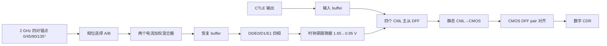

# RX 相位插值器、采样器与 CMOS 读出

> **当前修订**：首版 64 码 PI [pi_rotator](../../analog/rx/pi/spice/pi_rotator.spice)、四相静态 CML 采样 [rx_half_rate_samples](../../analog/rx/sampler/spice/rx_half_rate_samples.spice)、静态 CMOS 读出与 pair 对齐 [rx_cmos_pair_align](../../analog/rx/sampler/spice/rx_cmos_pair_align.spice)（[配置](../../config/rx_cdr.toml)）。
> **关键数字**：PI 64 码全部单调前进，DNL −0.134…+0.122 LSB，最大 |INL| 0.0096 UI；真实 PI + CTLE + 采样器在码 0/4/8 下 51 位比较全部正确，早晚票方向与负反馈一致。
> **主要缺口**：只有 TT；锚点是理想相关多相源，没接原生 PLL；pair 对齐依赖全速 CML→CMOS（SS 冷角失效）；孔径/失调/亚稳态未表征。

## 电路

| 部分 | 参数 |
|---|---|
| PI 输入 | 四对锚点各经 CML 隔离 buffer；互补极性补齐 8 个锚点 |
| PI 混合器 | 8 个等权真实 MOS 尾电流单元，温度计码分配 A/B；负载 600 Ω、每腿 200 fF；两个混合器锚点相差 90° |
| PI 恢复 buffer | 输入 W = 48 µm、尾 12 µm、600 Ω |
| 码 → 相位 | c = 8q + f，每码 7.8125 ps = 0.03125 UI；偶数扇区 A = q、B = q + 1，奇数扇区交换 |
| 采样输入 buffer | W = 24 µm、尾 12 µm、600 Ω |
| 采样 DFF | 数据/保持/时钟/尾 = 16/48/32/12 µm，600 Ω；四相顺序 D1 → E0 → D0 → E1，每段 125 ps |
| CMOS 读出 | 静态数据接收器（源跟随 + 镜像负载差分级 + 两级反相器），支持长同码 |
| pair 对齐 | 公共时钟取自 EDGE 相位经全速 CML→CMOS 和两级 buffer；四个 CMOS DFF 重定时；E0 加两反相器 + 20 fF 延迟 |

## 已验证结果

### PI 静态 64 码（理想 2 GHz、400 mVpp 锚点，每腿 20 fF）

| 量 | 结果 |
|---|---:|
| 步长 | 6.765–8.768 ps（名义 7.8125 ps） |
| DNL | −0.134…+0.122 LSB |
| 最大 \|INL\| | 2.394 ps = 0.0096 UI |
| 输出差分摆幅 | 365.5–393.2 mVpp |
| bank 功耗 | 5.04 mW（不含参考支路 1.53 mW） |

规定序列（62 → 63 → 0 → 1 → 2 → 1 → 0 → 63 → 62）的正反向回卷没有多余/缺失过零或窄脉冲；不是任意时刻跳码无毛刺的证明。来源：[PI 首版](../history/rx_pi_first_design.md)。

### 真实 PI + CTLE + 采样器（理想锚点、理想 PRBS7 输入）

| PI 码 | 错误 | 最小输出判决裕量 | 早/晚票 |
|---|---:|---:|---:|
| 0 | 0/51 | 196.4 mV | 0/22 |
| 4 | 0/51 | 197.3 mV | 11/11 |
| 8 | 0/51 | 190.6 mV | 22/0 |

采样组功耗约 9.3 mW（含输入 buffer、时钟移位、四个 DFF）。RTL 交接器的正/反向回卷轨迹驱动真实 PI/CTLE/采样器，144 位比较全部正确。来源：[采样与控制](../history/rx_sampler_control.md)。

### CMOS 读出与 PCB 短窗

CMOS 读出后码 0/4/8 各 48 位对齐数据零错位；读出后的鉴相零点在码 4–8 之间，与 CML 符号判读的码 4 不同。真实 TX 驱动/封装/C2/端接/CTLE EQ11/PI/采样/CMOS 读出串联 24 ns：80 位零错误，3 个 payload 字经解串 RTL 正确。来源：[RX 闭环](../history/rx_cdr_closed_loop.md)。

## 适用范围

- 只有 TT；锚点为理想相关多相源；输入为确定码型。
- 读出与对齐用固定延迟方案，只验证 TT；读出在公共时钟后 350 ps。
- 约 190 mV 是输出判决裕量，不是输入灵敏度；孔径、setup/hold、失调、kickback、亚稳态未表征。

## 待解决

- RX PVT（[问题清单](../status/open_issues.md) I-14）。
- pair 对齐对全速 CML→CMOS 的依赖（I-04）；物理 16 UI 降速/整字保持（I-15）。
- 鉴相零点与孔径偏移校准（I-23）。
- 接原生 PLL 八相，确认扇出与相位顺序（I-30）。
