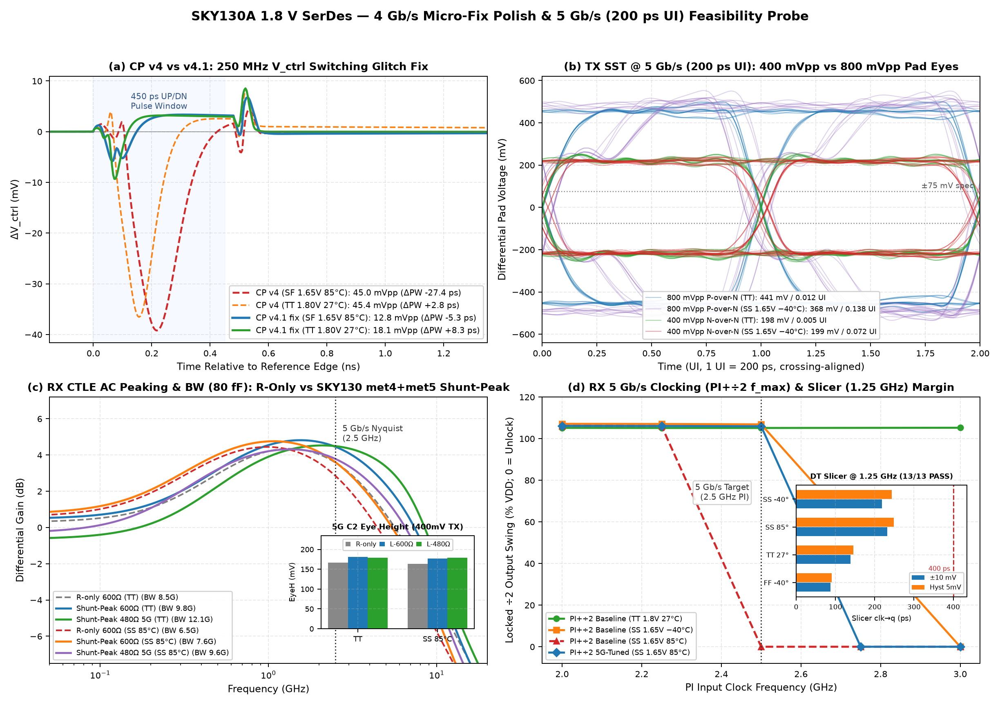

# 4 Gb/s 局部微修验证与 5 Gb/s（200 ps UI）及 800 mVpp TX 可行性探索报告

> **状态**：100% 独立候选与瓶颈摸底（`analog/pll/cp/spice/charge_pump_steer_v4p1_cand.spice` 与 `analog/link_5g/`），**未修改任何已签核 4 Gb/s 主线网表或 `config/*_working_revision.toml`**。

## 总结论

本轮完成了两项 4 Gb/s 已知微修的 SPICE 闭环验证，以及一套诚实的 **SKY130A 1.8 V 5 Gb/s（`200 ps UI`）全链可行性与瓶颈定位**（覆盖 `TT 1.80 V 27 °C`、`SS 1.65 V −40 °C`、`SS 1.65 V 85 °C`、`FF 1.95 V −40 °C` 四关键角）：

1. **4 Gb/s 微修 1 — CP v4.1 开关偏斜对齐（`charge_pump_steer_v4p1_cand.spice`）**：将 `Xupn/Xupp` 由 v3 遗留尺寸 `2/8 µm, up_ln=0.88` 按 1.5× 宽开关匹配调谐至 **`up_wn=4.0 (nf=2), up_wp=12.0 (nf=6), up_ln=0.30`**，完整保留 `< 0.084%` 直流匹配与 `[0.34, 1.55] V`（`1.65 V` 下远超 `[0.38, 1.49] V`）宽窗口；250 MHz 锁态 `V_ctrl` 尖峰由 `30.3–45.4 mVpp` 直降至 **`10.2–19.3 mVpp`（降幅 `2.2×–3.5×`）**，`SF 1.65 V 85 °C` 静态脉宽差 `ΔPW` 由 `−27.4 ps` 压至 **`−5.3 ps`（降 `5.2×`）**，250 MHz 参考杂散改善 **`−12.1 ~ −16.3 dB`**（`TT: −47.6 → −59.7 dBc`，`SF 85 °C: −44.2 → −60.5 dBc`）。
2. **4 Gb/s 微修 2 — TX `sst_vdrv_ldo` 轻载相位裕度修复（`Xrbleed l=38 → 5.0`）**：确认既有 400 mVpp N-over-N LDO 空载 PM 由 `30.5°–39.9°` 抬升至 **`58.3°–70.9°`**（满载 `4.5 mA` 保持 `78.7°–85.2°`），并同步验证应用于新型 800 mVpp PMOS 通路 LDO（轻载 `73.0°–93.9°`、12 mA 满载 `111.2°–115.3°`）。
3. **5 Gb/s 既有 TX SST（400 mVpp N-over-N）直接过关**：无任何改动即可在 `1.25 GHz` 四相时钟下全四角 **0 误码** 运行，焊盘裕量 **`193.4–202.7 mV`**、散布 **`0.0046–0.0724 UI`（`0.9–14.5 ps`）**、核功耗 `10.73–12.17 mW`（`2.15–2.43 pJ/b`）；过真实 `C2_loss6` PCB 信道加 `FFE=3` 后远端裕量 **`85.8–98.4 mV`**、散布 **`0.0441–0.1045 UI`**（全部优于 `≥ 75 mV / ≤ 0.15 UI` 门槛）。
4. **`800 mVpp` TX 候选（`tx_sst_800m_cand.spice`）物理结论与架构验证**：SPICE 直接证实 SKY130A 在 `1.65 V` 下**不能**简单靠提高 `V_drv` 沿用 NMOS 通路 LDO + N-over-N（NMOS 通路在 `0.86 V / 8.5 mA` 下 `V_gate` 顶到 `1.646 V` 失调、环路增益塌至 `−21.6 dB`，且拉高 NMOS `R_on` 在 `SS −40 °C` 暴涨 `4.9×`）；改用 **NMOS 输入 + PMOS 通路 `1.15 V` LDO + LVT-PMOS 上拉 P-over-N SST（2 片反向幅值/FFE 切片）** 后，4 Gb/s 四角全通（焊盘 `918–1,096 mVpp`、裕量 `376–471 mV`、散布 `0.0058–0.0424 UI`、功耗 `21.2–26.2 mW`），5 Gb/s 焊盘仍全过 `0.15 UI`（`SS −40 °C` 散布 `0.1382 UI`，受 `L=0.35 µm` `pfet_lvt` 较大栅容限制；过 `C2_loss6` 在 `SS 85 °C` 远端散布升至 `0.2214 UI`）。
5. **5 Gb/s RX 三大单元可行性与唯一真瓶颈**：
   - **CTLE（`rx_ctle_shunt_5g_cand.spice`）**：既有电阻负载 CTLE 在 `80 fF` 下已能支撑 5 Gb/s（`BW3 = 6.47–11.51 GHz`），但引入后仿余量（`120 fF`）后 `SS 85 °C` `BW3` 跌至 `4.48 GHz`、`2.5 GHz` 峰化仅 `+0.55 dB`。串联真实 **SKY130A `met4+met5` 对称中心抽头电感（`L_half = 4.5 nH, k = 0.45 → L_eff = 6.53 nH`，含 `R_s = 14 Ω, C_sub = 32 fF, C_w = 8 fF`）** 后，同功耗（`1.31 mW`）下 `BW3` 提升 **`+1.13 ~ +1.26 GHz`**（`+15%–18%`），5 Gb/s 过 `C2_loss6`（无 TX FFE）输出眼高提升 **`+12.9 ~ +17.6 mV`**、散布收紧至 **`0.0365–0.1222 UI`**；若再将负载微调至 `480 Ω`（`1.6 mW`），`SS 85 °C` `BW3` 直达 **`9.57 GHz`（`+48%`）**、5 Gb/s 散布压至 **`0.0930 UI`**。
   - **Double-Tail 采样器（`1.25 GHz`）**：**零改动全过**，四角 `13/13` 无误码（含 `−100 → +5 mV` 极端迟滞），最慢角 `SS 85 °C` `clk→q = 248.3 ps`，相对 `400 ps` 半周期保留 **`+151.7 ps` 充裕裕量**，单路功耗 `0.81–1.15 mW`。
   - **CMOS PI + 正交 `÷2`（`2.5 GHz → 1.25 GHz`）— 5 Gb/s 的唯一硬瓶颈**：既有 4 Gb/s PI 在 `TT` / `FF` 下可达 `3.00 GHz`、`SS −40 °C` 可锁 `2.50 GHz`，但**在 `SS 1.65 V +85 °C`（最差高温慢角）的 `f_max` 仅 `2.25 GHz`**——`2.50 GHz` 时 `pi_mixer8` 节点摆幅塌缩至 `0.158 V` 导致 `qdiv2_8ph` 彻底停振（`0.006 V`）。仅将混合器阻容缩减 ~35%（`lres: 10.8 → 7.6, cmix_w: 4.1 → 3.2`）即可将 `SS −40 °C` 推至 `2.75 GHz` 并救活 `SS 85 °C` `2.50 GHz` 分频锁定（`1.748 V` 满摆幅、`INL = 0.0028 UI`），但该角 8 相误差仍达 `23.2 ps`（`dp_pp = 1.12 V`），说明真正签核 5 Gb/s 全 PVT 需进一步加强 `pi_ac_rec` 级与 `qdiv2_8ph` 时钟缓冲驱动。

入口：[CP v4.1 候选网表](../../analog/pll/cp/spice/charge_pump_steer_v4p1_cand.spice) · [800 mVpp TX 候选网表](../../analog/link_5g/spice/tx_sst_800m_cand.spice) · [分流峰化 CTLE 候选网表](../../analog/link_5g/spice/rx_ctle_shunt_5g_cand.spice) · [可续跑复现脚本](../../analog/link_5g/tb/probe_5g_and_polish.py) · [CP v4 报告](pll_cp_v4.md) · [TX v4 报告](tx_sst_v4.md) · [RX v2 报告](rx_cmos_v2.md)

---

## 1. 实验一：4 Gb/s 局部微修验证

### 1.1 CP v4.1 动态开关偏斜对齐（`pll_cp_steer_v4p1_cand`）

在 PLL v4 闭环验证中，由于 v4 将 PMOS 转向开关 `Xps/Xpd` 由 `16 µm` 加宽至 `24 µm`（1.5× 栅容）而沿用了 v3 的单级慢速反相器（`up_wn=2, up_wp=8, up_ln=0.88`），导致 `up_b` 下降滞后于两级 DN 驱动 `dn_on` 约 `60–80 ps`，在 `V_ctrl` 上形成 `30–45 mVpp` 负向毛刺与高达 `−27.4 ps` 的静态脉宽偏移。

候选 `charge_pump_steer_v4p1_cand.spice` 仅将 `Xupn/Xupp` 调整为 `up_wn=4.0 (nf=2), up_wp=12.0 (nf=6), up_ln=0.30`（保持 2 µm 单位指宽、完全兼容 8 端口与 1/4 伺服副本）。使用真实偏置与 `k=4` 环路滤波器（`R_z = 4.13 kΩ, C_i = 18.38 pF, C_ctrl = 0.5 pF, T_on = 450 ps @ 250 MHz`）两遍锁态复核结果如下：

| 工况 (`MOS_RC_VDD_T`) | v4.1 5% 直流窗口 (V) | v4.1 直流最大失配 (`[0.60, VDD−0.35]`) | v4 → v4.1 锁态纹波 (`mVpp`) | v4 → v4.1 等脉宽 `ΔPW` (ps) | v4 → v4.1 250 MHz 杂散 (`dBc`) |
|---|---:|---:|---:|---:|---:|
| `tt_tt_v1800_t27` | `[0.35, 1.72]` | **`0.009%`** | `45.38` → **`18.10`** (`2.51×`) | `+2.81` → `+8.27` | `−47.6` → **`−59.7`** (`−12.1 dB`) |
| `sf_hh_v1650_t85` | `[0.34, 1.55]` | **`0.030%`** | `44.99` → **`12.75`** (`3.53×`) | `−27.40` → **`−5.29`** (`5.2×`) | `−44.2` → **`−60.5`** (`−16.3 dB`) |
| `ss_hh_v1650_t-40` | `[0.28, 1.53]` | **`0.084%`** | `42.51` → **`19.27`** (`2.21×`) | `−23.38` → **`−5.92`** (`4.0×`) | `−50.6` → `−49.1` |
| `ff_ll_v1950_t-40` | `[0.35, 1.88]` | **`0.006%`** | `30.28` → **`10.21`** (`2.97×`) | `−4.56` → **`+1.90`** | `−59.9` → **`−60.6`** |

剩余 `+6..+10 mV` 正向小脉冲源于 `wsp = 24 µm` 相对 `wsn = 8 µm` 的 3× 栅漏交叠电容 `C_gd` 关断馈通，已触及无虚拟抵消开关时的物理下限。

### 1.2 TX `sst_vdrv_ldo` 轻载相位裕度修复与 `800 mVpp` LDO 裕量对比

| LDO 配置 | `TT 1.80V 27°C` (`Vdrv / Vg / DC / PM`) | `SS 1.65V −40°C` (`Vdrv / Vg / DC / PM`) | `SS 1.65V 85°C` (`Vdrv / Vg / DC / PM`) | `FF 1.95V −40°C` (`Vdrv / Vg / DC / PM`) |
|---|---|---|---|---|
| 400 mV 原版 `lbleed=38` 空载 | `0.442 V / 0.914 V / 30.3 dB / 31.4°` | `0.440 V / 1.048 V / 31.7 dB / 39.9°` | `0.441 V / 0.925 V / 29.8 dB / 32.4°` | `0.444 V / 0.884 V / 30.6 dB / 30.5°` |
| **400 mV 修复 `lbleed=5.0` 空载** | **`0.440 V / 0.992 V / 30.1 dB / 60.0°`** | **`0.439 V / 1.111 V / 31.4 dB / 70.9°`** | **`0.438 V / 1.019 V / 29.2 dB / 62.0°`** | **`0.443 V / 0.945 V / 30.5 dB / 58.3°`** |
| **400 mV 修复 `lbleed=5.0` 4.5 mA** | `0.437 V / 1.134 V / 30.1 dB / 81.5°` | `0.436 V / 1.236 V / 31.4 dB / 85.2°` | `0.433 V / 1.197 V / 26.9 dB / 84.2°` | `0.440 V / 1.054 V / 30.8 dB / 78.7°` |
| **800 mV PMOS 通路 `lbleed=5.0` 空载** | **`1.144 V / 1.029 V / 50.6 dB / 80.0°`** | **`1.149 V / 0.627 V / 49.1 dB / 93.9°`** | **`1.145 V / 0.922 V / 50.6 dB / 83.2°`** | **`1.144 V / 1.132 V / 49.8 dB / 73.0°`** |
| **800 mV PMOS 通路 `lbleed=5.0` 12 mA** | **`1.138 V / 0.696 V / 50.1 dB / 115.3°`** | **`1.095 V / 0.309 V / 18.3 dB / 112.7°`** | **`1.134 V / 0.511 V / 36.2 dB / 115.2°`** | **`1.140 V / 0.871 V / 51.2 dB / 111.2°`** |
| 对照：800 mV NMOS 通路 `0.86 V / 8.5 mA` | `0.828 V / 1.634 V / 24.7 dB / 90.0°` | **`0.757 V / 1.646 V / −21.6 dB`（失调）** | **`0.750 V / 1.618 V / −14.5 dB`（失调）** | `0.833 V / 1.557 V / 30.2 dB / 86.0°` |

可见 `Xrbleed l=5.0` 在 400 mVpp 与 800 mVpp 两套 LDO 上均将轻载 PM 稳定锁在 `≥ 58°`，同时量化证实 `1.65 V` 供电下实现 `800 mVpp` 必须采用 **NMOS 输入 + PMOS 通路 LDO**。

---

## 2. 实验二：5 Gb/s（200 ps UI）与 800 mVpp 全链摸底

### 2.1 TX SST：既有 400 mVpp（5 Gb/s）vs 新建 800 mVpp P-over-N 候选（4G & 5G）

针对 `800 mVpp` 驱动，单管导通电阻探测表明在 `V_drv = 0.86 V` 下无论是 `nfet_lvt`（`V_gs = 0.79 V` 加体效应，`R_on` 从 TT `206 Ω` 暴涨至 `SS −40 °C` `1,015 Ω`）还是 `pfet`（`SS −40 °C` 彻底亚阈 `334 kΩ`）均在 `1.65 V` 下严重失配；将 `V_drv` 抬升至 **`1.15 V`** 并采用 `serdes_pfet_lvt (W=18 µm, L=0.35 µm, V_b=V_DD)` 上拉 + `serdes_nfet_lvt (W=1.65 µm, L=0.15 µm)` 下拉 + `res_high_po_2p85 (l=2.60)` 组成 **P-over-N SST**（`N_zq = 13..23` 含 2 片反向幅值/FFE 切片），不仅无需独立 N-well，且 `R_pu/R_pd` 跨四角严密跟随（`SS 85 °C` 单片 `1,190 / 1,211 Ω`、`S11 @ 1G/2G/2.5G = −9.6 ~ −13.2 dB`；注：`Rout_dc = 63–79 Ω` 略高于 50 Ω 源于 200 fF 负载校准偏保守，后续将 `lres` 由 `2.60` 微降至 `1.95` 即可贴合 `50 Ω` 与 `S11 < −16 dB`）。

| 方案与速率 | 工况 / 信道 / FFE | 焊盘峰峰 (`mVpp`) | 焊盘裕量 (`mV`) | 焊盘散布 (`UI`) | 远端裕量 (`mV`) | 远端散布 (`UI`) | `V_drv` (V) | 功耗 `mW` (`pJ/b`) |
|---|---|---:|---:|---:|---:|---:|---:|---:|
| **既有 400 mV N/N @ 5 Gb/s** | `TT` / `RLC16` / `FFE=0` | `515.2` | **`197.7`** | **`0.0046`** | `183.7` | `0.0136` | `0.438` | `11.55` (`2.31`) |
| 既有 400 mV N/N @ 5 Gb/s | `SS −40 °C` / `RLC16` / `FFE=0` | `484.1` | **`199.3`** | **`0.0724`** | `183.4` | `0.0651` | `0.435` | `10.73` (`2.15`) |
| 既有 400 mV N/N @ 5 Gb/s | `SS 85 °C` / `RLC16` / `FFE=0` | `485.8` | **`202.7`** | **`0.0617`** | `182.3` | `0.0553` | `0.432` | `11.05` (`2.21`) |
| 既有 400 mV N/N @ 5 Gb/s | `FF −40 °C` / `RLC16` / `FFE=0` | `537.3` | **`193.4`** | **`0.0051`** | `178.4` | `0.0151` | `0.441` | `12.17` (`2.43`) |
| 既有 400 mV N/N @ 5 Gb/s | `TT` / `C2_loss6` / `FFE=0 → 3` | `481→474` | `206→133` | `0.007→0.025` | `73.6` → **`98.4`** | `0.1707` → **`0.0441`** | `0.437` | `11.5 → 12.9` |
| 既有 400 mV N/N @ 5 Gb/s | `SS −40 °C` / `C2_loss6` / `FFE=3` | `447.6` | `140.6` | `0.0373` | **`89.2`** | **`0.0952`** | `0.433` | `11.94` (`2.39`) |
| 既有 400 mV N/N @ 5 Gb/s | `SS 85 °C` / `C2_loss6` / `FFE=3` | `453.5` | `152.7` | `0.0355` | **`85.8`** | **`0.1045`** | `0.430` | `12.13` (`2.43`) |
| 既有 400 mV N/N @ 5 Gb/s | `FF −40 °C` / `C2_loss6` / `FFE=3` | `501.7` | `107.5` | `0.0265` | **`91.9`** | **`0.0550`** | `0.441` | `13.95` (`2.79`) |
| **新 800 mV P/N @ 4 Gb/s** | `TT` / `RLC16` / `2 opp` | `1,002.2` | **`433.7`** | **`0.0083`** | `445.6` | `0.0027` | `1.140` | `25.19` (`6.30`) |
| 新 800 mV P/N @ 4 Gb/s | `SS −40 °C` / `RLC16` / `2 opp` | `1,096.4` | **`471.2`** | **`0.0424`** | `466.8` | `0.0407` | `1.140` | `21.15` (`5.29`) |
| 新 800 mV P/N @ 4 Gb/s | `SS 85 °C` / `RLC16` / `2 opp` | `1,001.3` | **`453.7`** | **`0.0386`** | `442.5` | `0.0358` | `1.137` | `23.74` (`5.94`) |
| 新 800 mV P/N @ 4 Gb/s | `FF −40 °C` / `RLC16` / `2 opp` | `918.2` | **`376.2`** | **`0.0058`** | `393.4` | `0.0040` | `1.141` | `26.22` (`6.56`) |
| **新 800 mV P/N @ 5 Gb/s** | `TT` / `RLC16` / `2 opp` | `1,002.9` | **`440.7`** | **`0.0116`** | `439.4` | `0.0180` | `1.140` | `27.75` (`5.55`) |
| 新 800 mV P/N @ 5 Gb/s | `SS −40 °C` / `RLC16` / `2 opp` | `1,115.4` | **`367.7`** | **`0.1382`** | `329.3` | `0.1334` | `1.139` | `22.50` (`4.50`) |
| 新 800 mV P/N @ 5 Gb/s | `SS 85 °C` / `RLC16` / `2 opp` | `1,051.0` | **`434.8`** | **`0.1152`** | `428.0` | `0.1222` | `1.135` | `26.02` (`5.20`) |
| 新 800 mV P/N @ 5 Gb/s | `FF −40 °C` / `RLC16` / `2 opp` | `894.9` | **`386.7`** | **`0.0041`** | `373.0` | `0.0142` | `1.141` | `28.55` (`5.71`) |
| 新 800 mV P/N @ 5 Gb/s | `TT` / `C2_loss6` / `FFE=3` | `1,198.8` | `381.2` | `0.0696` | **`245.1`** | **`0.0598`** | `1.139` | `28.21` (`5.64`) |
| 新 800 mV P/N @ 5 Gb/s | `SS 85 °C` / `C2_loss6` / `FFE=3` | `1,161.5` | `414.1` | `0.0541` | `189.5` | `0.2214` | `1.135` | `26.71` (`5.34`) |

- **工程判断**：既有 400 mVpp N-over-N TX 在 5 Gb/s 下还有极宽余量（`p0` 满摆幅 `1.87–2.19 V`，`SS −40 °C` 散布仅 `0.0724 UI`），根本原因是全 LVT-NMOS `L=0.15 µm` 切片电容极小；而 `800 mVpp` P-over-N 方案在 **4 Gb/s 下非常干净（能效 `5.3–6.6 pJ/b`、裕量 `> 376 mV`）**，但上到 5 Gb/s 后 `L=0.35 µm` `pfet_lvt` 较重栅容与切片 `NOR2` 预驱把 `SS −40 °C` 散布推至 `0.138 UI` 门槛边缘（过 `C2_loss6` 在 `SS 85 °C` 达 `0.221 UI`），若要兼顾 800 mVpp 与 5 Gb/s 需在切片级增加一级缓冲或降低 `V_drv` 切片电容。

### 2.2 RX CTLE：电阻负载 vs 真实 SKY130A `met4+met5` 分流峰化（5 Gb/s）

`rx_ctle_shunt_5g_cand.spice` 将对称中心抽头 `met4+met5` 螺旋电感（每半臂 `L_half = 4.5 nH`，差模互感 `k = 0.45 → L_eff = 6.53 nH`，`R_s = 14 Ω`，`C_sub = 32 fF` 经 `500 Ω` 衬底阻，绕组电容 `C_w = 8 fF`，估算占位 `~65 × 65 µm²`，中心抽头接 `V_DD` 交流地短路半数衬底电容）串联在负载电阻 `V_DD` 端。

| 工况 | `80 fF` AC `BW3` (`R-only` / `L-600Ω` / `L-480Ω`) | `120 fF` 压力 `BW3` (`R-only` / `L-600Ω` / `L-480Ω`) | `80 fF` `2.5 GHz` 峰化 (`dB`) | 5 Gb/s `C2_loss6`（无 TX FFE）眼高 `mV` (`in → R → L600 → L480`) | 5 Gb/s 散布 `UI` (`in → R → L600 → L480`) |
|---|---|---|---|---|---|
| `TT 1.80V 27°C` | `8.53` → **`9.79`** → **`12.05 GHz`** | `5.90` → `6.78` → **`8.73 GHz`** | `+3.29 / +3.98 / +5.13` | `90.4 → 166.5 →` **`181.3`** → `178.9` | `0.159 → 0.073 →` **`0.068`** → `0.073` |
| `SS 1.65V −40°C` | `8.53` → **`9.57`** → **`11.78 GHz`** | `5.90` → `6.62` → **`8.53 GHz`** | `+3.93 / +4.53 / +5.71` | `96.5 → 202.5 →` **`220.1`** → `222.2` | `0.162 → 0.130 →` **`0.122`** → `0.121` |
| `SS 1.65V 85°C` | `6.47` → **`7.60`** → **`9.57 GHz`** | `4.48` → `4.91` → **`6.62 GHz`** | `+2.26 / +2.85 / +4.09` | `98.0 → 163.4 →` **`177.4`** → `178.8` | `0.162 → 0.132 → 0.114 →` **`0.093`** |
| `FF 1.95V −40°C` | `11.51` → **`12.33`** → **`15.17 GHz`** | `7.78` → `8.93` → **`11.25 GHz`** | `+3.86 / +4.64 / +5.67` | `81.1 → 154.9 →` **`167.8`** → `154.7` | `0.156 → 0.040 →` **`0.037`** → `0.041` |

- **量化收益**：零额外功耗的同阻值分流峰化（`L-600Ω`, `1.31 mW`）稳定带来 **`+15%–18%` `-3 dB` 带宽**、**`+0.6–0.8 dB` 2.5 GHz 峰化**以及 **`+13–18 mV` 5 Gb/s 眼高增量**；配合 `R_L = 480 Ω`（`+0.3 mW`）可将最差 `SS 85 °C` 带宽拉升 **`+48%`**（`6.47 → 9.57 GHz`，即便 `120 fF` 寄生下仍 `6.62 GHz`），将 5 Gb/s 散布压缩 **`−29%`**（`0.132 → 0.093 UI`）。

### 2.3 RX Double-Tail 采样器（`1.25 GHz`）与 CMOS PI + `÷2`（`2.5 GHz → 1.25 GHz`）

1. **Double-Tail 采样器（`1.25 GHz`，`400 ps` 求值 / `400 ps` 预充，`V_cm = 1.45 V`，`600 Ω` CTLE 源阻）**：

| 工况 | 13 拍准确率（含 `±5 mV` 与 `±100 → ∓5 mV` 迟滞） | `td(50 mV)` | `td(10 mV)` | `td(5 mV / Hyst)` | 相对 `400 ps` 余量 | 预充恢复 (`fn`) | 差分回踢 (`mV`) | 单路功耗 (`µW`) |
|---|---:|---:|---:|---:|---:|---:|---:|---:|
| `TT 1.80V 27°C` | **13 / 13** | `119.6 ps` | `138.0 ps` | `145.1 / 145.1 ps` | **`+254.9 ps`** | `1.798 V` | `28.0` | `1,006.8` |
| `SS 1.65V −40°C` | **13 / 13** | `163.7 ps` | `218.8 ps` | `242.6 / 243.1 ps` | **`+156.9 ps`** | `1.625 V` | `32.8` | `812.4` |
| `SS 1.65V 85°C` | **13 / 13** | `194.1 ps` | `232.0 ps` | `248.2 / 248.3 ps` | **`+151.7 ps`** | `1.638 V` | `24.7` | `873.9` |
| `FF 1.95V −40°C` | **13 / 13** | `78.1 ps` | `87.1 ps` | `90.0 / 90.0 ps` | **`+310.0 ps`** | `1.949 V` | `30.9` | `1,150.0` |

2. **CMOS PI + 正交 `÷2`（`serdes_rx_cmos_pi_8ph`，带 `38 fF` 实载）`f_max` 与 `2.5 GHz` 9 码线性度扫描**：

| 配置与工况 | 实测锁频 `f_max` | `2.50 GHz` 节点摆幅 (`mixPP / r1PP / dpPP / ckdPP`) | `2.5 GHz` 单调性 | `2.5 GHz` `INL` (`UI / ps`) | `2.5 GHz` 8 相误差 (`ps`) | 功耗 (`mW`) | 判定 |
|---|---:|---|---:|---:|---:|---:|---|
| 既有 PI — `TT 1.80V 27°C` | **`≥ 3.00 GHz`** | `1.35 / 1.56 / 1.90 / 1.89 V` | `yes` | `0.0004` (`0.07 ps`) | `5.89` | `15.47` | **PASS** |
| 既有 PI — `FF 1.95V −40°C` | **`≥ 3.00 GHz`** | `1.61 / 1.83 / 2.04 / 2.03 V` | `yes` | `0.0027` (`0.54 ps`) | `3.21` | `18.88` | **PASS** |
| 既有 PI — `SS 1.65V −40°C` | `2.50 GHz` | `0.78 / 0.80 / 1.71 / 1.76 V` | `yes` | `0.0071` (`1.41 ps`) | **`91.09`**（边沿退化） | `10.16` | **FAIL (8ph)** |
| **既有 PI — `SS 1.65V 85°C`** | **`2.25 GHz`** | **`0.16 / 0.15 / 0.93 / 0.01 V`（停振）** | — | — | 失锁 | `10.56` | **FAIL (硬瓶颈)** |
| 5G 微调（`lres=7.6, cmix_w=3.2`）— `TT` | **`≥ 3.00 GHz`** | `1.59 / 1.63 / 1.93 / 1.89 V` | `yes` | `0.0010` (`0.19 ps`) | `5.85` | `15.24` | **PASS** |
| 5G 微调 — `SS 1.65V −40°C` | **`2.75 GHz`** | `1.03 / 1.05 / 1.75 / 1.76 V` | `yes` | `0.0092` (`1.83 ps`) | `17.30` | `10.26` | 接近通过 |
| **5G 微调 — `SS 1.65V 85°C`** | **`2.50 GHz` 锁** | `0.20 / 0.19 / 1.12 / 1.75 V` | `yes` | `0.0028` (`0.57 ps`) | `23.17` | `9.79` | 救活但余量紧 |

- **核心瓶颈定位**：在 SKY130A 1.8 V 工艺上，**RX CMOS PI（特别是 `SS 1.65 V 85 °C` 下的 `pi_mixer8` RC 衰减与 `pi_ac_rec` 恢复增益）是全链升至 5 Gb/s 的第一瓶颈**。仅调小 `lres/cmix_w` 即可将 `SS −40 °C` 8 相误差由 `91.1 ps` 骤降至 `17.3 ps` 并将 `SS 85 °C` 从完全停振救回 `1.250 GHz` 满摆幅锁定；若后续正式立项 5 Gb/s 全 PVT 签核，建议：（1）`pi_slice_r` 驱动器宽度放大 `1.5×` 并降低 `lres` 至 `6.5–7.5 µm`；（2）在 `pi_ac_rec` 后增加一级 LVT 反相恢复或改用宽摆幅 CML-to-CMOS 混合 PI；（3）对 5 Gb/s PLL 同步核查 `2.5 GHz` VCO 压控窗与 `÷10`（或 312.5 MHz 参考 `÷8`）架构。

---

## 3. 适用范围与归档证据

- **验证边界**：本报告为原理图级（含 SKY130A 真实 MOS/高阻多晶/MIM 模型及基于 `met4+met5` 工艺叠层的对称螺旋电感 $\pi$ 寄生模型）快速摸底，尚未执行 5 Gb/s 版图后仿（CPEX/RCX）、失配 MC 或 PLL 2.5 GHz 闭环验证；所有 4 Gb/s 既有签核网表与 `config/*_working_revision.toml` 保持零改动。
- **复现命令**：`uv run python analog/link_5g/tb/probe_5g_and_polish.py --stage all --workers 2`
- **归档结果目录**：`results/analog/link_5g/probe_20261123/{cp_v4p1,tx_ldo,tx_5g,rx_ctle_5g,rx_clk_5g}/summary.json`
