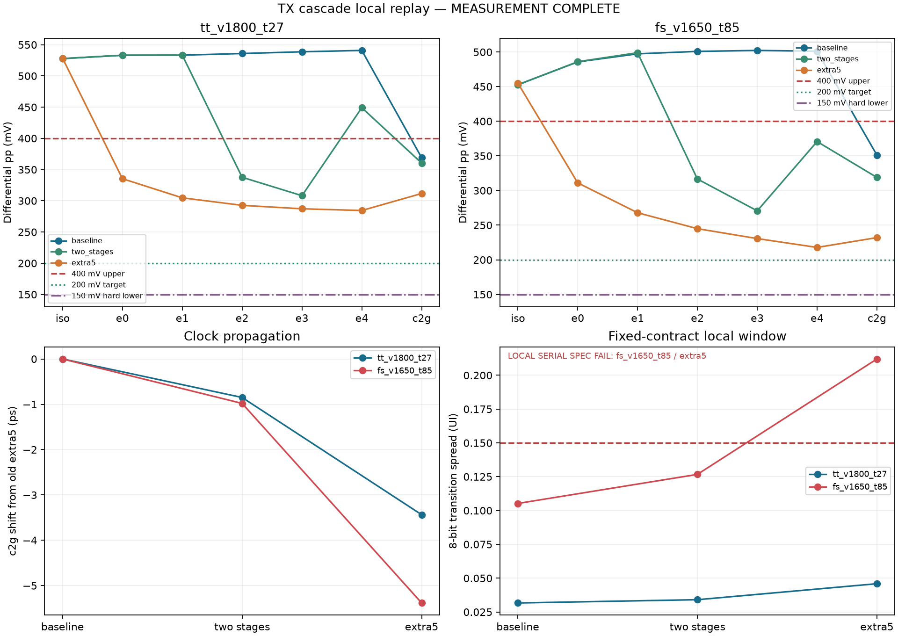

# TX 时钟缓冲：级联减幅与增益

**五个extra级统一改为WT12.8µm/名义320Ω不采用：FS低压热的局部位中心裕量69.75mV、边沿散布0.2120UI，两项均不满足75mV/0.15UI。** 五级输出已降到218–311mVpp，不能以摆幅或八位零错替代眼图门槛。当前完整TX采用候选保持不变，I-17仍开。



## 边界与比较

沿用[单级卡](tx_buffer_local.md)的TT及FS1.65V85°C两个已校准extra5切片，固定录制的理想PWL数据、时钟、偏置和电源；6.5ns测试，4.0–6.4ns观察、八位296–303固定合同。负载为原slice/driver/RLC16，无上游阻抗、共享偏置反馈、原生PLL或新PVT资格。

三分支分别为原基线、只改Xe2/Xe3、改Xe0…Xe4；后两者都使用WN24、WT12.8、名义R320。Xiso保持24/16/400，Xout保持32/16/240；电阻使用冻结的PDK映射。新增保存iso及e0…e4双端，不由末端波形猜测中间级。

基线逐节点波形、输入和原extra5串化边沿均复现；仍保留最初extra3到本次c2g的实际传播，再施加原训练相位。没有拟合八位数据相位。窗口只核对原位序合同，不足以独立恢复完整16位映射。

## 结果与判定

| 条件 | 方案 | e3 / e4 / c2g差分mVpp | 位中心裕量mV | 散布UI | 局部串化门槛 |
|---|---|---|---:|---:|---|
| TT | 原基线 | 538.7 / 540.9 / 368.9 | 140.05 | 0.03166 | 满足 |
| TT | 两级 | 308.2 / 449.1 / 360.4 | 138.60 | 0.03407 | 满足；e4仍超幅 |
| TT | 五级 | 287.2 / 284.4 / 311.7 | 129.62 | 0.04589 | 满足；iso仍超幅 |
| FS低压热 | 原基线 | 502.3 / 501.1 / 351.1 | 105.92 | 0.10522 | 满足 |
| FS低压热 | 两级 | 270.7 / 370.7 / 318.9 | 96.29 | 0.12671 | 满足；前部仍超幅 |
| FS低压热 | 五级 | 230.6 / 217.9 / 232.0 | **69.75** | **0.21204** | **失败，不采用** |

表中幅度是观察窗极值；每个完整周期和共模另存数据。五级TT/FS的e4最弱完整周期为284.05/217.34mVpp，c2g为310.60/230.56mVpp，均在200mV设计目标以上；这仍不能保证后级时序。所有分支八位采样零错、六个转换无缺沿或额外交越；FS五级的规格失败独立记录，不降格为通过。其c2g相对原extra5提前5.38ps，两级提前0.98ps。

iso在五级方案仍约528/455mVpp，且其他时钟、计数器、数据树与保持级未改。不能把五个extra级幅度符合性写成整个I-17已闭合。

## 模型预测与校准

开跑前用单轴及联合卡的五组实测，将未改动Xe3的2GHz幅度关系拟合为`A × tanh(g × Vin/A)`，再乘单级联合参数的实测降幅比。原级小幅增益拟合TT2.026、FS1.707；统一降幅的近似增益分别1.276、1.076，提示FS级联更脆弱。这是幅度近似，未预测关闭时序。

两级e3预测297.82/261.54mVpp，实测308.19/270.67，残差+10.37/+9.13mV、约+3.5%。样本内残差仅2.2–2.8mV，不能用作新级联预测误差。五级代理末端约267/202mV，实测284/218；代理输入及末级WN32负载不同，保留为粗规划，不作精确资格。幅度模型不能从这些结果推出眼图一定通过。

模型[源码](../../analog/tx/clock_distribution/theory/buffer_cascade_plan.py)、[仿真前数据](../data/tx_buffer_cascade_plan.json)已保存到campaign中的独立副本，发布器重算并逐项核对。下一步提高extra级的保留增益。由16→12.8µm单轴幅度作线性插值，再乘实测R320比例，WT14/14.4的单级TT粗预测为372.5/384.1mVpp、FS348.5/359.4mVpp；这是下一次局部比较的依据，不是级联预测。先比较这两个局部点及必要的输出驱动调整；同时约束最强点400mV上界、最弱点时序与完整周期摆幅。候选未仿真，不能当作选定参数。若参数约束无解，再比较隔离驱动或分离增益与限幅的结构。

## 证据与测量复核

[数据](../data/tx_buffer_cascade.json)、[索引](../../results/catalog/tx_buffer_cascade.json)固定`buffer_cascade_card/20261110T164906Z_4d3aeb7f`及分析`20261110T165149Z_31761fae`。每条件独立冒烟后正式运行，单worker；逐一检查源/边界/模型/工具/deck、执行状态及完整终点，发布时独立复算全部原始指标。运行成功和`measurement_complete`仅表示完成测量。

测量器另做两个内存故障注入：去掉第三支路时钟，以及插入不影响位中心的窄毛刺。后者仍零位错，但检出两个额外交越并判功能失败；两种情况均保留基线与另一个候选。该检查是测量器验证，不是DUT仿真，结果保留在campaign的`measurement_fault_checks.json`。

```bash
uv run python verification/plotting/tx_buffer_cascade.py --campaign results/analog/tx/buffer_cascade_card/20261110T164906Z_4d3aeb7f --summary results/analog/tx/buffer_cascade_card/20261110T164906Z_4d3aeb7f/analysis/20261110T165149Z_31761fae/summary.json --prediction results/analog/tx/buffer_cascade_card/20261110T164906Z_4d3aeb7f/sizing_model_before_run.json
```

实际R、尾管Id/Vdsat、支路电流/功耗及噪声仍未直接测量。实际源/偏置、SS/FF压力点、45MOS及机理相关无源角和完整TX回归继续保留。
