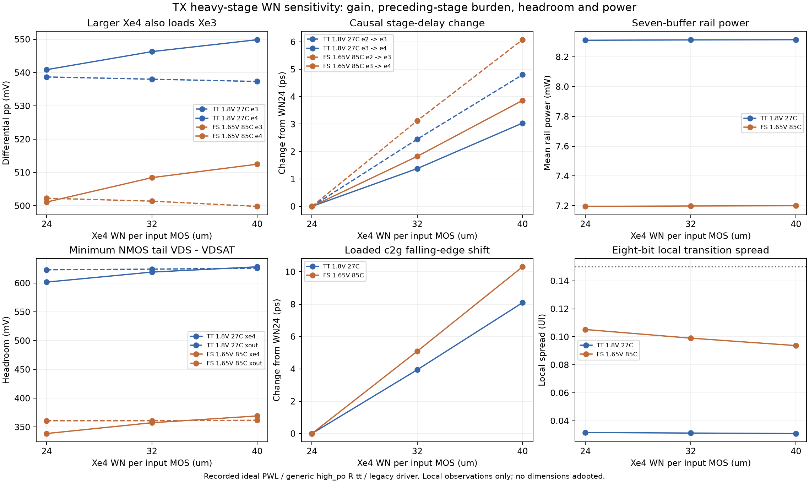

# TX 末级 extra 输入宽度与重负载卡

**输入管加宽主要改变了这条链的延迟，当前强输入点的幅度收益很小。暂不采用新尺寸。** Xe4 的 WN 从24加到40µm，加载后的c2g下降沿后移TT **8.09ps**、FS **10.31ps**；Xe4差分摆幅只增加9.00/11.36mV。前一级Xe3也变慢，不能只按Xe4的gm增加判断收益。本卡补充局部sizing灵敏度；[完整TX需求](tx_retime_demand.md)及[联合尺寸合同](tx_buffer_sizing.md)继续保留。



## 边界与仿真前假设

沿用已校准的`buffer_matrix_card/20261110T172325Z_dda392af`，三条数学分支都恢复为原uniform extra5：Xiso和Xe0…Xe4的WT16/R400，Xout为WN32/WT16/R240；只让Xe4的WN取24/32/40µm。**WN是每支输入MOS跨四指的总宽，两个输入管各取这个宽度，NF始终为4。** 真实冻结的保持/MUX与后级负载保留，未换成理想电容。

输入、两组数据、VDD及bias是登记过的理想PWL，电阻是旧通用`res_high_po`映射的tt角。负载中的driver为旧pre150/WT48/out256；当前完整TX是pre120/WT60/out192。因此八位窗结果不能升级为当前完整TX资格。完整仿真6.5ns，测量4.0–6.4ns；TT1.8V/27°C与FS1.65V/85°C两条件。每点先跑1.001ns冒烟，确认完整器件向量，再跑完整窗口；本轮最多一个ngspice。

仿真前在campaign的`hypothesis.json`记录：固定电流时，长沟道近似gm随√W、输入栅面积随W增加；加宽可能改善电流转向/尾管余量，同时增加Xe3的输入负担和Xe4自己的漏结负担。没有用这两个比例预言眼图通过，也未承诺精确延迟。三个变量倍率为1/1.333/1.667，√W倍率1/1.155/1.291。器件仿真用于校准该假设。

## 幅度、延迟与功耗

| 条件 | Xe4 WN µm | Xe3 / Xe4差分pp mV | c2g下降沿相对WN24 ps | 七级时钟链供电 mW | Xe4尾管最小VDS−VDSAT mV |
|---|---:|---:|---:|---:|---:|
| TT | 24 | 538.69 / 540.87 | 0 | 8.3111 | 601.64 |
| TT | 32 | 538.01 / 546.30 | +3.94 | 8.3134 | 619.05 |
| TT | 40 | 537.33 / 549.87 | +8.09 | 8.3148 | 628.18 |
| FS | 24 | 502.26 / 501.12 | 0 | 7.1955 | 338.65 |
| FS | 32 | 501.39 / 508.45 | +5.09 | 7.1984 | 357.41 |
| FS | 40 | 499.80 / 512.48 | +10.31 | 7.2001 | 369.18 |

加宽到40时，Xe2→Xe3平均传播增加TT4.80/FS6.08ps，Xe3→Xe4自身再增加3.04/3.86ps。上、下沿分别保留逐事件因果配对，不对一个周期取模；缺事件、重复事件或多个可能输入会报错。这使前级负担与本级延迟可以分别进入规划。

Xe4两个输入管的gm之和时间平均值增加TT27.8%/FS23.6%，但Xe4幅度只增加1.7%/2.3%，c2g幅度只由368.94→369.41 / 351.09→353.26mVpp。这里是约500mVpp的强输入，电流转向已较充分；该gm统计也不是小信号差分增益。不能据此推断约340mVpp弱输入或独立共模扰动下的传递函数。

Xe4尾流均值为TT659.9→661.5µA、FS623.2→625.5µA，尾管VDS−VDSAT在整个窗口均为正；Xout最小余量也为TT623/FS361mV左右。**当前点没有显示尾管失饱和是主要限制。** 这里只测尾管，不据此宣布输入管、保持级和全部节点的应力/余量合格。

时钟链七级包括Xiso、五个extra和Xout。用零伏源单独测其VDD电流，按时间加权计算VDD×I；WN24→40仅增加TT3.71/FS4.59µW。它不包含输入/bias理想源能量、其他TX支路、偏置、终端或PLL，不能作为整个TX/SerDes功耗。面积、噪声和失配尚未建模。

## 局部消费方观察与下一步

| 条件 | Xe4 WN µm | 八位最低有符号裕量 mV | 八位边沿散布 UI |
|---|---:|---:|---:|
| TT | 24 / 32 / 40 | 140.05 / 141.24 / 141.44 | 0.03166 / 0.03125 / 0.03092 |
| FS | 24 / 32 / 40 | 105.92 / 105.00 / 103.82 | 0.10522 / 0.09905 / 0.09373 |

六个局部窗口均零错、无缺沿/多沿，满足该八位窗75mV/0.15UI。FS散布改善伴随约2.10mV的中心裕量下降；延迟、slew和幅度同时变化，不能把改善单独归因于gm。没有重新拟合载荷采样相位，仍沿用原训练相位加实际时钟增量。未检查当前driver的焊盘或完整256bit映射。

下一张卡应在当前完整TX的明确源/负载上覆盖弱输入、独立共模和真实电阻实现，保留WN对前级电容的代价；再与消费方所需相位/幅度联合求解。不能因这六个点满足局部门槛直接扩成45点或采用WN40。400mV内部上界仍按[幅度依据](cml_swing_target.md)复核，当前高于400的Xe3/Xe4不单凭幅度作物理淘汰，I-17继续打开。

## 证据与复算

新campaign：`results/analog/tx/buffer_heavy_card/20261111T130949Z_13eba6a8`，边界ID `tx_extra5_heavy_wn24_32_40_v1`。两角WN24与父卡同绝对时间比较，最大单端差0.000103/0.000041mV、最大c2g绝对沿差0.0000082/0.0000044ps，均远小于5mV/2ps门槛；并保留原始extra5来源的独立基线检查。

每点保留deck、执行状态、完整终点、原始二进制波形和SHA。发布器重新核对全部身份，并从原始数据重算幅度、供电功率、尾流、尾管最小余量、上下沿传播及固定八位有符号裕量。完整逐事件数据在campaign的`analysis/measurement/summary.json`；[小数据](../data/tx_buffer_heavy.json)与[索引](../../results/catalog/tx_buffer_heavy.json)保存摘要和哈希。

```bash
uv run python verification/plotting/tx_buffer_heavy.py --summary results/analog/tx/buffer_heavy_card/20261111T130949Z_13eba6a8/analysis/measurement/summary.json
uv run python -m unittest discover -s tests -p 'test_stage_metrics.py' -v
```

测量函数还验证缺输出周期、缺时钟和模周期歧义会失败，时间平均包含插值端点；负尾管余量按实记录，不设未经设计推导的新硬门槛。
