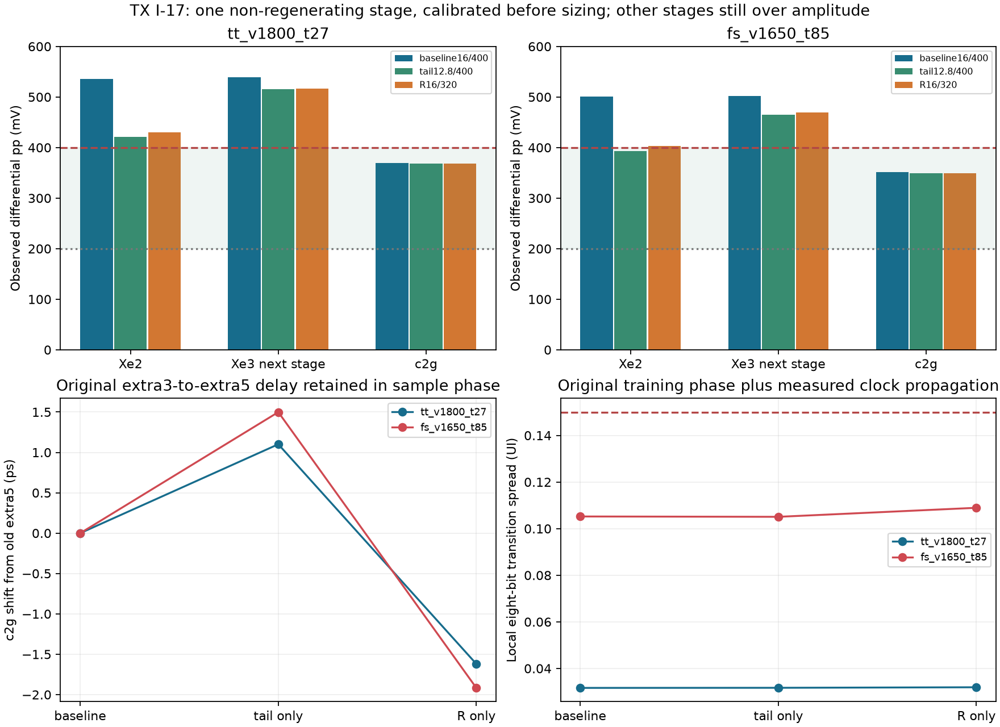
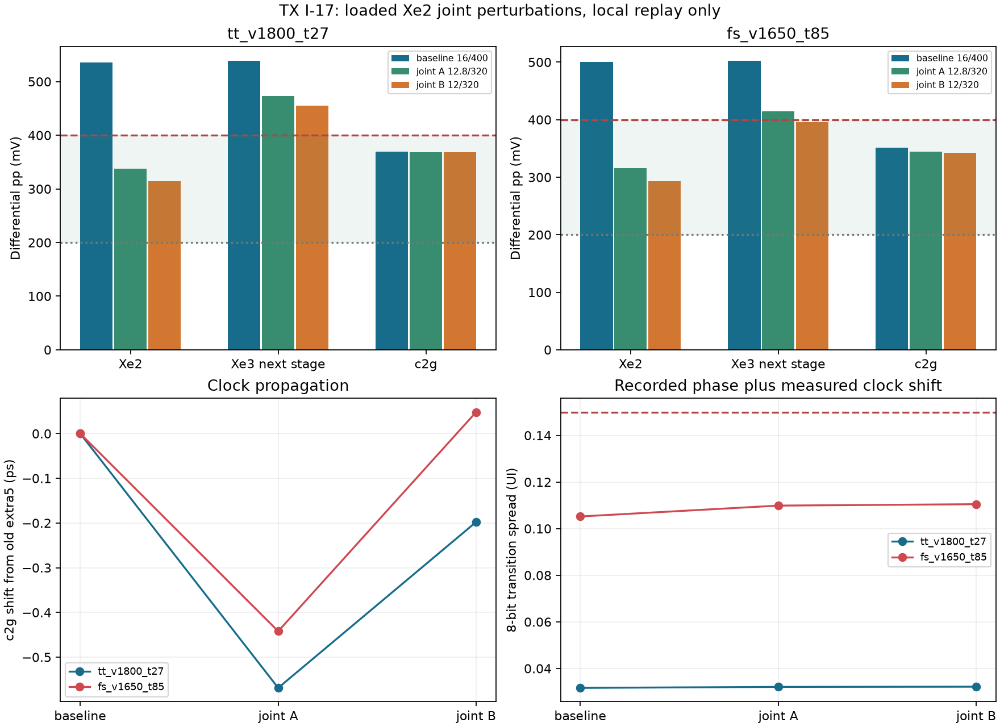

# TX 非再生时钟级：Xe2 局部尺寸卡

**联合WT12.8µm/名义320Ω把Xe2在TT/FS降至338/316mVpp，局部八位窗保持零错，模型幅度误差<0.3mV。** 后一级仍为473/414mVpp，下一步检查级联衰减与时序；当前采用电路未改，I-17继续打开。

## 边界与校准

固定来源是`native_reduced_clock/20261107T164517.822006Z_16514531`的TT及FS低压热两个已验证局部切片，源窗口6.5ns。新卡三分支均为extra5：隔离级、五级extra、输出WN32/WT16/R240、末级重定时slice、driver及RLC16负载不变；只改中间Xe2。输入、bias、电源是明确记录的理想PWL，忽略上游阻抗/反馈，不是重新验证真实偏置分配。无源使用冻结的PDK电阻映射。

两点的新分支1分别对旧extra5分支3匹配c2g、串化输出、A/B held及选择端：最大电压误差小于35nV，串化边沿误差小于0.00002ps；输入均在200µV门槛内。校准窗口3.5–6.45ns，测量4.0–6.4ns。原训练相位属于最早extra3源，必须保留该源到旧extra5已有的30.82/38.56ps传播延迟，再计本次扰动；不能只加相对旧extra5的增量。全部评分复用原固定相位8bit窗口296–303，没有拟合载荷相位。

## 结果

| 条件 | Xe2尾宽/名义R | Xe2差分mVpp | 下一Xe3差分mVpp | c2g变化ps | 局部8bit散布UI |
|---|---|---:|---:|---:|---:|
| TT | 16/400基线 | 535.94 | 538.69 | 约0 | 0.03166 |
| TT | 12.8/400 | 420.69 | 514.99 | +1.10 | 0.03170 |
| TT | 16/320 | 430.37 | 517.13 | −1.62 | 0.03193 |
| FS1.65V85°C | 16/400基线 | 500.84 | 502.26 | 约0 | 0.10522 |
| FS1.65V85°C | 12.8/400 | 393.03 | 464.82 | +1.50 | 0.10507 |
| FS1.65V85°C | 16/320 | 402.71 | 468.98 | −1.92 | 0.10894 |

六分支在局部八位窗均零采样错误、无缺沿或额外交越；TT位中心有符号裕量约140mV、FS105mV。c2g维持约369/349–351mVpp。Xe3仍超400，因此仅修改一个中间级不足以关闭整条支路的幅度约束，也不提升完整TX的资格。



## 联合参数确认

单轴数据的局部模型为`Vjoint = Vtail × VR / Vbaseline`，c2g时移作小扰动相加。联合卡在相同边界独立复现基线，然后比较：

| 条件 | Xe2尾宽/名义R | Xe2差分mVpp | 下一Xe3差分mVpp | c2g变化ps | 局部8bit散布UI |
|---|---|---:|---:|---:|---:|
| TT | 12.8/320 | 337.63 | 472.72 | −0.569 | 0.03209 |
| TT | 12/320 | 314.26 | 455.58 | −0.198 | 0.03218 |
| FS1.65V85°C | 12.8/320 | 315.79 | 414.48 | −0.442 | 0.10988 |
| FS1.65V85°C | 12/320 | 293.56 | 395.79 | +0.048 | 0.11049 |

两条新参数在两点均八位零错、无缺沿或额外交越；12.8/320相对精确单轴预测的幅度残差为TT −0.198mV（−0.059%）、FS −0.235mV（−0.074%），c2g时移残差−0.050/−0.024ps。基线继续符合原校准门槛。c2g为TT368mV、FS343–345mV；完整周期幅度和共模保留在数据里。

这说明单级减尾宽与减R的粗模型在本切片有效，不能推出多个相邻级同时减幅仍有足够增益。WT12/320只有FS的下一Xe3低于400mVpp，TT仍455.58；不为此继续单独压低Xe2。下一卡比较Xe2/Xe3两级及五个extra级共同使用12.8/320，观察沿链幅度、共模、关闭时刻和原固定相位字节窗。Xiso及Xout保留，尚不统一缩小计数器、数据树或再生保持管。



联合卡[数据](../data/tx_buffer_joint.json)、[索引](../../results/catalog/tx_buffer_joint.json)固定在`buffer_joint_card/20261110T163621Z_5e8b82b2`，分析`20261110T164012Z_a6f8ce8f`。独立发布脚本重新读取原始波形、复算全部测量并逐项匹配summary：

```bash
uv run python verification/plotting/tx_buffer_joint.py --campaign results/analog/tx/buffer_joint_card/20261110T163621Z_5e8b82b2 --summary results/analog/tx/buffer_joint_card/20261110T163621Z_5e8b82b2/analysis/20261110T164012Z_a6f8ce8f/summary.json
```

实际R、tail Id/Vdsat、支路电流/功耗尚未直接测量，保持ungraded；tail电压有保存，不能仅凭它宣称饱和余量。仍需SS低压冷、完整PVT/无源角、真实源/偏置、噪声与完整TX回归。

## 复核与执行

[数据](../data/tx_buffer_local.json)与[索引](../../results/catalog/tx_buffer_local.json)固定campaign、源/运行/模型身份，保存全部周期幅度、共模、传播和原始字节窗检查。原始结果在`results/analog/tx/buffer_local_card/20261110T162412Z_17c84a60`，分析`20261110T162413Z_71bd670e`。

```bash
uv run python verification/plotting/tx_buffer_local.py --campaign results/analog/tx/buffer_local_card/20261110T162412Z_17c84a60 --summary results/analog/tx/buffer_local_card/20261110T162412Z_17c84a60/analysis/20261110T162413Z_71bd670e/summary.json
```

新卡入口为`analog/tx/input_register/tb/final_clock_chain/buffer_local_card.py --prepare`，检查后由集成者登记标准边界提案，再`--resume <campaign>`。每条件单独1ns冒烟后6.5ns正式测试，单worker、不覆盖既有结果；新增条件或代码时建立新campaign。
